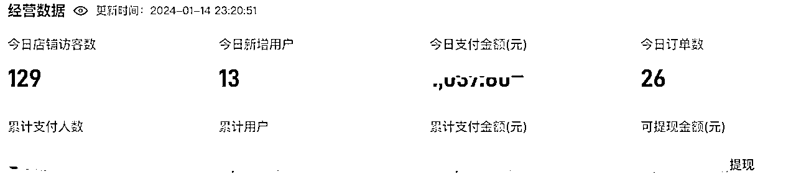
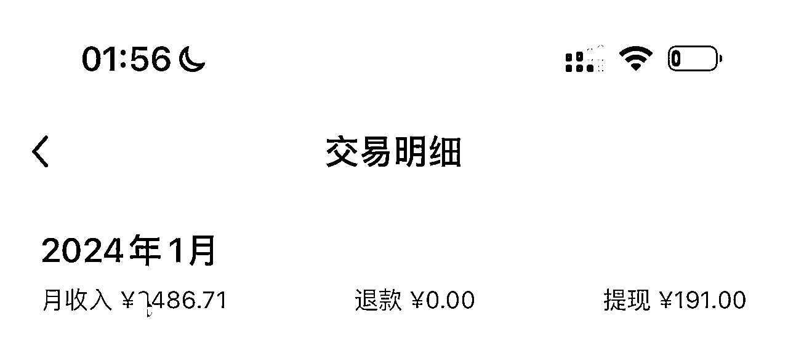
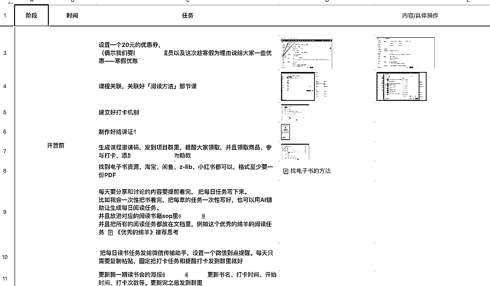

# 从接广告到卖产品：一个34万粉知识博主，如何把私域做到日均2000+？

大家好，我是漫漫。小红书上有34万粉丝，之前主要靠接广告变现。最近几个月没怎么更新复盘，是因为闷头去做了自己的产品。折腾了三四个月，总算跑通了：现在每天稳定有2000元左右的付费进账，主要来自小鹅通和知识星球。先给你们看下数据：

这几个月踩了太多坑，今天把核心心得整理出来，希望对想做知识付费、大学生赛道、私域转化的小伙伴有帮助。

## 商业模式就两件事：产品 + 渠道

产品怎么做？我自己定方向、控质量，具体的授课和答疑，找更专业的老师来交付。选老师的时候，我会先做一轮小规模内测，重点考察责任心——能力再强，没有责任心也不行。

产品不是自嗨，而是按用户需求来。粉丝最关心英语学习、阅读、求职、职场，所以我就做了线上读书会（每月2期）、英语口语营（每月1期）、求职课、学习方法课等等。需求对准了，转化自然高。

渠道怎么铺？公域平台能发的都发，小红书、即刻、闲鱼、知识星球、微博同步更新。和我一起开发产品的老师们，我也带他们做公域、教他们引流和维护IP，他们的私域也能反哺产品。

## 公域内容：三个关键心得

**第一，人群必须垂直。** 一开始我什么都发，一会儿求职一会儿小红书训练营，吸引来的人乱七八糟，有宝妈、有职场老油条，交付特别痛苦。后来我锁死“大学生”这个群体，内容也围绕他们的学习方法、英语考试、成长需求来做。算法会帮你精准推送，粉丝画像也清晰了。想要多圈人，就把关键词埋好；如果觉得人人都适用，那很可能谁都看不到。

**第二，选题从自己的课程里“切片”。** 很多人不知道发什么，其实直接从课程里挑最抓眼球的片段就行。比如课程里有一段5000字的阅读方法，我就把最精华的部分拎出来发。爆款有个通用公式：标题/封面突出“你能得到什么好处”（更快、更多钱、更多人喜欢、更美），内容按“好处+重要性+你该怎么做”展开，最后给具体步骤，用户会觉得你有货。

**第三，一定要蹭热点。** 上个月期末考、四六级期间，我们矩阵每天发这几个主题，流量和成交都涨得很快。

## 公域引流私域：简单但别踩坑

有人的平台就同步内容，小红书上做的内容，微博、即刻直接复制发过去。闲鱼可以当成一个明确的“售卖入口”。再多混社群、买别人的社群，把内容稍微改改就能发。

营销方面我的经验是：不懂营销就先把内容做好，别硬整花活。

尤其要记住——**千万别用0.1元低价引流。** 我吃过亏：低价商品吸引来一堆白嫖党，买完搞不清楚是什么，加微信态度很差，给了资料就拉黑。后来改成正价卖，哪怕低客单价的产品也正价卖，筛掉了白嫖的人，用户也更重视产品，下单的人反而多了。绝对不免费。

## 做产品：四个铁律

**围绕用户需求做产品。** 用户说想要什么——先看看有多少人想要——再决定做不做。别“我觉得好就做”，那是自嗨。如果自己有能力就开发，没能力就找个靠谱产品来卖，整合资源也行。

**用户反馈必须马上收集、马上改。** 我把SOP细化到每一个小动作：购买流程里有疑问，就补充到产品介绍里；交付时不会用App，就加到第一课里；常见问题直接做成“必看”文档，能减少一半售后问题。

**专业的事让专业的人干。** 我擅长阅读，但不擅长口语，那就找口语老师来交付。大家各司其职，一起赚钱，学员也学得更好。

**先小闭环跑通，再放大。** 千万别想一口吃成胖子。和合作伙伴磨合会有各种碰撞，小规模测试最安全。低客单价、少收几个学员，压力小，出了问题也可控。跑顺了再慢慢涨价、扩量。

工具上，目前感觉小鹅通适合卖课程，知识星球适合建圈子。买了小鹅通课程的，可以给星球优惠券补差价。

## 营销转化：信任是最底层逻辑

说真的，我不太会营销，朋友圈发得也不多。但恰恰是这样，来买的人基本都是因为信任我。互联网上课程和方法多得是，大家买你的东西，买的是喜欢你这个人，认可你做事的态度。

所以，**做好自己就是最好的筛选。** 这样来的客户，售后麻烦极少。

平时朋友圈可以多发自己的生活思考和感受，偶尔带点情感关键词，比如“爱情”“情绪”，会无形中拉近人和人的距离。我之前发过一条“我喜欢一个人看电影”的感想，结果好几个读者跑来报课。

另外，**产品就是口碑。** 我的复购率很高，付过一次费的人大多会继续付费，所以1000个铁粉比十万泛粉更重要。

还有一个容易忽略的动作：**请老用户帮忙宣传。** 只要在交付时说一句“麻烦帮我宣传一下”，很多学员就会主动转发到朋友圈。最好的模式当然是“收费合伙人+分销”，但我觉得自己还没到那个阶段，等商业模式更成熟再来。

产品千万别搞复杂。一个周期只做一个产品、只宣传一个产品，不然用户会陷入“这个也好那个也好”的选择困难，反而不下单。

## 创业中的几个好习惯

1. **肯花钱向有经验的人请教。** 在生财看到有结果的前辈，发个红包问几个问题，比自己瞎琢磨半年高效多了。很多坑，前辈一句话就能帮你绕开。

2. **保持阅读。** 创业以来我每月至少读5本书。最开始看运营、内容创作、写作、个人IP，后来迷恋投资理财和创业，这个月在啃营销和用户心理学。看书也是成本最低的知识付费。

3. **执行+反思+改进，循环起来。** 被骂过、做过蠢事，但路是一步步走出来的。

4. **预设最坏结果再行动。** 如果最坏的结果也能承受，就去做。哪怕赚不到钱，教训也是经验，而且是更宝贵的经验。

## 最后，想请圈友帮个忙

我做的是大学生赛道，说实话这个群体付费意识比较低，我自认为产品做得很良心、很有价值，但付费人数比想象中少很多。如果有做大学生赛道的前辈，特别想请教营销方面的问题。也想多对接一些大学生资源。

评论区有圈友建议我去做B站，说长尾流量很长，期末发的内容第二年还会被刷到。我之前因为不擅长视频口播放弃了，但现在想想，完全可以把录播课发一半到B站，剩下的一半引导到私域来买。这个思路确实好，准备去尝试一下。

