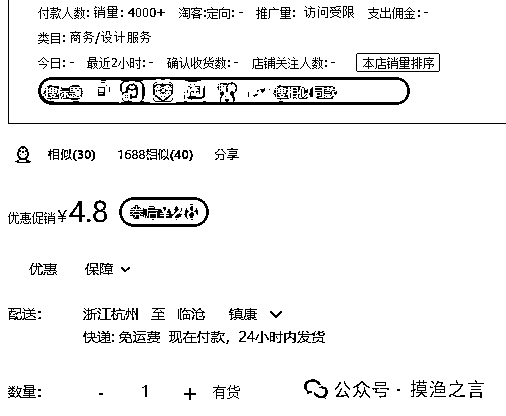
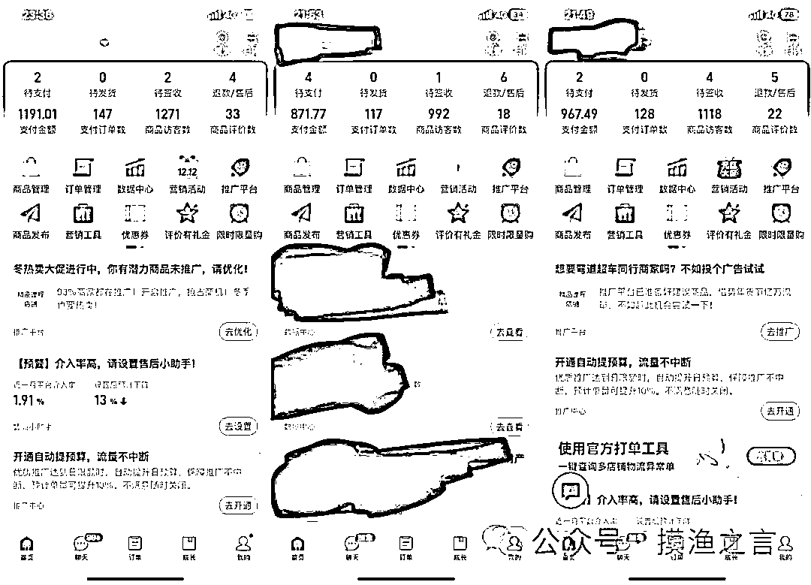
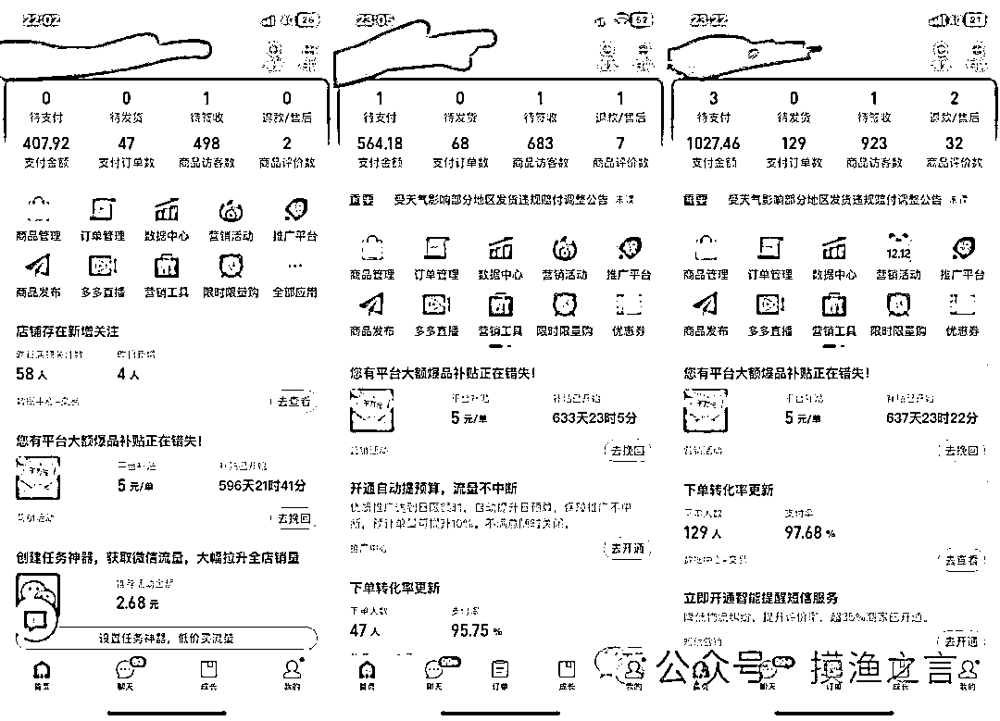
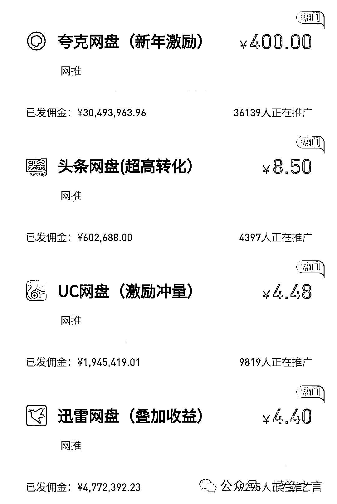
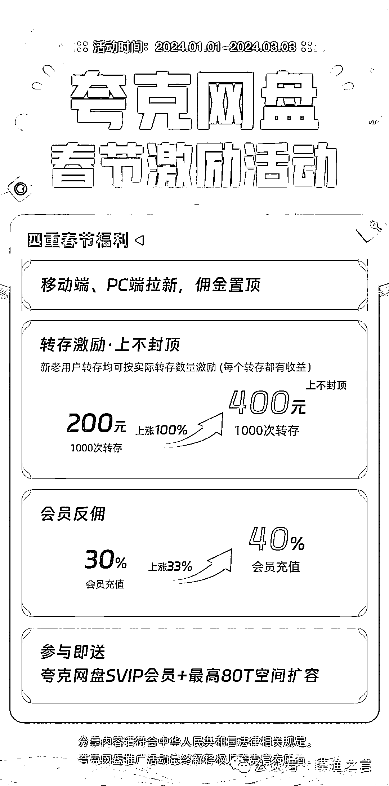
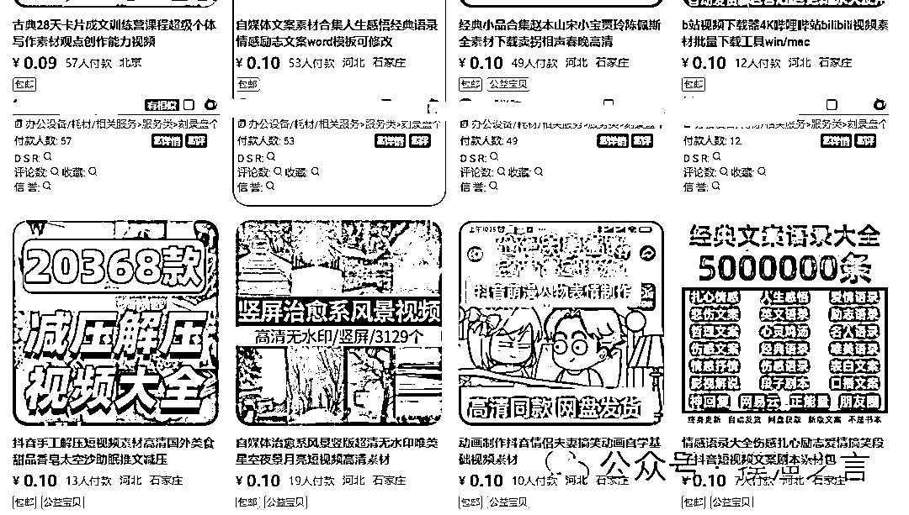
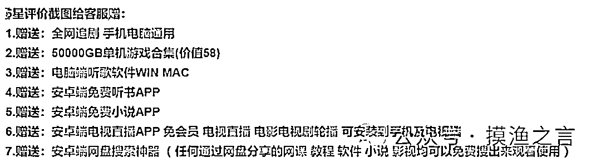

# 拼多多虚拟项目：无脑铺货也能做到单店日赚千元
作者：龙哥

## 多多虚拟项目最新打法：铺货就能稳赚，单店日利润破 1000

作者： 摸渔之言

日期：2024-01-15

虚拟商品这条赛道其实从未凉过。从早期的 C 站，到闲鱼，再到现在的拼多多，模式一直都在更新。说它简单，确实只要搬运上架就行；说它难，也确实有人因为选品踩坑导致店铺被清退关店。

看上去人人都会，一上手就翻车的典型。

很多人觉得虚拟单价低没利润，真实情况并非如此。单品就卖几块钱，但复购和需求极大，截图里这个链接销量已经过 4 千，12 月才上架，单品到手就超过 1 万。

眼下临近过年，实体项目放缓，咨询我虚拟副业的人明显多了起来。今天就把我们最近跑通的、一天稳定进账千元以上的虚拟打法分享出来，可以矩阵化操作，人手和店铺充足的话，日入上万也只是量的问题。

直接上干货了。

当前我们主推的组合拳是把**微付费引流+网盘拉新**结合起来，两个简单模式叠加后收益是 1+1>3。先看一下近期实测的数据表现

目前虚拟赛道竞争虽然白热化，但我们靠**全站开车砸量+极致低价+网盘拉新这套组合拳，再搭配差异化上架和自动发货裂变，效果出奇的好。**

裂变的核心要说清楚，商品只是载体，私域才是真正的资产。现在市场上一个普通私域粉丝都卖到几块到十几块，网创粉更是 20 多一个，这个价值早就超过了你卖虚拟本身的利润。

看明白没？网盘拉新本质上是花一份时间赚三份钱，对于想做副业的人来说是不是很香？

以现在主流平台为例，夸克移动端 4.7，PC 端 1.9，今日头条 8.5，UC 4.84，迅雷 4.65。全部算下来 4.7+8.5+4.84+4.65=22.69！

你可能会问一次下单怎么拉四个平台？办法有很多，细节后面会讲。

做过拼多多虚拟的老手都知道，投 100 块一般能出 20-40 单，具体看选品。我们按中间值 30 单来算，单单的拉新佣金就有 600 多左右，减去 100 块的投流成本，净赚 500 多。

再往下看，如何把日收入做到 1000+。

这个模型我实操验证过，目前在跑 5 家店铺，平均每家一天 200 单左右，日投流成本约 600 元/店。

核心玩法就是 1 毛钱引流法，也可以做高价配合全站投产。这个思路我之前提过，但很多人没吃透。项目不止多多能做，淘宝、📕、知乎都能跑，我最推荐拼多多，**因为多多花钱就能出单，价格足够低转化自然上去。**

品类上主攻教程和素材包，其他敏感品避开，避免违规和投诉。货量建议准备 200 个左右，我自己上的是 200 多个，再多操作起来会很乱。

**具体执行拆解如下：**

1、首先要拿到推广资格。网盘平台不会直接给你，你需要找第三方提供的带佣金推广链接，拿到后佣金会有一层抽成。

需要链接和入局方式的可以直接找我拿，拿到资格才能开始。

2、找货源建议去淘宝搜，1 分钱、1 毛钱的商品非常多，哪怕成本稍高也无所谓，后续全靠拉新盈利。把商品搬到自己的店铺后，售价就定 1 分钱或 1 毛钱，越低转化越高。图片直接用原图即可，优先选视觉好一点的。

品类比如新年 PPT 模板、年度总结素材、各行业教程等。带人名、带品牌、带版权的产品坚决不要碰，容易踩雷。

3、如何实现多平台拉新？需要一点技巧。先把准备好的素材包上传到对应的网盘里，我的做法是一单配两份资源，拉太多用户会不耐烦。比如买了 A，就额外送 B，免费的东西用户都喜欢，但免费要适度。

4、前三步完成后，对店铺做简单的基础运营，刷一点基础销量和评价，然后就可以放着自动出单。只要成交，就自动发网盘链接给他，配一套注册下载教程。客户没有账号就必须去注册下载，这样你就能同时拿到多个平台的拉新佣金了。

是不是很简单？别再说付费推广亏钱、类目太卷了，其实是方法没找对。

做这种项目，最核心的就是老老实实把店铺做起来，执行力拉满才是稳定的赚钱路径，投机取巧走不长。

**富在术数，不在劳身；利在势居，不在力耕。**

* * *

评论区：

专业酒店代订阿福 : 大佬求指教，我的店传了几百个虚拟品，但是一直搜不到，求怎么解决

KK 妍 : 大佬，请问怎么链接你？或者方便加我吗？WSY520126

筱夏美饰 : 好像说了又好像没说

理想 : 大佬，拼多多虚拟课程需要交多少店铺押金

摸渔之言 : 1000 押金

摸渔之言 : 好像按照方法做了，又好像没做

摸渔之言 : [OK]

理想 : 感谢哥

* * *