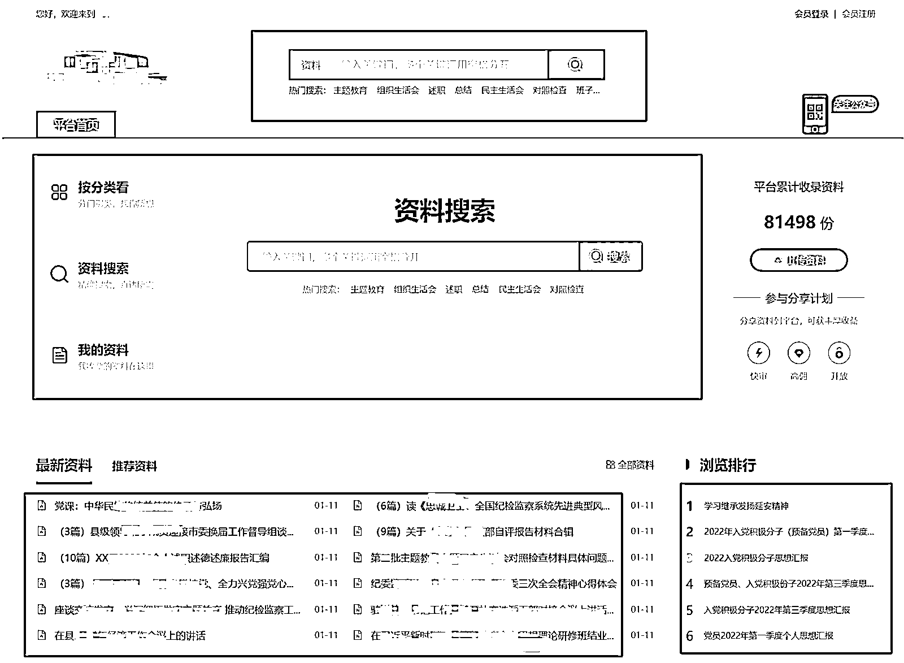
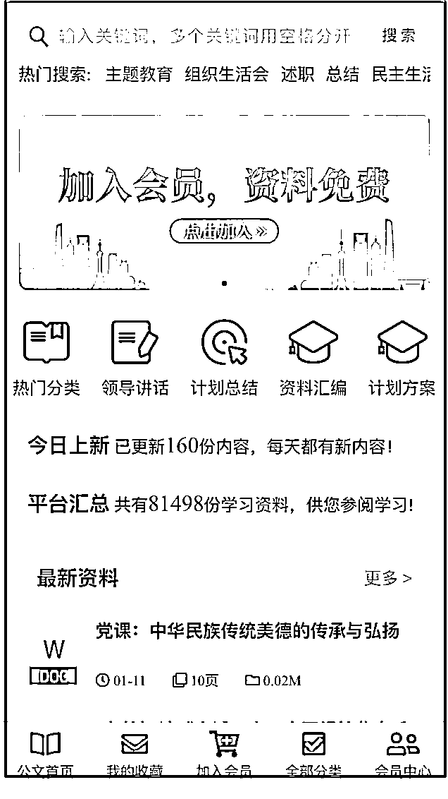
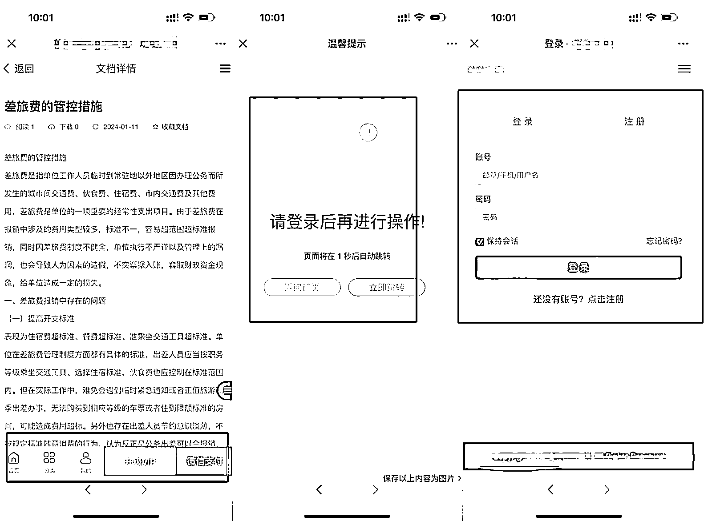
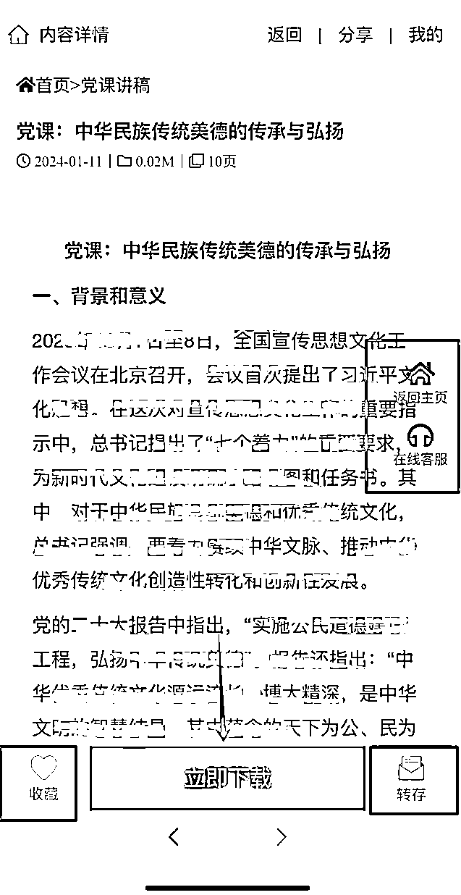
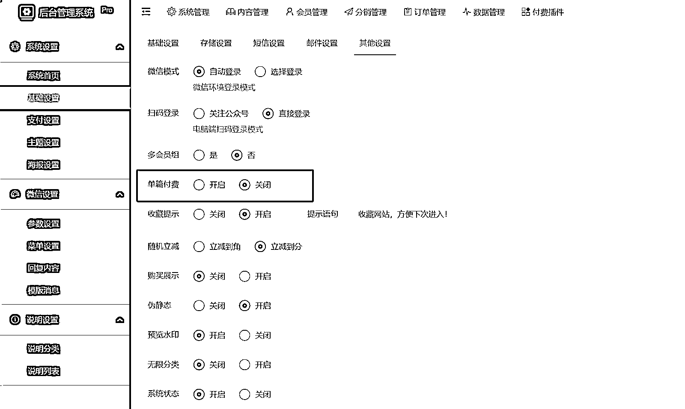
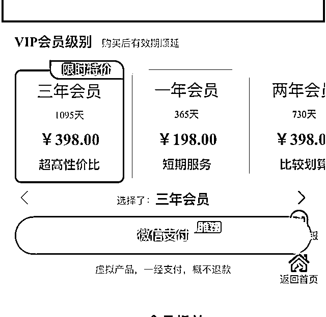
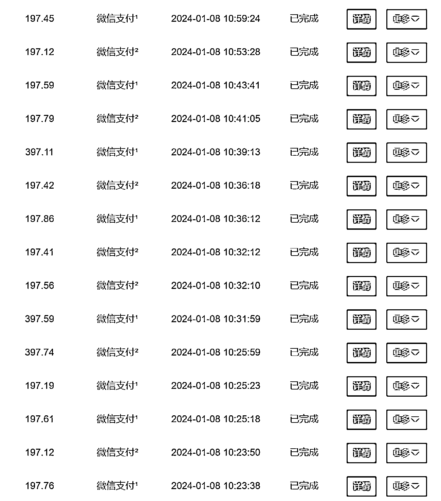
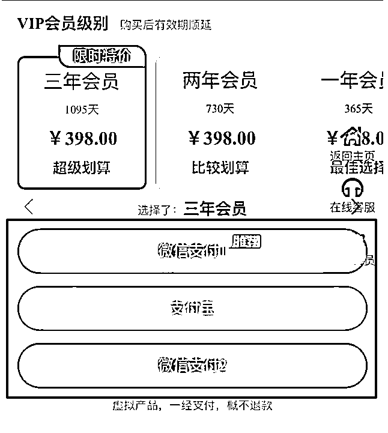
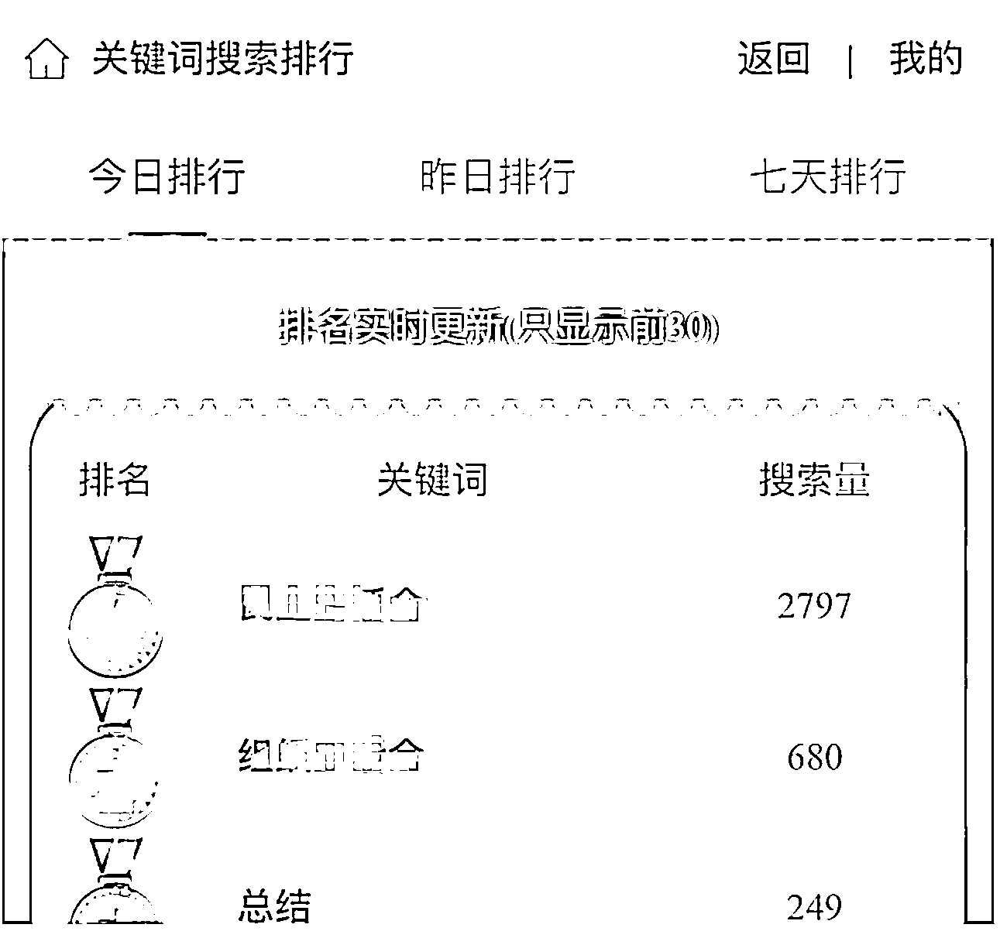
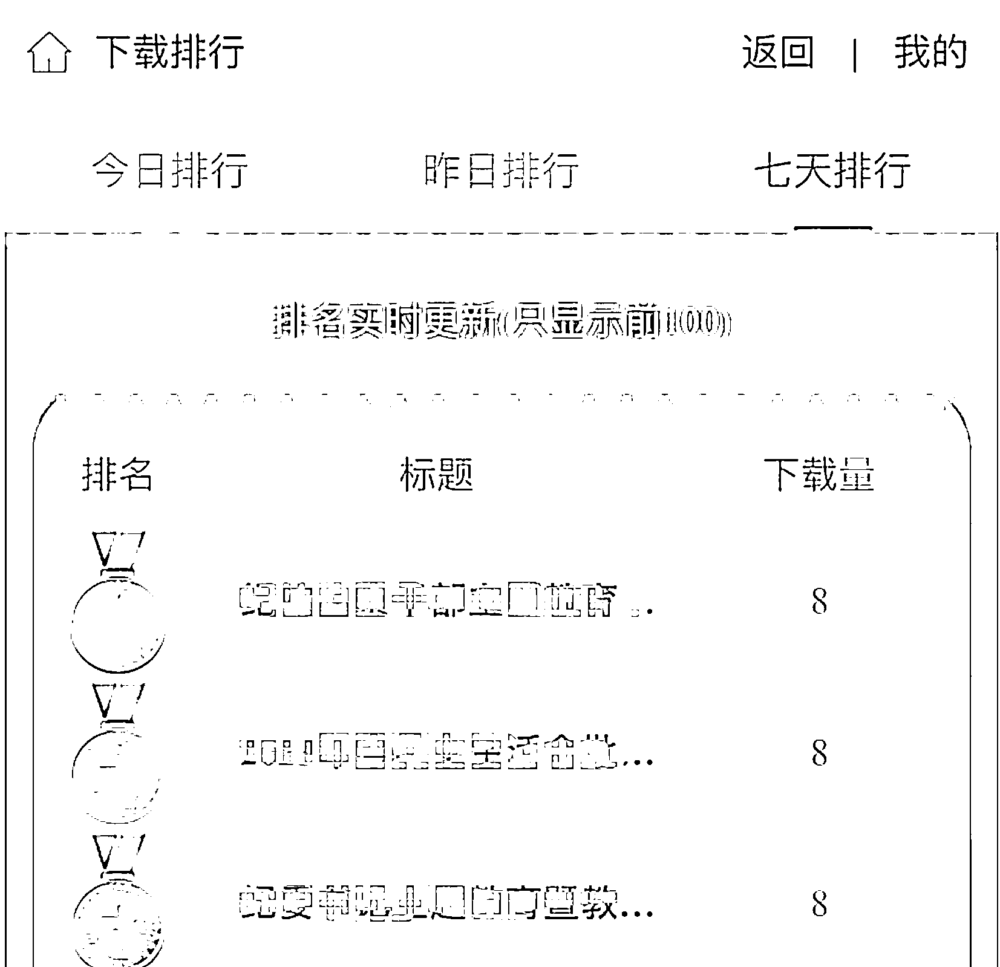

# 从零到十万单：一个公务员资料项目的迭代拆解

大家好，我是郭耀天，江湖人称郭少。

之前聊过公务员项目，今天正好撞上需求高峰期，还没看过的可以先回溯一下我的复盘：

[如何挖掘公务员需求，打造自己的赚钱系统，两年十万单复盘](https://wx.zsxq.com/dweb2/index/topic_detail/588521285821884)

赚钱圈里晒结果的人很多，讲清楚底层怎么打磨的人很少。今天我就把这套系统的进化路径摊开讲。

公务员资料是刚需，玩法也很多。市场上有人靠QQ群分发，有人放网盘，有人挂电商，有人做论坛、有人做独立站、有人做H5。小打小闹都能跑，但要规模化必须有自己的底座。我们最后选择走定制化开发，用一套更适配大众使用习惯的系统去承接项目。项目圈都知道一句话：体验顺手了，转化自然就上来了。

确定方向后，我开始做功课。把搜索引擎上能搜到的同类页面全部扒下来，电脑端一个个点进去体验。👸号里能打开的系统也全测一遍，前后累计深度拆解了几十家同行的方案。各种展示逻辑都看过，最后挑出一个体验相对顺滑的版本做参考，加以改造升级，到现在这套界面还在沿用。

刚上线时跟现在完全不是一个样。这个电脑端页面是反复打磨出来的，能精简就精简。搜索框下方的热门词、布局节奏，都是后期不断试错才定型的。如今在这个赛道里，这版电脑端可以算个标杆，不少同行都在抄。

手机端更折腾，从首页到每个交互细节都推翻过好几轮。现在能在手机上看到类似样式的系统，大部分是我们加盟商在用，极少数是独立复刻。

讲几个看起来不起眼但影响很大的细节。有的同行电脑端和手机端连微信扫码登录都没做，非要用户用手机先注册。注册当然能沉淀，但这个用户群体很少愿意在陌生平台上留下信息。最友好的方式是电脑端直接扫码登录，一步到位。

手机端也一样，很多系统都卡在最后一公里：用户已经准备付款了，结果跳转去注册、去绑定，流程一卡就流失了。我们自己先当用户去走一遍，能省则省，能快则快。你自己用着都嫌麻烦，用户更不会买单。

我们解决这些体验问题时，基本原则就是站在用户视角复盘。现在的页面首页干净，没有联系方式弹窗，没有硬广。点进去内容区，看到的是全真文档预览，右边悬浮返回首页和在线客服。

用户真正常用的其实是底部那一排功能。非会员会看到加入会员提示，会员状态下直接显示下载。左边收藏，一键存档，下次再找；右边转存，针对体制内用户爱用邮箱的特点，填个邮箱内容就直发过去，省去重复找资料的麻烦。

有时候改动一点点，成交率就能明显抬升。迭代到现在还在持续优化。很多团队用的是市面上的模板系统，模板提供方根本不会按你的用户习惯去改细节。开发团队如果不懂场景，就做不出来真正好用的功能。这也是我们能把公务员这个细分赛道做到十万单的关键之一。

再说支付逻辑。做公务员项目的有好几种变现方式：电商平台成交，单价被压得很低；私域成交，自动化程度差；网站卖单篇，确实能出单。系统刚上线时我们也卖过单篇，19.9一篇，一天几百单，看起来热闹，利润却很薄，而且买完一篇的用户基本没有后续。

后来我们直接关闭了单篇销售。这个调整让成交率和利润的体感都变好了。用户搜到一个需求点，发现不能单买，反而更倾向于直接办会员。会员年费198，对比单篇19.9，算下来明显划算。只是一个开关的调整，利润曲线直接上来了。现阶段还有不少同行在坚持卖单篇，表面单量好看，实际营收天花板很低。

这是十万单里很重要的一环。定价本身也是迭代过来的。当时调研市场里有39.9、69.9、99、169、218、298一年各种价位。后来我们结合天眼查上同行的定价规律，拿了个中间值：年费198，三年398，两年也是398。

会员价展示时，我故意把两年和三年的价格设成一样。用户看到这种价，会下意识觉得是不是标错了，反正398能买三年，谁还买两年？下单三年，我们的账期和留存自然就更高了。说到系统成交的优势，其实很简单：内容质量过硬，用户在站内搜索、看预览，觉得值就直接付费，几乎不需要售前。相比引到私域再沟通，实时成交效率高太多，客服压力也小很多。这也是我们坚持用系统去跑虚拟资料的核心原因。

看成交截图就会发现，每笔金额都不完全一样。刚开始上线时支付经常异常，后来被风控误判刷单。跟技术沟通后，我们让每单金额都做随机微调，支付的异常率立刻下降。

支付渠道也做了冗余设计。现在我们并行接入三条通道：微信商户、支付宝、第三方虎皮椒。很多同行其实不支持支付宝，而支付宝用户量也很大。多通道保证一条出问题，另外两条能兜底。

光有三条还不够，单量上来后还是会堵。我们又做了轮换支付机制，一个渠道下挂三个子支付，三个渠道合计相当于九个支付出口，每次发起都会自动切换。爆单时也不会集中冲击单一接口，异常情况大幅减少。

大量内容怎么知道卖什么？看数据说话。通过用户搜索量和下载量就能判断哪些资料是当下刚需。推广时直接把这些高频关键词和热下载资料投放到全网，精准触达有需求的人。我们的推广伙伴可以实时查看后台数据，哪里热就往哪里推，效率自然起来。

上面聊的就是我在公务员项目里踩过的坑和做过的关键升级。除此之外，我们还接入了分销裂变机制，项目跑通后大量招募推广者分佣。这套打法不只适用于公务员资料，几乎所有虚拟资源项目都能复用。

有人喜欢做电商，我更偏爱做系统。如果你在做虚拟项目、做开发，或者手里有不错的资源想变现，我们可以聊聊对接。我们有成熟的系统，也有成熟的运营方法论，能按需定制开发。

* * *

评论区：

倪大胖 : 厉害。方便问下这个系统的开发成本吗

郭耀天 : 目前花几十万

倪大胖 : 好嘞 多谢

* * *