# 0-1 知识类 IP，如何 3 倍提升销售增长空间

你有没有发现，很多知识型IP起步时最难的，不是写不出内容，而是“不好意思开口卖”。

我在互联网行业做了12年设计师，带过5年团队，去年开始转型做个人IP教练。最惨的时候一个月只赚400块，到12月单月破了5万，全年变现20多万。我没什么背景，没流量、没团队、没大V背书，靠的是一步一步把从流量到成交的每个关卡都跑通。

如果你也正在0-1阶段，总觉得自己卡住了，或者一谈钱就心虚，怕产品不值那个价，建议你花几分钟看看这篇。先晒一下我这一年谈单状态的前后对比：

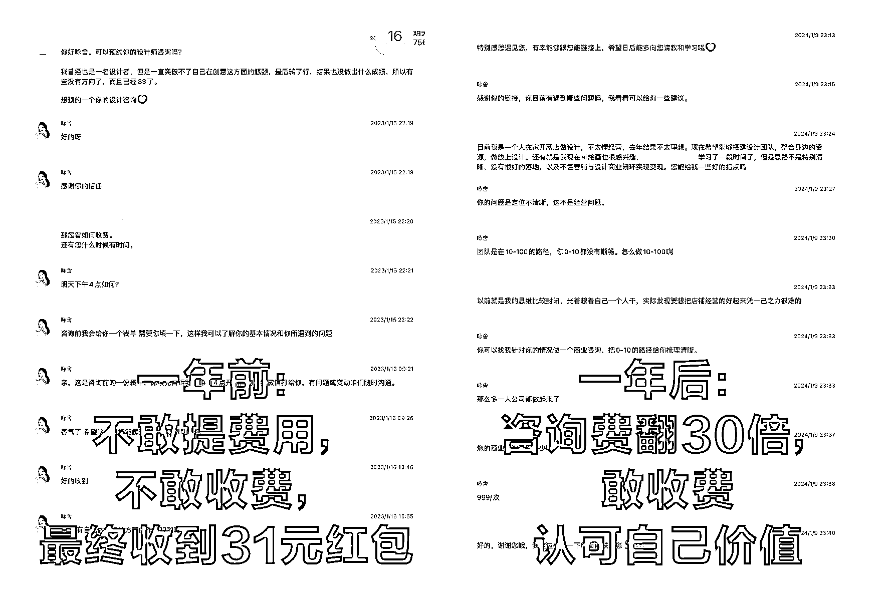

这套框架，前几天我在线下局里分享过，当时被圈友说价值很高，所以整理出来，希望能帮到更多跟我一样刚起步的人。

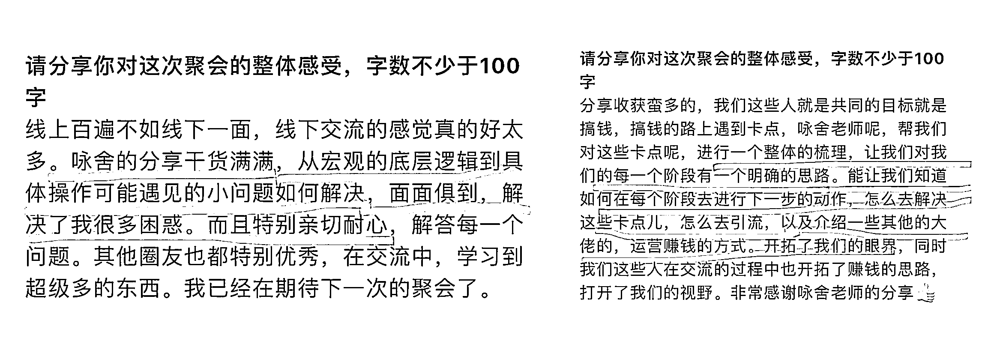

整体我分两大块讲：
- 第一部分：0-1阶段怎么通过三波操作把销售增长抬上去
- 第二部分：私域成交里最常见的卡点，以及怎么拆解

# 第一部分：三阶段策略，让销售增长一步步变大

**阶段一：学习成长期**。先别急着搞大生意，用学习陪伴的姿态做出第一个里程碑；同时铺开多元收入管道，靠分销别人的好产品积累被动收入，把势能养起来。

**阶段二：跑通闭环期**。从已经跑通的成功样本里找优化点，把路径SOP化，用模板和流程提效率，再靠差异化打造自己的高价值壁垒。

**阶段三：增量放大期**。布局完整私域生态，用朋友圈、社群、直播、1v1反复激活存量用户，让转化滚起来。

## 阶段一：多元收入+里程碑，先把销售拉到1倍

我不是大V，也没有操盘团队。就是个普通人，靠着长期坚持，一点一点熬出来的。到第2个月时，陪伴群从140人涨到330人，🛰️好友从2800涨到3700，👸号加全网粉丝也过万了。产品很简单：199元的社群、699元咨询、6980元私教，还有12800元的年度陪伴。

收入一开始特别不稳定，1月只有400块，8、9月也才几千块。但到了4月单月3.4w，12月直接5w+。比起职场那点固定工资，这种收入确实波动大，但我看到了一个没有天花板的空间——只要愿意持续建，就有更大的可能。

这里面的关键，是别让收入来源只有一条腿。

什么叫多元化收入结构？看下面这张图：

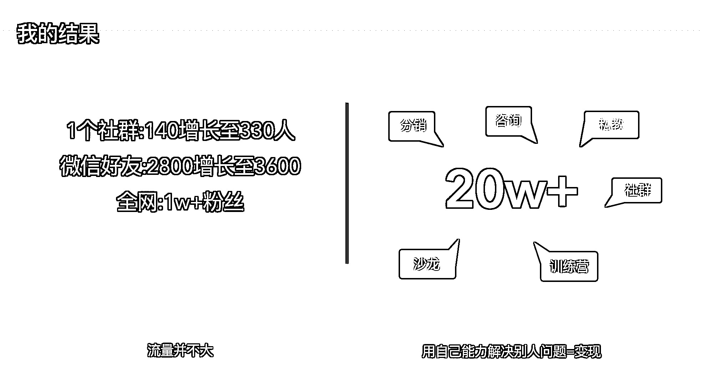

我理想的比例是主动收入、被动收入、资产收入按3:4:3来搭配。但大多数人正好反过来，约95%靠主动，其他收入少得可怜。主动收入特别耗精力，我80%以上的时间和心力都砸在它上面，剩下的必须靠别的管道托底。

所以收入还没稳定时，我特别建议去分销一些好产品。比如龙哥盟的知识星球，自带分销机制，发个朋友圈、推一下👸号就能有被动收入进来，还能近距离围观一场大型发售是怎么操盘的，等于顺便白嫖学习机会。

另外，势能是需要时间堆出来的。你刚开始不厉害，用户天然慕强，那就先帮别人做点事，把里程碑结果摆出来。等我2、3月份收入超过2w，很多之前不说话的粉丝自己就跑来问我是怎么做到的。

比如4月份，我的收入构成里知识星球分销就带来了9k多，被动收入加社群占比60%，主动收入（咨询+私教）只占40%：

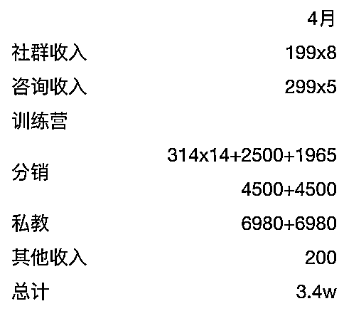

主动收入联动被动收入，会越滚越值钱，因为你的影响力变大了，思维和系统能力变强了，圈子也更优质了。

## 阶段二：流程标准化+差异化，销售翻到2倍

早期别急着找差异化，先找对标，模仿就对了。别人已经跑通，说明这条路径可行，你要做的是照着走通。

路径很简单：垂直定位→持续内容→获取流量→产品方案→销售转化。然后在这条链路上，把每一个关键点都打通。

怎么形成差异化？参考田忌赛马，不硬碰硬，用巧劲。

**第一，把标准化做到极致。** 我开了2个📕资料号，一周就承接了100多个新流量。接着做标准路径、标准步骤、标准话术，不用每次重复动脑：

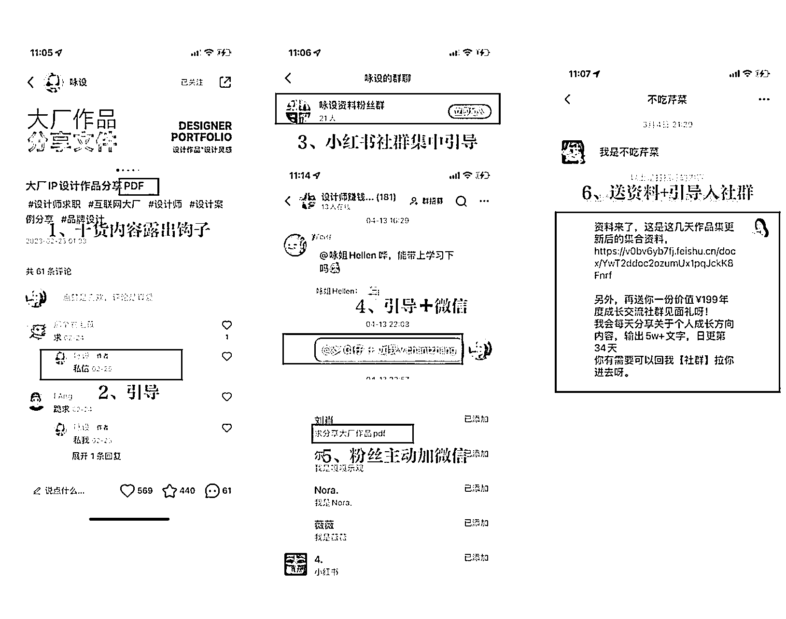

第二个动作，是把私域承接公域的销售路径也做标准化，每个节点用筛选话术，效率提升非常明显：

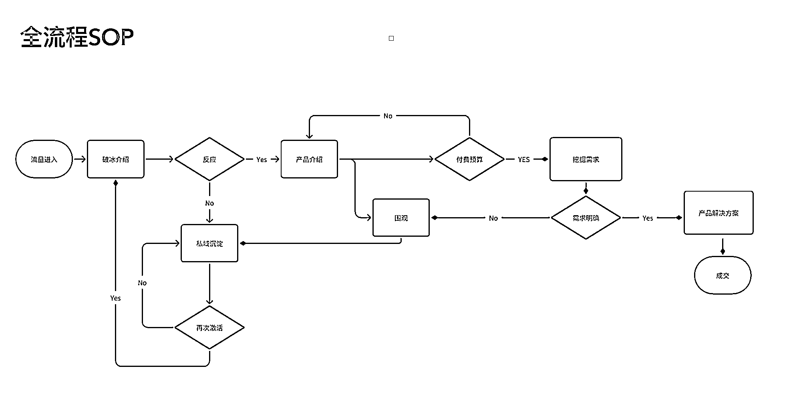

具体做法是，把每个流量从进来到成交的完整路径全部捋一遍，每个节点放模板。以前来回拉扯20-30分钟，现在标准流程下5分钟就能聊完。同时给每个流量打上来源标签，分别放进对应的私域容器里：

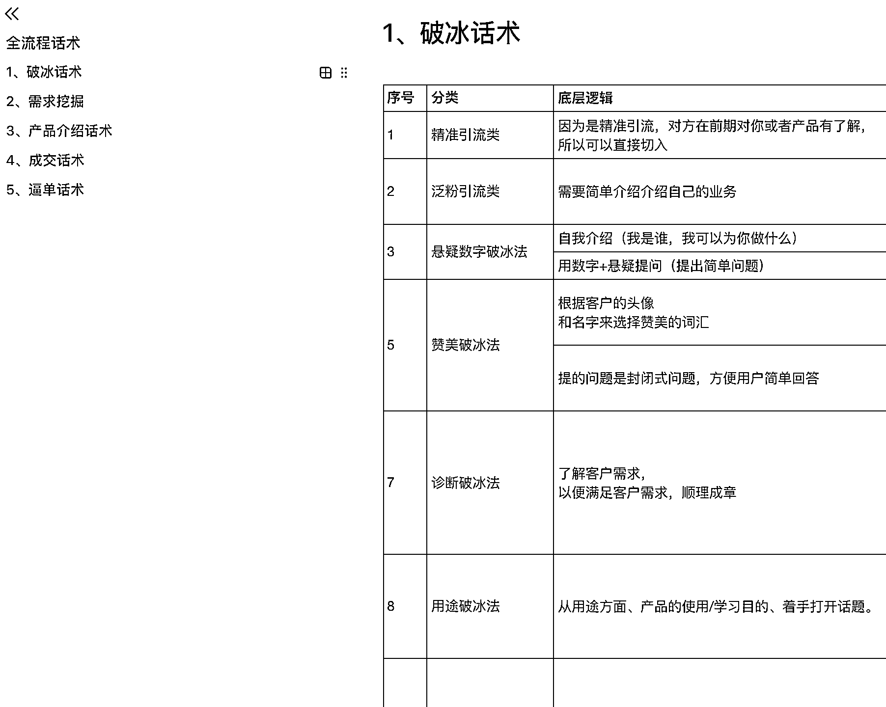

话术模板一：自我介绍模板。新加来的好友，先发标准版介绍，快速建立认知。

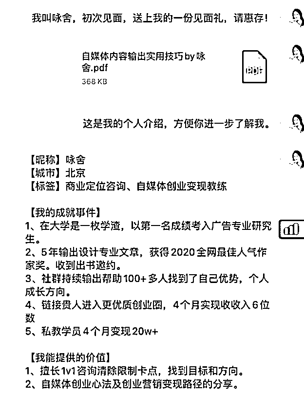

话术模板二：痛点挖掘模板。对感兴趣的人，进一步聊兴趣和需求，不同情况套不同话术，把顾虑提前摁掉。

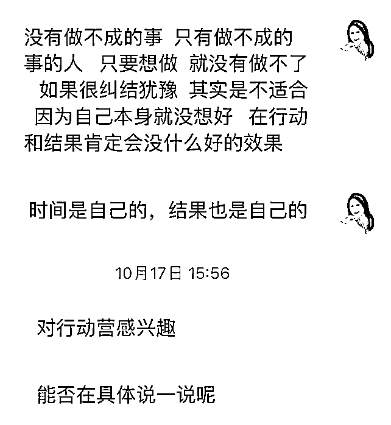

比如对方担心结果，就直接甩真实案例，用结果建立信任。

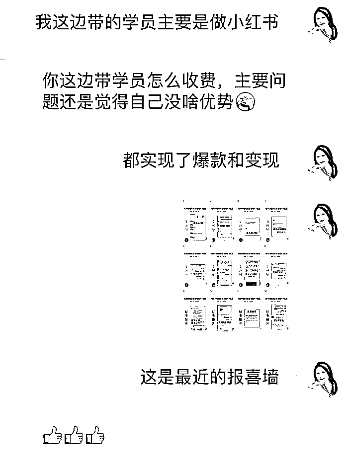

话术模板三：预算探测模板。

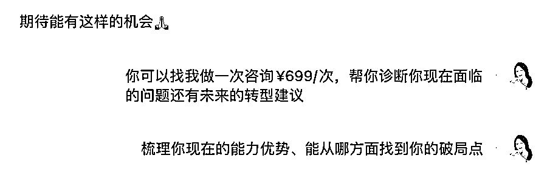

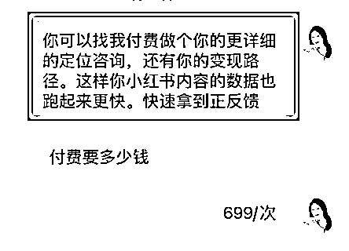

话术模板四：产品+价格推荐模板。按对方实际需求推荐产品，顺势完成转化。

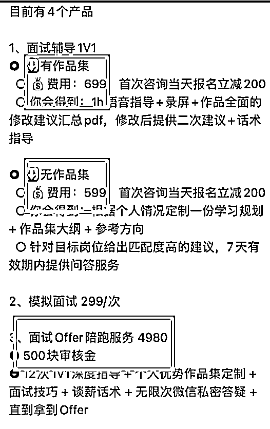

（这是我辅导学员时的产品截图）

标准化不是最终目的，真正的效率提升，在于把省下来的时间和人力，投到“没法标准化”的高价值竞争力上。

**第二，用“低成本标品+高价值非标”打出差异化。** 标品就压低成本，用标准化生产去跑量，别一上来就搞创新，创新意味着烧钱。非标品怎么找溢价？往更垂直的细分需求里钻，把用户痛点挖得更深。同时强化自己的核心优势。

比如我是做个人IP教练的，跟我同赛道的人很多，但我有三张牌：内容输出够深、心力够强、洞察够准。别人可能比我懂IP，但不一定有我的内容深度；有内容深度的，又不一定有我的高能陪伴。

优势要变成壁垒，可以从这几方面打磨：
- 把过往成就和经验变成“个人故事”。比如我靠输出拿过专业作家推荐，还有站酷、优设、36kr、得到知识城邦等平台的推荐。执行力强的背后是心力和目标感，这就是我和别人不一样的地方。
- 把服务过的成功案例做成铁证。我管理带团队5年，现在当教练，身份变了，但带人拿结果的内核没变。

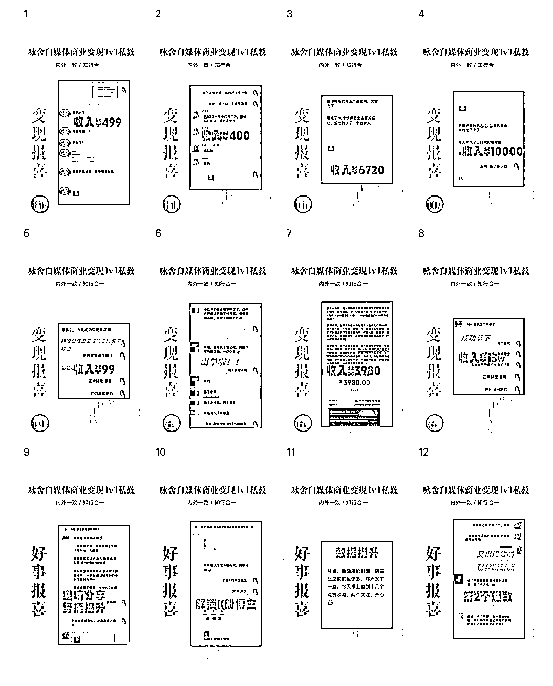

- 甚至性格偏好也能成为记忆点，比如我爱阅读、爱深度思考、长期输出，很多粉丝就是被这种持续吸引来的。

## 阶段三：私域生态布局，销售再冲3倍

到了增量期，要把私域当成一个小生态来经营。我习惯用“四件套”来比喻：
- 客服：直接🛰️聊天，承接用户问题。
- 展柜：朋友圈展示，把自己和产品“陈列”出来。
- 圈子：社群搭建，通过话题和分享增加信任。
- 活动：👸号、视频号、直播做活动福利，二次激活。

生态建好以后，每天固定做几个动作：发5条朋友圈、社群输出互动、跟5个人1v1聊天、每周做直播。一次两次没用，坚持做就能把私域存量反复唤醒，销售转化自然就上去了：

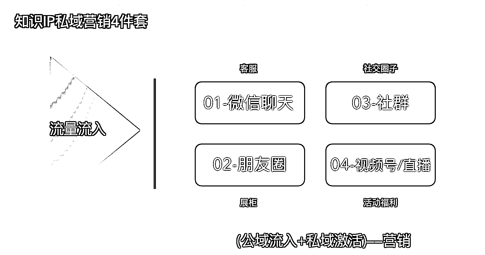

**动作一：每天5条朋友圈，科学搭配内容+产品+案例。** 梁靠谱老师说她5年日更了8000条，所以也一直提醒我，量不到位结果就出不来。发朋友圈有几个避坑点：
- 别自嗨。光写抒情小作文，点赞再高也没用，要让人知道你到底想指向什么。
- 放大痛点，顺便植入产品。赚不到钱、懒、认知低、圈层差，痛点背后全是人性。
- 适当秀肌肉。把用户证言、成功案例晒出来，再接上产品宣传，反馈才真正变成了转化素材。

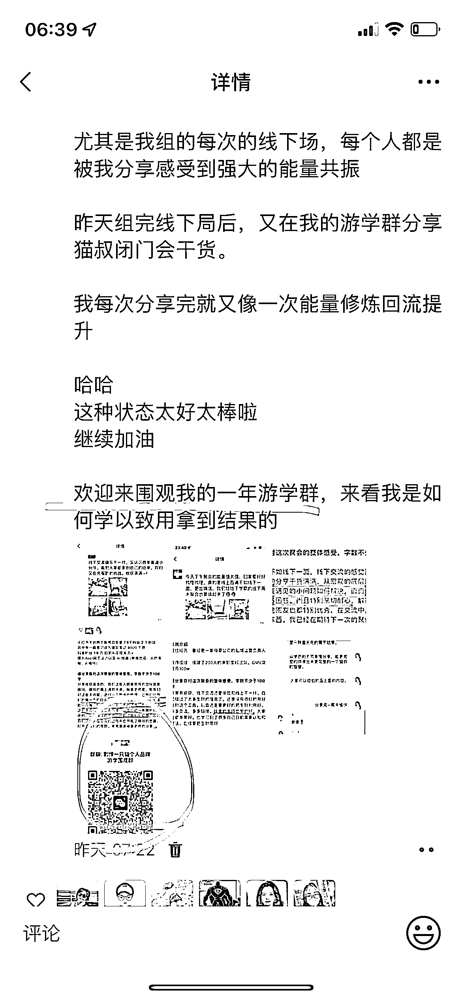

**动作二：每天社群互动，制造话题，定期做主题分享。** 社群不能死，要用内容反复养。

**动作三：每天找5个人1v1私聊，借社群活动或朋友圈点赞切入，聊对方真正的兴趣点。**

**动作四：👸号定期更新，视频号定期直播。** 用主题分享做产品渗透，一步步把陌生用户捂热。

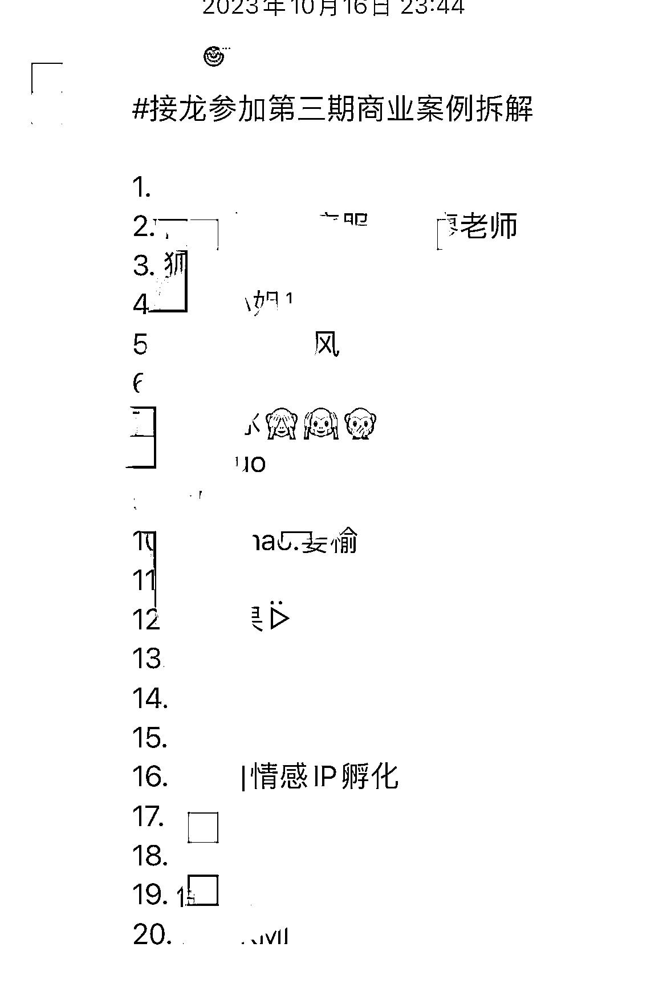

# 第二部分：私域成交中的常见卡点和破解思路

## 私域成交六大卡点

先看图：

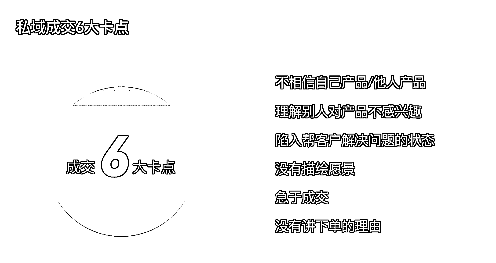

**卡点一：不敢收钱，因为不相信产品价值。** 很多人做知识付费，一谈钱就心虚，本质是不敢信任自己。破法很简单：先把自己变成学习者，让自己变好，或者帮客户拿到结果。我的万元私教客单价，就是在第一个学员变现2w后，才敢定出来的。当你帮的人越来越多，配得感自然强了，自然敢谈钱：

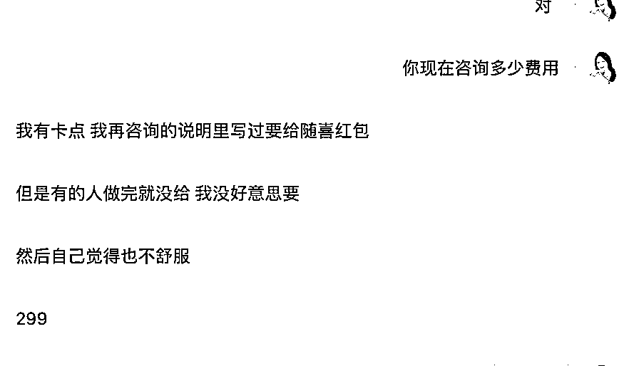

**卡点二：客户说“不感兴趣”，你就真的松手了。** 不感兴趣背后可能是买了别家、现在没需求，这些都需要挖。日常通过社群话题和案例分享就能筛出意向；哪怕对方只是旁观，你也可以主动私信关心，一步步把进度条往前推。靠谱老师有个“100%进度条”理念，客户只走到20%的兴趣，你自己先卸力，那就又归零了：

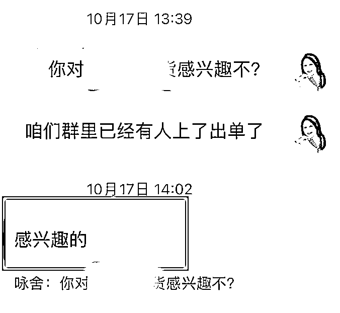

**卡点三：把自己变成免费顾问。** 用户一提问，你就恨不得全帮他解决。要有边界感：哪些是随手答疑，哪些需要付费做深度梳理。过度服务又累又不讨好：

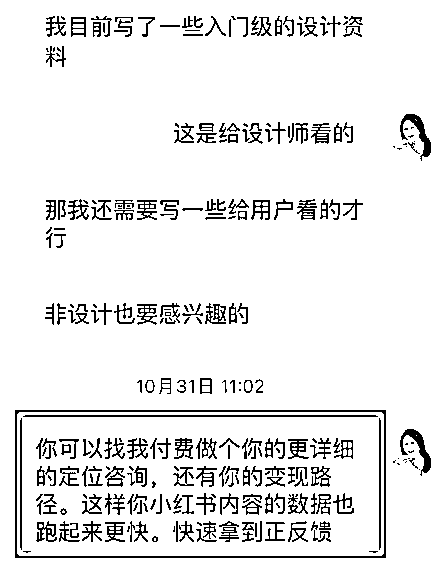

**卡点四：从头到尾没给用户画面感。** 人都希望自己最快出结果。你要把未来愿景放大给他看：你自己的结果、学员的结果、行业趋势，让他觉得跟着你就能走向更好的生活，而不是更苦的生活。

**卡点五：急着成交，被对方带节奏。** 别人问一句你答一句，满屏都写着“快买”。要跳出对方的问题框架，稳住节奏，深挖核心需求。挖需求卡住，多半是谈得少、练得少。多谈、复盘、再谈，就能找到真正痛点。注意，痛点别贪多，精准拿到一个，成交率就能上去。

**卡点六：聊到最后，没给对方一个下单理由。** 如果还卡着，大概率是他还有疑虑没说出来。那就主动引导，把疑问掏干净。同时可以给点临门优惠，比如当天报名立减200、再送福利：

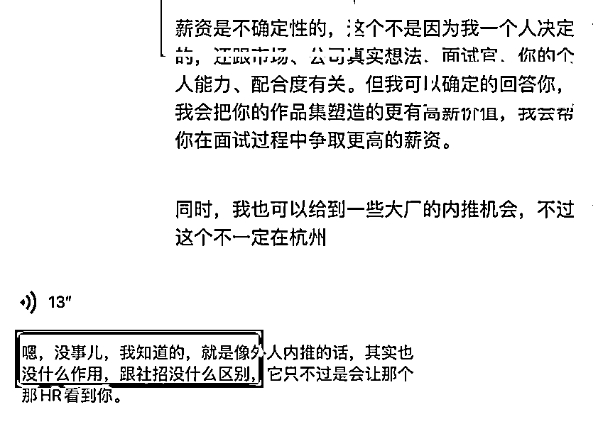

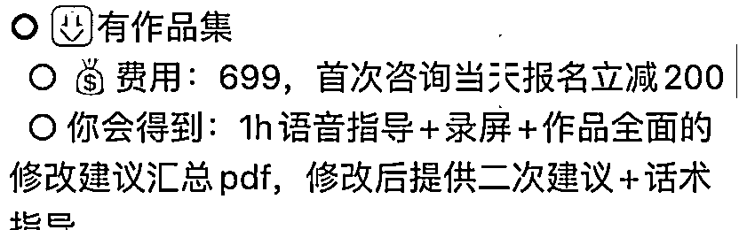

## 洞察客户4种决策心理

很多人一遇到“我再想想”“太贵了”“你有什么不同”“有没有结果”“已买了别的课”就懵了。其实转化就在这一脚能不能接住：

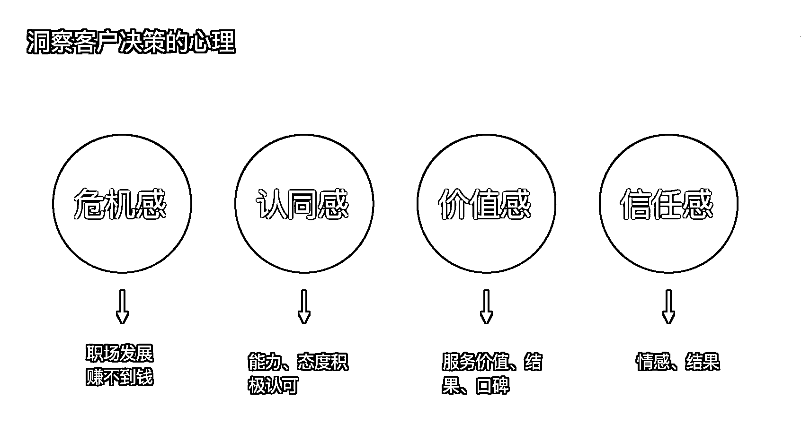

**①危机感决策。** 往焦虑深处挖：是不是找不到职场方向？是不是越来越不知道去哪里赚钱？说到底，都是对赚钱的焦虑。

**②认同感决策。** 先肯定对方的能力、结果和态度。每个人都想赚更多收入，已经有这么好的基础，就差自己最后愿意往前迈一步。

**③价值感决策。** 把服务价值、结果、口碑都摊开。当很多不同的人都在说好的时候，他会潜意识觉得“这应该真的很不错”，决策犹豫自然减少。

**④信任感决策。** 多讲个人品牌故事，塑造鲜活的人格。再小的个体，也有自己的品牌。

## 不同话术的回应策略

客户说“太贵了”怎么办？用“锚定+算账”接住。

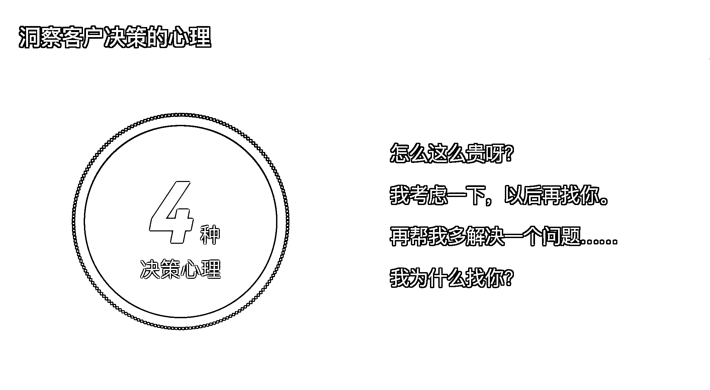

先突出稀缺价值：背书稀缺、福利多、结果硬。再拿同行对比，同类产品都收到5w，我这才1w多。最后帮他算笔账：社群一年365元，折合一天1块钱，换到的是价值3w的干货。这给的不是解释，而是给他一个放心下单的理由。

以上，就是我从0-1把知识IP销售空间一步步做大的全部心得。特别感谢我的销冠老师梁靠谱，要不是她去年一路敲打和点拨，我不可能把这些经验变成实打实的打法和结果。希望对同样在路上的你有用。

做销售久了你会发现，报价出去以后，最怕的不是客户还价，而是对方来一句“太贵了”。

但贵不贵，从来都不是绝对值。你得先判断对面的收入水平、消费习惯和群体属性。也许这个人本来就不是高客单的精准用户。遇到这种情况，聪明人不会硬推，反而会顺势往下一档走，把低客单价的产品带出来，成交反而更容易。

说到底，销售的核心能力只有一个——在和客户的你来我往中，敏锐捕捉到他的真实需求。

再来看几个高频场景和应对思路。

**当客户问“你凭啥跟别人不一样？”**

有人会说，我学过好多课，感觉都没用。这时候别急着辩解，而是告诉他你的课程到底特别在哪，顺便把往期学员的结果和服务模式亮出来。

关键是，客户一表现出疑虑，就要追问：你担心的到底是什么？是怕自己坚持不下来？还是怕没有人督促？还是自己信念感不够？

举个例子，那场对话里，我特意强调“会有老师手把手带”，直击的就是他怕自己搞不定的心理。

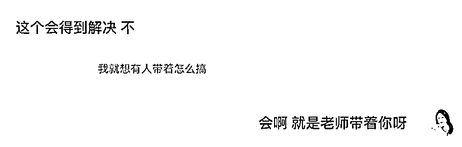

**当客户说“我已经买过别的课了”**

这种情况别慌，也别急着贬低同行，不如直接反问：那你学得怎么样？有效果吗？为什么没拿到结果？

之前有位客户跟我说，自己报了一堆课，全是录播课，结果一个都没跑出来。我就告诉他：问题不在课程，而是你缺人盯、缺人手把手带，执行力跟不上，结果自然出不来。

**当客户说“我再考虑一下”**

先别催，翻翻他的朋友圈，判断对方是什么类型。

思考型的人，你要给他空间，逼单反而容易丢。
行动型的人，直接甩同类型客户的真实案例，更有说服力。

另外有个特别容易踩的坑：介绍产品时滔滔不绝，把123456789个卖点全倒出来，结果客户一个也没记住。

真正有效的做法是——先挖出他的核心痛点，然后只讲一个最对症的卖点，一击即中。

比如你觉得圈子好、老师牛，但如果对方最关心的是“我能不能做出结果”，那你就只讲这个。

---

如果前面这些招都用了，客户还是没有被打动，那你需要冷静下来复盘这几点：

1. 是不是自己积累还不够，个人势能还撑不起这个信任？
2. 是不是朋友圈展示的量不够，案例太少，说服力不强？
3. 是不是客户对你的信任基础还比较薄弱？
4. 是不是你戳的痛点还不够深、不够准？

想通了就释然。时间还长，不必急着成交。把客户当朋友，慢慢养在朋友圈，等他需要的时候，你正好在。

私域运营的终极心法说到底就一句话：不被删、不招烦、不树敌，踏踏实实做真实的自己。

---

**做个人IP这件事，让我最兴奋的有两点。**

第一，这行根本看不到天花板。这一年我不断把想法跑成落地、验证闭环、梳理路径、优化关键环节，每走一步都发现还有更大空间。那种“够得着结果”的渴望，每天都在推着我往前走。

第二，我遇见了更精彩的自己。一路披荆斩棘，在事上磨、事上练、事上成，不断拓宽人生的厚度与边界。让自己变好的同时，也能帮更多人过上更好的生活。

你贡献的价值越大，你收获的价值就越大。

全文链接：
https://v0bv6yb7fj.feishu.cn/docx/BOyddnSIWoPdSLxHO2vcQUWfnYb?from=from_copylink

* * *

评论区：

🔥逆熵增者💰 : 感谢咏舍分享，对我很有帮助❤️

