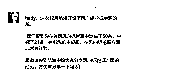
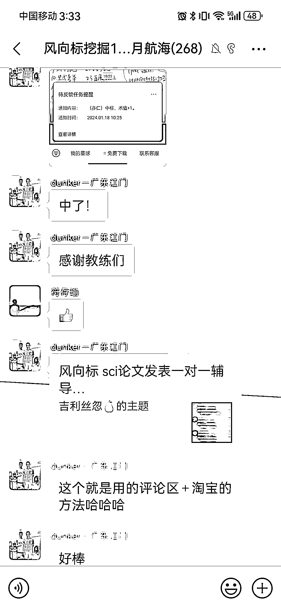

风向标挖掘这事，新人最容易卡在“找不到题”上。最近群里传来一个好消息：有小伙伴用了我分享的“刷评论区+逛淘宝”这套组合打法，顺利拿下了一条中标。收到这样的反馈，我整个人都特别兴奋。

先简单交代下背景：我是hedy，目前全职做小红书，天天和内容风向打交道。这周二受生财官方之约，在风向标航海群做了一次关于“怎么挖风向标”的实战分享。没想到刚讲完没两天，就有船员拿着结果来找我报喜，说用这套方法直接命中了。看到大家拿到真实回报，比我自己中标还开心。

借这个机会，我也想把这套思路同步给更多圈友——特别是那些刚上手方向标挖掘的朋友，希望能帮你们少走点弯路，找到一点感觉。当然，我水平有限，如果有说得不到位的地方，也欢迎兄弟姐妹们留言一起切磋，咱们一起进步。

想看完整干货的圈友，可以点开下方文档：

[`d1b2c9b6c0.feishu.cn/docx/VbnkdASLToXXdOxo8ffcGrYWnzg?from=from_copylink`](https://d1b2c9b6c0.feishu.cn/docx/VbnkdASLToXXdOxo8ffcGrYWnzg?from=from_copylink)

* * *

评论区：

暂无评论

* * *