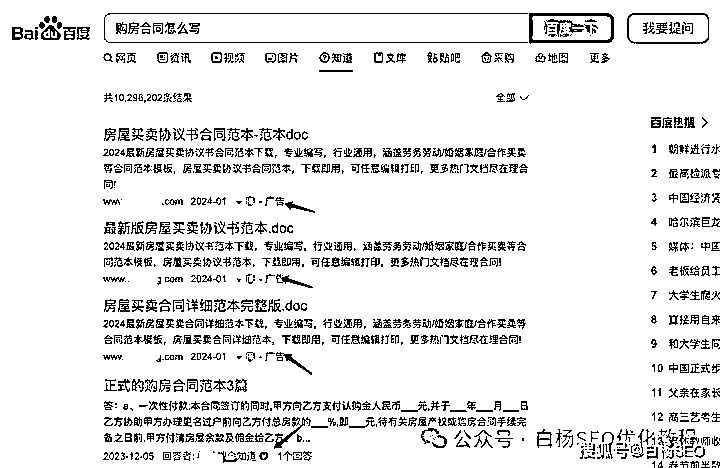
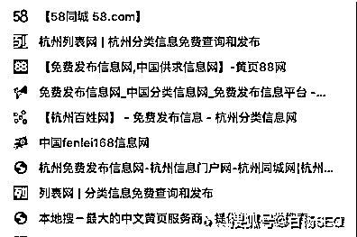
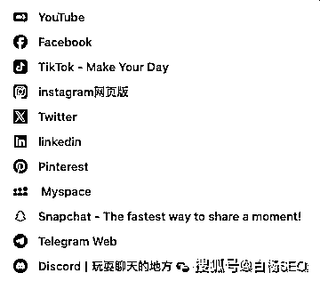
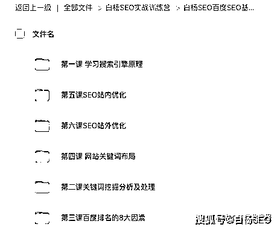
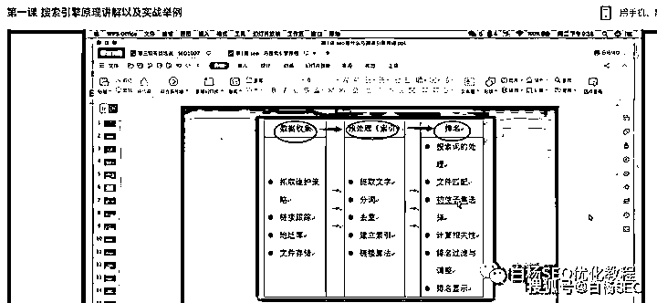
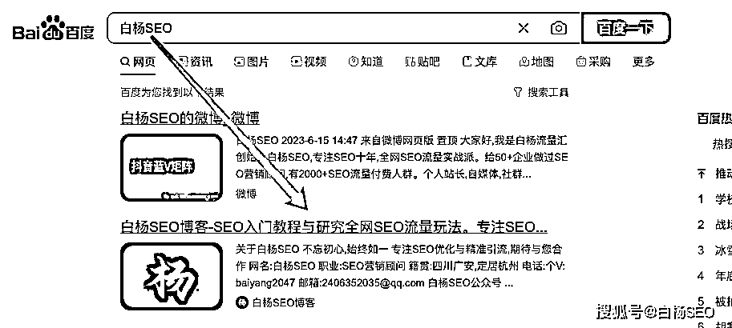
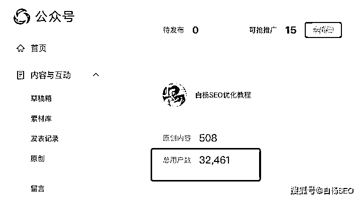
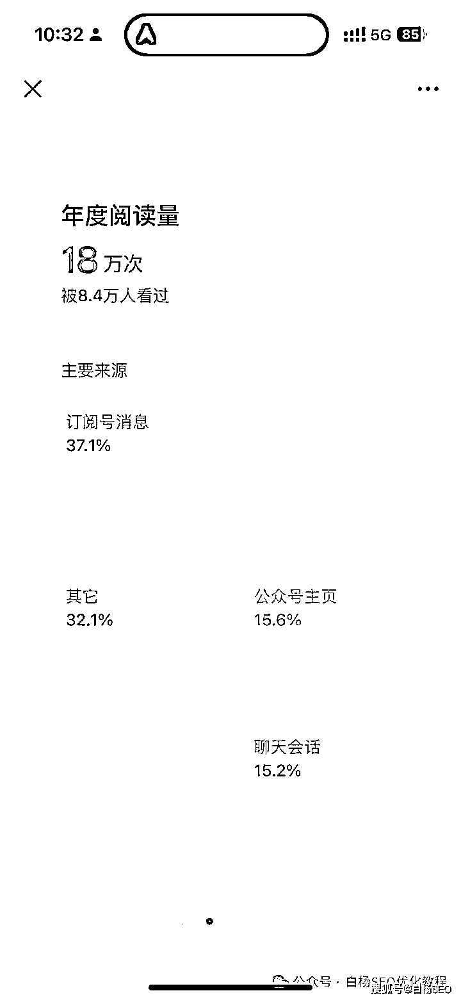

# 2024 年搞网络推广哪个平台流量更好？

又到一年规划季，很多人都在琢磨：2024年搞线上推广，流量到底该押在哪个平台？在展开之前，先把范围说清楚——这里讨论的是通过互联网渠道去推广自己的产品或服务，而不是开店卖货，所以某宝、某东这类电商平台一律不在讨论之列。

国内的渠道，大致能分成几大阵营。

先说百度系。免费入口有百度知道、贴吧、文库、经验、图片、百科、百家号、好看视频等。不过，免费归免费，门槛并不低，百科类内容审核极严，个人几乎啃不动；百度知道前面照样挂广告，想排到前面就得花钱做认证。

付费入口则是竞价、爱采购、惠生活，以及百度旗下各垂直领域的产品。另外，自建网站去截获百度生态里的自然搜索流量，也是一条经典路径。

再看腾讯系。QQ虽然很“上古”，但几乎人人都有号，好友、群、空间、短视频都能用来触达用户。微信这边的想象空间更大：👸号、视频号、小程序、问一问是免费的，广点通和朋友圈广告属于付费投放。别忘了企鹅号、QQ浏览器里的搜狗搜索，也都能算进腾讯流量盘。

接着是字节系。头条APP和网页版，既可以免费运营头条号，也可以花钱买巨量引擎的信息流投放。抖音是短视频一哥，免费的玩法是自己拍视频、开直播，付费的玩法是投DOU+、投千川。西瓜视频、懂车帝、火山小视频、头条百科等也都归属于这个体系。

除了这三家，垂直阵地同样不少：快手在短视频里坐第二把或第三把交椅，🧣是热点发酵的第一现场，📕是女性生活方式的主场，知乎是问答社区，B站是学习型中视频的代表，宝宝树则主攻母婴人群。而那些老牌的B2B和分类信息网站也值得重新看一眼，比如58同城、顺企网。

国内说完，再看海外。谷歌系绕不开，网页搜索、SEO、付费广告、AdWords都在其列。社交这边，Facebook、X、YouTube、TikTok是主力。

白杨SEO的观点很明确：全网推广渠道实在太多，不可能列完，更不可能全部做完。2024年一定要做取舍，把力气集中在几个点上才有机会做精。如果做国内市场，重点盯📕、抖音、视频号、百家号和👸号；如果非要再压缩成一类，那就瞄准短视频与直播。做海外市场，则重点看Google、Facebook、YouTube、TikTok这几个。

对于刚入行的SEO新人，或者从别处转过来了解SEO的人，白杨SEO反复强调：基本功必须打牢，像是关键词挖掘分析、搜索引擎基本原理这些。想免费入门，可以点进他👸号菜单栏的“SEO学习”自学；想系统点，也可以看他以前录制的网站SEO视频课程。

至于SEO老手，得分两种看。如果你网站运营得不错，变现也顺畅，那完全可以继续做，不管中文站还是英文站，毕竟“剩者为王”，走的人多了，竞争反而没那么激烈，也不必担心新进来的玩家。反过来，如果在SEO这行待了好些年，网站流量却一直不温不火，那就别死磕网站SEO了，不如学点新平台规则，或者干脆转向推荐流量，顺势而为，说不定能打开新局面。

白杨SEO自己就是一个活生生的例子。他坦言，如果只做网站SEO，特别是在百度SEO上，他的博客再怎么用力也就到权重2、权重3——因为他拒绝做与网站定位不符的流量，即便这样，在某些人眼里依旧不够看。2018年他转身投入微信👸号，当时大家都看衰这个平台，他从零开始写原创，如今积累了3万多粉丝，在圈子里也算有点姓名。

他晒出的2023年数据是：全年阅读量18万，虽然没法跟动辄几百上千万阅读的大牛比，但当年新增了五千多关注（当然也有取关的），这就是最好的证明。他也说自己其实错过了抖音SEO的头班车——他可能是最早提出“抖音SEO”这个词的人，却一直守在微信生态里。而抖音上有个同行，把“SEO”这个关键词做到搜索前三，吸引的粉丝比他👸号做到前三要多得多。

所以白杨SEO的结论很直接：平台选对了，同样的付出能换来翻倍的回报。如果2024年只让他押一个平台、一个赛道，他一定会押注视频号，并把重心放在直播上。

另外，他判断“私域流量”这个词会在2024年被所有人反复提起，虽然它早就不是新概念了。社群也一样，知识付费未必还像前几年那么风头正劲，反而沉寂许久的免费社群这种玩法可能会重新火起来，甚至成为那些做私域、做个人IP或搞联合共赢的人最基础的盘子。你信吗？

即便如此，白杨SEO仍会在2024年继续坚持自己运营了六年的付费社群模式。他始终信一条：用户要经过筛选才更有价值，免费往往才是最贵的代价。你怎么看？欢迎留言聊聊。

作者白杨SEO，专注SEO研究十年，是全网SEO流量实战派，对互联网精准流量有深入研究。全网各平台同名：白杨SEO。

相关推荐：
- 如何在抖音搞到TOB客户流量？
- 视频号SEO是什么？怎么做关键词排名和视频号推广？
- 旅游行业📕引流怎么做？免费SEO手段+付费投放结合

* * *

评论区：

暂无评论

