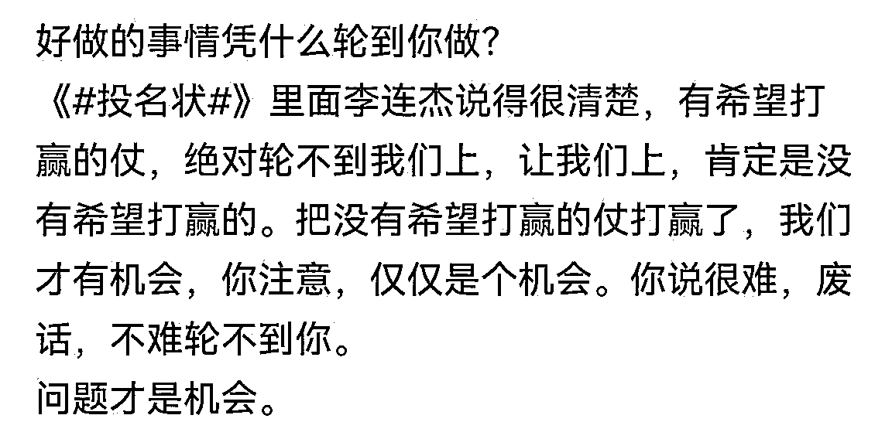

很多人一碰到麻烦，第一反应是头疼、烦躁、想绕开。但换个角度看，麻烦背后往往藏着别人没看见的突破口。

真正的高手，从来不害怕问题。因为他们清楚，每一个棘手的难题，都是一道筛选门槛——大多数人被挡在外面，谁有能力解决，谁就能脱颖而出。

“问题才是机会”，这句话听起来简单，实践起来却需要格局和勇气。与其抱怨环境，不如把难题当成跳板，在解决它的过程中积累别人拿不走的竞争力。

就像一场硬仗，打下来了，或许会付出代价，但也能赢得名声和立足之地。评论区里那句“攻坚战，一战成名万古枯”，说得也很实在：风险和收益从来都是一体两面。

所以，下一次再遇到让你挠头的事，别急着躲。停下来想一想：这个问题背后，是不是正躺着一个属于你的机会？

