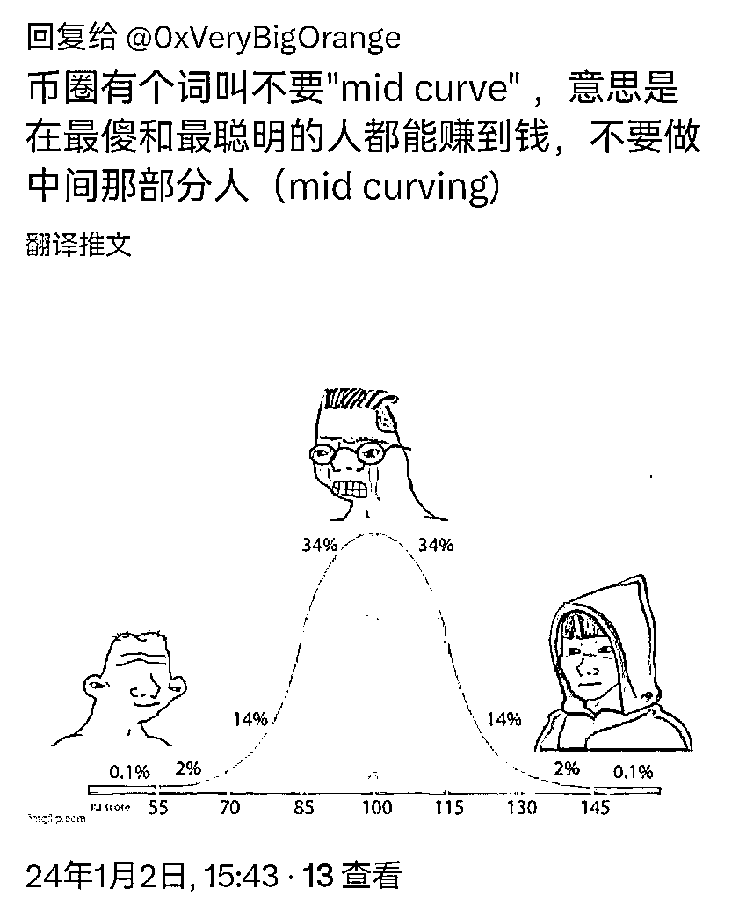

# 真正能在市场里赚到钱的，是两头那群人，中间的最惨

前几天看到一个观点，越想越觉得有意思：

在投资这个圈子里，最容易赚到钱的，往往是处在两个极端的人——一类是极度“简单”的，另一类是极度“聪明”的。反而那些自认为“懂一点”、站在中间地带的人，最容易成为被收割的对象。

什么叫极度“简单”？就是那些看透了之后选择最笨方法的人。他们不研究K线、不盯盘、不猜涨跌，只做一件事——认准了就拿着，不动了。这种“傻”其实是大智若愚，用时间换空间，最终反而能吃到整个趋势的红利。

什么叫极度“聪明”？就是那些在更高维度玩的人。他们做量化、发项目、控盘操盘，本质上是在规则层面设计游戏或者利用规则赚取收益。他们赚的钱，来自于市场波动本身，而不依赖对短期涨跌的预测。

最怕的就是中间那一批人。他们既不像“傻瓜”那样拿得住，也不像“聪明人”那样看得透。他们天天泡在市场里，试图通过反复交易和加杠杆来博取更大的收益。结果往往是在一次次的追涨杀跌中，把本金折腾得越来越少。

说穿了就是：在“最傻”和“最聪明”这两个极端，都能找到活得很好的玩家；唯独中间那群上蹿下跳的人，常常两头挨打。

所以啊，如果你不够聪明、站不到食物链的顶端，那就老老实实做那个“最傻”的人，拿住、别乱动。千万别做中间那类人——那是一条最难走、也最不赚钱的路。

* * *

评论区有人总结得挺直白：最笨的人就是买完放着囤着不动的；最聪明的是搞量化、发项目、做庄的；中间的人则是追热点、炒短线、加杠杆的。

