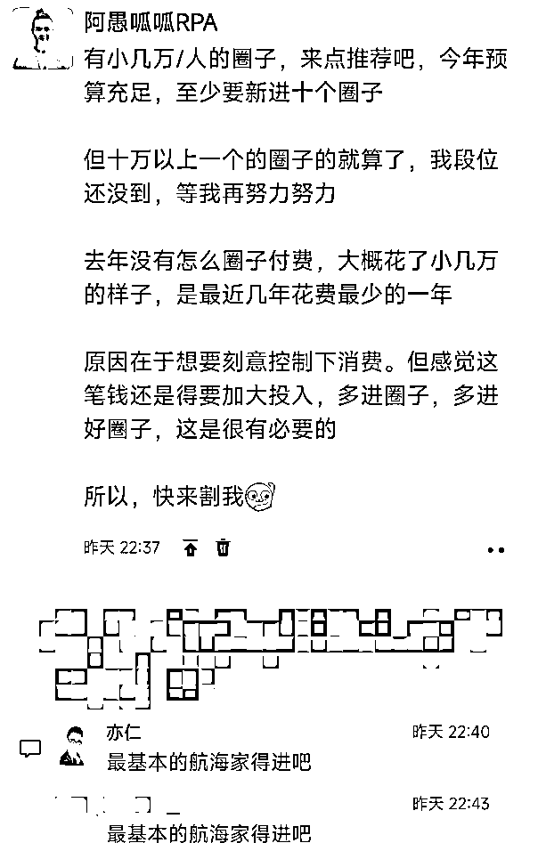
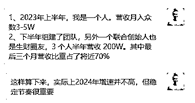
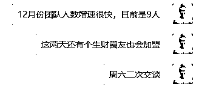
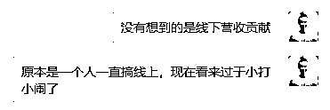
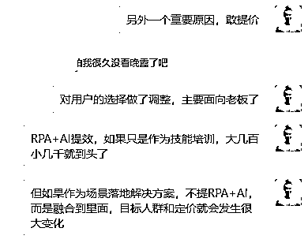
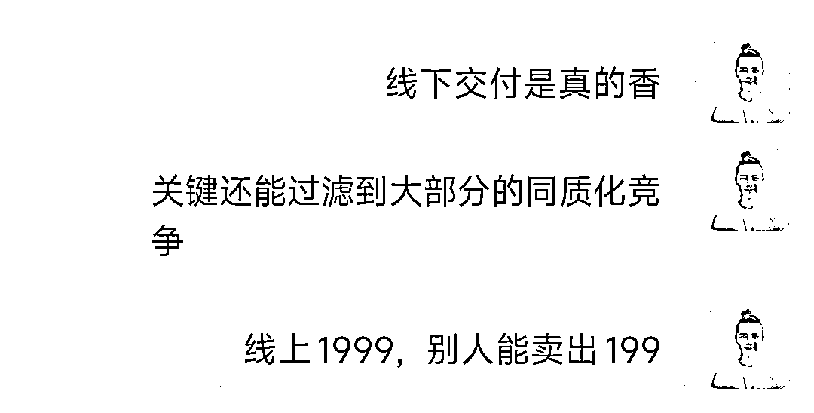

# 刚进航海家，龙哥拷问我：你今年目标是去年 4 倍，背后的信心和路径是什么

刚进航海家大门，就被龙哥直接点名：你今年目标定成去年的4倍，信心从哪来，路径是什么？

说实话，我当时心里咯噔一下。但缓了一天之后，我决定认认真真把答案写下来——下周的年会我本来也要向团队讲同样的思考，干脆借着这个机会，一并梳理清楚。这篇帖子大概也算是龙哥盟里的一股“泥石流”吧。

先交代下背景：我是阿愚呱呱，昨天正式加入航海家俱乐部。这个圈子我惦记很久了，说白了，我需要两方面补给：商业认知和信息筛选。我们团队偏技术，合伙人霸夫是23年程序员出身（三年前他自己说是20年经验），技术很硬，但商业信息和筛选能力相对欠缺。之前没加入，一方面是因为航海家太神秘了，我印象里只偶尔扫到过一两次，甚至一度忘了还有这么个“地下组织”；另一方面，一月份我连着进了三个圈子，价格从大几千到近两万，航海家是第三个。当时我发了条朋友圈，龙哥带着一大波水军来了一轮饱和式评论，全是“基本的航海家得进吧”。可发完就没了下文。按套路，这时候该有万能的鱼丸私信我“是靓仔哦……”，顺势把我收了。结果没有。倒是有别的圈友私信我推荐了他的圈子，我就先进了那儿。

所以这次加入航海家，我罕见地认真填了半小时申请资料。群里自我介绍也发得特别详细：姓名阿愚呱呱，坐标长沙。我是鹅有招创始人，提供RPA+AI自动增效和矩阵获客解决方案，服务20多个矩阵团队；国内最大RPA运营自动化社群主理人，也是赚钱RPA提效航海教练。2023年下半年营收200W，2024年打算做到800W。我能提供：RPA自动增效服务（培训+社群+定制），图文工厂服务（培训+工具+代生产），企业级自动增效深度落地。核心需求：给10到100阶段的合作伙伴深度实施自动化，承接矩阵团队的图文视频自动化生产，也欢迎大家推荐5K到5W的高质量圈子。最后放了免费知识星球链接，当时2900多人，现在已经是3067人了。

这里插一句真心话：免费知识星球太重要了，特别适合早期做个人IP的朋友。一定要搞一个，做自我介绍时放上链接，真的会有用。

发完介绍，红包秒空。过了一会儿，龙哥就抛出了那个灵魂拷问：

那一瞬间，我脑子里闪过千万个字，最后只回了这么两条：

一条总结数据，一条提炼节奏。对，增长速度不算惊人，但稳定的节奏真的很关键。我单干时，月收入多数情况下是3到5W，少的时候不过万，多的时候一周能有十万——但那些都不是常态。相比之下，我更喜欢现在这种踏实的状态。用一句很接地气的话说：2024年，就得奔着800万营收去。

后来我又补了一些碎片思考：

把细节摊开来讲：

**第一，历史数据是底气。** 为什么我重点讲下半年，尤其是最后三个月？因为6月份我才和霸夫组队，开始新一段创业。6到9月是磨合期，营收稳步增长，平均每月20W；9到12月继续上涨，平均每月四五十W。这些数据都是真实发生的，可以复盘的。

**第二，团队能力在变厚。** 6月之前团队只有我一个人。6到9月变成2人，9到12月变成3人，12月直接跳到9人。写这篇帖子的时候，确定到岗的已经有11人，还有2人春节后再来。人数增加并不等于能力增长，但人手变多之后，我和霸夫原本的能力边界确实被撑大了。对我们这种喊“自动增效”口号的团队来说，每加一个人都要反复掂量。

**第三，线下被证明是放大器。** 我原先完全没想到我们还能搞线下。这里必须提小糖果——她是9月正式加入的，之前一直远程协作，是团队里唯一有线下运作经验的人。11月我们办了第一场会员见面会，20多人；12月办了龙哥盟长沙见面会，70多人，直接创下长沙站人数纪录；1月又开了第一场图文工厂面授，目前报名人数已经110+。

**第四，目标人群必须调头。** 创业者、老板本来就是我们的主要客户，但我前三年一直没下定决心专门做这块，总想把技能课程打磨得更丰富，去做职场人的技能培训。后来无意中做了个“老板会员”，结果它贡献了至少80%的收入。再傻也看明白了，那就顺应现实，以后安心服务老板们。

**第五，产品设计要跟着人群重构。** 服务老板，交付方式就得换。有段时间训练营推得猛，会员价值感是爆棚了，但一位老板会员直接跟我说：训练营很好，但是给“精技会员”的，别让他们参加打卡了，重新设计一下交付。翻译一下就是：钱不是问题，要有匹配他们的交付，他们乐意掏钱，但不想“遭打卡的罪”。还有这种好事？顺着会员的真实需求走，才能吃饱饭。于是我们快速推出了图文工厂、视频工厂、流量工厂、操盘手RPA等产品。现在做产品设计和交付，我们随时提醒自己：要有会员视角。

经过2023年这一年，我们算走完了0到1，正处于1到10。2024年怎么做800W？答案不只是今年的规划，更应该从2023年里找。我就从产品/交付、流量/获客、转化/运营、团队/公司四个角度，试着做一次大梳理。第一次写这么长的复盘，很多地方未必清晰，但贵在真实。要是能对圈友有点启发，是件很开心的事；也欢迎各位拍砖。

**一、产品/交付**

先聊产品升级。项目名称从“RPA帮”到“AI帮”，再到“鹅有招”，这背后是定位不断聚焦。我们主要帮客户解决两类问题：增效和引流。由此拆出两大类方案：最普适的自动增效，用RPA+AI把人从重复劳动里解放出来；以及增效在获客场景的深度落地——图文工厂、视频工厂、流量工厂这些。服务形态也从最初的单一课程，扩展成课程、训练、社群、工具、见面会、面授、深度定制。很多人没想到，一个看似只有线上的小团队，线下反而干得很猛——龙哥盟长沙最大规模见面会是我们组局的，2024年第一场挤满培训室的图文工厂面授也是我们开的。我们可能是国内最早落地RPA+AI的团队之一：2023年2月我推出RPA+ChatGPT超级写手，很快就打爆了，还被官方邀请做分享，一周创收7W。我三年前就开始了RPA创业，也是赚钱圈第一个分享RPA内容的人，半年后才陆续有其他圈友跟进。2024年，我们决定继续下沉做深：一边搭更系统的RPA+AI解决方案，用培训、社群、工具交付；另一边加强线下，在全国各大城市搞面授，并走进大客户现场做深度服务。

再说图文工厂。它是RPA+AI的大型落地解决方案，也是我们对外面授的第一个大型解决方案。12月29日对外发布，正式开启面授计划。从发布到开课只隔了两周，正常面授怎么也得提前两个月准备，但效果远远超出预期，是真的“爆了”。图文工厂会是产品矩阵里的重要构成，兄弟是视频工厂，上面还有内容工厂。2024年我们会开不少于12场图文工厂面授，视频工厂、流量工厂也会启动。

工具方面，发布了两款📕笔记批量生成工具，图文版和导图版都在疯传——也许是自我感觉有点膨胀，但数据确实超预期。我们还上线了60个RPA机器人，对📕、抖音、ChatGPT等多个平台实现自动化驱动。工具为什么受欢迎？说白了，所有需求都来自会员，做出来又回到会员手里，简单可信赖。这些工具也开放零售和代理，但我们现阶段没打算在单品销售上砸太多精力。2024年还会有更多好工具和机器人上线。

训练营方面，6月到12月我们开了70+场，它是交付价值、拉高会员活跃度和满意度的好抓手。2024年场次会控制到100+，同时把品质要求再提一档。

线下交付这块，必须说：互联网团队太容易忽视线下，或者想搞又不敢搞。但我们一搞就发现了一片新天地，收入肉眼可见地涨。而且线下交付本身就是提升获得感的重要方式，线下见一面，胜过线上聊千遍。很多真实反馈，线上永远拿不到。2024年全年我们会搞不少于20场线下见面会和面授。

知识星球也值得讲。它是当前最适合做社群内容沉淀的工具。特别推荐大家搞免费星球，对想做超级个体的人尤其香。我现在手上有5个星球、2个星球码。免费星球3000多人，付费星球650人。2023年付费星球人数不增反减，因为之前有ALL IN小鹅通的想法，把内容迁到了小鹅圈，现在回头看，这个策略确实绕了些弯路，但弯路也算数，最合适的还是搭配着用。2024年3月1日知识星球会重启，目标5000个星球用户，挑战很大，所以产品策略会做比较大的调整。

**二、流量/获客**

私域是基本盘。现在我们有16个🛰️号，好友3W+。但坦白讲，这个数量配不上我们的能力，问题在于有劲没使出来。加好友这件事，我一直认为是永远正确的动作，可惜多数打工人很难理解它的意义。我个人主要管理2个号，合计1.2W好友。2024年的计划是增至30个号、10万好友。

公域走的是矩阵霸屏。目前账号200+，干的就是矩阵霸屏的活。2024年肯定是我们的爆发年，大家可以等着看效果。之前我们一直没下场，主要是给客户提供技术支持；既然技术在手，自己的矩阵也该搞起来了，现在RPA已经做到了部分霸屏。给小白、素人一个建议：别有什么IP情结，多干活、多发内容、多搞账号、多抄爆款，普通人老老实实干这些就好。2024年目标1000个账号，把多个小品类都打到霸屏。

👸号有16个。我主理的主号现在粉丝6743人，说实在的没怎么认真做，但很省心，从引流到转化流畅得不行。我建议大部分人先从👸号做起，它虽然没有抖音📕那种泼天流量，但你认真对待的每一个流量，大概率都能转成客户；抖音、📕的问题在于很多人搞不定公域到私域。2024年👸号要做到50个，既要有几个大号，也要有矩阵号霸屏。

视频号目前12个，数量还远远不够。我们不做什么IP账号，就是靠量取胜。视频号引流转化的机会很大，去年我们无意中尝到了甜头，今年会放大再放大。2024年目标50个视频号，也是大号加矩阵号的思路。

流量工厂的计划其实2022年就有了，很多客户特别需要这个方案，但2023年因为种种决策没有正式启动。所谓流量工厂，不会局限某一个平台，也没什么IP情结，就是无情地做内容饱和式输出。可持续搞流量，听起来玄，底层逻辑就是低成本、高效率、大规模地向平台供应有效内容。这里面融合了大量RPA+AI技术和作业流程。对内，它是我们的流量生命线；对外，它是我们重磅输出的解决方案。2024年，大家不妨一起来见证威力。

**三、转化/运营**

会员见面会：11月我们搞了第一次鹅有招会员见面会（那时候还叫AI帮），20多人到场。团队一共四个人，其中一个新人刚来没几天，就办得有模有样。说实话我参加过不少见面会，我们这场也有很多亮点。会员能感受到用心，彼此交流得也很深，还顺带用升级消费支持了我们。2024年计划做4场城市见面会。

销售能力：互联网科技团队天天跟电脑手机打交道，通常不太喜欢谈销售，总觉得产品会说话，能让客户静默下单。但我们越来越发现，这个认知太浅了。静默下单只适合标品或低客单，当服务越做越深、价格往上走，销售就成了关键环节。销售不是什么丢人的事，它是把价值传递给客户。幸运的是，我们团队里有人真的热爱销售，这直接助推了快速发展。2024年，我们要构建更强的自我增长和复制销售能力。

客户运营方面，我们有两句铁律：第一，不靠贩卖焦虑，只拿解决方案说话；第二，从会员的实际需求中长出来，再踏踏实实回到会员身上去。我甚至觉得，被人认可的价值心法，就是这么朴素的两点。2024年，我们会争取赢得更多客户的信赖。

**四、团队/公司**

团队组建是2023年的一个节点。在“RPA帮”阶段，我完全单干；2023年3月推出RPA+ChatGPT训练营，一周进账8W，于是决定组团队，6月新团队正式成立。联合创始人霸夫是赚钱圈友，也是持续创业者；春节后还会有一位赚钱圈友加入。夸一下赚钱这个圈子：我最早的RPA创业就是在这里验证的，合伙人也是从这儿找到的，很靠谱。创业团队搭建向来难，尤其是初创期，但我们现在已经形成了“产品×流量×转化”的组合，并进一步迭代成产品线和增长线，分别由我和霸夫主导。我们跨过了0到1，正处于1到10阶段。创业路上步步惊心，希望大家祝我们好运。2024年会积极引入重要人才，现在真的方方面面都缺人，欢迎帮忙推荐。

公司搬迁也值得一提。原来办公室只有32平方米，这次换到160平方米的两层复式楼，离地铁口47.98米。离地铁近特别重要，员工满意度能上来不少。装修没有请外部人员，全是内部人慢慢折腾出来的，很给力。总结一下：找又便宜又好的办公室，得快速多看，最好集中一两天看上十几个，再做决定，一般不会后悔。2024年大概率不搬了，同时会严格控制人员规模——毕竟我们干的活，就是增效降本。

以上，就是我从2023年作业里看到的2024年答案。希望能给圈友一点启发，也请多多指正。

这段时间复盘 2023、展望 2024，聊的其实都是同一个核心：创业团队能不能跑得稳，跑得快，拼的不是喊口号，而是协同能不能打通，执行能不能沉下去。

先说工具与协同这块。
我们现在几乎把所有内部协作和交付都压在了飞书上，从文档共创到最终交付物沉淀，全部在上面闭环。用下来体验是真的顺手，门槛低、上手快，承载力也够强，目前还没找到比它更合适的替代品，如果你有更好的方案非常欢迎推荐。
当然，飞书再好也不是万能的。我们花了不少时间去试错、去打磨，怎么用才能真正贴合业务需求。说实话，这中间下了不少笨功夫，但换来的效率提升是实打实的。也有它的局限性，很多场景下必须和外部工具搭配，才能把内部协同和对外交付都托住。

工具只是载体，更关键的是要搭起一套协同体系。
我们内部已经砍掉了日报、月报，只保留周报。更核心的是在建一套可复制的执行 SOP。团队起步没什么历史沉淀，所以我们对 SOP 有点近乎偏执的信念：新人进来，只要跟着 SOP 走，就能快速上手、少走弯路。
2024 年的目标很明确，把协同体系再往下沉一层，给到各个板块、各个环节更细化的 SOP。这依然是一件需要长期磨、苦功夫的事。

再聊团队管理。
人多了，问题自然就多了。执行力、协作力、薪酬设计、业务认知、劳务合同……各种杂事会像雪片一样飞过来。
创业前我前后带过近百人，换工作相对频繁，所以带的人数不少。但创业团队的管理和传统公司完全是两种体感。我不敢说自己有什么高深的管理经验，只能说踩坑里攒下一些体感。人比机器人复杂太多，既要制度化，也要人性化，这两件事都要下功夫，而且是在创业进行中不断修行。
关于规模，2024 年我们不会激进扩张，团队体量大概会稳定在 15 人左右，保持精干。

以上就是 2023 的复盘和 2024 的量化预期梳理。写到现在已经快凌晨了，创业嘛，都懂的，忙得经常是哪里着火去哪救火。这次梳理既是回应老板的提问，也是对自己和团队的一个交代。欢迎大家拍砖，也期待看到更多同行的年度复盘。

最后祝 2024 大家都能大发，身体健康，家庭幸福。

补充一个最近被问得比较多的迁移问题。
有朋友问，为什么当年我们把社群从知识星球搬到小鹅通的鹅圈子，现在又要考虑重启付费星球？
当初 ALL IN 小鹅通的核心逻辑是想打通两件事：
1、支付和发货一键闭环。我们培训内容放在小鹅通，社群却还在星球，体验是割裂的。发货在这里指的是用户付款后权益能立刻生效。
2、尽可能减少平台切换，让用户主要在小鹅通+🛰️里就能完成所有动作。
3、小鹅圈在后台运营体验上确实有很多亮点，功能很强，运营起来很顺手。
4、越研究越觉得小鹅通的上限很高，很多运营玩法都能实现。

但实际落地后发现几个硬伤：
1、小鹅圈并不能真正替代知识星球。社群活跃度被弱化了，用户打开意愿很低，教育成本极高。所以今年计划重启付费星球，让它作为一个独立的产品存在。小鹅圈做不到这一点，对我的产品矩阵协同是明显的损伤。
2、小鹅通也做不到真正的 ALL IN。虽然看起来什么都能做，但很多内容形态承载感很差。比如知识库，我们曾尝试从飞书迁移到小鹅通，体验很痛苦，用户端差、我们也付出大量人力成本。
我们现在在用小鹅通旗舰版，也会继续用，但认知更清晰了：用其所长，避免用其所短。

一起加油，很高兴在赚钱长沙见面会上认识你，期待下次再聊。

