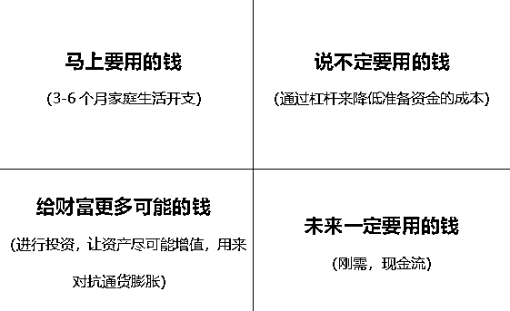

# 会花钱和不会花钱的有钱人

有钱人最大的难题，不是赚钱，而是把钱花对

一提起有钱人，很多人以为他们最不缺的就是花钱的底气。现实往往相反：真正让有钱人栽跟头的，恰恰就是“花钱”这件事。金融圈有句扎心话——有钱人最终都是被金融收割的。那些暴雷的大公司里，损失最惨重的常不是普通散户，而是手握巨额资金的有钱人，只是他们觉得丢脸，一声不吭。

当然，我也见过另一种人，真能把钱花出“以一当十”的效果，甚至用一笔学费改写人生剧本。

### 三十万学费，换来一条逆袭路

小L就是这样的例子。三十出头，被公司裁员，拿到N+6赔偿，五十多万到账。换作别人，可能先买包买车犒劳自己。她却先出去旅游两个月，花掉五万，然后转身做了一个让很多人看不懂的决定：花三十几万去读MBA。

她没想过靠商学院撩到金龟婿，而是看中了一个逻辑：这是通往有钱人世界最省力的通道。商学院里老板一抓一大把，只要有人愿意搭理她、气场相合，她就去采访对方怎么做生意。如果对方愿意多聊几句，她就把自己的困境和盘托出，看能不能换来一些指点。男性老板大多有些“好为人师”，说不定真能捡到宝。

结果，两年读下来，她手里已经握了六七个offer，最后进了一家顶级大厂做总监，年薪冲到七八十万，后来又拿了新项目。老板们都说，她的思维方式早已超越了普通员工的层次。

小L最厉害的地方，是她花这笔钱的时候，居然没算回报率。大多数人的第一反应是算账：什么时候回本？能赚几倍？可一旦算起账，思维就开始被熟悉的框架锁死了。年入几百万的人，再怎么算也跳不出七位数的盒子。她不算，反而让一切皆有可能。

当然，不算ROI是有风险的，可能满盘皆输。但正是一开始不指望具体回报，惊喜反而容易降临。这恰好验证了一个观点：越没钱，越容易盯着投资回报率；而真正的大回报，往往是在你刚开始不算回报率的时候才出现的。

所以，很多人去混圈子、买合伙人、进私董会，心里总盼着10倍100倍赚回来，这其实只能算“花在项目上”，不是“花在人身上”。

### 两种花钱逻辑：给项目，还是给人？

先说什么叫花在项目上。本质就是投资思维——投项目、投公司、投操盘手，目的是让钱生钱。有个自测题：如果这个项目不是你自己执行，而是你花钱去加速它的成功，你知道应该把钱砸在哪个环节吗？是买关键资源，还是搞定优质货源？答不出来，说明你根本没看懂这个项目。

有人会说：“我虽然不懂项目，但我相信操盘手。”这貌似是第二种，其实还是第一种——你只是把操盘手当成了判断项目的一个维度罢了。

那什么叫花在人身上？一点也不玄乎：好好吃饭、住大房子、买游艇珠宝，或者家人病的时候不用纠结用什么药、去哪个国家治。说白了，就是让真实生活肉眼可见地变好。舍得给自己和身边人花钱的人，人生通常差不了。王思聪有句话说得直白：我不在乎别人交朋友是不是图我的钱，反正谁都没我有钱。

反观很多有钱人，永远在钱生钱，唯独舍不得在人身上花钱。他们的快乐不来自生活体验，只来自数字增长。这种快乐很危险，因为金融游戏从不发阶段性奖杯，只在终点收答卷。而金融市场收割的“韭菜”里，分量最足的往往就是这群人。

所以，年轻时一夜暴富，反而值得警惕。如果钱是一点一点赚到的，你的认知大概能覆盖花钱的需求；可有些行业用一年时间就能让你赚到几千万，接下来的功课就是守财，比赚钱更难。

### 真正的财富，需要三权在手

很多人把资产当财富，其实两者差得很远。有些保险讲座总爱说“只有保险才是真财富”，这话立场太明显，但我们可以借它把外延拉大：真正的财富，必须同时满足三个条件——金额管理、权属管理、自由管理，都在自己手里。

先说金额管理。你有一套价值5000万的房子，急用钱时抵押或变现，可能只能拿回4000万，金额当场打折。相比之下，活期存款、定期存单、保险退保的现金价值，说多少就是多少，确定性极高。当然，一些上升期公司的股权、当年的学区房，也曾在金额管理上很强势——只是条件会变，别把话说死。

再看权属管理。这笔钱会不会有一天突然不归你动了？举几个例子：你在A股有500万市值，今天确实全卖了，可T+1，明天才能用，今晚你依然是个“穷人”。如果股票停牌了呢？账户被冻结了呢？另一半偷偷转走了呢？《繁花》里的范总，钱都在厂子里，自己能动的真不多。权属不清晰，财富就只是账面数字。

最后是自由管理。即使钱在你名下，也未必能按你的意志花出去。就像《年会不能停》里的董事长，签个字就支出6000万办年会，可每一分钱真的都花对地方了吗？给孩子打300万留学费，他一定都用来学习和生活了吗？所以越来越多有钱人用家族信托来锁定意志：太太生个孩子奖励多少、考进藤校给多少、创业启动资金多少，拿着计划书来还能额外给多少。每一笔大钱，都按自己的剧本上演。

### 四象限图：不是教你按比例花钱

再分享一个有趣的花钱工具——四象限图。

千万别急着套用标准普尔家庭配置图，那套比例对真实生活基本无效，反而容易让人烦躁。每个人都有独特的价值观，哪有什么“应该”在哪里花多少比例的定式？有人天生赌性大，爽感就来自于投钱后那种满满期待的过程，你跟他说风险投资不能超过30%，他只觉得你扫兴。

这个图的正确用法，是帮你把“花在人身上的钱”与“花在项目上的钱”区分开，然后按自己的偏好优化。

花在人身上的钱，狭义上只有两块：一是马上要用的日常开销；二是未来一定要用的刚需，比如教育、养老。除此之外，都算花给项目的钱——生病、公司增资、各式各样的投资。这些钱的本质完全一样：降低成本，博取收益。用更直白的话说，就是使用杠杆和时间周期。

举个例子，你计划三年后买车，没必要攒全款，留出10万首付就行，其余的钱统统可以投进项目。与其把钱困在谜一样的大A，不如试个直播间，三年后的收益大概率超过贷款利息。这就是杠杆。

买保险也是这个逻辑。万一得病要花十万，与其专门留十万现金，不如花几千块买份保险，省下的钱拿去投流，不香吗？当然，日常吃饭的钱不能上杠杆——今天省一顿，三天后也不会多出两碗饭，刚需就是刚需。

我也见过不少客户，生活费备好了，孩子的教育金备好了，手里还剩800万。凭什么非要给人家规定，800万里只能有40%做风险投资？为什么非得让人买保险、做存款？教人怎么花钱，特别招人烦。就像一个人明明镜头感好又话痨，你非要让他做📕图文，结果图文憋两小时依然很丑，录视频十分钟轻松搞定。尊重个性，比什么都重要。

钱只是工具，谁都没有资格规定别人应该怎么对待钱。但底线要有：刚需的钱先留足，剩下的随便你造。有人很疯，连砸十个直播间，赌一个水花；有人求稳，上杠杆但还备好退路。都没问题，大家开心，生意才能做得久。

### 钱不够时，用时间和杠杆，别抠

如果把生意做大了，你迟早会遇到钱不够用的情况。这时候，把投项目想象成养一个“亲儿子”。做实业起家的有钱人，往往最舍得给公司花钱，看起来厚此薄彼。可如果把时间拉到五年后，公司交给儿子，等于给了他更多的钱。用时间周期衡量，很多取舍都说得通。

钱不够时，最简单的解法，要么用时间换空间，要么用杠杆撬资源，抠抠搜搜永远走不远。

所以，有钱人不会花钱，通常只是因为他们只对数字有概念，分不清花给人还是花给项目，也不懂杠杆和时间周期。

说到底，龙哥盟只是开始，花钱有术才是真本事。愿我们都能和财富做朋友。

