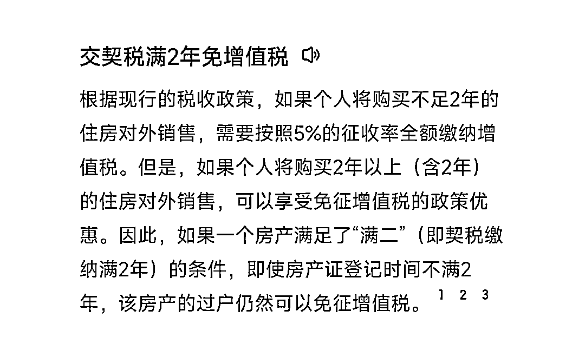

# 自媒体3年：从负收入到月入10万，我是怎么熬过来的？
作者：龙哥

嗨，大家好，我是龙哥。97年出生，中文系毕业，目前运营着“慕卿久”和“未来可期的小赵”两个👸号。全职做自媒体三年，粉丝累计超过18万。我的强项是👸号运营、个人IP打造、搭建付费产品以及私域运营。靠着这些，我已经变现60多万，现在月入稳定在4万以上，最近三个月更是连续冲到了10万+。

但这条路，起点并不光鲜。从最初负收入，到如今连续三个月月入10万，中间是实打实的低谷和煎熬。

**低谷篇：婚礼没了彩礼，生活全靠硬扛**

三年多前，我大学毕业刚两年，换过几份工作都不太顺心，干脆一头扎进👸号。头四个月成绩不错，粉丝很快做到2万。

那年春节，我在当时的男朋友（大学学长，毕业后两年又走到了一起）老家过年，见了双方亲戚，准备五一结婚。可假期一结束，我们刚回广州，学长妈妈就因身体不适去检查——因为疫情，她有一年没复查了，这次一查，就是癌症晚期。

全家人瞬间坠入深渊。婆婆一度想放弃，我妈一直劝她别放弃。我当时没多想，把15万彩礼全拿出来给婆婆治病，爸妈也很支持，说亲人的健康最重要。所以结婚时，我是零彩礼。

嫁妆方面，我妈原本给我存了几万块，留着婚后用。但学长觉得我弟弟还在读书，我们既然成了家，就该自己撑起来，这笔钱先别动，存着备用。而我大学念的是民办学校，学费很贵，家里已经为我付出很多，婚后妈妈还帮忙带娃，我心里总觉得亏欠。

再看经济压力：学长之前在常德买了套房，公公出首付，他每月还房贷；婚后孩子的奶粉、衣服、尿不湿又压了上来。为了撑起小家，学长辞掉了广州那份月薪过万、干了四年的工作，回长沙重新开始，工资却连原来一半都不到。有大半年时间，我们每个月入不敷出。那段时间，也正是我怀孕生子、最需要休息的时候，日子真的挺苦的。

生完孩子、休完产假，身体恢复后，我正式全职做自媒体。到👸号第二年，勉强月入过万，但几乎存不下钱。我特别着急，想赚更多。一方面惦记婆婆的身体，另一方面也清楚：想在长沙买房，首付、房贷都得自己扛，月入两三万可能都不够。孩子以后要上学，这些迟早要面对。更何况，我还想帮衬父母，回报他们一路的支持。

**煎熬篇：卖房亏掉20万，我发誓年前赚回来**

这三年，公公从广州回到长沙，一直陪婆婆治病。身体好点的时候，他会出去接活，毕竟有一门装空调的手艺。我们也会常带孩子去看婆婆。她做了放疗、化疗，虽然状态始终谈不上乐观，但一直在认真治疗。

直到今年，婆婆情况急转直下，我和学长轮流陪护。8月，她还是走了。虽然早有心理准备，但一家人陪她抗癌近三年，看着她唯一的儿子结婚、生子，她最后一程总算少了一些遗憾。

我们考虑了很久，决定把常德的房子卖掉，全家都在长沙发展。房子挂到58等平台，很长时间都没有动静。大环境不好，看房的人少，地级市房价又一路在跌。九十月份终于等来买家，学长反复确认：真的要卖吗？那时孩子外婆在长沙乡下带娃，学长老家又在常德澧县乡下，我们怎么也不可能住到常德市里去。我说：卖吧。

结果，这一卖亏了20万。房子地段不差，卖价也算合理，亏全亏在当初踩的坑里：学长买房时正赶上利率高点，又稀里糊涂选了先息后本，利息交得肉疼；前两年没入住，也没考虑卖房，契税一直拖着没办，转手时又被收了一笔5%的增值税……办手续时，真的心疼到想哭。

公公和学长心里都很难受，毕竟这房子装了父子俩太多心血，学长甚至觉得这四年都白干了。但我特别感激他们，即使如此，依然尊重并支持我到长沙生活的决定。

卖完房，我的压力前所未有地大。这20万不能白亏，还有，卖掉常德的房子、搬去长沙，是我的决定。我暗暗发誓：年前必须把这笔钱赚回来。

怎么赚？我把以前买过的付费课程、资源全部翻出来，厚着脸皮向老师们请教，抓住一切机会向上链接、持续破圈，学习优秀自媒体人的商业思维，一点点武装自己。

浸泡式学习了一段时间，我开始动手：
- 运营私域，每天发6到8条朋友圈，反复打磨文案；
- 搭建社群、打磨课程，不断迭代，用心服务每一位学员；
- 和婷子、小她一起，做了个私教合伙人项目，每天用语音或文字和合伙人深入交流；
- 参加线下见面会，把分享嘉宾的精华吸收、内化再输出；
- 坚持高频分享，前前后后几十次，把社群的学习氛围带起来；
- 主动请缨，拿下了觉醒团队千人社群发售的操盘机会。

顶着压力，一步一步往前走。

回想起来，大学时我也曾因为迷茫、不确定未来的方向，逼自己卷出了励志奖学金、优秀毕业生等荣誉。而在这生娃前后的三年，压力一直如影随形，却也推着我突破了月入10万。

**曙光篇：连续三个月月入10万，亏掉的钱赚回来了**

2023年下半年，我终于等到了质变。月收入从年初的2万，到年中的4万，再到第四季度连续三个月突破10万。之前亏掉的20万，也连本带利赚了回来。

这三年，我还做成了不少事：
- 帮助1000多人实现了自媒体变现；
- 陪跑7年合伙人，从0到1搭建出产品体系；
- 两个🛰️号累计沉淀私域流量超过1.3万；
- 和合伙人累计通话200多次；
- 操盘千人社群，累计创造30万+销售额。

算下来，三年总收入还不足百万，这个月我也还在努力冲。现在说“轻舟已过万重山”还有些早，但确实已经苦尽甘来。

2024年，我准备在长沙买新房。我们对房子并不熟悉，感觉处处是坑，如果大家有经验，欢迎给我支支招。目前手里有几十万存款，但买了房再装修，估计也所剩无几。所以新的一年，我要赚更多钱，给自己多攒一些安全感和选择权。

最后，说几句心里话。做自媒体之前，我从来没想过自己能走到这一步。回看这一路，有太多感慨，但最想感谢的，是那个一直没有放弃的自己。

所以，永远别给自己设限。大胆一点，勇敢一点，如果条件允许，把目标定得更高一点。

2024年，我已经给自己列了不少KPI，接下来会带着团队和合伙人一起奋力搞钱。希望今年的我们，都能保持对自媒体的热情，也保持对生活的积极。

今天先聊到这儿。更多自媒体的心得和实操干货，我会在小报童和社群里，和陪伴彼此的大家一起慢慢分享。

