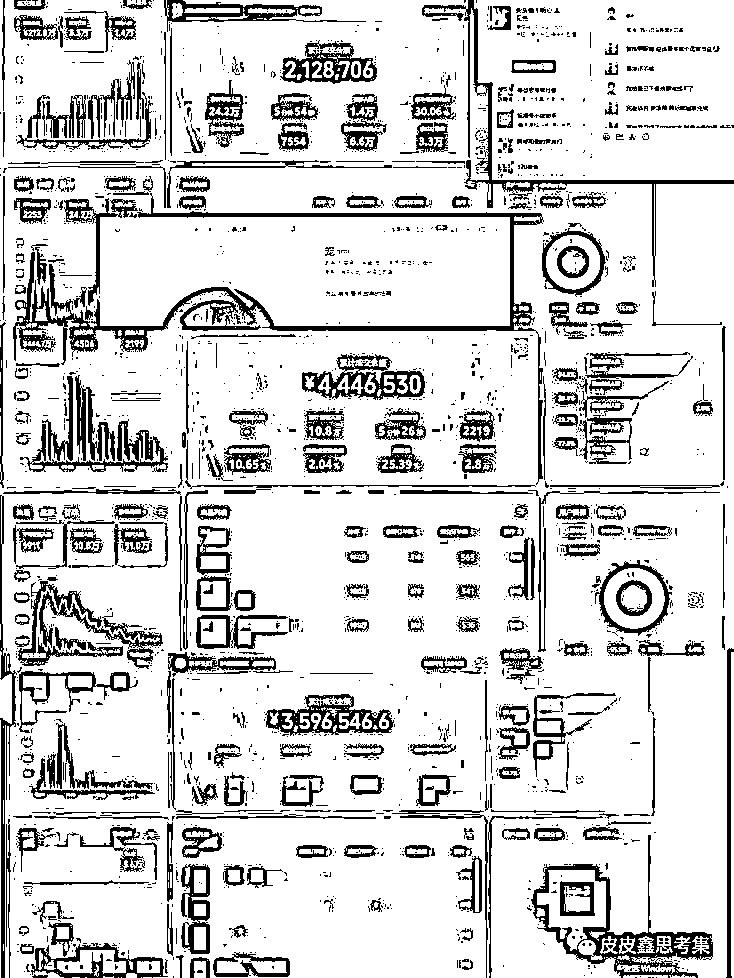
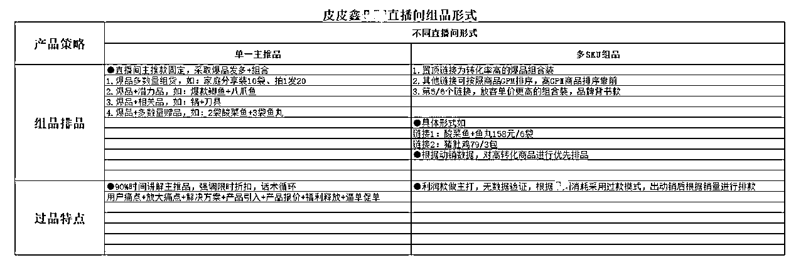

# 视频号操盘经验：1 人，10 人，100 人的付费投放策略有哪些不同？

**视频号投产是抖音三倍，1人、10人、100人的投放策略差别有多大？这份操盘经验全讲透**

同样是卖一款货，抖音标价50，视频号敢标89；广告费花下去，视频号的投产比能跑到抖音的三倍。是不是听着有点夸张？

这不是我编的，是我直播间跑出来的真实账。

我是皮皮鑫，真名刘俊鑫，一个从抖音转战视频号的操盘手。去年11月，我听说视频号是风口，兴冲冲杀了进去，结果亏到差点怀疑人生。后来调整方向，把付费流量当成起号的主要武器，一顿操作，账号才慢慢有了起色。

视频号的机制现在依然不算完善，平台规则也经常让人摸不着头脑。但恰恰因为很多规则还没定死，流量红利也就还没被瓜分完。同样一件货，抖音卖50，视频号能卖89；价格卖得更贵，付费广告的投产却能跑到抖音的三倍。做过投放的人都知道，这背后藏着多大的空间。

更魔幻的是，我身边很多把视频号做得风生水起的朋友，你问他“你怎么做到的”，他常常答不上来。有位朋友想了半天跟我说：好像也没做什么特别的事，就是把抖音上已经跑量的视频拿过来照样播，结果直播间突然就爆了。

我社群里有位用户，没有抖音基础，几乎零经验，去年7月开始做视频号，一个人一台设备，现在一天能卖两万多。我追问他做对了什么，他想了很久，还是说不出个所以然。

还有个做线下销售的女性，做了两个多月视频号，一个人跑出了日销十来万的成绩，专程来问我怎么把盘子放大。

后来我在社群里几乎挨个问了63个用户，能讲清楚自己成功路径的，一只手数得过来。

有位长辈跟我说：很多人只信自己愿意信的，你说真相，反而没人听。这话放到视频号一样适用——风口大家都看到了，但“为什么能爆”这件事，大多数人依然停留在玄学阶段。

这也正好说明：视频号的入场姿态是敞开的，只要选品不出大问题，哪怕一个人单干，也有机会跑出来。但同时，方法论还没有被系统沉淀，谁先把打法固化下来，谁就能吃到更深一层的红利。

所以我的判断很直接：现在买视频号的流量，很可能是未来三年里最便宜的一次。下一步，我会把公司业务全部押到视频号上，抖音那边直接砍掉。

下面这份操盘框架，是我从0到1、从1到10、从10到100一路实践下来的经验浓缩：

这次分享会按14个板块展开：

1. 我的完整经历——建议先看，理解我的判断逻辑
2. 视频号的前景与天花板
3. 我做视频号踩过的坑
4. 赛道怎么选更稳
5. 视频号直播算法拆解
6. 直播团队怎么搭建
7. 货品怎么组、玩法模型怎么用
8. 直播间场景怎么布置
9. 主播怎么批量复制
10. 短视频内容怎么创作
11. 微信豆投放的具体打法
12. 主流起号方式和直播玩法拆解
13. 操盘手运营能力如何提升
14. 视频号长效经营规划

你可能会疑惑：一个年轻人，凭什么讲这些？那得从我的过去说起。

我出生在揭西河婆良田乡的一间瓦房里，下雨天屋顶漏雨，床铺湿透。小时候经常吃不饱，喝粥都见不到几粒米，还因为营养不良进过医院。7岁那年，一家人搬进镇里新盖的水泥房，没装修就住了好几年。之后我每天跟着爷爷奶奶种菜、卖花生。爷爷只读过四年书，奶奶没上过一天学，但爷爷总把一句话挂在嘴边：要努力读书，别让人瞧不起，改变自己的命运。

我天生比旁人多一根手指，小时候在学校被嘲笑，甚至挨过打。回家后，又因为写不出一个“我”字，被父母狠狠教训过。那几年我浑身是伤，夜里经常躲在被子里哭，一度想过轻生。但每次哭完，心里总有一个声音：既然被当成人群里的异类，那就活成人群里最亮的那一个。

中学我彻底叛逆：早恋、泡网吧、逃课去打工，一天干十几个小时拿50块钱，什么人、什么套路都见过。高中落榜后，我妈劝我别读书了，出去打工分担家里压力。我偏不。我选了广州一所专科学校，一心想去大城市看看世界。当时我还一心想学音乐，身边所有人都摇头，但我偏要跟这些“不可能”碰一碰。

专科期间，我边读书边折腾，先是混了半年社团，后来干脆自己创办了一个，直接对标学校的计算机协会。申请了两个月都没批下来，我不服气，叫朋友去对方的社团潜伏观察，把人家的人员架构和运营模式摸了个底，再回来改良。折腾一年多，社团慢慢有了知名度，发展成百人团队，我带着同学们做闲鱼、玩电商，赚到了人生第一桶金。

后来我给自己定了一个更野的目标：考暨南大学。一边忙社团，一边啃高中课程，高考季回去插班考试，2019年，我真的考进了暨南大学工商管理系，还当上了班长。家人依然反对，为了筹资学费，我先出去工作，收到过凡科集团产品运营的offer，月薪6k。但我始终放不下读书这件事，打电话给爷爷。爷爷说：学费不用你管，家里就算砸锅卖铁，也要送你读。就这样，我走进了暨南大学。不过只读了半年，我觉得时间太闲、开销不小，索性退了学，回到一线去实战。

这些年，我赚来的钱没有买豪车、穿大牌，几乎全花在投资大脑上：学演讲、学管理、学决策、学投资，哪怕兜里没钱的时候也没停过。

回头总结我这一路，最值钱的就是三条经验：

第一，不必什么都拥有，但什么都可以为我所用。看见别人有结果，就去拆解他的方法和流程，拆完消化成自己的——我管这招叫吸星大法。

第二，方向比努力更重要。在合适的时机选对赛道，从顶层规划倒推路径，再动用一切资源去打，往往能实现降维打击。

第三，迷茫的时候，去读道德经、易经；焦虑的时候，去学习、去折腾。过往那些不堪的经历，最后都会变成你的底气。你不需要急着和世界和解，但要接受自己的普通，允许别人做别人，也允许自己做自己。

我始终相信，知识真的能改写命运。那些嘲笑、讽刺、毒打和落魄，只要你自己不认输，就没有谁能替你判定结局。

完整版的万字自传，我放在微信👸号“皮皮鑫思考集”里，也可以直接点开这篇：[皮皮鑫的前世今生经历文](https://mp.weixin.qq.com/s/VNCU_T0o_WocqaiQMISPAA)

写这篇分享，是想把自己的得与失全部摊开，能帮你少走一段弯路，就够了。视频号的窗口期还在，越早进场，越有机会吃到低成本流量的红利。

今天想跟你聊点掏心窝子的话。

不知道你还记不记得小时候，老师或长辈问过我们那个问题：“长大了想做什么呀？”大多数人的答案可能早就随风飘散了，但我记得特别清楚。大学课堂上有一次，教授让我们对某个内容做个简单的举手表决，我跟我舍友都举手了。当时我站起来说了句话：“以我们国家现在的发展速度，科技更在不断往前跑，我想成为一个对社会真正有用、能创造价值的人——哪怕要用命去换。”

说实话，课里具体讲了什么我已经忘了，但教授当时的反应我记到今天。她后来特意把我叫去聊天，对我说：“你有自己的想法，真的很难得。但你要想清楚，这条路要付的代价很大，你真的做好准备了吗？我活了这么几十年，能在课堂上这么大声讲出这种话的，很少。我只是希望你能好好地热爱这个世界，别轻易说放弃。哪怕以后不在这个学校了，该给你的学习资料和考试内容我照样发你，你自己去考，我相信你做得到。”

那一刻我差点绷不住眼泪。你知道那种感觉吗？从小到大，你的每个想法几乎都会被身边的人泼冷水，被各种反对声包围。突然冒出一个人，认真地对你说“我相信你”，整个世界好像一下子就变得很温暖，突然觉得不再是孤零零一个人在往前走了。

所以皮皮鑫啊，你得记住：哪怕没人陪，哪怕只是一个人默默赶路，也千万别害怕。心里那团火不要灭，相信它、护着它、往前冲。

---

从暨南大学退学之后，我回到创业这条路上。那年快要到2019年底了。

大概过了大半年，我认识了一个伙伴，一起合作干。差不多做了半年，店铺终于有点起色了——开始爆单，干到了头部。但悲剧来了，我自己判断力不够，疯狂备货，库存压死，直接亏了大笔钱。那段时间我周旋在各种供应商之间，很多都是江湖上四五十岁的老狐狸，搞到后来，我对身边所有人都开始怀疑了。真的是一路踩坑踩到底。那时候心态直接炸了，我心里就想不通：我对别人掏心掏肺真诚相待，为什么连亲戚朋友，一到利益面前全都在给我使绊子、刀刀往要害捅？

那一遭彻底把我打老实了。你们现在看到的我，做事谨慎、爱分析、爱判断，不是天生的，就是那一年被毒打出来的。对事对人，包括面对自己，全是教训堆出来的。更讽刺的是，老天爷好像还特别成全我，什么大坑都让我踩一遍，就连最亲近的亲戚，看我落难了还不忘再坑我一手——啧，真是个好人。

---

之后我有一两个月完全是废物状态。每天什么事都不想干，提不起劲，就打游戏摆烂。到了2020年年底，我遇到了合作伙伴的一个客户，他算是后来我人生每个阶段的一位“贵人”。

他建议我回广州发展，跟我讲了他的经历。有句话我印象太深了：“我创业五年了，如果当时一毕业不急着创业，先去公司上班干两年，会少走好多弯路。这几年我就是一路亏亏赚赚、踩坑踩过来的。你先别想那么远，去广州上几年班再说。”

我听完，也没多想，认识不久但直接听进去了。我把手上的业务全砍了，行李一收拾，又一个人跑去了广州。心里憋着一口气——我这么好强的人，我不想输，我得把这口气挣回来，想明白我到底是怎么输的。

在广州打工了一两个月，那两个月其实算是帮我找到“财富密码”的两个月。我进公司的目的就很简单：到处看、到处学。两个月时间我换了10多家公司，面了50多家。我完全以大学毕业小白的身份进去的，过去经历一概不提，就想看看这些公司到底是怎么玩的、商业模式怎么搭的、人员管理怎么做的，每块都不放过，跟“偷师学艺”似的。看到有人做抖音赚钱了，我也记下来，想着后面自己试试。

你也可以管这叫“卧底式学习”。我同时向几十个“导师”取经，把他们脑子里的思维模式想办法抠出来研究。见的人多了以后，我把他们的做法梳理成自己的方向。虽然不能说清晰到哪一步吧，但至少心里的路数慢慢有了。后来我又开始拉合作伙伴，搞新项目。

皮皮鑫，记住：凡事都有答案，别傻傻地死磕。找不到答案的时候，走出去看看、翻翻书。

---

时间来到2020年底。我拉了一些投资方，开始了抖音直播创业。我拼命研究直播到底怎么玩。一开始我自己上——穿着高跟鞋拍视频、直播，连每天出单打包都是自己来的。最搞笑的是有件事我到现在都记得：快递员看我就那几件货，连过来收都不愿意。我只能自己骑着小电驴，把包裹送过去5公里。到了晚上，卖出去的还是自己送。这么过了三个月，快递员还阴阳怪气地说：“哎你这都三个月了还这么点东西，搞什么直播？要不要来我这儿跑快递？”我没太在意，因为确实没什么起色，投资人的钱我也不敢乱花，于是每天白天直播，晚上还能跑几单外卖维持生活。

但好家伙，可能真的是天无绝人之路。直播间人数突然飙起来了，我拼了命地播，开始招人。然后哗啦啦地爆单了。后来直播间GMV从10万、20万、50万，一路做到单场100万。

人到了这个位置就开始想要更多。我在琢磨怎么复制更多直播间，于是我不断招人来复制，结果接连失败亏钱。

后来我突然来了思路——这些直播间先稳住，我再去面外面的公司，大概面了100家，把做得好的直播间的模式直接copy下来，打法和运营细节都不放过，有时候甚至把对方公司的人直接挖过来当核心合伙人，让他帮我整条链路落地。我自己呢？我开始每天出去跟大量圈子的人交流，研究适合自己的生意模型、公司运作规律、股权设计、薪酬设计等等。

但接着问题来了——我想得越来越多，真正做的时间越来越少。然后我又栽了，用人失败、管理出问题，加上投资方，这次亏得不算太多。但归根到底，还是我的认知不够。于是我又停了两个月，到处旅游、走走看看，想想人生到底怎么走。

---

2021年底，我抖音创业的劲头又上来了。很快又冲到头部，这次我尝试多种合作和品牌代运营，接到了明星头部和各路大牌，破圈了，拿到了很多资源和资金。但随着收入增长，我又开始思考，怎么能让模式更轻一点、资产更轻一点、成本更低一点？

2022年我基本上都在学习路上。大量读历史、易经、道德经、奇门遁甲、四书五经，还整天跟各种企业家交流。严格算起来，大概深度交流了1500家，一天好几场，在公司的时间少得可怜。老业务慢慢稳下来。2022年11月我开始研究视频号直播带货，不断把外部信息往内灌输。

后来视频号也出了些成绩。从单场几百块，到几千、几万、几十万，再到单场上百万，整个过程也是一路踩坑过来的。但怎么说呢，我始终把自己看成那个在直播电商里拼命撞笼子的普通人。以前办事确实很蠢，走了各种弯路，但以后可能还会踩更多——说到底，这对我来说是修心的过程。我希望自己可以不断走向深渊、走进黑暗、不断“死亡”、“归零”。在敌人干掉我之前，我先把自己干掉，不破不立，涅槃重生。

有意思的是，今天在朋友圈看到晨哥发了一段话，大致是说：为什么我朋友圈里很少晒数据？我不是少晒，我是根本不晒。直播四年了，好像除了2022年初晒了个“百万开门红”，之后再也没发过。不是说晒的人不好，有些人单纯分享喜悦，干了大半年终于爆单了，我不仅不否定，还挺替他高兴。可我不能晒。作为一个知识博主，说话不能只考虑自己——有些人因为喜欢你，你发个朋友圈他都当金句看。可现实是什么？直播这个行业不是人均法拉利，也不是人均百万GMV。现实就是现实。我从来不想制造焦虑。真实世界是：大多数人也就贴补家用，厉害点的能顶打工人一年收入，极个别赚一辈子花不完的——但百万分之一吧。

我还是想传递点正向的东西。创业这事儿，慢慢来反倒比较快。发点运动打卡多好，我就不信大家天天刷爆单截图，看到一个自律的人的日常还会拉黑你？要是没拉黑，不如点个赞？

我看到之后立刻点了个赞。朋友圈天天晒数据的，我真懒得说。我要真晒，岂不是天天都有得晒？是真不想拿那些数据去怼人。你以为你很牛？天天晒，没完没了。

年底的时候我还给自己立了个小目标——开始写每天深度思考。刚开始一个字都憋不出来，后来天天写，写作能力慢慢上来了，慢慢地我竟然能在公开场合脱稿演讲，这个能力在2023年帮我了不少。

2023年过年，我做了整年规划和未来五年规划。我决定去做一个IP。2月11日，我定了未来三个月五大目标：

第一，写作。每周一万字，每天从500字总结提到一千字深度思考。第二，抖音IP，三个月内每天一条视频，总共100条，每条一分钟，做不到就罚钱。第三，直播。每天播两小时以上，就算空气里没人看也对着空气讲。第四，阅读。每天一小时打底，一个月一份思维导图还要直播输出。第五，交流。每天找两个人深度聊天、碰撞观点。

到5月11号的时候，这些目标全部超额完成，而且还在继续，不会停。未来这个IP，我希望真的对别人有价值——哪怕初期价值不大，如果你看到这里还认同我，欢迎和我一起共创这个圈子。希望你是乐于分享、积极向上的那种人。

我对我自己的期待很简单：能靠自己的努力不断变强，持续给大家输出价值——不管直播带货也好、判断决策也好，只要你哪天需要帮助，随时可以后台找我。

我的全新创业时代4.0，还在路上。敬请期待，皮皮鑫会比所有人更卷、更玩命。

---

聊完我自己，再聊聊视频号。

大家都说视频号是风口。这话对吗？对，但真相不止于此。我们实操下来，视频号现阶段有三种碾压级的优势：

第一，成本低。用户可以反复触达，不用反复花钱买流量；第二，隐私强。数据比较隐藏，相对没那么透明；第三，利润高。综合利润很可观，在这个平台不太需要付费，就能获得相当精准的流量。

现在入局视频号，平台流量本来就大，还能把各平台的用户导到私域。链路短，价值高——价值高意味着用户忠诚度高、消费力强、可以持续触达。

目前视频号最合适这三类人：第一，有品牌——传统线下品牌、强产品力的白牌；第二，有私域——有私域运营能力和用户基础的人；第三，有时间——宝妈、退休银发族、大学生、农村轻创业的朋友。

对抖音玩家来说，做视频号简直跟开卷考似的。不管你做没做过抖音，现在来做视频号，就像提前拿到了财富剧本，把抖音赚钱的路子再在视频号走一遍，照样能赚到钱。

---

但别高兴太早，视频号也是一路“死伤无数”。大家做不成，最大的问题就是赛道选错了。

什么样才叫好赛道？直播间必须资金、能力、资源三者匹配。如果你三个里面两个都凑不齐，那这项目多半做不成，想都不要想。

我接触过起码两千多个视频号操盘手，在这里做个死亡复盘总结：

常见误区一：自有工厂，上来就干，不做任何数据调研。觉得淘宝天猫卖得好就以为直播也能卖好，觉得线下卖得好就以为直播能卖好，还有的人线下渠道本来就做不好，居然指望靠抖音翻身。这就是盲目自信，认不清自己的能力边界。看到别人直播大屏GMV几十万、上百万，以为自己也行了？做什么梦呢。

常见误区二：有供应链就说自己有供应链优势。顶多算“我认识几家工厂”，且只是在你有限的圈子里的有限选项。自认为“顶级”，产品可能是不错，但有没有能力做，这是两码事。这也太小看视频号了。

常见误区三：产品有卖点，但没有产能+用户+售后+竞争优势。能出单但产能跟不上；或者能爆单但用户天花板太低；或者能爆但售后跟不上，规模一出就出问题；还有一种，能出单但扛不住内卷，最后被同行卷死。

常见误区四：供应链还行，但团队不行。产品对主播要求高，可你解决不了主播；产品对团队玩法要求高，可你做不了千川也拍不出好素材；产品对资金要求高，投流成本或压货成本都高，你还偏选纯付费类目。

为什么这么多人踩坑？第一，不做调研，供应链选错了；第二，忽略了直播的壁垒，觉得有货就能卖；第三，缺乏对整个电商链路做要素分析，只看货，人、资金、资源通通不管。你不死谁死？

---

那怎么选赛道？我总结为——能力、资源、资金，三维要素匹配模型。

能力方面，要看你在已有直播操盘里嫁接的能力。你一直做付费流，突然去转女装自然流，那是你没有的能力。还要看能力短期能不能快速补上。比如食品直播间用图文内容创作，但如果你缺个强主播，还偏要做自然流，那也是过度自信。

资源方面，光“有货”不等于供应链。你要问自己：能在这个赛道找到供应链吗？有相关资源吗？找到的供应链有价格优势吗？质量、产能达标吗？这些答不上来就继续问。人才资源也一样——你要出镜人设，能找到吗？要懂行的运营，筛选得出来吗？要强转化主播，找得到人吗？

资金方面，别以为做直播花不了几个钱，更不要拿少数“没钱也做起来”的案例骗自己——那是以前了。现在的人货场视频，一个点不具备极致优势还想靠自然流？多半是做梦。要用半年的周期去匹配项目，先看自己口袋里钱够不够。不够的话，外部能不能找到投资伙伴？这也是关键。

---

说完成功的门槛，再聊聊选品和选赛道。

我一直很信奉一句话：选择永远大于努力。你在一个细分竞争少的赛道里稍微努力就能赚到钱，但如果你去女装里拼，越努力离倒闭越近。

选市场有三个基本准则：第一，大类当中找蓝海；第二，红海当中找蓝海；第三，自己造一片海。

把这三句话刻在脑子里。中国古代军事里我们看过很多以少胜多，但你得问问自己：我是不是那万中选一的将才？我有他们那样的实力和运气吗？反正我没有。所以我只选比自己弱的赛道打，比我强的赛道我都不碰。这是生存法则。

在视频号上如何用第三方工具做数据筛选？蝉妈妈、有米云、飞瓜、考古佳都不错，上去按我下面说的方法筛就行。

筛选有两种路线：一是有供应链，你先盘点自己手上有什么，再验证赛道，最后拿数据来分析可不可行；二是没有方向，先用数据筛出来，再想办法找资源。你属于哪一种，就对号入座。

数据筛选的核心是：在红海里屏蔽冲动，在蓝海里找机会。

怎么判断红海？看三级类目。头部垂号和品牌自播号，如果发现3个以上稳定日GMV在50万的直播间，这就是红海。头部越多，流量竞争越厉害，马太效应明显，新直播间难度极高。如果三级类目20万以上的直播间超过三个，第一名和第二名差距明显，第2到第5名之间差距不大，也算红海——市场规模有限，用户已有固定选择，新号想抢老用户或者再开拓新用户很难。

怎么找蓝海？红海当中找蓝海：已经有头部账号说明市场可行，再往下细分到单品，做品类的垂直增量——品的细分就是人群的细分。别嫌钱少，一个赛道站住脚就是一家直播公司的立身之本。大类当中找蓝海：三级类目日GMV10万以上不到三个，第一名和后面有明显差距，但同时在播直播间超过10个，那基本能算蓝海。

再说“自己造一片海”：完全没人做，但传统电商有市场+供应链头部，这种情况有机会，但跟风做不起来的会被卷死。至于“死海”：完全没人做，传统电商也没人做。那是先知先觉者的游戏，99%是炮灰。

很多朋友问我某个赛道能不能做、竞争激不激烈。其实世上没有绝对不能做的赛道，行行出状元。关键看你做的时候，资金、资源、能力是否匹配得上这个类目的门槛。

从资源角度匹配：你有没有现成的供应链？没有的话，周围有人有吗？都是否定的答案，那直接放弃换下一个。如果有供应链优势，还要做两步调研：一是拉出前10名同行做对比——价格、利润、质量、售后全维度；二是问自己：同等质量的条件下，我的价格有没有优势？利润能撑住千川吗？质量能不能扛住售后？厂家库存够不够深、迭代能力强不强？能答上来，你心里就有数了。一个都答不上来？先去凉快凉快。

从能力角度匹配：没做调研就别张嘴评判这个赛道行不行。至少拆解50个对标直播间——人货场、视频、团队、供应链，全部研究透，你才有资格说，这事能不能干。

---

行，话说得有点多了。最后皮皮鑫还是想嘱咐你一句：不管你现在是不是一个人往前冲，都别怕。前路肯定不平，会有暗夜，会有深渊，但也请你一直揣着那团火——你本来就不该是那个“认命”的人。

共勉。

在直播带货这条赛道上，很多人一上来就在拼运气，却忽略了最重要的“赛前体检”。到底能不能做、怎么做、值不值得做，这三件事想不清楚，硬着头皮上，大概率是赔了时间又折兵。

一、开干之前，先给团队做次“全身体检”

别急着搭直播间，先问问自己三个层面的问题。

第一个层面，是人。你需要的到底是人设型主播还是强转化型主播？如果同行都在靠人设出圈，说明用户吃这一套，而你手里有没有这样的人？再看操盘手，这个人能不能看懂同行的打法？如果看不懂，需要多久才能追上？还是说根本找不到合适的人？最后是短视频团队。抖音也好，视频号也好，内容永远是流量入口，团队有没有持续产出优质视频的能力？如果现在没有，能否快速培养？能培养要多久？培养不出来，能不能花钱招到现成的？如果以上全走不通，就别硬上。硬撑着只会断得更快。不合适就换方向，别像舔狗一样死缠烂打，没必要。

第二个层面，是钱。做任何赛道都要算清楚五本账：场地、设备、人员、货品、投放。想了解真实成本，最直接的办法是破圈。加入付费圈子，找到真正做过这个赛道的同行，或者虽没做过但有丰富直播经验的玩家，向他们请教。可以用钱换信息，也可以用感情换经验。至少问三个同行，拿到的成本数据才有点参考价值。比如人员怎么配、冷启动要买什么设备、场地要多少预算、货品要囤多少、投流大概烧多少、回款周期多长。如果自己的资金够，接着往下走；不够但能融资，也行；如果这个赛道必须重资金砸下去，而你又没有足够的钱，那趁早换赛道。而且一定要预留至少6个月的运营成本，这是最稳妥的保底方案。

把这些想明白后，我们得到三条结论：第一，要用数据说话，数据能帮你看清真实的市场位；第二，能力、资源、资金三者匹配度越高，赛道的风险就越低，如果三样里有两样都不具备，基本做不起来；第三，很多人不是不知道这些，而是懒得想清楚就冲进去，这就是人性中的惰性。

二、视频号算法的真面目，别再拿抖音逻辑硬套

我刚开始做视频号时，也犯过用抖音思维做视频号的错。以为把成交和互动数据刷上去，视频号就会源源不断给流量。结果发现完全行不通。

视频号的推流有自己的一套逻辑：

一种是原生算法，基于社交推荐。你的内容先进入自己的私域流量池，然后根据完播率、点赞、评论、转发、关注这些指标，再扩散到朋友的社交关系链。私域用户越多，系统越愿意推给更多精准人群，本质上是用私域撬动公域。

另一种是新增的类抖算法，也就是去中心化的赛马机制。系统不再看你是谁，只看你的表现。它会把你放进同层级流量池里，和同行实时PK。谁能冲出系统给的考核线，谁就能进入更大的流量池。通常一级流量池是300-500人，二级是500-5000人，三级是5000到50万人，冲到100万以后，还有人工审核。

那么赛马到底赛什么？简单说就是“时间马”和“金钱马”。视频侧看完播率、互动率、转粉率；直播侧看停留时长、互动率、转化、关注；还有整体的即时成交转化率和GMV。说到底，你就是一个给平台打工的人，你要不断拿出结果证明自己，老板才愿意给你高工资。所以做视频号要常问自己：我的视频要曝光，需要完成哪三项指标？我的直播间要曝光，又需要完成哪三项指标？我在其他平台数据很好，视频号就一定会给我推荐吗？未必。

三、团队怎么搭？先亲自跑通再谈扩编

如果你还没跑通0到1，请先自己下场干一遍。等模式验证了再招人。成熟的团队结构，因起号方式而异：

自然流直播间：绿幕模式、仓库走播模式，基本配置是主播、运营、场控；半无人手播是主播加运营。

短视频付费投流直播间：需要主播、运营、投放、场控、编导、拍摄剪辑，一个都不能少。

内容人设号直播间：主播、运营、场控之外还要编导团队。

再说说大家最关心的薪资和考核。

操盘手：底薪2万起（因城市有差异），加上直播间利润分红30%起。试用期一个月，要求写一份完整的运营方案，然后再看他的执行能力和实际效果。

主播：专业主播底薪1万起，新手4000-8000，提成平均1%，按客单价调整。试用期也要给提成。考核看能否带动GMV增长，以及日常数据表现，新手更看重成长。

运营/场控：底薪4000起加奖励，设置月度GMV目标，完成有阶梯奖励。日常按岗位细则考核，场控合格可以转主播。

编导：底薪1.5万起，加主播提成的20%。试用期主要看能不能产出爆量素材。

拍摄剪辑：拍摄底薪8000起加阶梯奖励，剪辑底薪5000起加素材增量奖励。

投放：内部员工底薪8000起加奖励；外部合作没底薪，按消耗抽2%-5%。

四、货品怎么组？不同玩法有不同货盘

自然流的货品组合，通常包含引流款、福利款、利润款、战略款、赠品款。

为什么自然流一定要有引流款？你想想用户凭什么进你直播间？要么冲你的IP，要么货够好，要么内容够惊艳，要么价格够低。前三条门槛太高，所以更多只能拼性价比。但价格战越打越低，没有最低只有更低。

引流款要有煽动力：普适性强、认知价格高、采购成本低、最好是品牌货，还能和利润款形成互补。条件越多，煽动力越强。

福利款用来承接流量：卖点充分，性价比高，价格梯度弱，不追求盈利，目的是让用户下单，把转化率和GPM做上去。

利润款才是赚钱的：选潜在爆款或常规爆款，保持单品利润，还要有价格优势。利润款支撑直播间的整体盈利。

战略款是用来做价格锚点的：客单价高，衬托其他货品，利润率也高，卖出一单就能大赚一笔。

赠品款是为了逼单：关联性强、认知价高、采购成本低，用赠品促成正价成交。

视频流玩法的货品，选品标准是“强视觉”。因为没有憋单驱动，视频直播间只能靠视觉降低爆量难度，否则很难有自然流优势。福利款负责承接流量和打标签，利润款负责赚钱和测品，战略款定价格锚点，赠品款辅助成交。

什么样的产品适合做短视频爆款？第一，卖点能通过视觉极致展现；第二，在同类品里有明显优势，比如功能强、功效明显、颜值高、新奇特、够划算；第三，必须保持性价比。

微信豆玩法的货品要求更苛刻：利润要够高，产品利润比至少50%以上；退货要低，否则投流成本血亏；最好选往期爆过的品，二类电商的爆款也值得试；新奇特产品有优势；卖点强；视觉强。这六点占得越多，爆款概率越大。

如何找这些品？可以发挥已有资源，用圈子找人；有现货就先播，没现货找代工，别轻易自建工厂；也可以借助第三方工具看别人的佣金和利润，再去阿里巴巴对比拿货成本。

千川直播间的组品形式，关键是怎么排品才能排得有章法。

五、场景搭建：留人的第一道门

很多人直播没人看，问题往往出在场景上。同样的品、同样的价、同样的运营团队，场景差距就能让流量成本差出好几倍。

想象一下，用户刷推荐页时，你的直播间封面、画面、声音，直接决定他点不点进来。主播声音好听不好听，进入率都不一样。场景的吸引力又决定了用户愿不愿意停下来。货品怎么摆、卖点贴纸有没有展示，又会直接影响购物车点击率。所以要记住了：曝光进入率不行，什么玩法都白搭，改变场景往往是最快的解法。

一个合格的场景，要有三部分：

主推区：用户两秒内看出你在卖什么，主播站在哪，用户注意力就在哪，展示区要突出主播讲解的产品。

展示区：即使再好再爆的产品，也不能保证观众都喜欢，所以要有其他商品的展示，来延长停留时间。

道具区：用来增强信任感，比如福利活动、品牌元素，通过活动留人。

另外，还有七个因素会影响直播间转化：场地、场景、声音、灯光、设备、环境、陈列。

场地：个人主播8-15平，团队20-40平，美妆8平就够。先测试隔音和回音，不行就用隔音棉加木板。

场景：背景墙选浅色或纯色，以简洁明亮为主，灰色系最不容易出错。

声音：背景音乐可以放，但别盖过人声，最好用平台自有版权音乐。

灯光：美食和家居用暖光，显得有食欲；服饰美妆用白光，还原真实颜色；鞋帽彩妆护肤建议冷白光。

设备：手机基本都用苹果，最好两部，一部直播一部发视频，不插卡不锁屏。补光灯用环形一体式。灯光要有顶光、侧光和轮廓光。其他还有背景墙、展示台、支架、散热器、充电设备、电脑改价、声卡耳机、秒表计算器等小道具。

环境：光线清晰、环境敞亮、物品整洁。可以放模特模型但别太多。重要信息用小黑板写清楚，比如包邮、尺码、材质。

陈列：陈列架让商品看起来整洁有序，小直播间商品尽量都在镜头里。

如果看中对标账号的场景想模仿，最有效的方式是像素级复刻，再改造成自己的。找竞品可以刷推荐流、查排行榜，或者用第三方工具。合适的竞品要画面友好、符合产品、适应人群、销量够高。然后从主推区、展示区、道具区、声音灯光设备贴纸等维度去1比1复刻并改良。最后问自己六句话：用户两秒能留人吗？两秒能知道在卖什么吗？商品层次分明吗？卖点可视化了吗？视觉听觉舒服吗？整体符合人设定位吗？都能通过，才算合格。

总结几个场景搭建的黄金法则：视觉冲击是点击率第一生产力；人性挑逗是停留率第一生产力；越贴近生产流程，越能激发购买欲；越贴近人设，越能带来信任感。新号在人货上突围很难，但场景反而是弯道超车的机会。要小心那些和产品完全无关的内容表演，就像给七十岁大爷塞小卡片，毫无意义。最好的文案和场景，其实就是把货本身变成内容。

还有绿幕直播间的指南：绿幕买三四米以上越大越好；电脑配置要i7-12代、3060ti显卡、16G内存；收音麦推荐猛犸M1；监视屏55-65寸；直播设备可以用单反或专业摄像机；灯光配双色温补光灯。这些投入都是值得的。

直播这条路没有捷径，但少踩坑就是最快的路。希望这份拆解能帮你少走一点弯路。

2.  设备投入别省，预算够就选更专业的配置，比如爱图仕这个档次。

**（8）主播流水线批量复制的打法**

**1、视频号里主播大致分哪几类？**

**①稳播型主播：**
1. 节奏偏缓，口播语速慢，更多以过款带货为主；
2. 常见于品牌官方场、短视频入池场及客单价较高的直播间；
3. 对这类主播的核心考核是拆解商品能力和成交推动能力。

**②爆发型主播：**
1. 说话语速快，节奏明快，控场氛围强的；
2. 能读懂用户心理，会根据活动策划直播氛围；
3. 主要活跃在低价走量、促销清仓的直播间；
4. 这类主播擅长玩氛围、拉流量，选人是关键。

**③经营型主播：**
1. 兼具稳播与爆发的特点，更偏向经营思维；
2. 大多数场景下主播本身就是负责人，能独立完成冷启动；
3. 经营型主播靠内在驱动力，难得一遇，有创业者特质。

**2、主播如何提炼产品卖点？**
本质上是让主播对产品形成认知，训练方向如下：

①谁会买？年龄、性别、身份、兴趣标签。
②在什么场景地点使用？居家、办公室、车内、街头。
③什么具体情境会用？同学聚会、婚礼、商务会面、方案讲解、面试、相亲、孩子毕业等。
④使用时牵涉到哪些关系？子女、父母、夫妻、婆媳、上下级、同事、朋友。
⑤什么时段会用？一天24小时、季节节点、人生阶段。
⑥使用时的情绪怎样？喜、怒、哀、乐。

**3、新手主播话术的八步拆解法**

1. **先学话术，最笨的方法最有效：牢记三条准则**
①不要原创，不要高估新手水平；
②不要生搬硬套模仿，容易嘴巴僵硬；
③授人以渔比授人以鱼更重要，让主播用脑子去播。

2. **八步搭建个人话术体系：**
①找对标：让主播寻找与本品相似的直播间，对标需满足高热度、高成交、高互动；
②录对标：主播观看并自录两小时话术，先看一遍加深印象，再录完整两小时；
③抄话术：用笔或电脑完整抄下，抄的过程就是反复阅读和记忆，必须亲手抄；
④拆话术：用表格把话术拆解，拆解的过程促进思考，训练模块化思维；
⑤融合话术：结合自身商品和人设，把别人的话术替换成自家商品话术，按人设重新编排风格；
⑥话术训练：主播需做到倒背如流，前期铺垫后记忆更轻松，只有倒背如流才临场不乱，模仿对标账号的停顿、节奏、抑扬顿挫，录屏由负责人验收；
⑦上场实战：先小号试播，再大号实战，小号与运营场控配合流程默契，大号先做副播，磨合一段时间再转主播；
⑧迭代创新：创新是在倒背如流后自然产生的，主播会主动调整内容，长期坚持即可具备编写能力。

**4、七天把新手打造成S级主播的SOP**

**第一天：了解行业与直播生态**
①先别动手，给主播10个竞品直播间；
②要求上午10点看到中午12点，期间不打扰；
③下午2点复盘提问：记住哪些直播间名字？主要播什么品、什么价位？主播说了什么、怎么说的？如何引导下单？记住了哪些场景？看到什么？
④临时提问的意义：筛掉偷懒没看的，筛掉不爱思考的，判断可培养潜力。优秀主播一定主动、会思考、会总结；
⑤再给10个正在开播的直播间看2小时，到点继续追问，目的：看不懂直播就不适合做主播；
⑥下班前教会正确的直播间分析法：账号信息看橱窗商品；前端短视频看作品形式、播放量与亮点；场景端看直播间搭建、主播台、背景、道具；直播端看主推商品、价位、卖点、主播形象、话术、节奏、活动、玩法、促销；购物车看商品品类、价位、销量；
⑦必做功课：手机刷成同品类推荐流，每天至少关注5个账号，每天至少观看两小时，让眼睛沉浸在竞品里。

**第二天：建立行业认知、直播认知、商品认知**
①让主播自行陈列直播间商品并分析，下午询问对商品属性和卖点的理解。大多数主播提炼不出体系化卖点，因缺乏读品能力，教学读品模型；
②挖掘场景是卖点提炼的必经之路：
谁会用？年龄性别角色兴趣；
在哪用？家、办公室、车上、街上；
什么场合用？聚会、婚礼、见客户、讲方案、面试、相亲、毕业；
使用涉及什么关系？子女父母夫妻婆媳上下级朋友；
什么时间用？24小时、季节、阶段；
什么心情用？喜怒哀乐。
③卖点提炼维度：
外观：产品最大广告，差异化最直接，外包装创意、颜色寓意、形象创意、风格引领；
材质：拆解材质原料，差异化提升信任，材质讲究、组合、创意、独特性、级别；
工艺：虚实结合加背书突出独家，独家工艺、原理工艺、配方工艺、大师工艺；
数字：越具体越真实，次数、个数、时间、流程数；
地域：难以复制的品质背书，气候、地区、地理、地形、地貌；
人群：细分需求，性别、年龄、地域、职业、肤质定制；
背书：权威认可，设计师、研发者、工程师、教授、检测机构、学术观点、新闻报道、科研成果、明星达人；
理念：借用已有消费理念，设计理念、使用理念、品牌理念、行业理念；
概念：唯一不可复制实现差异化，解决痛点；
情怀：引发共鸣，创始人苛刻、对立坚持、极端定位、颠覆行业、纯手工。
④下班前作业：提交卖点提炼文档并背熟。

**第三天：培养模块化话术能力**
①模块化的好处：拆整体为部分记忆效果更好，便于针对性提升；
②负责人现场讲一段脚本，主播读两遍，手把手讲解各模块特点；
③活动话术：活动是什么？为什么做？今天怎么做？粉丝怎么做？
④互动话术：放诱饵、给规则、下指令。

**第4-5天：培养话术创作能力**
①寻找对标，满足高热度高成交高互动；
②录制两小时对标话术；
③亲手抄写话术；
④表格拆解话术；
⑤融合人设与自家商品替换重排；
⑥倒背如流训练，模仿风格节奏录屏考核；
⑦先小号试播再大号实战，先副播后主播；
⑧倒背如流后自然创新，长期坚持形成编写能力。

**第6-7天：实战试播**
①先小号试镜再大号实战，小号与场控磨合，大号先副播，负责人每日复盘带教；
②创新是倒背如流后的自发调整，长期坚持即可编纂话术。

**招聘主播的建议**
1. 面试多提问，多做背景调研，降低跳槽风险；
2. 采用3+7+30模式，3天无薪试岗+7天带薪试岗+30天带薪试用；
3. 对主播坦诚，不画大饼，避免预期落差；
4. 让主播了解新号常态，如冷启动；
5. 除了业务技能培训，建立合理绩效体系；
6. 孤立无圈子是打工人跳槽的核心精神原因。

# 八、短视频内容创作

**（1）什么是合格的带货视频？**
①效益对比：
涨粉向短视频：考核播放量、点赞率、互动率、转发率、完播率。
带货向短视频：直播间曝光次数、进入次数、点击率、引流成交额。
②及格标准：
优劣看能否把精准流量导入直播间并形成规模成交。
爆量带货特征：简单直接突出商品、讲清是什么、针对谁、解决什么痛点，卖点即爆点，创意加持弱化营销，赋予符合视频号算法的呈现形式，结合目标用户与当下爆款元素。

**（2）优秀带货视频的底层逻辑**
1. 内容垂直，围绕单品；
2. 画面直白，直击卖点；
3. 界面简洁，时长5-20秒；
4. 视觉大于文案，视觉大于口播；
5. 效果对比，痛点鲜明；
6. 配乐用大数据；
7. 树立人设，情感共鸣；
8. 触及审核红线即爆量上限；
9. 卖点提炼难，要赋予产品新卖点；
10. 抓住前2秒，后续再展开；
11. 剧情演绎带动商品；
12. 抄=超=钞。

**（3）是否值得模仿同行素材？**
①看品类：同品类最佳，其次同类不同品；
②看时间：近两周爆发并形成规模效应；
③看点赞；
④看评论区：评论数量与相关性比点赞更重要。

**（4）如何找到对标作品？**
视频号搜索栏检索，或借助第三方工具。

**爆量视频复刻与裂变**
1. 第一原则：1:1直接复刻，二进制修改重复；
2. 第二原则：场景找类似，音乐不变，文案沿用前三秒结合卖点改写，人物尽量接近，配音非侵权可直接引用；
3. 第三原则：模式沿用，场景类似，设备可变特殊类目除外，画面尽量模仿，音乐不变，卖点借鉴形式融合自身，文案沿用前3秒改写，人物接近，配音引用或自主配音。

**爆量带货短视频实操总结**
①画面有美感，开门见山，前3秒抓人；
②时长集中在5-20秒，视觉化表达；
③利益点不硬推，置后或轻点带过；
④文案重要，但视觉永远优先；
⑤标签精准，直给直卖；
⑥电商短视频：产品>形式>内容。

# 九、微信豆投放方法

投放问题多源于投放量不足，缺乏信心就放弃。核心是整体投放规划。

初期多投微信豆，ADQ暂缓。我们高峰期微信豆消耗达千万级别，实操经验总结如下：

**微信豆投放SOP**
**（1）微信豆放大自然流，基础承载力不足别指望付费拯救**
判断是否该投：
看播放量12小时内是否陡增；
看点赞评论占比，评论是否强相关；
看直播间产品是否同行爆款，是潜力品。
潜力品投法：
小额投放：单次200元起，效果好再追加；
多批次：分批投放降低试错；
转化目标：系统推荐/达人相似；
投放时长：建议6小时以上，越久越精准。
总结：前期追时机，中期追叠投，后期追数据。

**（2）微信豆测款测品**
测款发布规则：多账号测试，每账号不同风格，每天发3-5条，不同产品分开测。
投放规则：每个视频投500豆，看评论相关性判断产品可行性。

**（3）账号打标签建模型**
新号先发垂直作品，每天1-3条，权重积累后逐步加量。
打标签时走短视频带货就投关注数涨粉/点赞数+定向人群+6-12小时投放，连续7天。

**（4）破冷启动**
弊端：开播在线低、互动少、测款难。
解决：开播即刻投直达直播间，连投1-3笔，单笔100-300，新号投到限额；选自定义人群；目标成交。
目的：解决初始流量、制造羊群效应、配合福利品拉口碑分、提升成交密度建权重。

**（5）纠正标签**
方法：拿出往期或同行爆款做成交密度；拍爆款带货视频打标；直接微信豆付费建模，开场即投、直投直播间、小额多笔叠投、自定义人群、直播成交。

**视频号投放九大核心技巧**
1. 素材决定消耗，投前优化直播间、视频素材、封面背景商品图，确保DSR高；
2. 小额多投，单账号建4条以上计划，同一时段至少2个包同时跑；
3. 投放时长单条≥6小时，观察0.5-1小时测试，投产高叠投，投产低调整；
4. 组合策略：通投+高价抢精准，先跑量再提精准度；
5. 小额多笔订单+长时间投放+达人相似定向；
6. 预算根据客单价和毛利率测试不同出价，找到合适ROI，客单低出价低；
7. 出价技巧：先低价试跑，跑不动再提价，保持稳定进量，转化好再抢量；
8. 推广目标调整出价，按客单价毛利率测试ROI；
9. 复投逻辑：复盘历史数据，优质计划复投，出价提高30%以上易起量。

# 十、主流起号方式的直播打法拆解

**视频号常见起号方式：**
1. IP起号：知识付费或人设博主，通过短视频打造IP积累高净值粉丝，短视频到直播转化可达60%；
2. 私域起号：把存量私域导进视频号快速冷启动，通过社群朋友圈宣导利益点，直播引导加企业微信公转私；
3. 直播自然流起号：薅平台免费流量，坚持日更拉时长，主播匹配风格，定时开播培养习惯，用爆款承接流量难度高，需强人货场与节奏把控；
4. 付费起号：依画像投微信豆或ADQ获新流，前期做成交密度提升层级，通过引流款、福利款、利润款、形象款组合提销量；
5. 短视频起号：纯靠发布视频涨粉种草再成交，周期长，依赖创作能力。

起号这件事，很多人都在找“最稳”的打法。其实最稳的，是把多种玩法叠在一起用——也就是“五频共振”。我们团队现在自己跑的就是这个方向，大几百万的直播间，用的还是三频共振：付费拉量+自然流+短视频。当然，起号没有标准答案，每个人手里的牌不一样，团队擅长什么，就用什么方式起号，我的经验只能当参考。

说到操盘手，最核心的一项本事，就是拆解对标账号。你得把对手拆到“一丝不挂”，看得清清楚楚。怎么拆？我给了个标准流程：

先选竞品，标准是同类同品、起号不超过30天、最好只看最近7天的数据。找对标的渠道，推荐去视频号直播广场刷。刷到一个账号，先看账号信息和橱窗商品，再看前端短视频——发了什么内容、什么形式、播放量怎么样、亮点在哪。接着看直播间：场景怎么搭的，主播台、背景台、道具怎么摆的；主播在卖什么品、什么价位、卖点是什么、长什么样、话术怎么讲、节奏怎么控、做了什么活动、发了什么券、搞了什么促销。最后看购物车，里面放了什么品、什么价格、每个品的销量怎么样。

拆解的目的是什么？快速看懂对手的打法，把黑马账号的优点借过来提升自己，还能筛出有潜力的竞品，拿来做爆品测试。

再说视频号的长效经营。很多人做着做着就迷茫焦虑，是因为没想清楚每个阶段该干什么。我把路径拆成三段：

**从0到1**，先扎根产品，选一个初级玩法匹配。黑马账号要爬取，同行玩法要挖掘，对外交流要参加，算法要自己研究，原创玩法要设计。定个目标，给自己3个月，往死里干。直播流程提前设计好，准备好了再开播。老板自己得冲在一线，事必躬亲。给团队犯错的空间，但每场必须复盘。心态要放平，死号很正常，谁还没死过几个号。保持学习，不断出去交流，把外部经验带回来。3个月后复盘两个问题：产品有没有竞争力？不行能不能补？补不了就换赛道。团队能力够不够？够不够优化？不行能不能从外面招人？都不行就找个门槛低的赛道。判断自己有没有跑通0-1，看三个标志：直播间流量稳了，不再靠新号拉流；GMV至少到行业腰部，能养活团队或者有盈利；团队基本功扎实，对这类目已经很熟了。

**从1到10**，先把成熟直播间的天花板往上顶，持续优化，让它保持盈利，公司良性运转。再新增直播间，扩大容量。做同品的风险比新品类小得多，基于爆品去带动同类直播间。然后优化经验，把玩法跨界复制到不同品类，但预期要放低，核心精力还是放在原来的直播间上。这个阶段的标志是：单直播间做成行业头部，有了壁垒；能复制同品类直播间，做成矩阵盈利；团队能分化，各自都有独立起号的能力；整体在大类目里做到腰部以上，比如单月1000万到5000万的级别。

**从10到N**，要搭建抗风险的壁垒。不能只靠一个品类，得多个品类都盈利；不能只靠一种玩法，得多套玩法都能跑。同时深挖公司价值：GMV增长慢了，就去布局下游供应链，把成本压下来；如果产品有流量性风险，就深挖产品内核，做品牌价值；还可以扩大变现，做直播周边的服务业务。

最后，皮皮鑫对想入局视频号的朋友说几句真心话，值得反复看：错过抖音没关系，视频号还是未来五年最好的机会，别被失败案例吓住。选对赛道，好的赛道自带流量，也能降低成本。事必躬亲，只有自己会对项目负责，别指望别人。扩展圈子，你大部分的迷茫，都是因为信息差，出去认识高手，花钱买认知，值。控制心流，能轻易做成的项目没有壁垒，视频号有壁垒，别急功近利，给自己多一点时间慢慢做。

