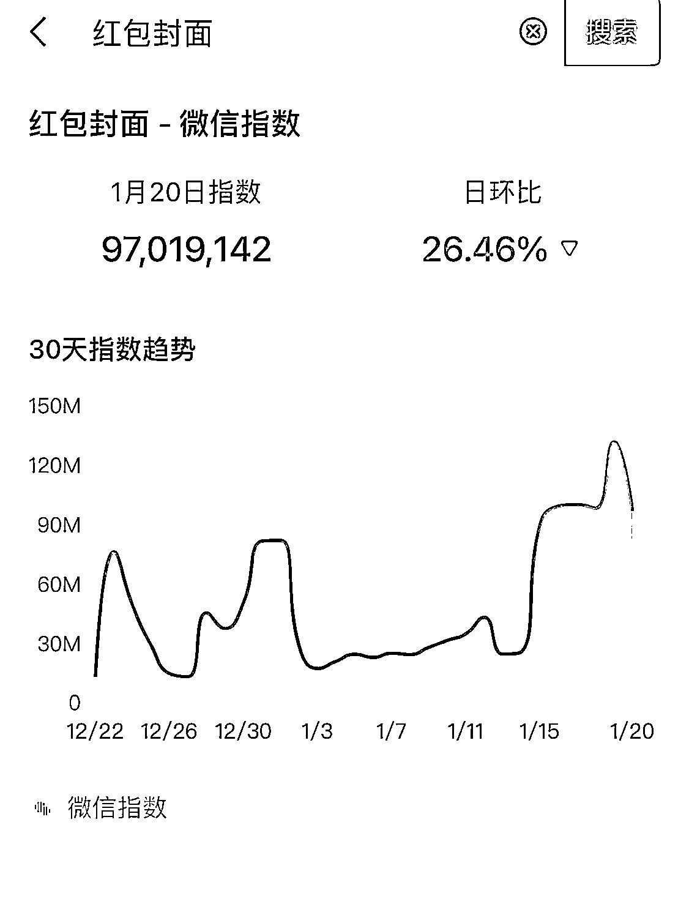

我是辰风。今天要讲一个特别“抠门”的引流玩法：靠公众号平台免费送的红包封面，我一天之内给私域加了500多个好友，一篇推文阅读量直接冲到1w+。

事情是这样：最近公众号平台向不少号主发放了免费红包封面额度，少的有6000，多的能到1.8万。而红包封面每一年都是爆款话题，涌进来的人一拨接一拨，微信指数也跟着一路飙升。

可惜的是，很多号主拿到封面就让它躺在后台睡大觉。要么不知道怎么过审，要么不知道发出去能做什么。但我当时就想，既然封面是白送的，拿来当鱼饵搞搞获客，或者刺激一下新关注，岂不是美滋滋？

于是我把验证过的一套标题和文案直接套上，用免费封面去撬动羊毛裙的流量。跑出来的数据相当能打：只要封面颜值不翻车，基本都能做到几千甚至上万曝光，再把这些曝光导到微信上，轻轻松松进账几百个好友。

流量到手之后，真正的变现路子也简单：收19块9卖红包封面项目，赚点小零花；开个红包封面小店，收割那些想买封面的人；再往后接一些副业兼职广告、课程广告，每一笔都是额外收入。

评论区里就有小伙伴问：“是不是只有订阅号才有这个？我的服务号怎么没有？” 我这里的答复是：个人公众号一般有，但也确实有一些号没有。