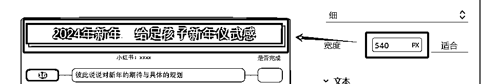
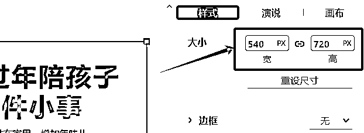
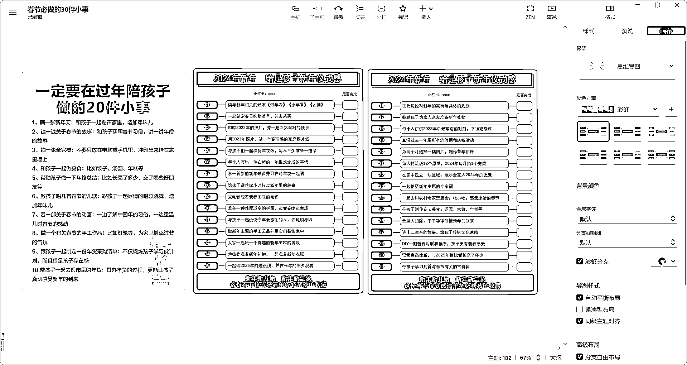
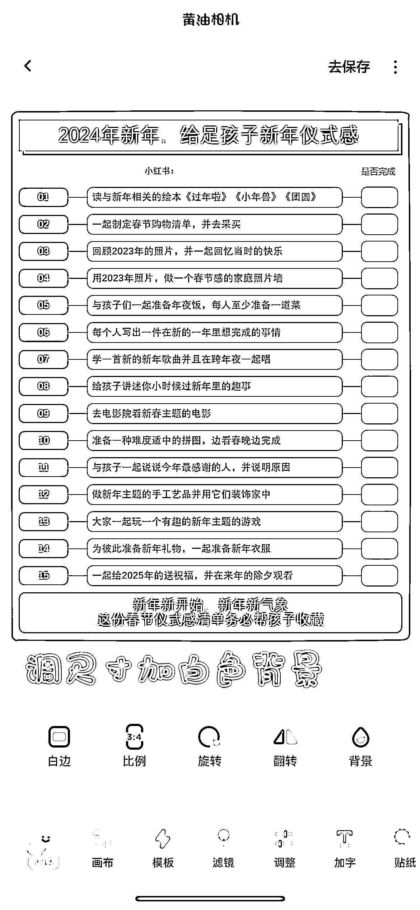
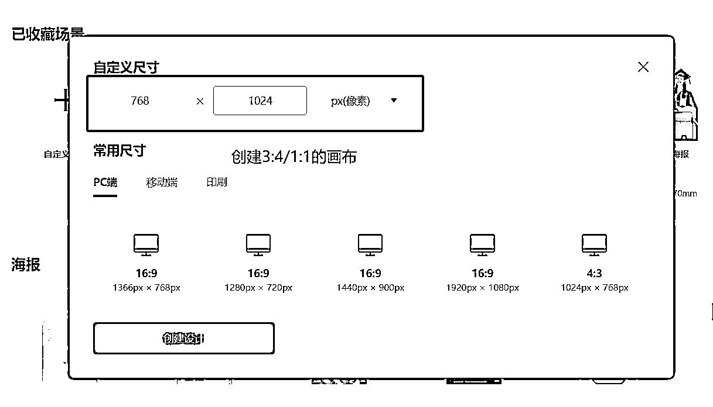
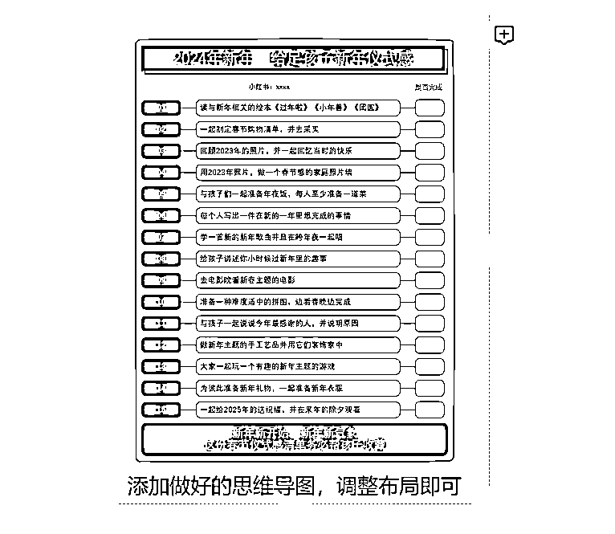

# 如何把思维导图运用到📕运营及社群破圈中

用竖版思维导图撬动📕流量和社群人脉：一场实战复盘

大家好呀，我是龙哥。做了4年全职妈妈后，我彻底觉醒了，给自己定下了一个小目标：7年攒够300万FIRE资金。

这次航海，我收获了两件特别开心的事：一是📕从被限流，到靠思维导图图文拿下600+赞藏；二是从社群里的小透明，到真正成交变现，还被高手认可、获得了曝光。

先交代下背景。上船时，我既是航海船员，也是📕运营的志愿者。但当时我的账号因为没遵守“三个一”被关小黑屋，折腾了整整两个月也没起色。后来我直接换了两张手机卡重新开始，结果如何谁也说不准，但我心里很清楚：干等不会有答案，不如跟着航海节奏不停发笔记去测试。

真正的转机，是我开始拆解爆款的时候。封面按“高手领航”里梨云老师的方法来做，内页改用竖版导图来呈现。这个过程里，我沉淀出3个很实用的经验：

**1. 先把图片比例定下来：1:1 还是 3:4**
这个不用纠结，要么沿用你自己一贯的图文风格，要么参考对标账号的配图尺寸。

**2. 在思维导图里放一张同尺寸的参考图**
这是罗卜老师在“高手领航”中分享过的：先在导图里加入一张同比例参考图，后续内容和布局怎么安排，一眼就能心里有数。特别提醒一句：为了保住手机端的阅读体验，竖版导图里最长的那条主题线（也就是标题区域），宽度尽量控制在 500～700px。

确定了宽度之后，把参考图的宽度也设为同一个数值。这样一来，你基本能预判一张导图该装多少内容，不会等全都做完才发现版式不对，只能无奈返工。

上面这张图，可以直观看出参考图与竖版导图的大小区别。

**3. 用外部工具补背景、调尺寸**
截图保存出来的竖版导图，很难天然就是 1:1 或 3:4。这时可以借助黄油相机、稿定设计等工具，给它加上背景并把尺寸处理到位。

- 黄油相机

- 创客贴

走完这三步，你就拥有了一组标准📕尺寸的竖版导图，也再不会因为图片大小不统一，让用户看得别扭。

那具体怎么反哺？我觉得“去中心化”是最聪明的打法，核心就一句：**人无我有，人有我优！**

竖屏思维导图在圈内还不算普及，罗卜老师为什么能被赚钱看到、被雪姨记住？靠的不正是竖屏思维导图吗。所以，我们不能只沉迷做图，更要学会破圈思路。比如，试着去拆解风向标、热门项目，整理成一张张思维导图后主动分享；也可以从方便别人转发的角度入手，把航海高手分享的回放拆成导图，发给有需要的人。

我就是沿着这个思路发出第一张图，很快拿下了第一笔成交。隔天又发第二张，被一位高手认可后转到了朋友圈，曝光一下子就来了。仅仅两张图，就足够让大家注意到我、记住我。接下来要做的，就是朝着正确的方向反复执行，用持续行动换一个确定性的结果。

最后想说，竖版导图目前还是相对小众，但正因为这样，我们反而能利用它的差异化特点，为每件事赋能。小熊老师在“高手领航”里也分享过：导图真的能贯穿我们的一生。

我是小梦，如今正在努力醒来的全职妈妈。如果哪里没说清楚，欢迎随时来和我互动交流～

#航海实战#

评论区：
有圈友看完后留言说，原本惆怅的脑子一下子有了灵感，还直夸我太棒了；我开心地回复：那可太好啦，一起龙哥盟。

