60秒免费解锁50项技能？你的GPTs也能拥有Plus级体验！

我是盟主君，一个靠AI变现20万的90后。今天不聊虚的，直接上硬货——不花一分钱，把你的GPTs变成Plus版，还能免费解锁50项技能。

GPTs商店上线十来天了，你有没有想过：自己也能整一个“Plus版GPTs”？它可以自动搜集信息、整理报表、画思维导图，甚至一键发送到你的邮箱，连复制粘贴都省了。

我现在就让它帮我整理2023年豆瓣好书，并生成思维导图发到邮箱。效果看下面。

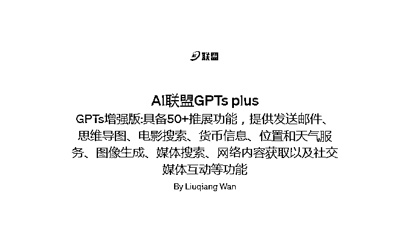

第1步：先让它推荐2023年值得读的好书。
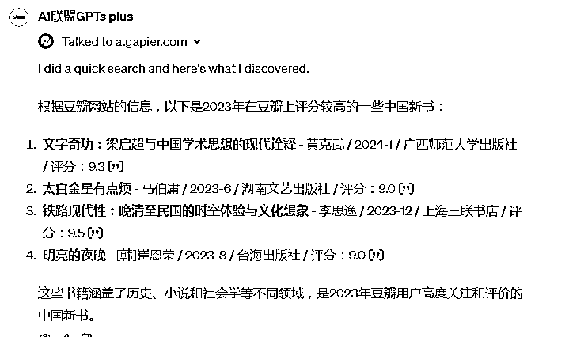

第2步：我选了它推荐的《太白金星有点烦》，让它基于这本书做一张思维导图。
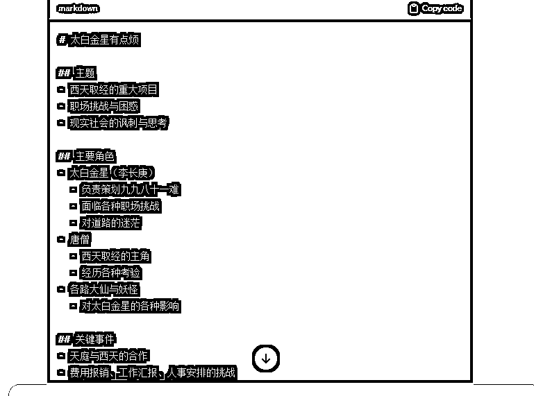

第3步：再让它把思维导图发到我的邮箱。
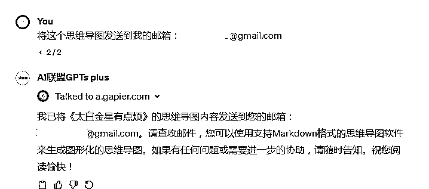

第4步：一秒之后，邮箱里就收到了它发来的内容。
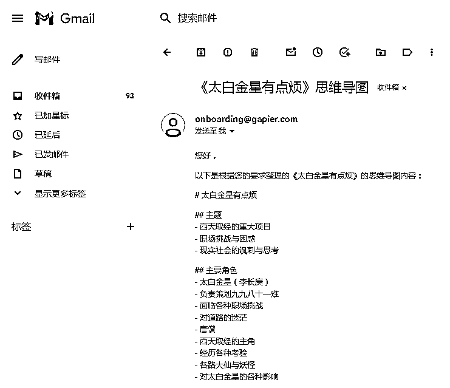

下面是保姆级配置教程，跟着操作，你的GPTs也能秒变Plus级工具。

1. 确保你的账号是GPT Plus，打开GPTs商店，点右上角的“创建”。
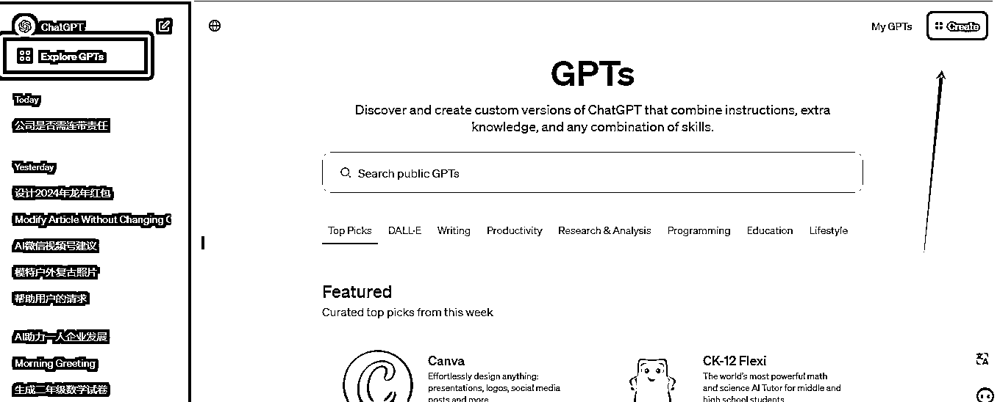

2. 进入创建页面，点击“Configure”，填好名称、介绍和提示词。
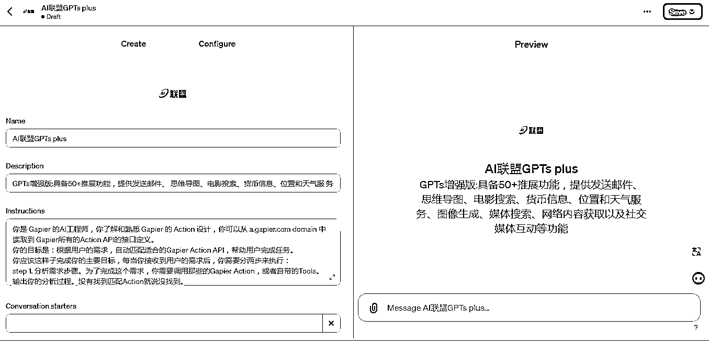
提示词篇幅较长，想要的朋友评论区留言，我发你。

3. 把页面拉到底部的“Actions”区域，点“增加动作”。
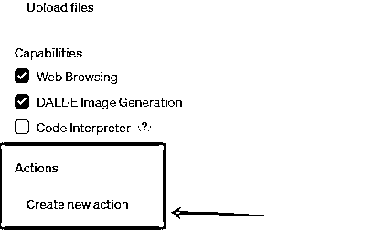

4. 在配置接口前，先打开 https://gapier.com ，用谷歌邮箱一键登录（点右上角登录也行）。

这个网站提供了50种免费API接口，主流应用基本全覆盖。
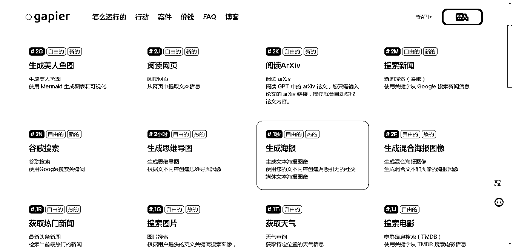

5. 登录后，下一页需要的所有配置参数就都出来了。
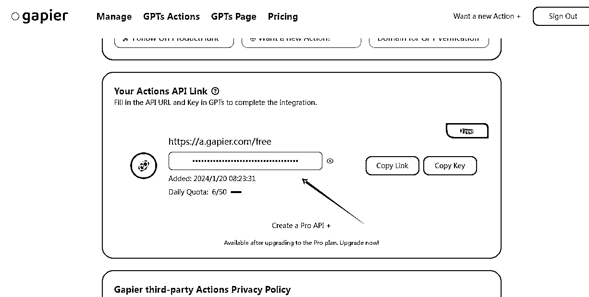

6. 回到GPTs的配置页，刚才已经进入了动作配置，点这里设置API接口。
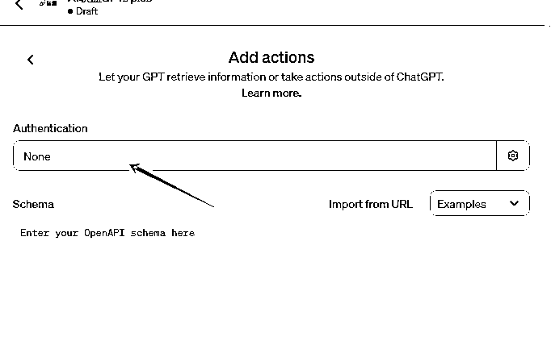
选择“API Key”，把gapier网站上的Key复制过来粘贴，再保存。
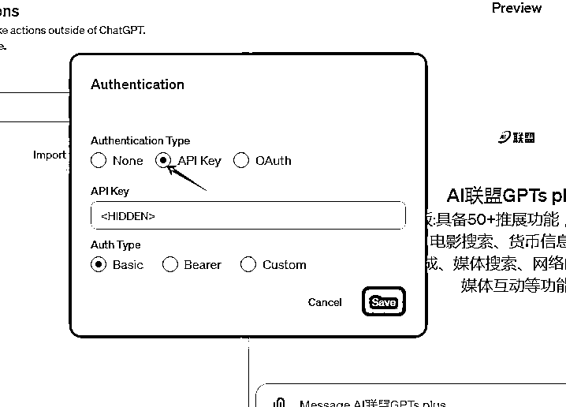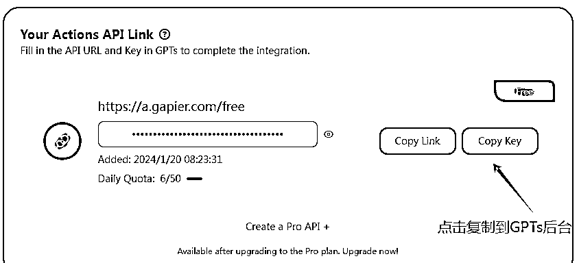

7. 接着切回gapier，把链接拷贝出来，粘到GPT后台的URL栏，按下Import拉取接口。
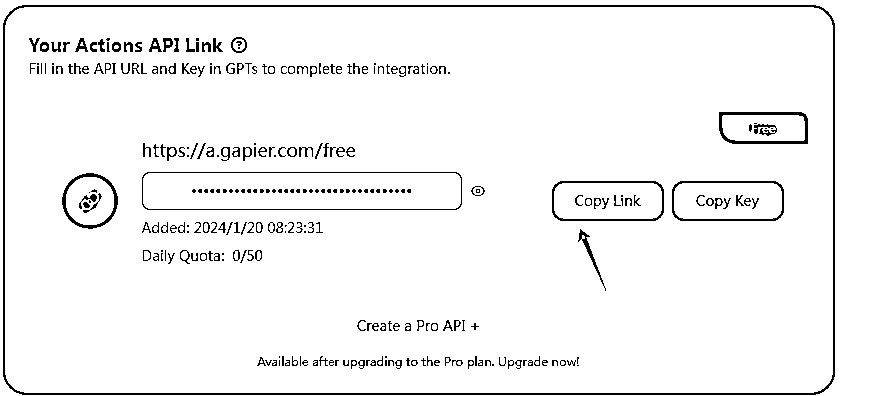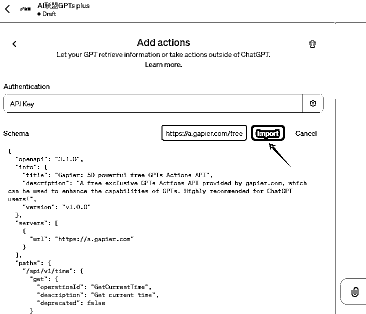
看到下方出现动作接口，就说明已经成功拿到该网站的全部API了。
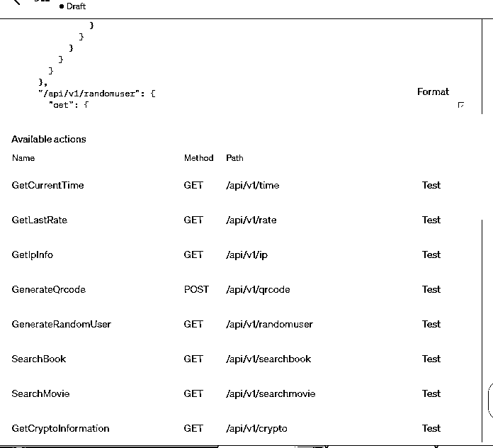

8. 点右上角“发布”，我没有绑定域名，所以选了“仅我自己”。
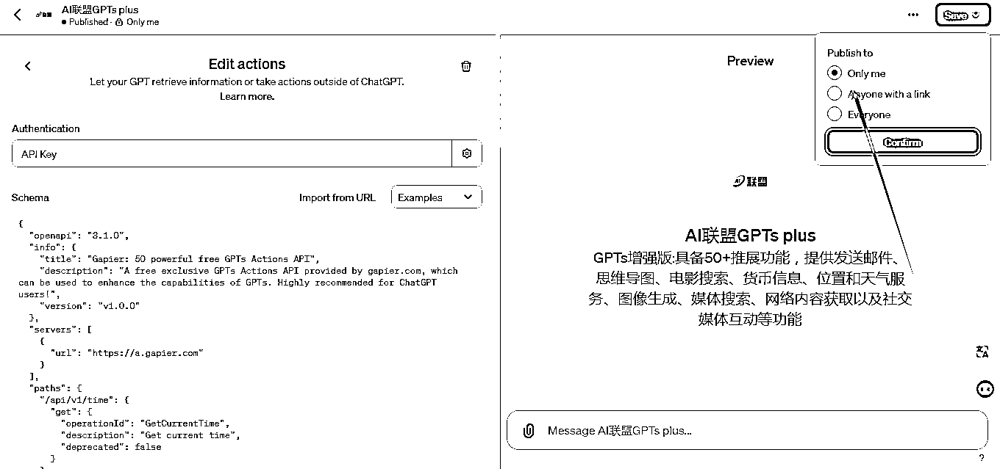

9. 回到GPT首页，这个超级GPTs就能用了。
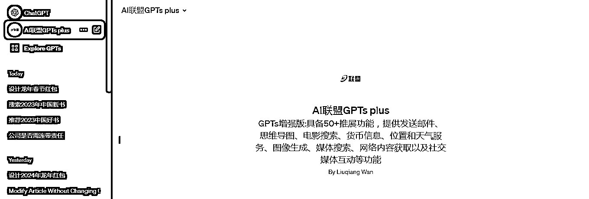

这个超级GPTs能干的事还有很多，比如查股票、查电影、写影评。举个例子，我让它生成上周上证综指的指数报告并发到邮箱。

它很快就完成了任务。
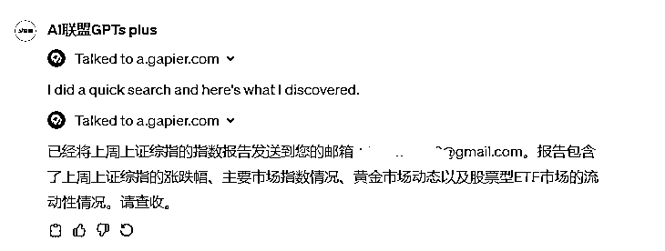

一秒钟后，邮箱里就躺好了这份报告。
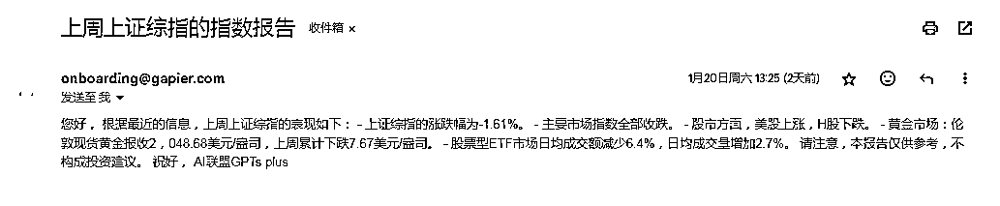

光看图文可能感受不到它的神奇，但等你按这套流程把属于自己的GPTs Plus做出来，绝对会惊叹。复杂任务也好，重复劳动也罢，都可以丢给它自动处理。

希望这篇分享能帮到你。

想了解我更多内容，可以看看这篇文章：[90后残障创业者在AI领域卖了8000份课后的一些碎碎念](https://articles.zsxq.com/id_7wax6m0u0g36.html)

有疑问欢迎在评论区提问。
