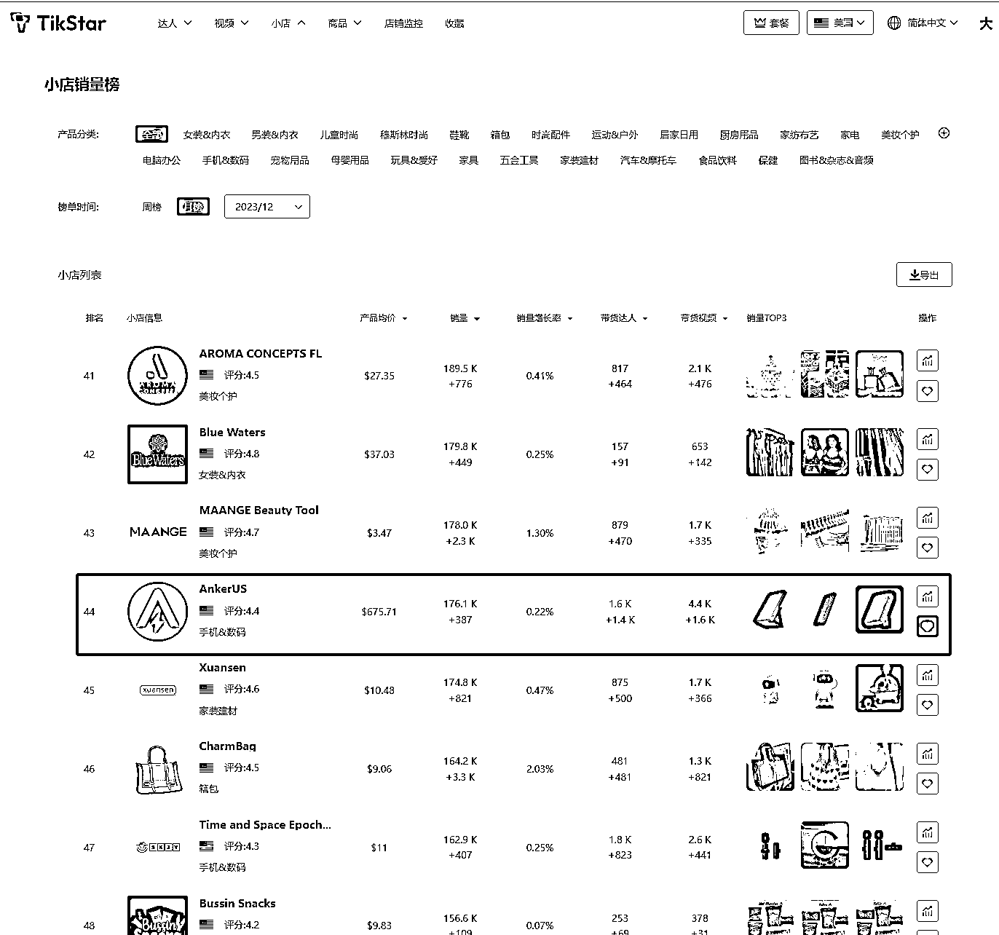
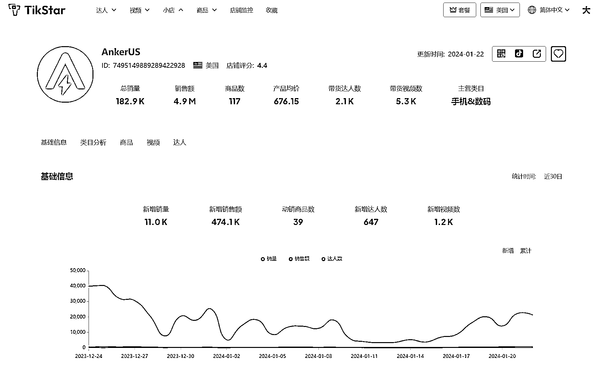

# 三个月撬动 500 万美金，TikTok 美区小店的红人战争正在白热化
作者：龙哥

最近 TikTok 美国小店的热度已经从风口变成主流战场。玩法框架跟国内类似，但竞争已经卷到以天为单位。借着 Anker 的实战路径，我们来拆解一下现在美区小店到底有多卷。

**Anker 12 月在小店销量榜坐稳第 44 名**，这次就以 Anker 的达人投放打法做拆解，文末我也会把达人实操方法论和 Anker 最新对接的 500 位达人联系方式一并放出。

**01 小店销量榜**

据 TikStar 统计口径，截至 2024 年 1 月 22 日，Anker 在 TikTok 美国小店的累计表现是：总销量 18.29 万单，总销售额约 490 万美金。在售 SKU 达 117 个，客单价 676.15 美金，参与带货的达人规模 2.1 千人，累计带货视频 5.3 千条。订单结构上，达人带货是绝对主力。

看最近 30 天的增量：
新增销量 1.1 万单，新增销售额 47.41 万美金，动销 SKU 39 个，新增合作达人 647 位，新增带货视频 1.2 千条。

Anker 的打法其实很直白：疯狂做达人 BD。一个月内新增将近 650 位达人，平均下来每天要聊 22 个新达人。
而美区整体 5 千粉以上的达人资源池大概有 13 万人，各家品牌都在抢人，优质垂类创作者早就被反复询价了。

内容发布遇到问题，完整版资料已转存飞书：

* * *

评论区：
冬日暖阳 : 怎么做呢

* * *