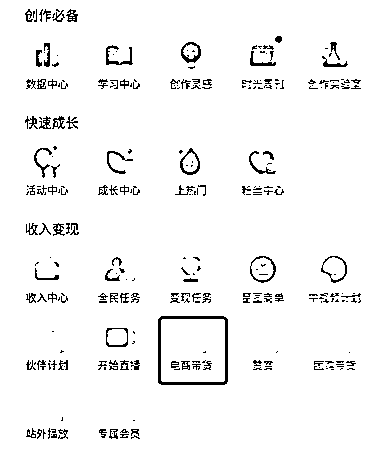
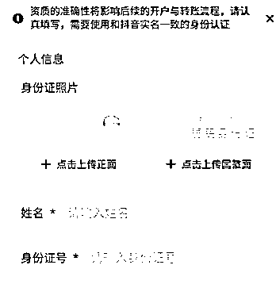
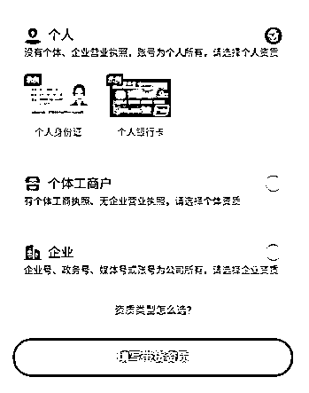
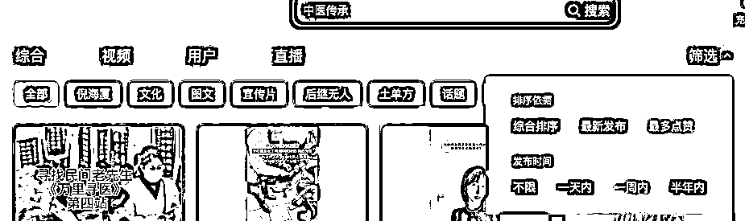
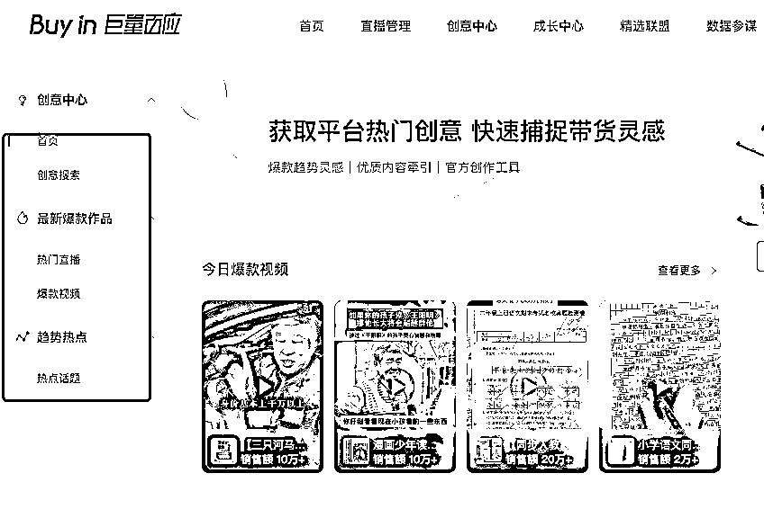
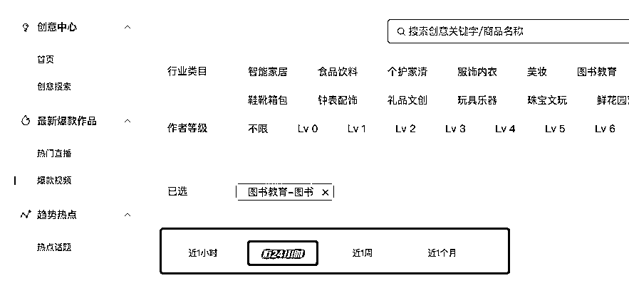
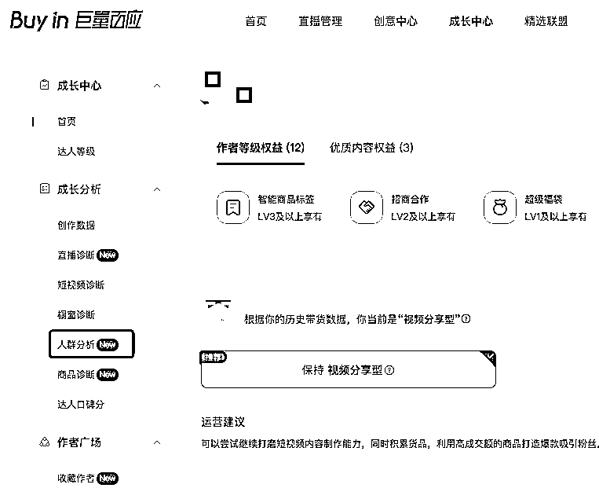
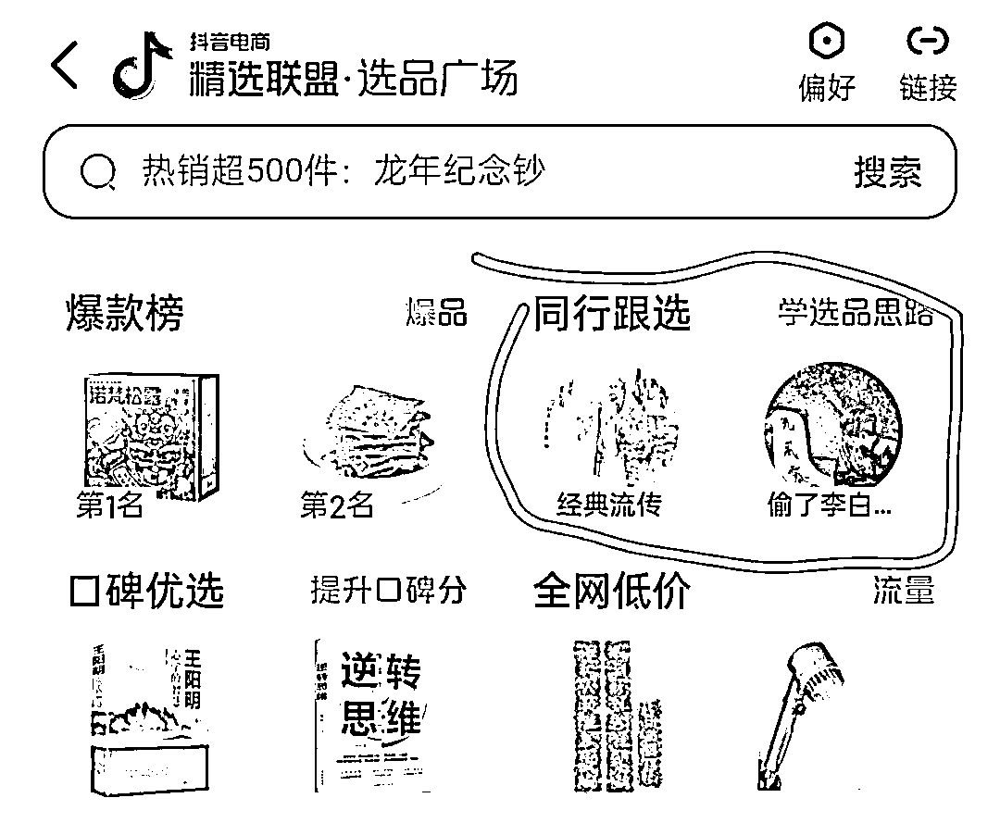

# 一年深耕银发带货，我的实操复盘与心得

## 做了一年中老年带货，我的一些思考与总结

作者： 小马哥 xy50

日期：2024-01-22

大家好，我是小马哥。

从去年起我就开始专攻中老年短视频带货赛道，这个方向也常被叫做中老年养生带货、银发养生带货。

本质上就是三件事：人群、货品、变现方式。锁定中老年人群体，以养生品类为主，用短视频带货去完成成交。

这三点构成了整个项目的底层逻辑：围绕中老年人群体的养生需求做内容，做短视频带货。

起步阶段主要在抖音跑，后续视频号也火起来了，两个平台的核心受众都高度重合在中老年。

不过实操下来会发现，两者的偏好仍有差别。比如我们现在以图书为主，这个品类更偏中年人购买，因为他们觉得养生还来得及，想学点中医、养生相关的知识；老年人则需求更细分，要看账号调性来匹配相应的商品去推。

整个项目的运转逻辑很清晰：先用内容把中老年人吸进来，再持续做带货，循环滚动。

整体跑通分这几步：起号并开通橱窗，发布带货视频并成交，持续输出能吸来中老年的内容。

表面看很简单，细化后就涉及：起号与流量获取、带货权限开通、持续挖掘可复用的内容模板，也就是流量内容和带货内容要分开看、测品、持续选品。

总之带货项目就是不断测品，不断上新的带货视频和流量视频。

**橱窗开通准备**

做中老年养生带货前期要先备好什么：

抖音这边：

1、准备2-5个手机号，注册2-5个抖音号。前期可以不实名，现在0粉也能开橱窗，但只能引导橱窗下单，转化很差。建议先注册不实名，达到千粉后再实名开通橱窗。

2、橱窗需要千粉，涨粉既可以通过内容自然涨，也可以借助一些增粉手段。

内容涨粉要找优质对标内容去模仿；借助手段就是各种涨粉渠道，有免费也有付费，看自身情况选择。

3、达到千粉后开通橱窗带货功能：

操作路径：抖音我的页面-右上角三横-抖音创作者中心-账号数据下方全部打开-变现里的电商带货

点进去按提示操作，会要求绑定银行卡、实名等。绑定银行卡、支付宝、微信是为了后期结算打款，实名是账号与身份证绑定，便于收款匹配。

开通带货身份可按自身情况选个人、个体或企业，每个身份背后的财税逻辑不同，企业走对公，个体走对私。

账号的包装比如名字、头像、简介，可以先参考同行，后期再调。不是最关键的环节，前期更侧重营销内容，也就是广告感，比如头像、简介、封面可以弱化处理。

视频号：

视频号在账号体系上比抖音复杂一些。

首先要有微信号，微信号本身需要养号，对账号、网络环境、手机号都有要求。

手机号可以自己去不同运营商办理，尽量把套餐额度降下来；也可以办主副卡，但副卡仍占用实名名额，只是缴费走主卡。不要注册来路不明的卡，最好走正规渠道。

视频号的第一步是有微信号，通过微信号开通视频号，实名后开通橱窗。政策变动快。

之前一个人可开5个视频号5个橱窗，现在只能2个，而且视频号需要千粉或小店账号才行。用小店开通橱窗后，最近要选身份，是达人身份还是小店账号，以及店铺授权号。

店铺授权号只能卖店铺里的货，所以一步步来，最好用达人身份开通。

# 起号：我们当时是怎么起来的

从去年开始做中老年短视频带货，正好赶上风口，去年下半年大家对健康都很关注，尤其是中老年人，对这块特别敏感，同时中医西医的争论也在发酵。所以我们就这样起盘了。

在抖音、各大平台搜中医传承等关键词，看近期点赞量、互动量高的内容，下载素材后模仿剪辑。

去年混剪还能玩，而且大多数人都在做混剪。混剪关键是去重，靠剪映滤镜和一些参数调整来实现。

跟着同行剪，他们怎么剪我们怎么剪，剪完流量ok的话基本都能上十万播放，我自己最高80万，怕影响账号就隐藏删除了。

当时就是找近期有热度的话题内容、存在争议的内容来起号。

现在看，这类内容偏泛了，而且尺度把握不好容易封号，很多人反馈都是这个问题。

那现在怎么找内容模仿起号？

1、延续老方法，去找同类内容，挑复制性高、风险低的。风险低就是别提功效。

关键词：中医传承、传承文化。这类词日常要收集，还要不断拓词，看同行带的话题，看SEO相关内容里围绕这类话题词的内容。总之要持续整理汇总，慢慢聚焦到一个点。

2、抖音创作者平台[`creator.douyin.com/creator-micro/home`](https://creator.douyin.com/creator-micro/home)

猜你喜欢里的内容很有参考价值。

3、刷父母的账号，他们常看的内容就是创意来源，很多内容很简单但天然能吸引中老年互动。

起号目的就是把账号人群定下来，有人看、有互动、有关注，持续涨粉到千粉再带货。

起号内容最好和后期要卖的品结合起来，比如要做中医，就做中医相关起号内容；要做健身就做健身相关的。总之中老年养生带货品类很多，书籍、百货、食品都可以。

选定人群，做对应内容，带对应品。

看品看内容可以参考抖音商品橱窗里的创意中心，既能选品也能找内容对标。

起号只是开始，千粉后是为了给账号打下前期内容基础，让推流更精准。如果刚开始，起号也能帮你建立内容感知，锻炼找同行内容、找人群内容、提升剪辑能力。

# 流量内容与带货内容

起号一般用流量内容来做，带货则要用带货内容来做。第一次听可能有点懵。

我解释下区别，从字面看就是内容目的不同，是为了拉流量还是为了变现，这是本质区别。

内容分清了，找内容时就能判断一条内容是干嘛的。比如巨量百应创意素材里的内容基本都是带货内容。

再说下两者关系，流量内容可以单独做，也可以和带货内容结合。比如我们经常刷到剧情里插广告，这就是流量+带货的结合。

先用流量把人吸住，后面突然广告。还有一种本身是广告但用流量形式包装，比如访谈类。

玩法很多，可以先从基础做起，把内容按目的拆解再借鉴。

流量内容剪辑时看观点、冲突性、对用户的实用性。点赞评论收藏是用户反馈。争议性内容评论区多，有用性内容点赞收藏多。

所以找内容可以根据这个来判断能不能模仿。

带货内容有结构，需要不断模仿。比如书可以直接硬推，也可以用讲故事的方式讲书里内容，增加停留再接入带货。

最高级的内容是有IP背书的内容，这种内容既能做流量也能做带货。

好的产品就是有内容的产品，这个内容就是有IP加持。

比如《额尔古纳河》，很多人吐槽不好看，但董宇辉一讲就成了，讲解本身就是对书的加持。

所以很多人借名人来推书、推好物，逻辑就在这里，天生有内容高度，比自己写强，因为有背书加持。

下面说下怎么拆解内容来快速提升感知。

# 内容拆解方法

前面说了流量内容和带货内容，无论做电商带货还是其他短视频，核心逻辑都是用内容撬动平台流量。

内容难，但对群体喜好了解后，用内容撬动流量就容易。作为普通人，深耕内容是撬动平台、获得收益的关键。

怎么拆解内容？拿简单的流量视频来说，很容易。

把视频画面、文字、文案标题、音乐拆开，想拆更细可以加上评论区和账号整体方向。

拆解时不一定手写，关键用脑。看到一个画面就能明白剪辑思路，需要什么素材，素材怎么衔接，视频核心点在哪，一层层分析。

分析前要会剪辑，会剪辑才能仿出来。

刚开始模仿就把视频下载本地，用剪映打开，分离视频音频，对镜头拆分。现在有智能镜头分割，但初期手动拆更有效。

然后调整内容，比如背景、画中画等。把视频拖进剪映拆解的目的是复刻新视频，同时要考虑去重。不能一比一模仿，要在部分改动上重新生成。

模仿+改造，调文字、片段元素等。

用模仿练剪辑，用改造练素材收集，用剪映提升改造能力。

同行就是老师，用他们的素材学习，形成自己的视频再去测试。

流量视频核心看内容本身，带货视频核心看流量内容和带货内容的衔接，文字衔接、视频衔接等。

就是不断模仿+改造，同时多刷抖音锻炼内容感知。刷到一些内容一眼就能判断能不能模仿，刷的时候就在想哪些能借用，怎么调整成自己的。

这就是在拆解中学习。

也可以拆更细，有表格把视频架构拆出来，比如第几秒做什么，目的什么，尤其是剧情类，把镜头语言、文字、产品一一对应。

对我们来说太细上手难，但简单拆还是可以的，比如这个视频几个镜头，有没有画中画，怎么做的，我要做怎么做，这样思考。

量上去了，自然知道怎么剪，剪辑背后才会有自己的想法，于是开始做自己的作品。

我现在一般先写脚本，再匹配素材剪辑。

平时多看优质视频，尤其是手作类，他们衔接常用自然物或动物做过渡，也就是空镜头。国外的视频也有类似手法。

优秀作品很多也是混剪，衔接怎么做就是要学的。

# 选品，变现核心

前面说了内容拆解，掌握内容后就要按人群需求选品。

选品方法很多，简单说几种：

1、看巨量百应，先了解自己要做的方向，近期爆的是什么品，比如过年，过年类就是一个方向。

2、刷抖音，用推荐算法找感兴趣内容，前提是先把号刷成对应兴趣方向，很简单，多搜关键词，最好用小号。一方面了解内容，一方面能看到品。

3、看同行直播间，同行在卖什么可以借鉴。接触久了就能按兴趣筛选。

4、看手机端电商橱窗里的选品广场推荐，以及同行选品。

这只是部分。总体就是大量看后台数据、大量刷视频看近期品、看优秀同行数据。

从去年到现在，我每天都在看巨量百应创意，不断学习内容和产品。

下载优秀同行创意，看他们怎么把流量内容和产品融合。总之学得多，内容掌握就快。

推荐个下载技巧：懂网页代码可以直接F12找到链接下载；不懂可以装猫爪这类插件。

前面提到流量内容和变现内容的区别，你中有我我中有你，多看巨量创意就会发现这点。

总之每天工作就是：选品-剪辑-发作品，另外还要找商家沟通佣金政策、要素材、要样品。

要经常联系商家，敢要样品，敢要政策。

选到品，有同行内容参考，跟着学、拍摄、剪辑、发布。

人群可以参考创作者中心数据中心[`creator.douyin.com/creator-micro/home`](https://creator.douyin.com/creator-micro/home)

手机端：我-三横-抖音创作者中心-账号数据详情-粉丝数据

巨量百应的数据更准，有带货人群参考。

最近手机端选品广场有同行跟选，既能发现同行看其内容，也能看其品，还能看到品对应的内容怎么做。

总之算法之下，同行无处遁形。

# 中老年账号方向分享

前面说了做中老年带货账号，一开始我们做中老年养生需求，做中医类书籍、养生汤包，后来演变出一部分做fs、地理、相术类书籍。

发展过程中发现比较稳的方向：

1、纯中医类书籍，每天分享推荐书籍

2、古中医类书籍，这类需要引流到抖音成交，类似虚拟资源。分享老版本书籍或PDF资源

3、中老年健身，每天分享健身动作，比如肩颈、手部等部位

4、偏隐晦的中医小知识

更衍生的话，围绕某个点都能做，尤其是兴趣类更广。

不过中医类受限较多，尽量做稳健业务。

现在带货还有一种玩法，做私域，帮商家引流到私域按CPS结算。

可以用短视频或直播操作，流量精准就能起盘。

卖书送课程就是这个逻辑。有些商家把书价压得很低，分佣50%，你要看他有没有夹带引流卡片。商家赚钱不一定靠分佣差价，后端高客单才是核心。

如果你想做一个方向，这是个好路子，用短视频引流沉淀一层，再引到私域做二次沉淀。

围绕中医方向还有很多，比如做高端文化账号，类似彭南科，把中药方制作过程用视频呈现，不刻意强调药效。

或者做草木类内容，抖音常有一句话：多识草木，少看人心。这类账号就讲草木。

还有就是拿一个品去做，比如艾草相关产品。总之方向很多，接触深入融合深入，基本都有垂类。

围绕一个垂类反复做，抖音适合垂类，越垂人群越精准，转化越高。

至于形式是口播还是混剪，后期看要不要做IP，就需要了解口播拍摄、布景、打灯等。

都是由浅入深的过程，越专业越不能丢掉最初吸引人的东西，也就是账号基调。

其他相关内容：

[2023 年短视频带货：做带货就是专注于自己，做好自己的事情](https://articles.zsxq.com/id_gijfim1toux9.html)

[视频号直播带货需千粉，汇总一些目前的解决方案](https://wx.zsxq.com/dweb2/index/topic_detail/811458224411812)

[巨量百应类的操作细节](https://wx.zsxq.com/dweb2/index/topic_detail/814445425244522)

* * *

评论区：

暂无评论

* * *