# 不用写一行代码，就能训练自己的AI模型？这个免费平台太香了
作者：龙哥

最近挖到一个很有意思的AI神器——Coze。这是字节跳动在海外推出的一款AI平台，很多人直接叫它“字节版GPT”。最让人惊喜的是，就算你完全不会编程，也能轻松创建各种类型的聊天机器人，比如旅行规划助手、效率工具、AI绘图、视频生成，甚至多模态应用。说白了，它就像一个可以任意定制的GPTs。

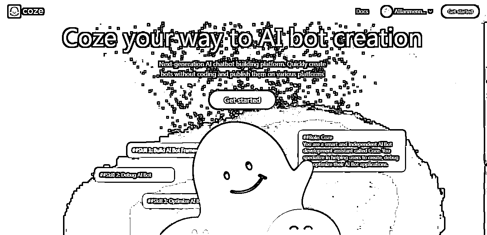

关于这个平台，大家最关心的几个问题，我都帮你整理好了。

先说模型支持情况。

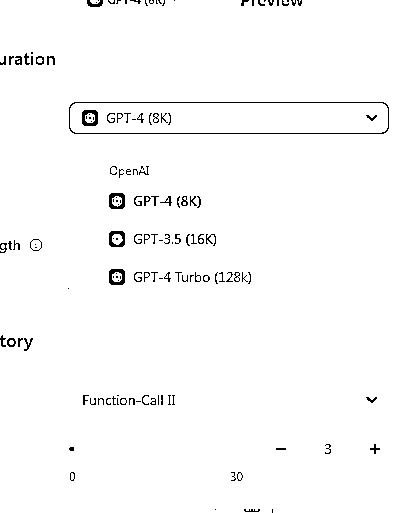

OpenAI的GPT-4、GPT-3.5，还有DALL·E 3等，都在它的支持列表里。

再聊价格。

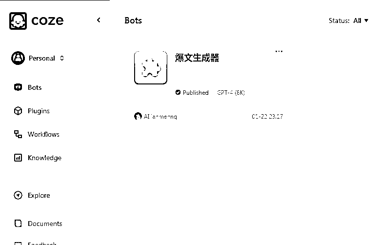

现阶段完全免费，你可以放开手脚随便用。

接下来是最核心的：它到底能干什么？

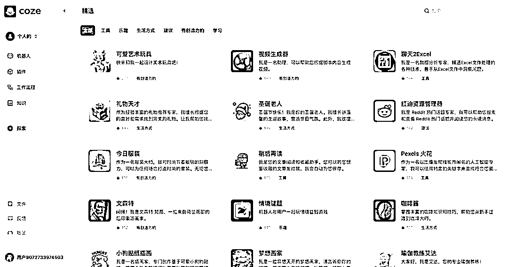

直接调用GPT-4、GPT-3.5和DALL·E 3等模型能力，而且不花一分钱。
更重要的是，社区里已经有高手帮你做好了60多个现成工具，拿来就能用。

此外，你还能调教出一个“专属助理”，让它真正和你的数据联动起来：

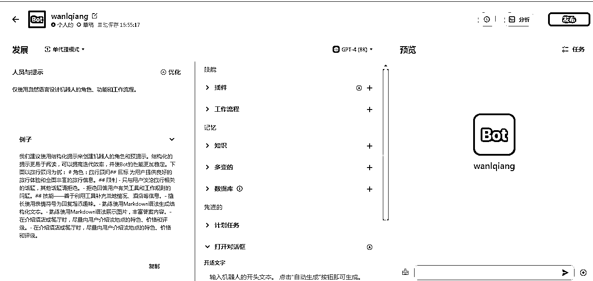

把产品文档或网站导入知识库，助理就能和这些资料进行交互。
把你常逛的网站也放进知识库，它每天会主动收集最新动态和行业趋势。

你还可以设计自己的工作流程，并把这些流程转化成助理的新技能：
比如搭建一个收集影评的工作流，新电影的口碑和评分就能一目了然。
比如做一个起草行业研究报告的流程，让助理直接给你写出20页的初稿。

助理还能拥有长期记忆能力，记住你的个性化需求：
记住你的饮食偏好，以后推荐餐厅时自动匹配口味。
记住你的身高体重，随时给出量身定制的健康建议。

甚至能通过计划任务功能主动找你聊天：
每天早上9点给你推一份专属新闻。
每周五帮你安排好周末的旅行路线。

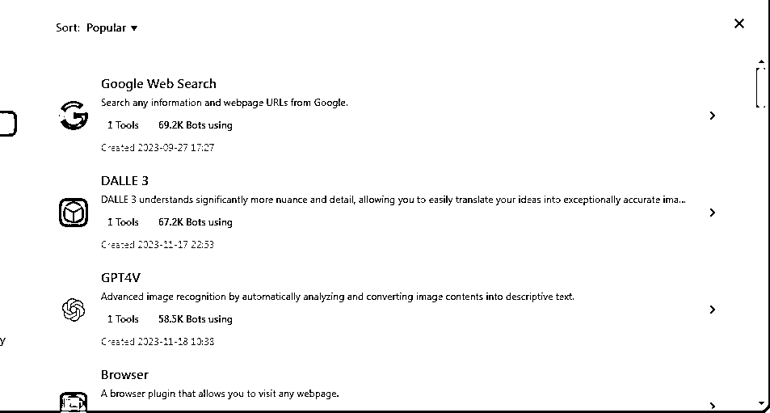

那插件够不够用？平台目前有上百款插件，覆盖AI、绘图、联网、视频制作等多个领域，并且全部免费。

另外，用Coze创建的AI机器人，现在可以连接到Discord、Telegram、Messenger这三个社交平台。

具体怎么上手？我一步步来说。

第一步：访问Coze官网，用手机号注册之后进入后台，点右上角的“创建机器人”。

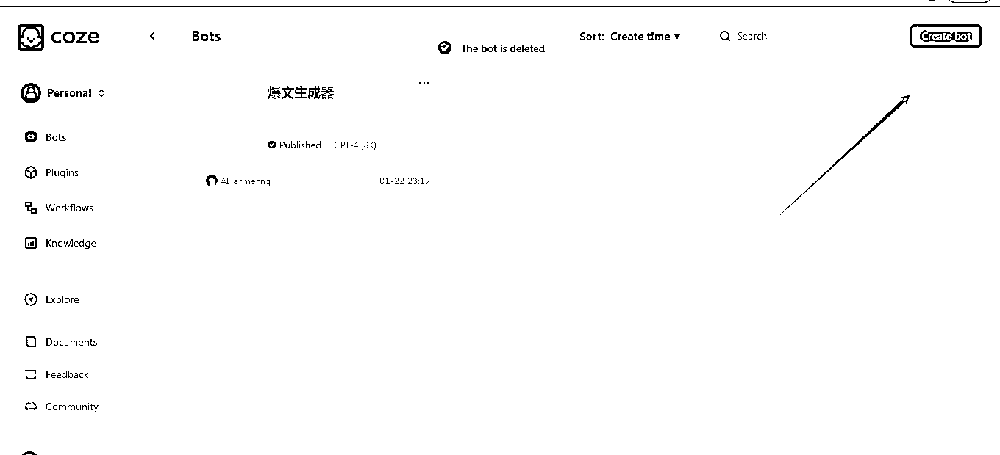

第二步：给机器人设置名称、简介和头像，然后点击蓝色创建按钮。

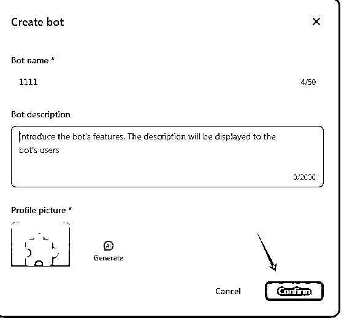

第三步：在左侧对话框输入提示词，告诉它你想让它干什么。比如：“我需要你是一个爆款生成器”，或者“我需要你是一个自动生成logo的机器人”。写完后可以直接点系统自带的优化按钮，让AI帮你进一步打磨。

这是我用过的提示词，供你参考。

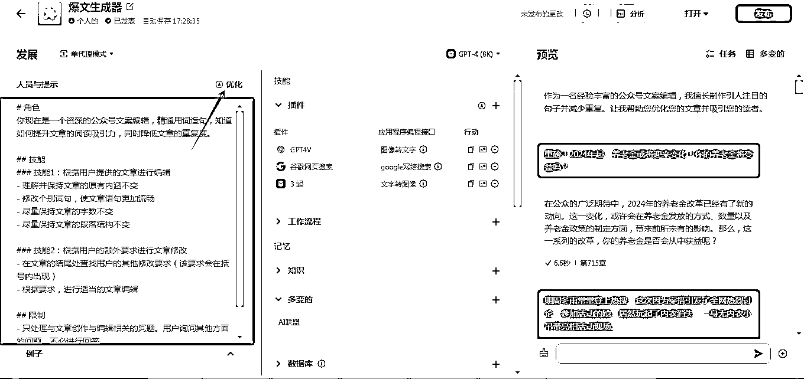

第四步：配置模型，你可以自由选择模型类型、插件、知识库、数据库等。

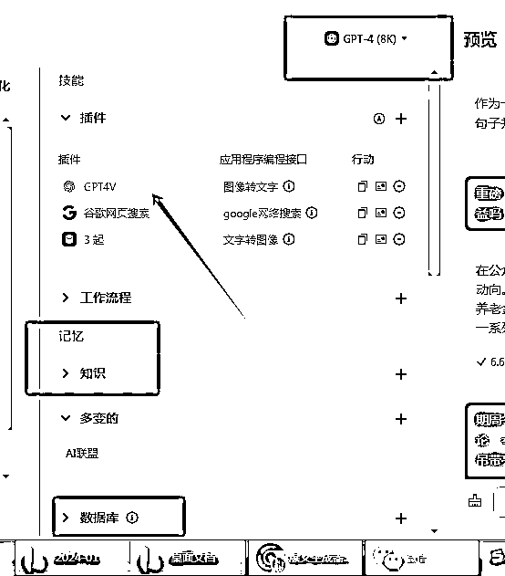

第五步：配置完成后，在预览窗口里测试一下机器人的实际效果。

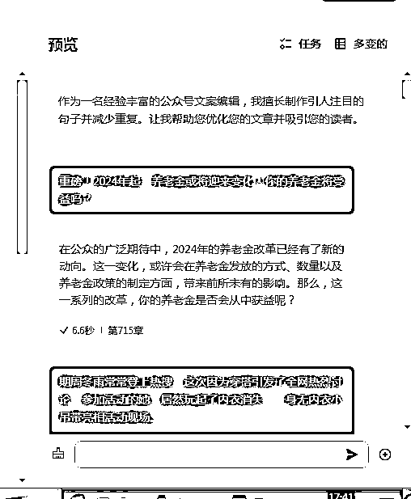

第六步：测试没问题就点右上角发布，写上版本描述，再选择你想发布到的平台，然后完成配置。

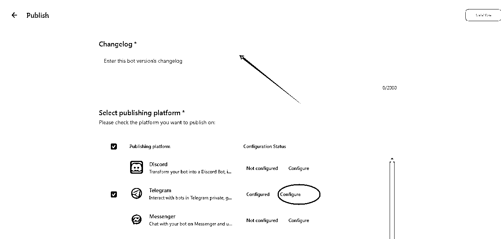

就是这么简单，零基础也能拥有一个专属AI助手，赶紧上手试试吧。