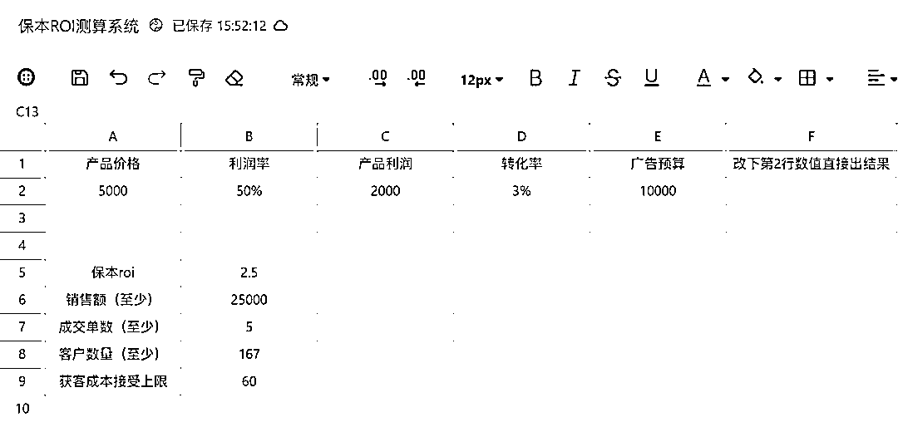
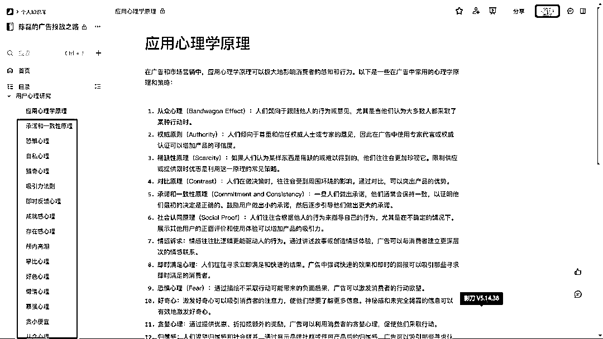

# 把广告投放从瞎忙活变成可复制的优化体系

有问题并不可怕，可怕的是你根本不知道问题出在哪。

很多老板在投放，花钱耗着，却看不懂数据、说不清下一步该动哪里，脑子里没有一套清晰的优化框架。今天这篇就是给你一套底层的方法论，让你能站得住脚去做调整决策。

如果你现在调账户总觉得没方向，通读一遍，应该能帮你理清测试的思路。

整套方法论围绕六个模块展开，相互配合：

ROI 测算，摸清盈亏底线
超级转化率，精准定位卡点
AB 测试，用实验解决问题
值与不值，做出取舍判断
关键指标，为前三板斧提供数据支撑
行为心理学，给投放加码

其中超级转化率、AB 测试、值与不值是最高频使用的核心三板斧。ROI 测算、关键指标、行为心理学则是辅助支撑，三者协同作战。

**1、ROI 测算：先算清能亏到什么程度**

知己知彼，才能放大。投放的终极目标是雪球越滚越大，最难的是让雪球先成团。投产打正后，放大投入、持续循环即可。

对大多数人而言，走通投放第一步才是最关键的，但市面上几乎没人系统教这个。

陈磊邀请你共同编辑表格《保本 ROI 测算系统》

[`www.yuque.com/g/chenlei-aycaj/vn5sne/fxedx3uekbgsa9xl/collaborator/join?token=Vgli3D1WgqfwrmC6&source=doc_collaborator#`](https://www.yuque.com/g/chenlei-aycaj/vn5sne/fxedx3uekbgsa9xl/collaborator/join?source=doc_collaborator&token=Vgli3D1WgqfwrmC6)

在表格里填入你的真实数据，系统会自动算出保本 ROI，这就是你的及格线。高于这条线赚钱，低于这条线亏钱。没有底线谈优化，都是空谈。

**2、超级转化率：把漏斗拆开找卡点**

超级转化率的逻辑是：曝光→点击→私信→转化，每往下走一层用户都大量流失。转化链路越长，累计流失越严重。所以提升有两条路：缩短路径，或者提升每一层的留存。

公式表达为：超级转化率 = 转化率1 × 转化率2 × 转化率3 × ……

在一条完整的链路上，把层级拆得越细，优化点越清晰。超级转化率越高，整体效果越好。

举例：超级转化率 = 点击率 × 私信率 × 加粉率

用超级转化率就能快速锁定问题环节，找到问题再对症处理。

这里要理解“系统之美”。从曝光到转化，既可以拆开优化每个节点，也是一个整体，牵一发而动全身。广告优化既要分拆找问题，也要合并看全局。

**3、AB 测试：用实验消灭不确定性**

AB 测试是行之有效的实践工具，使用时要满足两点：测试对象明确，其他变量保持不变。

比如客户反馈质量不行，排查后怀疑是插件描述的问题。那就只改话术这一处，给 100 多个流量做验证。结果好，就说明方向对；结果不好，就排除掉这个因子。

无论结果如何，都要记录沉淀到团队里，好是经验，不好也是经验。

规则即道。平台已经明确写死的规则，别硬刚，成本太高。AB 测试测的就是未知，让未知变已知，这就是经验的积累。

做测试时，测试对象越细，结论就越有价值。细节决定成败。

**4、值与不值：用价值判断代替感觉**

这既是一种价值观，也是一种决策标准。投放里很多操作不可逆，犹豫就会错过窗口。

比如一条计划跑量不错，但你觉得转化率偏低。动它，可能更好，也可能直接崩掉；不动它，现状能接受，但天花板也锁死了。

值与不值的用法是：先尽可能多收集数据来支撑判断。当计划确实到了必须调整的临界点，就果断出手。算一笔账，动的收益和不动的收益哪个更大，就选哪个。

广告投放的一切抉择，都可以用这个框架理性判断。别用“我觉得”去脑补，用数据去佐证。数据会比感觉更靠谱，即便有偏差也不会偏离太多。

没有绝对的对错，但要避免做错一次关键决策。

再举一个真实场景：你投了 1 万，流量质量还可以，成本也不差，但项目转化周期长，手里只剩 2 万预算，继续投还是停投？

投了，会有资金压力，但能持续拿量提升出单概率；不投，压力缓解，可以等回款再上，心理更稳，但暂停后重启可能再买不到之前的成本和质量。温馨提示：跑得好的计划要一直保持运转，暂停、控预算、改结构都会伤势能。

用值与不值的视角去看，你会怎么选？这是两个我真实遇到过的案例，没有标准答案，唯一的决策方法论就是值与不值。值，就对。

**5、关键指标：给优化配上望远镜**

你必须清楚转化链路里每个指标的意义和影响因素，再配合超级转化率、AB 测试、值与不值来用。

以知乎外链引流加粉为例，链路是：
曝光→点击→插件曝光→插件点击→落地页曝光→长按识别→加粉成功

每个节点都是关键指标，整体是一个相互影响的系统，又可以拆开单独看。

超级转化率 = 点击率 × 插件曝光率 × 插件点击率 × 落地页曝光率 × 长按率 × 加粉率

其中：
点击率 = 点击量 / 曝光量
插件曝光率 = 插件曝光量 / 点击量
插件点击率 = 插件点击量 / 插件曝光量
落地页曝光率 = 落地页曝光量 / 插件点击量
长按率 = 长按识别量 / 落地页曝光量
加粉率 = 加粉成功量 / 长按识别量

只要任一环节数值偏低，整体就会被拖累。优化就是找这些细节。

比如点击率低，可以拆两条线看：

影响曝光量的因素：
投放先要量，有量才有优化空间。量主要来自 ECPM。
如果你用 OCPC/OCPM，就要看 ECPM = 预估点击率 × 预估转化率 × 出价。
平台会把流量给综合得分最高的人。出价高、点击率高、转化率高，量就越多。
预算不足也会导致系统不给量，这是正常现象。

影响点击量的因素：
标题是知乎筛选流量的第一道门槛，也是权重最大的因素。
封面，有没有图、图是否抓眼，都影响点击意愿。
描述，第一句话要精准圈人、有吸引力，知乎描述是外显的，不点开就能看到。

要考虑标题、封面能否承接定向，能抓多少量，定向与内容是否垂直。调账户最难的不是怎么改，而是先找到改的方向。方向对了，AB 测试就能快速验证。

所有关键指标都有可拆分的影响因子，把它们可视化，亲自预览几遍广告，底层逻辑就清晰了。这套打法可以复制到抖音、📕、百度等任何媒体和链路。

**6、行为心理学：让内容会说话**

外行看热闹，内行看门道。一个广告里用了多少心理学技巧，决定了它是让人上头还是平平无奇。

正所谓套路得人心，在创意制作时融入行为心理学，能显著提升转化。

我用红框标出的这些点，字面意思很好懂。去拆解同行的爆款广告，你会发现应用了多少，再对照自己能用多少。

使用时要结合实际场景，拿捏好度，点到为止，起到画龙点睛的效果。

推荐阅读，相辅相成。

[广告投放避坑指南 100 条（适用于抖音、📕、知乎，百度等各媒体）](https://articles.zsxq.com/id_ol4ica1pm4j2.html)

* * *

评论区：

拱卒 : [强]

陈磊 : 感谢认可

冬日暖阳 : 这边是做巨量投放广告吗

陈磊 : 有做

冬日暖阳 : 我这边也是做这个的

* * *