# 38岁，普通人的我，靠轻创业赚到人生第一个20万（长篇干货）

大家好，我是菜菜。在互联网内容营销这行摸爬滚打了13年，目前是人人都是产品经理的专栏作家，也是三节课的特邀讲师。我现在专注用ChatGPT做营销内容，帮有卖货需求的企业和个人，在公众号、小红书、短视频、朋友圈这些平台上高效地宣传产品、引流成交。我的三节课学员已经超过5000人，同时也是生财有术ChatGPT航海教练、航海家俱乐部成员、AI破局俱乐部合伙人。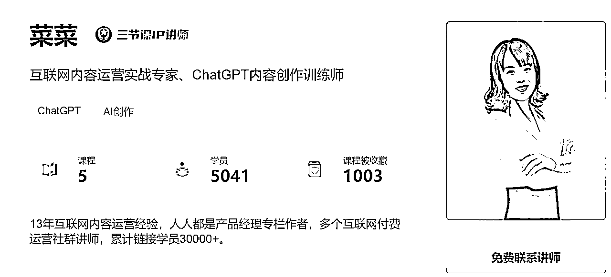

从2023年2月开始接触ChatGPT，差不多一年的时间，我变现了11万；2024年3月转型全职创业，现在收入已经到22万。跟很多大佬比这不算什么，但对我自己来说，是真正的突破。今天的分享没有一丁点推销，大家可以放心看完。

说实话，很多大龄职场人都会有我那种焦虑。我之前所在的线下教培行业，公司做培训机构的数字化管理工具，三年疫情加“双减”双重打击，行业几乎被重创，公司收入缩水，只能全员降薪。我每个月少了1000到2000块，对二胎家庭来说不是小数目。更折磨人的是裁员和并岗——真正接到通知的人反而解脱了，没接到通知的人整天活在“下一个会不会是我”的恐慌里。再加上35岁门槛，没做到管理层基本就等于晋升通道关闭，很多公司直接不招35岁以上的人。我是85年的，去年38岁，焦虑感只会更重。还有被替代的危机：公司想找第二增长曲线，大量引进新鲜血液，尤其当时大厂裁出来的“大厂人才”涌入市场，我们这些老员工在老板眼里思维跟不上、理念也落后。记得2022年10月，老板在两位90后领导到办公室前10分钟才通知我们部门要空降领导，那一刻真的很难受。虽然我很快调整心态，告诉自己可以向他们学东西，但该焦虑还是焦虑。回到家看着孩子天真无辜的脸，我忍不住问自己：工作都快保不住了，怎么对得起家人？只能自救，对吧？

于是我开始投简历，用Boss直聘。35岁前，我投简历基本都会接到电话，一个月内就能拿到不错的offer。但那段时间，我把简历改了又改，投了200多份，要么已读不回，要么直接说“不合适”。最扎心的是有HR直白地回复：“你年龄太大了。”这几个字让我又委屈又受伤。我们80后明明成熟稳重、经验丰富，凭什么被像弃妇一样嫌弃“年老色衰”？我抑郁了三天，然后反手举报了这家公司，举报他们歧视大龄职场人。

不过今天的主基调不是卖惨，而是给你带来真东西：
1. 帮大龄职场青年重新建立信心；
2. 告诉你没变现过的人怎么赚到第一笔钱；
3. 教你破除内卷魔咒，跳出激烈的竞争，实现非线性增长；
4. 分享一条成长公式。这条公式至少值19.9元，我现在免费讲给你听。

先把公式摆出来：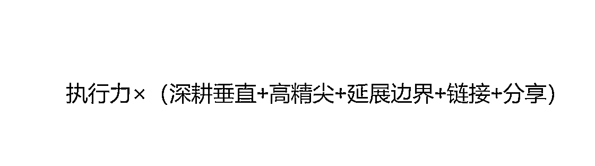

## 一、执行力永远第一

我观察十几年，很多人焦虑的根源是对未知的恐惧。你不知道未来会怎样，越不知道越慌。但破解的方法只有一个：干起来再说。比如你做个产品，担心竞品比你有价格优势、用户评价比你好，那你在家焦虑一百遍也没用，不如马上冲出去研究对手、研究你的差异化优势、研究用户的真实需求，然后立刻改进。只要你马上去做，焦虑自动消除。

这个“做”不只是手上干活，还包括输出——做完了马上展示成果、分享出去。

我执行力算很强的。2023年2月，我在生财有术看到一篇讲ChatGPT的帖子，其实这东西2022年11月就出来了，我知道得算晚的。但那晚我兴奋得一宿没睡，连夜研究官方文档，琢磨怎么把ChatGPT和内容生产结合起来。第二天就直接上手，用ChatGPT写文案。第一个作品是培训机构的课程销售话术——我们做ToB，客户全是培训机构从业者，我训练了一个“销售助手”，模拟家长和课程顾问对话，生成销售话术。效果特别好，发到朋友圈后引来一大波围观。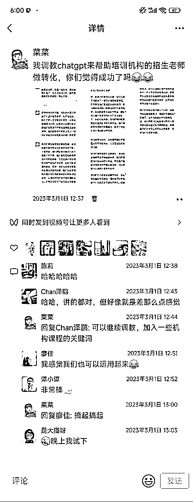当时很多人还没听说过ChatGPT，觉得特别新鲜。你看，做了就输出，总会对某些人有用。有了正反馈，你就有动力持续做下去。

之后我持续在朋友圈分享各种实操，包括销售话术、小红书文案、用ChatGPT学Excel等等。一边做一边分享，每天都有好多人点赞。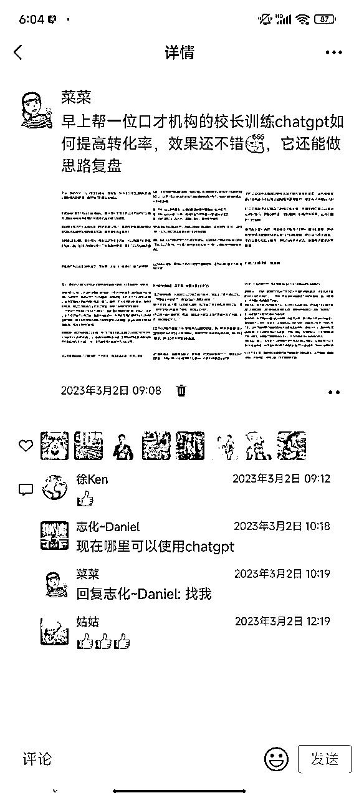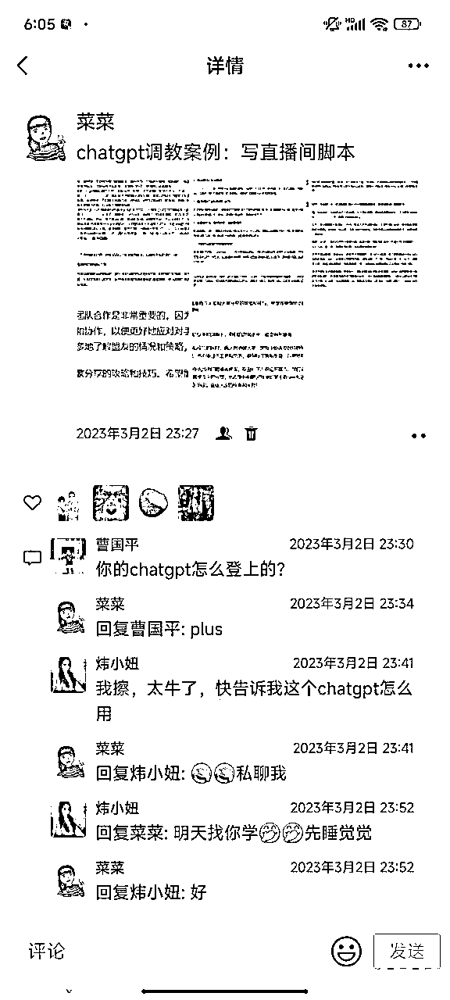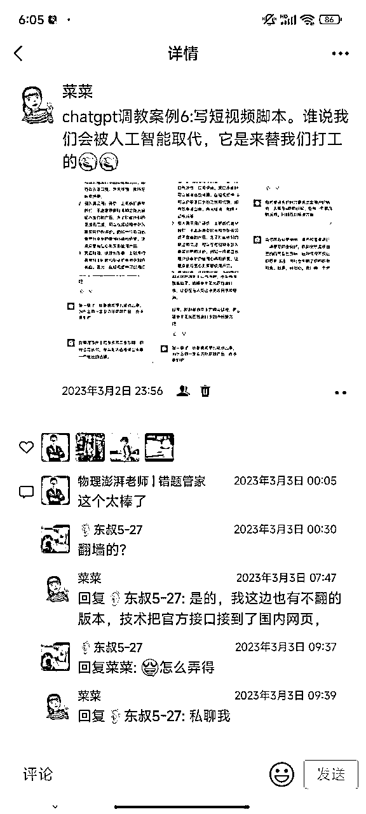

今年1月，我花5位数加入了AI破局俱乐部合伙人。当天晚上我就把480多位合伙人正在做的项目全部刷了一遍，精华帖也大致翻了一圈，分析自己该占哪个生态位。我原来是做ChatGPT自媒体，但发现不少非技术背景的人都冲进来做技术类项目，行业太卷，也凸显不出我的专业优势。于是我果断转向AI+营销领域，目标客户从普通人转为创业者和个人IP。后来证明这步走对了：这个领域对人的综合要求更高，竞争反而小，但市场空间更大，因为直接和商业挂钩，收益也更好。

还有运营圆桌会的大国老师那边，我2023年5月成为合伙人，不到一周就做好了ChatGPT内容教学课程，马上在大国老师那里开了分享课，效果不错。

我有个学员，执行力强到让人佩服。我最近在做AI内容营销100节课，前5节讲如何用AI做公众号流量主、改写爆文赚流量收入。这个学员12月18日买课，看第一节课时问了个让我震惊的问题：“老师，你这么长一串提示词，我到底是一段一段输入，还是整段输入？”连ChatGPT基本操作都不会，但他就是埋头苦干，每天花几个小时做改写。不到一个月，他出了两篇十万加爆文：第一篇阅读量冲到56万，后来涨到70多万，光这一篇就赚了4000多；第二篇早上7点发，11点就破十万加，至少700元到手。他另一个没爆十万加的账号，半个多月也有了3000块流量收入。你看，只要执行力强、听话照做，一个月稳赚8000，不香吗？后来我才知道，这个学员有强直性脊柱炎，身体非常不好。他都能坚持执行，我们有什么理由偷懒？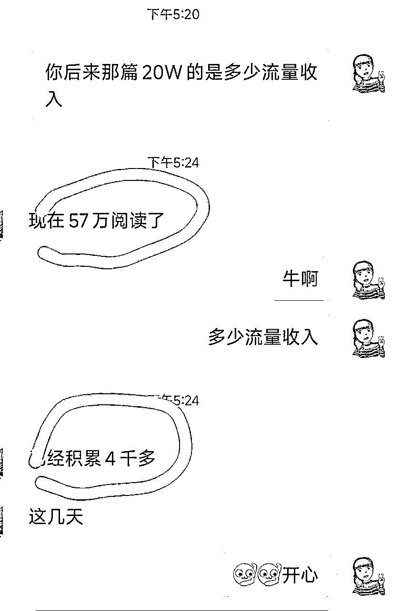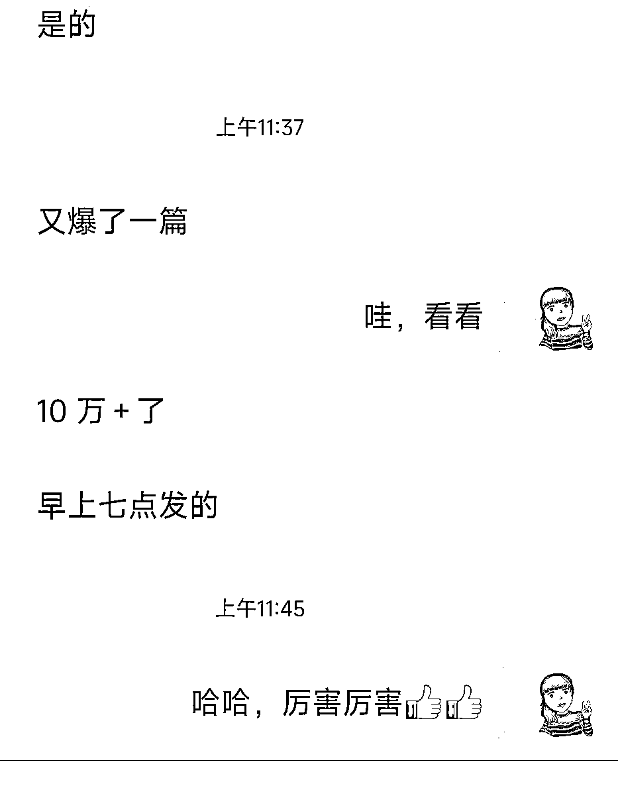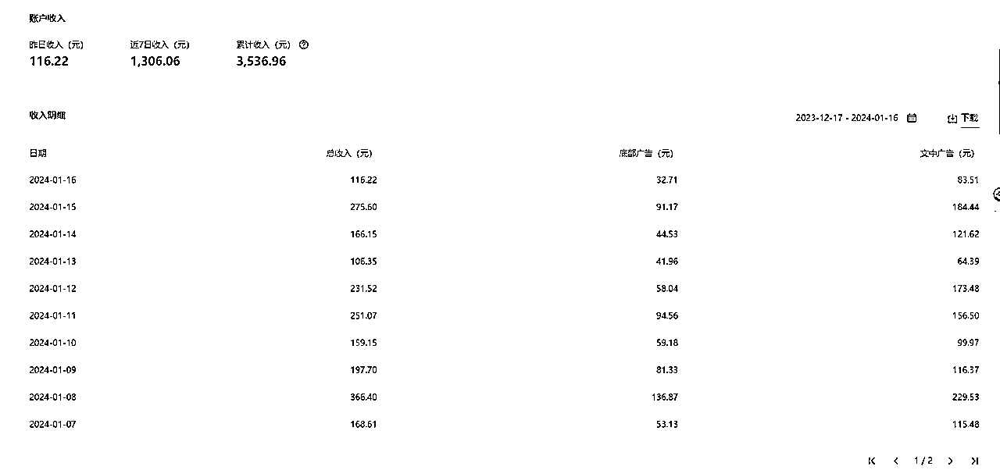

还有一个学员，50多岁了，从航空公司退休，衣食无忧，但想发展第二春。她持续学了40多天，通过做代写赚到了人生中第一笔工资以外的1000元。后来又做了职场IP，接单+流量收入+职场辅导，平均每个月能赚4000到6000。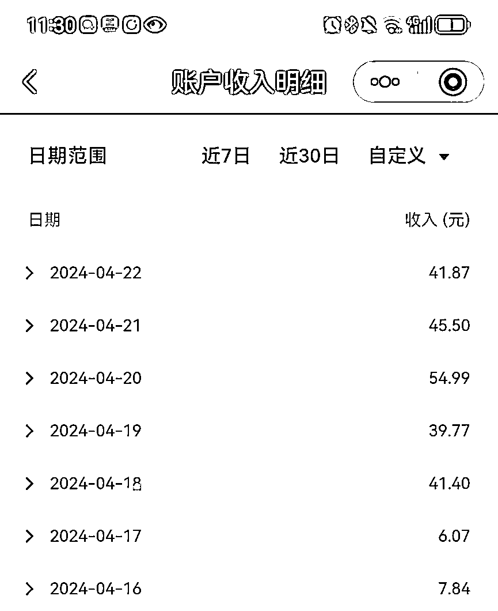

所以说，执行力永远是第一位的。

## 二、深耕垂直领域，专注做好一件事

我十几年的职业生涯，始终没离开过内容生产。这里简单介绍一下：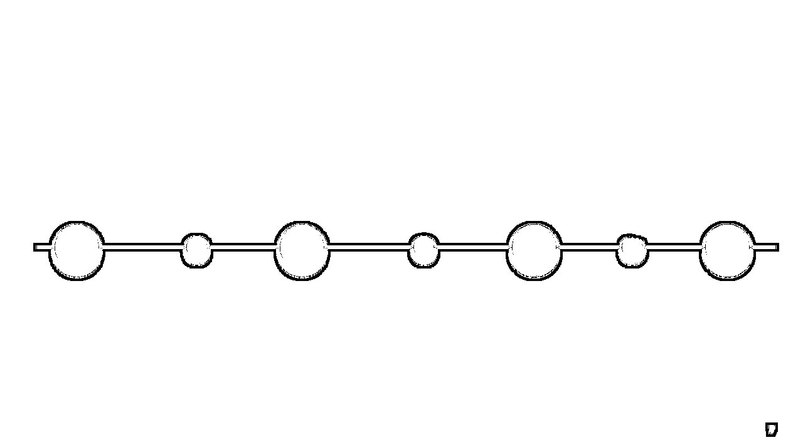2007到2011年，我在长沙电视台当记者，吃的是事业单位的饭，做的第一份工作就是内容。2011年从传统媒体跳进移动互联网，去了新浪微博，正好踩中风口。我带着团队做内容创作和活动运营，一年半做出了一个长沙本地美食大IP，60万粉丝。2016到2018年，公众号风口来了，我去了一家健康电商公司，从零组建新媒体团队，做一个营养健康科普账号，做到了新榜健康领域前20强。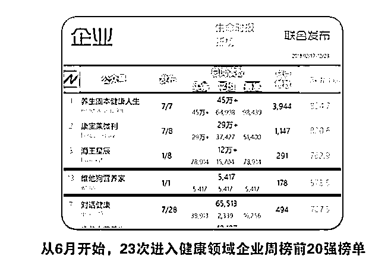还被人民日报、科普中国等平台多次转载，出了多篇10万+。2019年今日头条风口，我跳槽去了一家三甲医院，带100多名医生打造医生IP，成功打造出3名医生IP，帮他们拿了多个今日头条青云奖。

为什么说要在垂直领域深耕？因为只有在一个领域沉淀足够久，你才能洞察到风口和机会。你如果今天做内容，明天又去做销售，那就很难抓住真正属于自己的机会。2019年底我来到现在这家公司，继续深耕内容，在人人都是产品经理、芥末堆等垂直平台做连载，慢慢写成了专栏作者。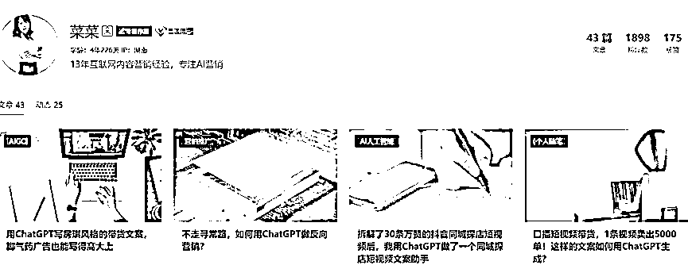

后来短视频、直播火了，2022年我开始一个人包揽文案、拍摄、剪辑、运营、直播带货，每个月大概给销售带10条线索，也有成交，客单价4000多，累计做了几万块钱。我们还联合头部客户做企业直播资源置换，获客成本比百度投放降了66%。

2023年2月我开始研究ChatGPT，别人都在搞工具、信息差，我还是坚持用AI做内容创作。所以你看，深耕垂直领域有多重要？行业经验会不断积累，数量堆上去了，质变自然发生。我接触到的很多AI领域做得不错的大佬，其实不是AI技术出身，而是本来在某个垂直领域有深厚造诣，恰好学会了驾驭AI。AI+教育、AI+个人IP、AI+产品经理，都是特别好的赛道。AI能把所有行业重新做一遍。你问问自己：是不是把专长丢了，正在跟风做什么AI老照片复活、AI代写？我建议你把目光收回到自己熟悉的领域，用AI重新解构一遍，那才是能赚钱的方案。

## 三、打造高精尖，做难而正确的事

我是个蛮较真的人，尤其在内容质量上。比如品牌营销部接到销售部任务写产品宣传文案，其他同事可能草草写几行，我不行。我会追着销售、产品、甚至客户问，搞清楚这个产品对应哪些使用场景，调研我们和竞品有什么本质区别。每写一个文案，先做一轮详细调查、收集资料，然后才动笔。

早在刚入行做文案时，我就会有意识地学专业方法论，比如定位、金字塔写作法、痛点文案。就算内容风口期大众对质量要求不高，我依然用高标准死磕自己。2015年公众号最火的时候，我带着团队完整学习了丁香医生的自媒体课程，1比1复刻他们的流程，把基本功打扎实。为什么这么严？可能和原生家庭有关，父亲特别严格，对我期望很高，我慢慢习惯了这种状态。

所以我的思考是：深耕之后，要保持在高精尖状态，向行业最牛的人请教，才能建立起难以超越的竞争壁垒。凯叔讲故事创始人凯叔说过：在高位的竞争其实没什么竞争，反而很轻松；中位和低位才卷得要命。要想告别内卷，不管职场还是创业，都要去做难而正确的事。

比如前阵子AI代写特别火，有位大佬请我去做AI代写教练，白白送上门的机会，我婉拒了。第一，跟我的AI+营销定位不符；第二，我懒。我不想频繁换赛道。这个项目门槛太低，以后只会越来越卷。我宁愿前期苦一点，也要在高位竞争，不想在副业、创业的不同赛道之间跳来跳去。后来果然验证了我的判断——现在AI代写已经低价到你想像不到。当然，如果你想短期赚一笔快钱，这条可以不看。

## 四、拓展能力边界，构建组合拳

这就像玩游戏打Boss，第一次打不过，就学会新招式再去打。组合几个招式，Boss自然就被拿下了。

我做自媒体时，本身专注内容，但如果只做内容、不会用户运营，账号很难出彩，更谈不上裂变。于是我主动去学运营，第一本看的运营书是黄有璨的《运营之光》，还有当时很火的《黑客增长》，这两本书帮了我很大忙。后来做了管理层，要带团队、向上沟通、向下管理，我又去学了管理技能；2020年还学了教练技术——这也是AI破局创始人洋哥预测今年会火的风口。我发现把这些技能组合起来，做ChatGPT教学时有很大优势。比如辅导学员，我不生硬地告诉他们“你应该怎么做”，而是通过提问引导他们看清自己的现状，自己找到解决方案。这样一来，我和市面上其他老师就形成了差异化，也积累了很多铁杆学员。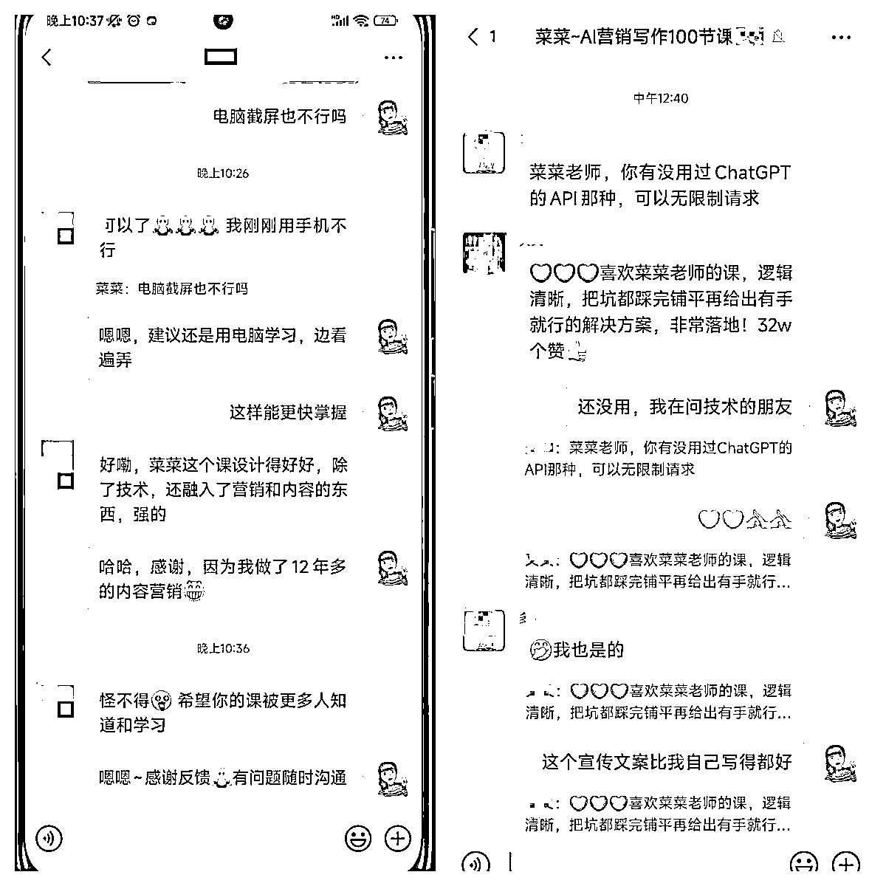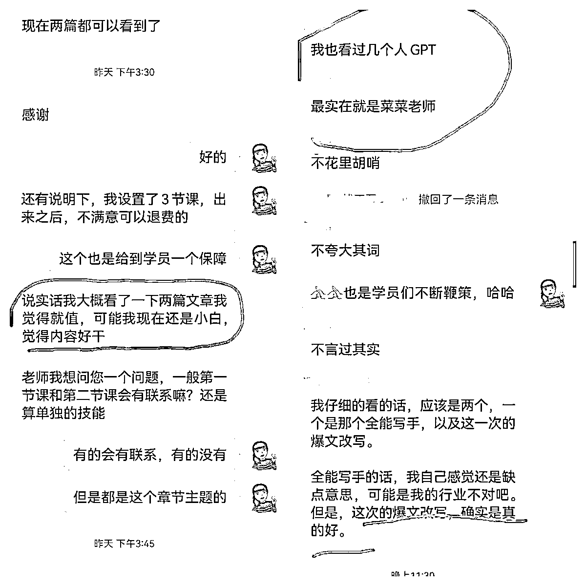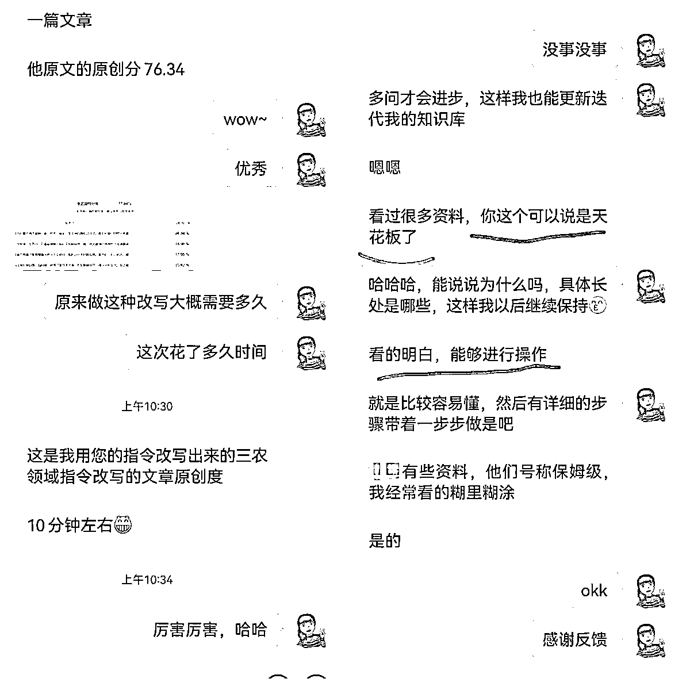

## 五、想尽办法链接资源，实现非线性增长

再说一个你可能猜不到的故事。当年我们公众号的内容能被人民日报转载，其实是靠我“盲目自信”来的。我当时觉得自己的内容特别好，就主动去给人民日报的小编留言，说我们的内容能帮到很多人，希望贵号转载。你可能觉得国家级新媒体怎么会理我？但人家真的回复了。我记得那位老师姓李，她加了我微信，看了内容后觉得我们是用漫画讲健康科普，挺有意思，就转载了，一共转发了两次。第一次发出去就爆了，我们应该是整个新媒体行业里少数被人民日报转载的公众号。老板高兴坏了，直接给团队发了2000块奖金。我把这个经验分享到了西瓜君公众号上。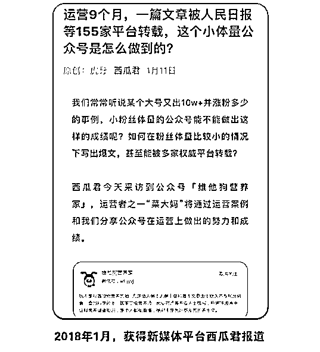

后来我如法炮制，不只找人民日报，还找科普中国、华为运动健康等平台，一边写稿一边去他们的公众号留言自荐，慢慢积累了500多个平台。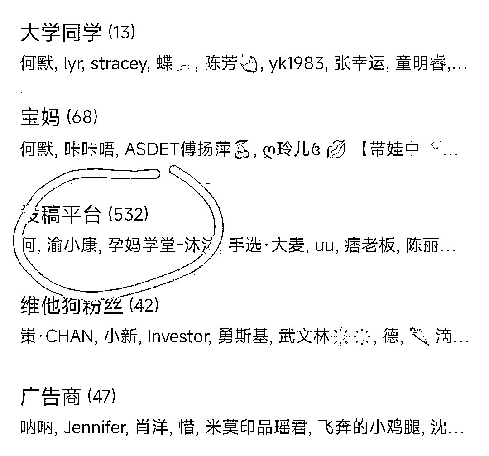只要我们的稿子写好发出来，他们就愿意转载。就这样，我们的声量被一点点铺开，公众号一分钱推广费没花，积累了4万多精准健康粉丝。但链接的好处不止于此，它会形成复利效应。比如人民日报的老师后来把我介绍给了人民卫生健康出版社的老师，人卫老师又邀请我们参加国家级科普辟谣大赛，我们的内容拿了二等奖。

人脉也是链接资源的重要部分。这里特别感谢运营圆桌会创始人大国老师。我最初是因为他资料整理做得极好，用资料做引流产品，吸引了一堆互联网从业者。我也是被引流资料吸引过去的，加了好友之后，凭着那股“盲目自信”，我直接问他：“我能不能来你平台做分享？”因为当时我已经在人人都是产品经理、运营研究社等平台做过分享，反馈还不错。就是这样一个主动开口的举动，带来了一段特别有价值的合作关系。

回看我这一路，从一个焦虑的38岁普通职场人，到靠ChatGPT赚到第一个20万，靠的其实就是这五步：执行力、深耕、高精尖、组合拳、链接资源。希望对同样处在迷茫期的你有一点启发。我们一起在AI时代，把自己的路走宽。

最初让我着迷的，不是账面上的数字，而是站在聚光灯下的那个瞬间。我只是想验证，我究竟有没有价值。

后来大国告诉我，他翻过不少我写的东西，觉得有厚度，有判断力，于是给了我一次公开试讲的机会。效果出乎意料，他社群里好几个成员主动加我聊。机会总是环环相扣。不久，他邀请我加入他的伙伴计划。他很直接，说我的能力可以放大，他的生态里缺少能做出高精尖内容的创作者，他愿意给我一个起飞点。他是我争取收入路上的第一位伯乐。

那笔合作费我几乎没犹豫，这是我在线上学习上最大的一笔支出。回头看，我的第一款付费课能面世，全靠他推了一把。他手里有大量 GPT 使用者，却缺少能交付的服务。他看到我在带人做文案训练，就建议我把方法做成体系。我先在他的群里做试讲，随后推出九十九元的入门课。

那天手忙脚乱。第一次卖东西，女儿又发烧，只能一边抱着她一边连麦。讲完后，五十多人直接转账。这个画面给了我极大的信心。

我由此明白，人脉是收入的土壤。该花的钱不要省，花小钱换别人十几年的经验和判断，太值了。

梁靠谱老师有个说法：认知比信息稀有，资源又比认知稀有。资源站在最高处。没有大国的渠道，我不可能一天拉到几十位用户。他擅长聚集人气，我擅长打磨交付，两块拼图一拼，路就宽了。

# 六、敞开公开，先给后要

做 GPT 相关输出到现在，我累计加了近 q000 个好友。基本来自各平台的免费内容。我的原则是：知道多少就给多少。

比如我在生财有术发过一篇关于 GPT 高效对话的六字口诀。那条帖子不仅让好友增加，官方也来联系，希望把方法收进资料包。随后，正式课的订单也明显多起来。因为我持续公开智能获客案例，有读者说：你的帖子我每篇都收藏。

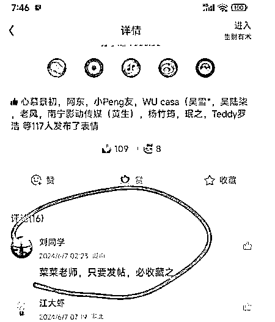

平台也看到了这些积累。今年我成为生财有术 GPT 训练营的教练，带了两期，还参加过一次导师联动直播，反馈不错。

时间再往前，我在一个互联网产品写作社区发文，原本只是记录，后来成了社区里的固定专栏作者。平台没给过一分钱奖金，但被读者记住是更大的回报。每天都往前挪一点，努力就不会消失。靠着这份坚持，我又加了几百位精准用户。

很多人一加上我就问：有课吗？我的第一单付费咨询就这样出现了。对方转来 1000 块，换一个月的内容诊断。

常听说，有一千个死忠粉就足够过好日子。我更相信，哪怕攒下一百个真正信任你的人，也足够撑起日常开销。前提是你持续提供价值。我给自己定了一周不少于两篇文章，写经验，写怎么用 GPT 做文案。

我的很多用户，都是被这些文章吸引来的。我不像一些博主，加上好友就轰炸广告，也不搞“名额只剩多少人”的把戏。我只是在动态里写思考、发案例、晒训练结果。想学的人自然会来，甚至直接转账。

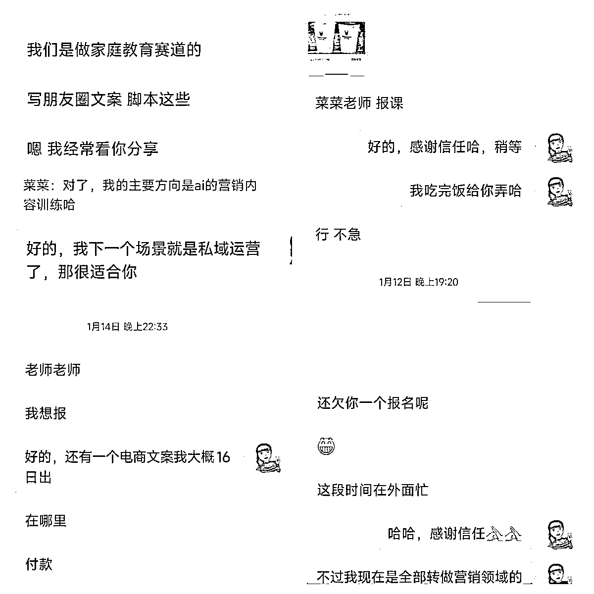

下面这些名单，是我从各渠道的内容引流进来的高质量用户。我带的学员基本都来自这里。

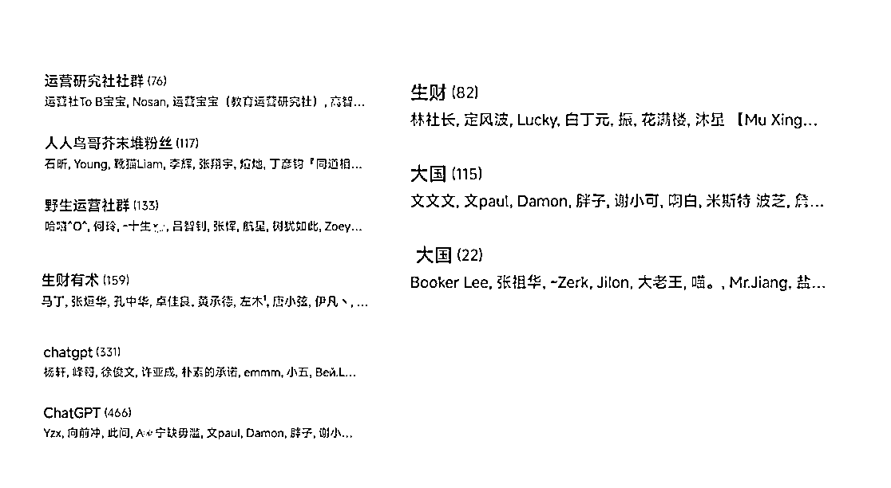

副业或创业，解决了客源，就解决了八CD问题。而持续开放自己的内容，是最省力的方式。

总有人说：我是写代码的，我是做医生的，不知从何写起。我会回答：要有意识地拓宽边界。不会写，就付费跟人学。我熟悉的那个 AI 圈子，大家都叫它 PJ 俱乐部，里面八成用户是程序员，理科背景照样写出影响力。创始人洋哥也是写代码出身，靠着长期对外分享走到今天；社群里还有不少程序员转型成写作教练。

所以关键不是能不能写，而是你愿不愿意改变。

# 七、赚钱的基本原理

赚钱的基本原理很简单：你能解决具体麻烦，用户觉得你的帮助比价格值钱，交易就会发生。

我现在这套智能文案百课，解决的是个人品牌或小团队卖货时的真实场景：私人动态怎么写，商品说明怎么写，如何找到用户的痛点，如何制定促销方案，如何跟进有意向的人完成成交。

有位学员的单价在五千到一万之间，他花 5999 买我的课，成交一单就回本，当然觉得值。另一位学员，报课首月就多赚了八千多，也认为物超所值。

再进一步，是比同行解决得更好。永远有人比你强，但只要比大多数人多想一步，被选择的机会就会多一分。

我是线上课的深度用户，见多了教学产品的毛病：要么只有理论，搬运案例；要么流程断裂，没法落地。所以我做课时，专门绕开这两个毛病，每一步都让用户能操作。用户买了基础课觉得好，才会继续信任高阶课。产品持续迭代，你就不会被无谓的竞争缠住。

最高段位，是解决同行搞不定的问题，在细分领域站稳。市面上教写作的课程很多、很便宜，但用 GPT 生成小说、生成带货文案的完整解法，几乎没人做。

去年 11 月，我在 5118 数据工具里看到一个搜索量很高的词：GPT 创作小说。当时没找到放心教程，很多人都说做不到。我不信，买了三本故事写作的书，通读后把方法抽出来，再让 GPT 执行，最后做成一套可落地的方案。学员拿到后反馈：这是我看过最详细、最实用的版本。他只用了半天，就完成了自己的第一篇小说框架。

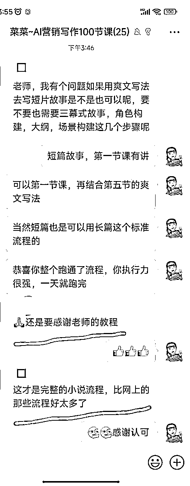

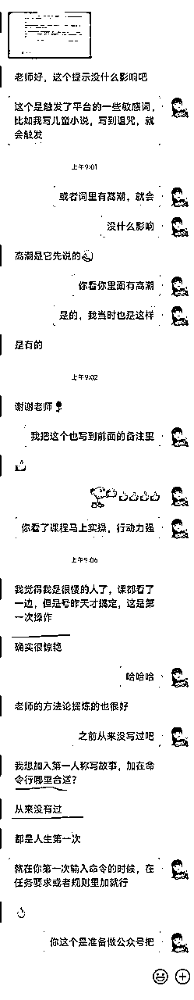

# 八、赚钱的动力：先赚一块

具体到赚钱，先说一句：别把起点定得太高。我最初问自己：能不能先赚一块钱？

第一单生意，是倒腾账号。我买进 500 个，每个成本两块，卖五块，一单赚三块。别小看这三块，没有它，后面九块九、九十九、一百九十九都无从谈起。

九块九的定位服务，也是从一次小实验开始的。我先免费帮朋友做小红书定位，请对方写下反馈，再把反馈发到个人动态里，围观的人变多了。某天我灵机一动：免费评价不错，收费会怎样？于是发了一条动态：9.9 元，一小时小红书定位。

算下来这个服务几乎亏本，因为当时我的一小时已经值九十多块。但我仍然做了。

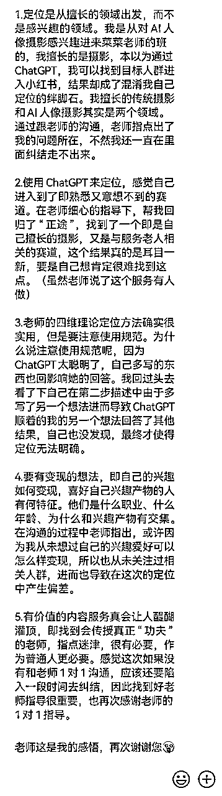

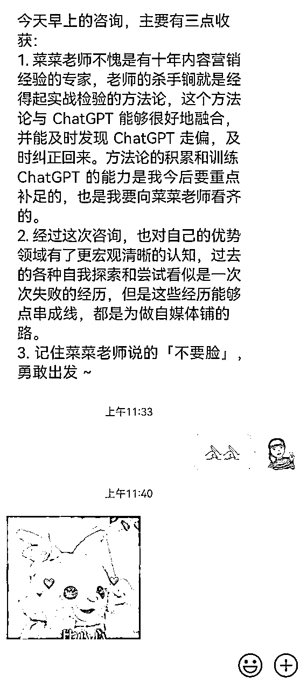

后来，从 9.9 到 39，到 99，再到一小时 199；课程也从 99 起步，慢慢走到 199、299、699、2999、3999、4999、5999。低单价完成信任，高单价才有基础。人不要一开始就幻想大数字，把每个小项目当作对自己的训练，心态会稳定很多。

# 九、赚到钱的经验与踩过的坑

回顾这一年，我先说做对的三件事。

第一，心态淡。我起初没指望赚快钱，只想持续供给价值。创业期有房贷有孩子，说没有压力是假的。我给自己一年时间：把解决方案做完，就算不赚钱，只要不吃老本，就很感恩。结果这一年赚到的反而比上班时多。

第二，主动请大家给反馈。每次直播或交付后，我都会追问学员，哪里好、哪里卡。好评征得同意后发到个人动态；差评拿来修补。一个堵点被解开，我就比同行多一分优势。

很多课程改进都来自用户。起初我直接给出现成 prompt，是想替大家省时间。有用户说，他想知道我是怎么一步步做出这些 prompt 的，这样才能迁移到自己的工作里。我这才发现，省掉过程反而让价值少了一半。于是我把完整推导流程放进课程，从给结果升级成给能力。

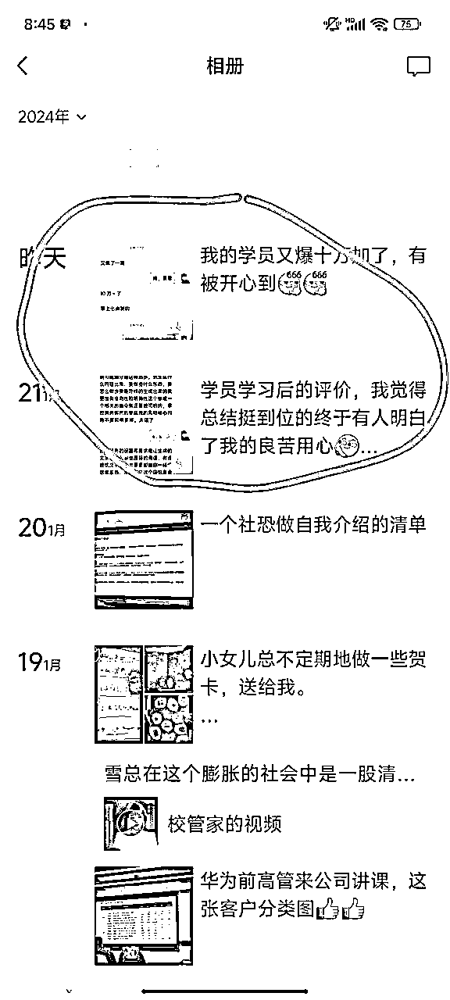

现在，我的一些学员是实体店主，比如美业、教培、摄影门店。他们把这套方法带回店里，让员工也能独立帮客户做推广，正好补上低线城市门店缺推广人才的短板。

再说踩过的坑。

头一个坑，是做自己不熟的事。倒腾账号看起来简单，实际很考验即时处理网络问题的能力，偏偏我技术很弱，连 Excel 都玩不转。结果一单只赚三块，却要花大量时间答疑；账号被封，还倒贴过钱。

另一个坑，是自嗨式开发。做内容的人容易觉得自己的东西天下无敌。你自信做到前列，用户却完全感受不到，或者他只需要一个简单的答案。更会传播、价格更低的同行，反而能轻松打乱你。所以不能关起门造车，要贴着用户的真实需求走。

还有一个坑，是不够聚焦。它会偷偷吃掉时间和精力，却让你赚不到钱。《10x Is Easier Than 2x》这本书值得反复读。它总在提醒我：如果要把收入放大十倍，应该服务谁，应该砍掉什么？

2024 年，我给自己写下八个字：笨一点，怕一点。笨，是不觉得自己都懂；怕，是对行业和用户抱有敬畏。只有认真服务别人，交付真实价值，钱才会反过来追随你。

希望这些经历能给你带来一点提醒。新的一年，愿你在自己的路上走稳，也走远。