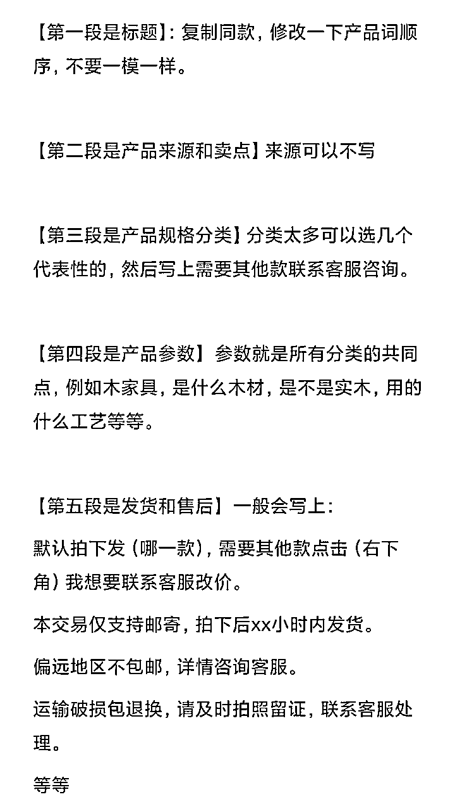
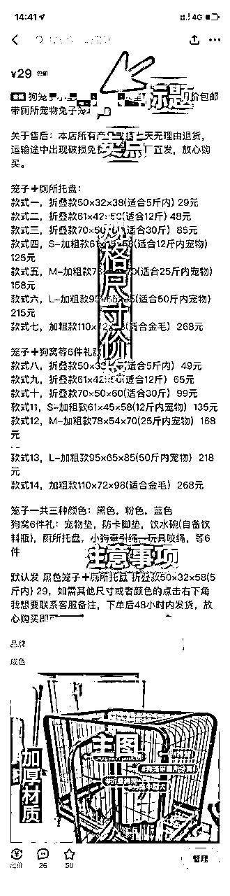

# 闲鱼文案不会写？别慌，这份“万能公式”直接抄！

很多刚开始做闲鱼的朋友都来问我：到底该怎么写宝贝描述？转手理由要怎么编才不尴尬、不假、让人信服？

其实平台帮你判断合不合法，你只需要负责“合情合理”。而一段走心的文案，恰恰就是让买家对你产生好感、愿意下单的关键。

**同样一件商品，会不会写文案，销量真的能差出一大截。**

好的文案，不只是把东西说清楚，更是在帮买家说出他们的需求，让产品自己“会说话”。当客户觉得你懂他、你靠谱，下单就是顺理成章的事。哪怕之后遇到些小问题，对方也更愿意跟你商量，而不是直接退货差评。

尤其在同类商品一大堆、价格都差不多的情况下，想让自己那件宝贝杀出重围，拼的就是文案的“软实力”。

如果说标题决定的是“能不能被搜到”，那文案就决定了“看到了愿不愿意点进来问一句”。文案吸引人，咨询自然就多，出单也就更快。更重要的是，闲鱼平台会把这种商品判定为“优质宝贝”，从而给你更多的曝光和更好的排名——这买卖，不亏。

---

## 一、一篇完整的闲鱼文案，到底要包含哪些要素？

其实一点也不复杂，核心就这几块：

1. 30字以内的标题  
2. 转手原因  
3. 产品介绍  
4. 产品规格  
5. 发货时间  
6. 注意事项  
7. 售后流程  

下面咱们一个一个拆开说。

---

## 二、标题怎么写？这招最省力

标题的重要性不必多说，它直接影响你的宝贝能被多少人看到。

这里教你一个懒人方法：去拼夕夕搜同款商品。找销量在500到5000之间、价格居中的那些链接，直接参考它们的标题。

通常这类标题都在30个字左右，而且关键词已经很成熟了，你直接搬过来用就行。复制的时候记住：别把它的核心关键词给盖住或删掉。

除了商品词，你还可以在开头加一句“钩子”来抓眼球。比如：

**门店撤店、门店转型、厂家清货、厂家直销、最后几个、特价处理、全新未拆封、全新包邮、亏本清仓、店铺关门、限时特价、仓库搬迁、特价捡漏、大量闲置、低价直出、全新处理、现货秒发**

随便挑一两个放在最前面，看起来就很有“捡漏感”。

---

## 三、转手原因这样编，没人不信

转手原因写得好，买家才会觉得“嗯，这卖家是在处理好东西，不是卖破烂”。这里有十个现成的思路，你可以根据情况直接套用：

1. 外包装有点磨损或污损，没法正常上架卖，所以干脆便宜出。
2. 工厂股东闹了矛盾，经营不下去了，库存全部按批发价清，一件也批！
3. 公司回款困难，急着给工人发工资，出厂价甩卖，同品质的别家起码贵两百。
4. 工人没仔细清点库存，结果囤多了，现在赔本出，全新包邮，这价格我自己看了都心疼，快来捡漏！
5. 仓库租期到了，清库存，不求赚钱只求清空。
6. 本来想跟合伙人一起开店，货都进了，他临时跑路，只能含泪低价处理，货都是全新的，质量放心。
7. 要回家带孩子读书，店面到期不租了，清库存，数量有限，要的抓紧。
8. 常年在外打拼想家了，今年要把工厂搬回老家，库存全部低价处理。
9. 之前做电商囤的货，没经验亏惨了，剩最后一点，全部亏本包邮，含泪甩！都是全新没拆封的。
10. 外贸公司弃单，几个柜的货堆在仓库没人要，只能亏本清，已经是最低价了，就别再砍了哈。

---

## 四、产品介绍：不用自己憋，直接“借鉴”

产品介绍这块，最简单的方式就是去看商家的官方宝贝详情页。懒得打字？直接截图用“图片提取文字”功能，分分钟搞定。

重点提炼出这些信息：**材质、功能、性能、作用、尺寸**等等。但别写成长篇大论，买家没耐心看。

如果你是做无货源，更要注意：描述里尽量贴合商品实际情况，别夸大，免得后面闹纠纷。

那“卖点”去哪找？去拼夕夕的评论区！很多买家已经替你总结好了产品的优点。一般提炼个4到6条就足够了。

---

## 五、产品规格：别漏，也别太贪

产品规格在商品的下拉菜单里就能看到，同样用手机截屏识别文字，又快又准。

这里给新手一个建议：利润控制在10%到20%之间就好。

如果产品规格比较多，那就挑前面几个价格低的规格来引流。也可以看看商家哪个规格卖得最好，你参考着来。

---

## 六、发货与验收：把丑话说清楚

### 适合普通小件：

> 本交易仅支持邮寄，偏远地区不包邮。  
> 所有商品都是仔细检查后才发货，收到包裹后，请务必开箱验货，有问题直接拒收。一旦签收，就默认宝贝完好无损了。  
> 拍下后48小时内发货，先拍先得！非质量问题不退不换，感谢理解！  
> 这次是清仓活动，全国除偏远地区外都包邮送货上门，机会难得！下单后记得跟客服确认收货地址，48小时内极速发货。

### 适合大件/贵重物品：

> 本交易只支持邮寄，打木架包装走物流，偏远地区不包邮。拍下后72小时内发货，不接急单，介意的人请不要拍。  
> 保证全新未拆封正品发货！高价值大件商品，快递费不便宜，收到货一定要确认没有损坏再签收。如果不是产品质量问题，不退不换，请考虑清楚再下单。要是出了问题，运费得自己承担。  
> 运输过程中难免有些磕磕碰碰，万一有轻微划痕或者凹陷，基本上不影响使用，还请理解，介意的慎拍。

---

## 七、售后与注意事项：让买家放心

售后写得好，下单跑不了。这些模板可以直接用：

> 我们只追求品质，口碑永远第一。本人芝麻信用极好，所售商品保证品质，放心购买！  
> 本店长期跟厂家合作，各类商品都是出厂价出售，欢迎大额订单！  
> 声明：这是易损物品，而且都是未拆封的。如果不是质量问题，就不退不换了，希望大家理解。  
> 本人芝麻信用800分，信用极好，所有商品都有质量保障，有任何问题包退换。  
> 默认发XXX型号，需要其他款式请点右下角“我想要”联系我。  
> 需要其他型号的，点“我想要”咨询，拍下后改价。

---

闲鱼卖货的完整流程、曝光技巧，我之前也都整理过，大家可以去翻翻往期文章。

这篇文案模板，建议直接点赞收藏。下次上新品的时候，拿出来对着套，保证你写文案不再发愁。

**本文标签**：闲鱼文案、闲鱼副业、闲鱼无货源、闲鱼卖货经验、上班族副业、宝妈副业、大学生副业

---

**【往期推荐】**

1. 《闲鱼卖货全流程步骤，手把手教你卖货！》
2. 《闲鱼曝光底层逻辑及提升闲鱼曝光快速出单的两大诀窍！》

希望今天的内容能帮到你，咱们下次见～