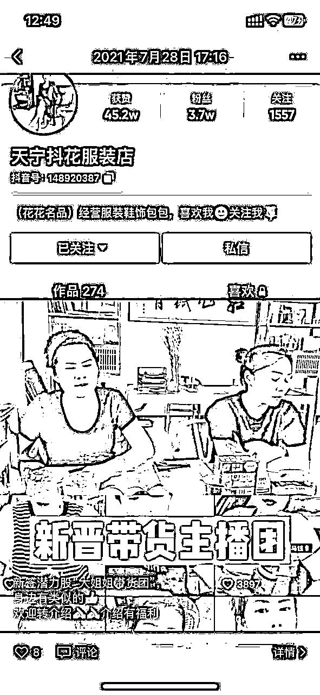
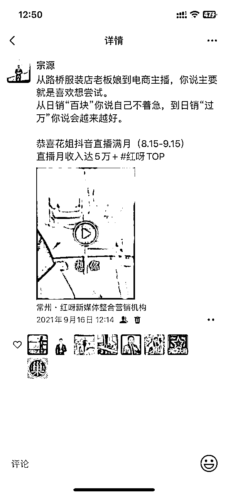
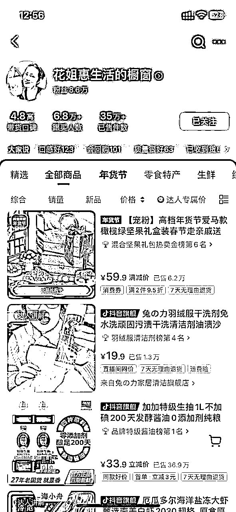
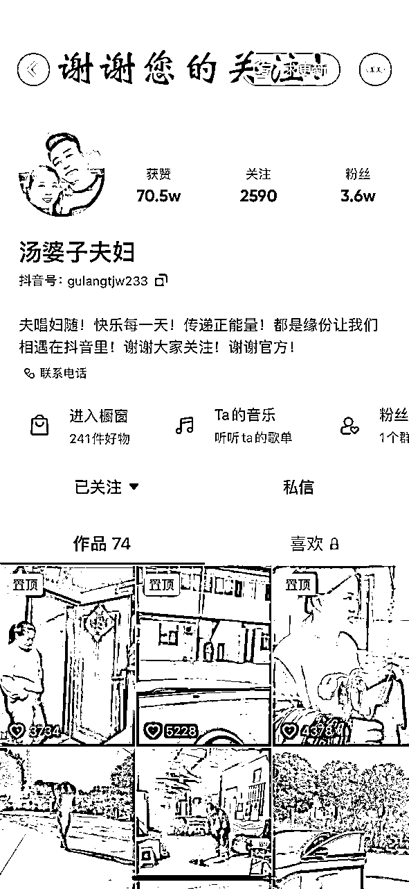
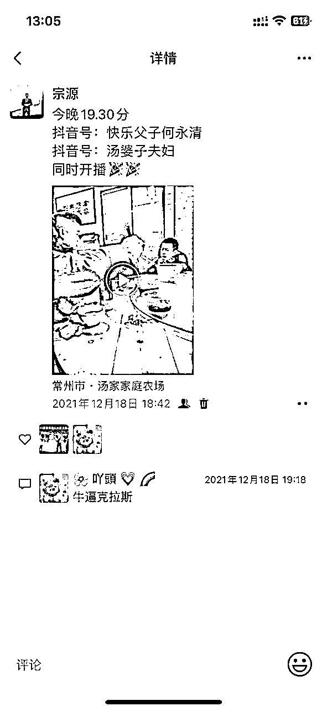
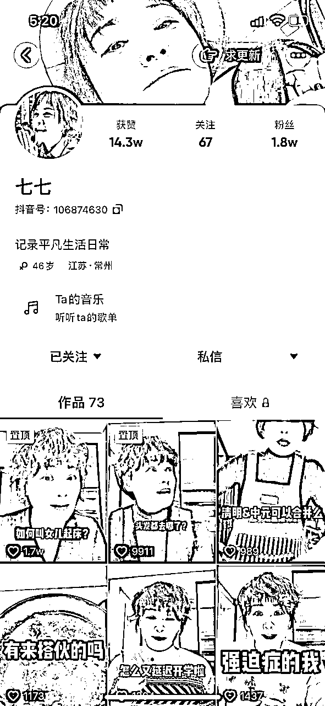
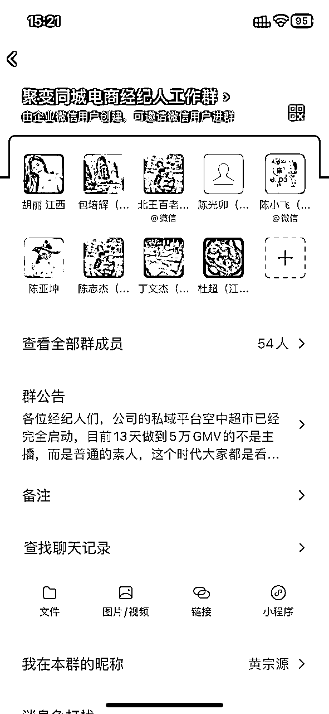
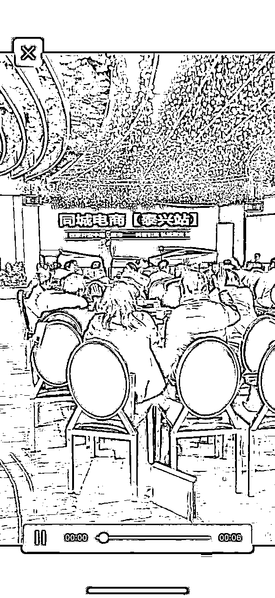
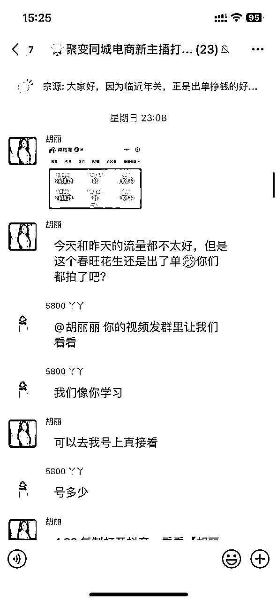
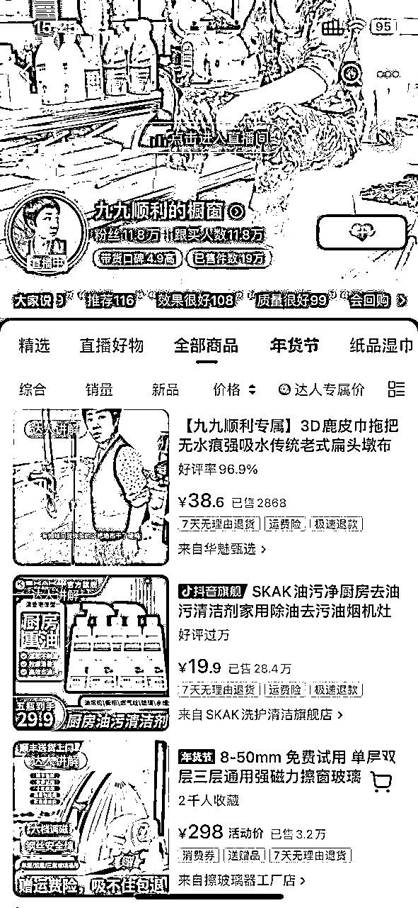

# 抖音最后的红利洼地：打造月入5万、可批量复制的同城电商IP

# 开场白

今天要说的这个“抖音同城电商IP”，和市面上吵得沸沸扬扬的同城探店号、同城商家号完全不是一回事。花十分钟读完，你会看到我用三年时间实操出来的那条生路。我认为，这就是当下抖音还没被盘烂的最后一块绿洲。

大家好，我是龙哥，聚变同城电商MCN的创始人。2024年是我创业的第九个年头。2015年大学还在实习，就开始创业了。那波互联网浪潮正猛，我的思路很简单：不做创新，直接抄。把一线城市的020洗衣模式搬到江苏常州这个三线城市复制，两年就开了十多家门店。2018年我离开团队进入新媒体创业，2021年前公司一直靠TP代运营续命。虽然拿下过区域内不少头部客户，但始终是“饿不死也吃不饱”。那三年里，我一直在找一个能标准化复制的垂直赛道。我的信念是：小而美、可复制，才是好生意。

这个赛道，我是2021年7月找着的。下面就直接讲我是怎么闯出这条冷门蓝海的——抖音同城电商IP。

# 起源

2021年7月，合伙人介绍来一位在常州开服装店的花姐。疫情期间门店难熬，她本地人，有3万多粉丝的抖音号，内容基本是自拍和店里的段子，口音是地道的常州话。我们聊完后决定让她在抖音做百货带货。开播第二个月，账号就做到了月佣金5万+，全靠自然流量，没有投一分钱广告。截止现在，橱窗累计销量已超35万+，两年多累计佣金破百万。

在常州验证通了后，我们继续找同城属性的主播：汤婆子夫妇、七七、高小兔。用同一套打法，她们也很快跑通，月收入稳定在5万+，橱窗销量纷纷突破10万+。

# 她们凭什么能成？

1. 顺应平台规则：讲方言能迅速给账号打上同城标签，获取本地流量，完全契合抖音的推荐机制
2. 解决信任痛点：流量变销量最关键的是信任。方言主播自带的“老乡情”，信任感天然在线
3. 极度细分：把抖音电商做成同城化、私域化，本地竞争小，起量快
4. 避开正面竞争：同城电商达人的对手不是大网红，而是本地大商超。价格直接碾压
5. 人货场高度匹配：看腻了节奏炸裂的大网红直播间后，居家有烟火味的老乡直播间更让人松口气。信任感和共情自然起来。同城达人多为35岁+女性，和粉丝共鸣极快，而卖的都是百货生活刚需，人货场天生一搭

# 第一阶段成果：把抖音开成“同城百货超市”

当时大家谈抖音电商，脑子里想的都是“怎么把一个品卖到全国”“怎么打造垂直头部网红”“怎么导流给实体店”。我们承认造不出李佳琪、罗永浩，但能造出一批每个城市都会卖货的小明星。用全国的好货源集中打同城市场，这个思路被验证可行。

很多同行听到抖音同城电商就以为是做探店号或卖团购券。选项目时我只看底层逻辑。探店号市场终究会存在，但公司化运作很难做得好。一是卷，二是人货场不成立。探店卖的团购券大多是服务类非标品，消费者体验参差不齐，很难沉淀信任人设。久而久之，探店号在用户心智里就是“谁给钱帮谁说”的营销号，引导力越来越弱。

我们培养的同城电商IP，本质是把主播快速养成同城KOC。公司负责运营和供应链扶持，帮她们成为本地百货超市的老板娘。

# 能否复制到别的城市？

2022年上半年疫情期间，我联系了苏州和泰州的朋友去复制项目。苏州找的“堂一静”，泰州找的“大聪明诺诺”和“小辣椒”。

先说苏州。堂一静是当地村委会干了11年的公职人员。2022年8月11日首播，9月份就辞职全职带货了。起初账号粉丝模型我们并不看好，男粉占比80%。但苏州本地粉超70%。经过人货场重塑，三个月内从月销10万涨到月销30万+，现在月收入稳定5万+。账号的短视频和直播粉丝模型也洗成了女粉80%+。这个案例证明，只要同城粉占比高，后期完全可以通过人货场调整重塑流量模型，只是需要时间与主播耐心。

同期诺诺和小辣椒同样跑通，开播当月就月入过万，如今也稳定在月入5万+。

多地复制成功后，我们确认了赛道的复制性，也逐步标准化了运营SOP、供应链和合作模式。合作方式是带货佣金37开，公司3主播7。我们不追求在一个主播身上赚100万，而是100个主播身上每人赚1万。

# 如何加速复制？

到2023年，我们在江苏常州、苏州、无锡、泰州、南通、扬州，以及省外的江西、天津、广州都打出了结果，孵化出几十位改命的同城达人。

下一步要解决的是：稳定增长的流量入口和标准化的交付流程。

我们需要的是“更多符合条件的主播”，怎么触达？我们尝试了“网红经纪人招商模式”。招募认可项目的网红经纪人也就是城市星探，给他们一套选人方法，达人签约后佣金分成。靠抖音招商博主拍视频招商，一周就招了40+人，一个月签约数倍增。但利润并没有明显增长。复盘发现三点问题：1.经纪人像“皮条客”，卖完就撤，新达人得不到陪伴，缺乏安全感；2.经纪人没运营经验，眼光不足，签来的种子质量差；3.达人零门槛零成本，主观能动性弱，边际成本飙升。

2023年10月，我决定做“同城素人培训板块”，这是对项目可复制性的补位，也是闭环设计。让已跑通的同城达人发视频招学员，她们本身就是城市自媒体又是活案例，效果极好。4天就聚了60+线下学员和上百人的线上群。我们孵化素人成同城达人的成功率约70%，成功标准是两个月内照做做到稳定月入3000+。这个“以培代招”打法打开了更大市场。

早期我们主要赋能0.5阶段已有同城流量但未变现的达人电商化。但每个城市0.5存量有限，如果打通0到0.5的素人培训，市场就被放大了。

打通“0-0.5素人培训”+“0.5-1达人变现”后，我们思考每个城市最关键的角色是什么。需要既懂运营又懂媒介的人，我称之为同城电商IP操盘手。参考海参哥的IP操盘手培训路线，需要线下陪跑+资源匹配。试点后，天津合作商已稳定月入5万+，其城市达人“九九顺利”等月销破100万+，成效显著。

# 收尾

经济下行已成共识，当下选项目要看现金流、轻投入、刚需品、可复制。短视频机会很多，但也要认清自己能力边界。2021年我选择同城电商达人，是刻意避开头部MCN的战场，去做他们看不上的生意。越小众的市场越有大机会。

中国电商资源高度集中在杭州广州，而三四五线城市资源极度匮乏。这些城市里却有很多有流量的方言主播存量。我们瞄准的不是大城市，而是整合各小城市资源。用蚂蚁雄兵模式搭建同城电商矩阵。业务上以培训做流量入口，电商做利润点，整合城市供应链，强化区域营销壁垒，打造一个个小而美的区域电商市场。

三年打磨迭代，我相信没有白走的路。每一步都算数。有想法的人一起来，市场很大，干就完了。