# 0-1知识类IP，如何3倍提升销售增长空间
作者：龙哥

晚上好，我是龙哥，来自乐活创富｜百万IP俱乐部。

感谢白老师给我今晚分享的机会，主题是：0-1知识IP，如何3倍提升销售增长空间。

这篇文章记录了我去年离开职场、专心做个人IP的完整经历，包括每个阶段拿到什么结果、做了哪些调整。如果你也正在这条路上摸索，希望我的故事能带给你一些启发。

先简单交代一下背景：我做过12年互联网设计师，其中有5年是设计管理岗。现在是一名百万设计师IP打造教练。过去一年，我持续付费学习，把学到的内容消化重构，最终整合成一套“设计师个人IP商业私教体系”，累计变现20w+。

我的盖洛普优势前三是：思维、学习、成就。

回看2023年，1月我只变现400来块，到了12月，单月做到了5w+。从最初的0-1，到后来不断优化销售转化、拉高收入，我到底做对了什么？

如果你刚开始做知识IP，却搞不清自己卡在哪个阶段；如果你不好意思收钱、不敢卖自己的产品，甚至不相信产品值这个价，那么这篇内容就是为你准备的。

先看看我这一年前后的谈单对比。

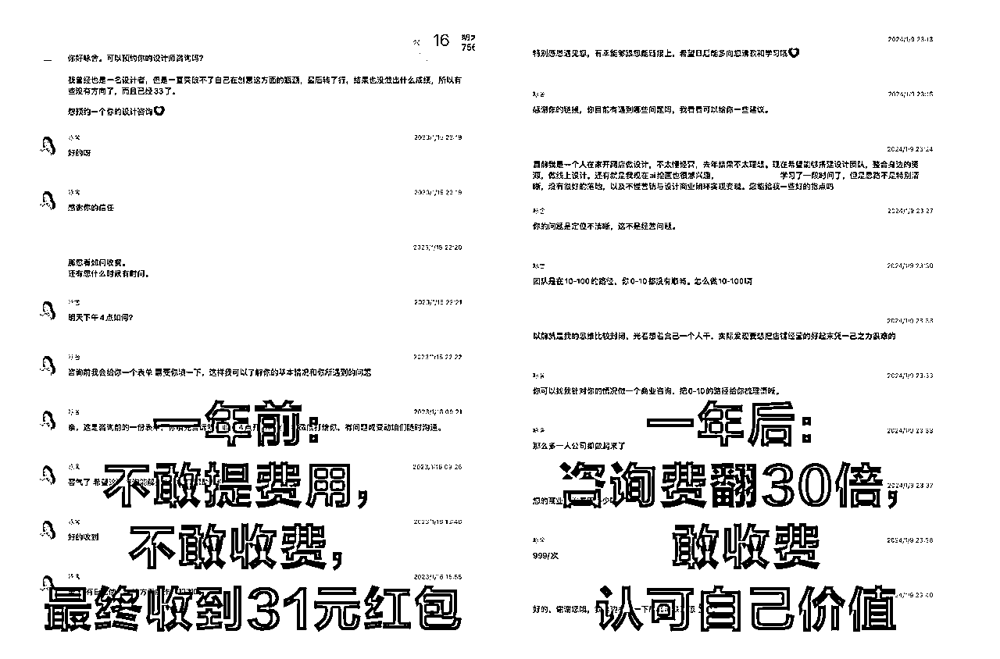

今天的框架分为两大块：

第一块：0-1知识IP在不同阶段，该怎么定策略？
- 学习成长期：销售提升1倍的关键，是布局多元收入渠道，用里程碑结果拉高势能；
- 跑通闭环期：销售提升2倍的关键，是梳理SOP流程，提升效率，打造独特的高价值产品；
- 增量放大期：销售提升3倍的关键，是布局私域生态，多次激活私域存量用户。

第二块：私域销售里常见的卡点和技巧。
- 成交6大卡点；
- 洞察客户决策的4种心理；
- 实用的话术应对策略。

先看第一阶段：学习成长期。

这个阶段的目标很简单：以陪伴式学习为核心，先跑出第一个结果。你不需要多厉害，但要把变化和结果展示出来；同时跑通“流量转入私域”的路径，设计出产品体系，完成第一次变现。

我其实是个特别普通的人：不是大V，没有海量流量，没有团队操盘，也没有金光闪闪的背书。我能走到今天，靠的只是长期坚持，一点点积累。

两个多月时间，我的成长陪伴社群从140人涨到330人，🛰️好友从2800人增加到3700人，👸号加上全网粉丝数突破1w。

我的产品线也比较简单：陪伴社群199元/年，单次咨询699元，设计师个人IP商业变现私教6980元/6个月，以及12800元/年。

一年下来，我累计收入20w+，4月份做到3.4w，12月份做到了5w+。当然，收入并不稳定，1月只有400块，8、9月也只有几千块的咨询和线下活动收入。但在我眼里，这恰恰意味着另一个可能：一个没有上限、可以持续创造收入的空间。

我的收入方式，不是靠单条腿走路，而是搭成了一个多元收入结构。这是什么意思呢？

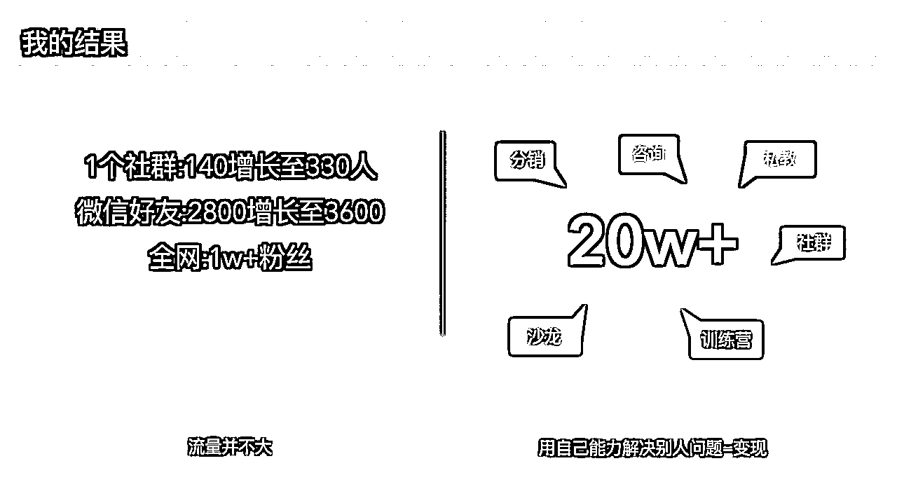

说白了，主动收入不能是唯一收入。你要为自己建立多管道收入，这样遇到危机时，选择权才会更多。鸡蛋不要都放进一个篮子里。

我理想中的收入比例是：30%主动收入＋40%被动收入＋30%资产收入。

但现实中，大多数人的收入结构是：95%主动收入＋5%其他收入。所以收入上不去，根源在这个比例。

有投入就有产出，没有投入，自然难有产出。

为什么我会提出这样的收入结构？因为主动收入要占用我80%以上的时间和精力，而且它不像职场工资那样稳定，很容易被市场波动影响。所以我会刻意去找一些相对稳定的被动收入，来支撑整体创收。

尤其是在收入不稳定的阶段，我更建议你去卖那些带分销模式的好产品。你只需要在朋友圈、社群或👸号里推一下，就有机会获得被动收入。

而且，这个过程还能让你近距离观察别人是怎么策划一场发售、怎么做销售的。这种学习价值，是不是比佣金本身更值钱？

另外，人的势能是需要长期积累的。刚进入一个新领域时，你还不厉害，用户天然会有慕强心理。这时候，不妨先观摩学习，帮别人做点事，积累里程碑式的成果，让势能慢慢起来。

我在2、3月份收入超过2w之后，势能明显起来了。不少老粉开始主动来问：你是怎么做到的？

举个例子，我4月份的收入结构是：主动收入（咨询＋私教）占40%，被动收入（多渠道分销＋社群）占60%。

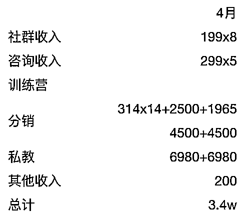

这里需要注意的是，主动收入和被动收入相互联动，是一项未来越来越值钱的投入。原因有两点：
一是你的影响力会越来越大，思维和系统能力会越来越完善；
二是你能接触到的资源和圈子，会越来越优质。

接着是第二阶段：跑通闭环期。

在早期，你不需要差异化，因为大家拼的就是同质化：谁先把流程跑通，谁就能先赢。所以一开始，找到领域里已经成功的对标，照着模仿就好。别人能跑通，说明这条路走得通，你要做的是在垂直标签下深入打透，快速拿到正反馈。

这条闭环路径是：垂直定位 → 持续输出内容 → 获取流量 → 产品解决问题 → 销售转化。

跑通之后，再回到每一个关键节点做优化。那怎么构建差异化竞争力呢？可以借用田忌赛马的思路：用自己的优势去打别人的弱势。

先看第一个抓手：标准化效率，用SOP优化各环节的触达效率。

单个成功案例是有偶然性的，不具备持续复制的可能。你需要持续实践、持续拿反馈，从大量样本里挖出增长的确定性。

路径1：从公域往私域导流。我做了两个📕资料号，一周时间就快速承接了100多个流量进私域；然后通过标准化的路径、步骤和话术，节省了大量人力。

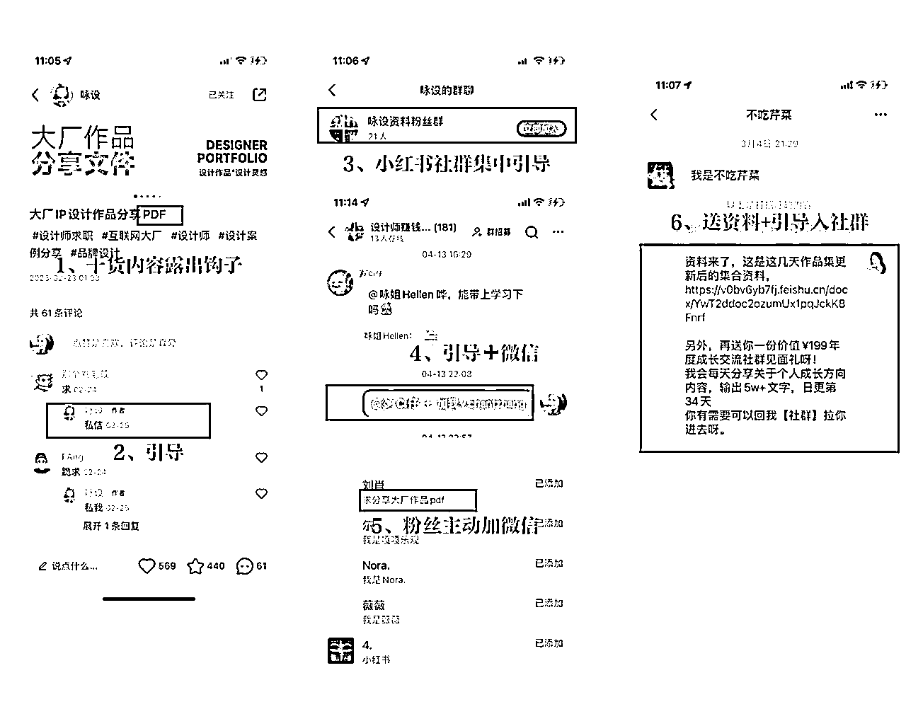

路径2：梳理私域里的销售路径，在关键节点用标准话术筛选客户，效率立马上来了。

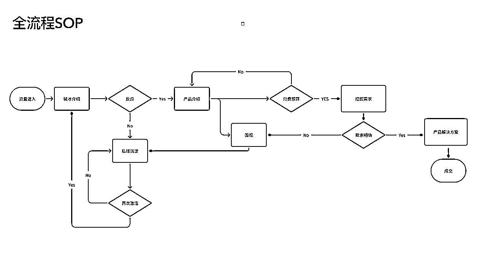

举一个具体例子：我把“公域承接→私域转化”的路径彻底跑通，把每一个流量样本的路径都记录下来，在关键节点配上模板话术，整体效率提升了3倍。以前需要20到30分钟来回沟通，现在5分钟内就能聊完。

同时，我会给每个流量来源打上标签，放进私域里不同的容器中。

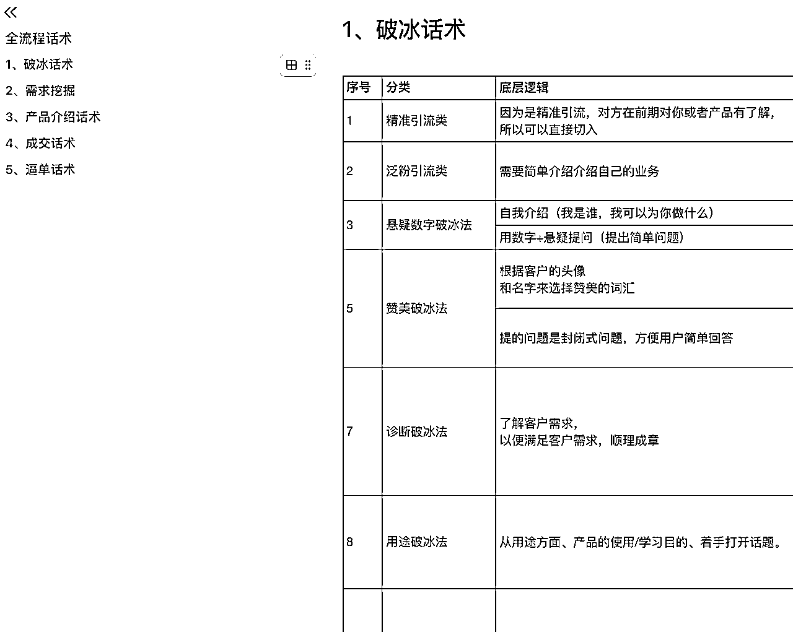

来看几个标准话术：

话术1：自我介绍模板。用标准化的自我介绍，稳稳承接公域流量。

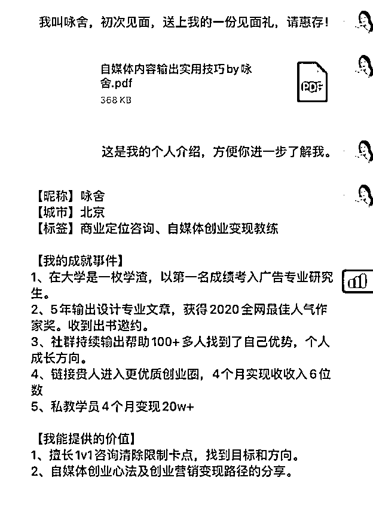

话术2：需求痛点挖掘模板。对感兴趣的用户进行兴趣和需求深度挖掘，再根据不同情况，用对应话术打消顾虑。

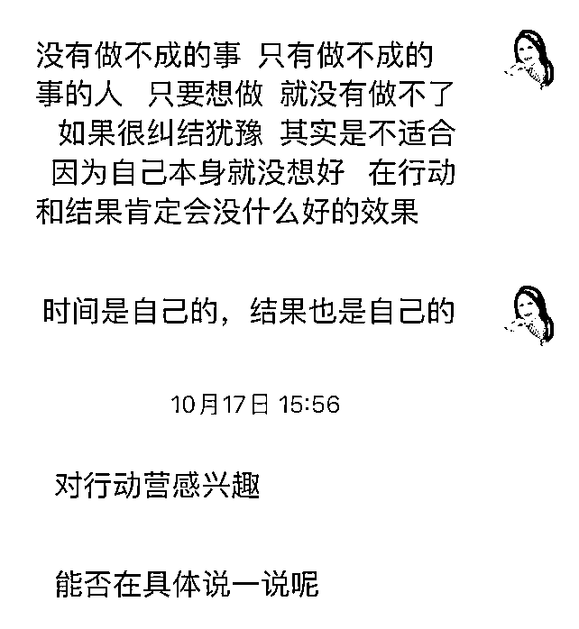

比如，对方担心结果，你就用真实结果案例来打消信任顾虑。

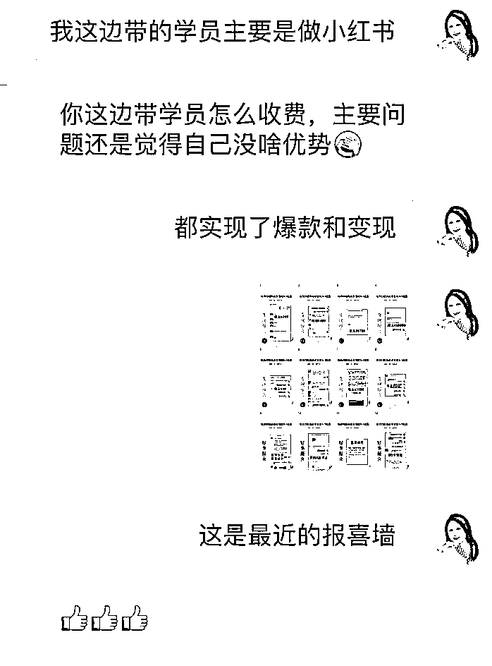

话术3：付费预算模板。

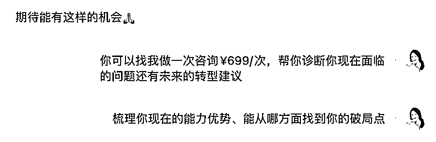

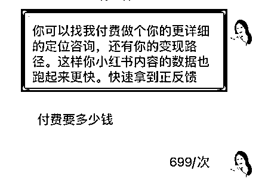

话术4：产品＋价格介绍模板。根据客户的需求推荐产品，完成转化。

只要在每个关键节点持续优化，你就能总结出一套更高效的规律和方法。

这里想强调一下：提升效率的本质，不是省下所有人力，而是把更多时间精力投入到那些无法被标准化的竞争力上。比如，让更优秀的人去做高价值产品。

第二个抓手：低成本标品＋独特价值的非标品。

对于市场上同质化的标品，你可以用标准化生产的方式，把成本压得比同行更低。尤其是流量型产品，一定要控制成本，而不是一上来就搞创新。因为创新本身意味着高成本。

那非标品的溢价空间从哪里来？两个方面：

第一，挖掘更垂直的细分痛点。通过市场调研、用户反馈和数据分析，洞察目标客户更细分的需求，然后提供更有针对性的产品和服务。

第二，强化自己的核心优势。《孙子兵法》里讲，攻在于胜势；市场竞争也一样，你的优势要强到足以形成壁垒，让别人无法模仿和超越。

举个例子，市面上个人IP教练并不少，但我的核心优势是：内容输出有深度、心力能量强、洞察力准确。同样做个人IP的人，不一定能给出强大的心力支持，也不一定有那种直击本质的内容输出能力。

所以，专注打磨自己的优势壁垒，建立不可替代性，才是从同质化中跳出来的核心。

核心优势怎么建立？可以从三方面入手：

第一，用经验和成就打造个人品牌故事。找到你身上独特的成就或经历，讲成“个人故事”。比如我通过持续输出，拿到过专业作家的头衔，也得到过站酷、优设、36kr、得到知识城邦等平台的推荐。这些结果能拿下来，靠的是执行力；执行力背后，是清晰的目标和强大的心力。

第二，用成功案例强化服务价值。我有近5年的设计管理经验，带团队拿过不错的结果；现在创业，定位是个人IP营销教练。身份变了，但内核没变：都是带着更多人拿到结果。

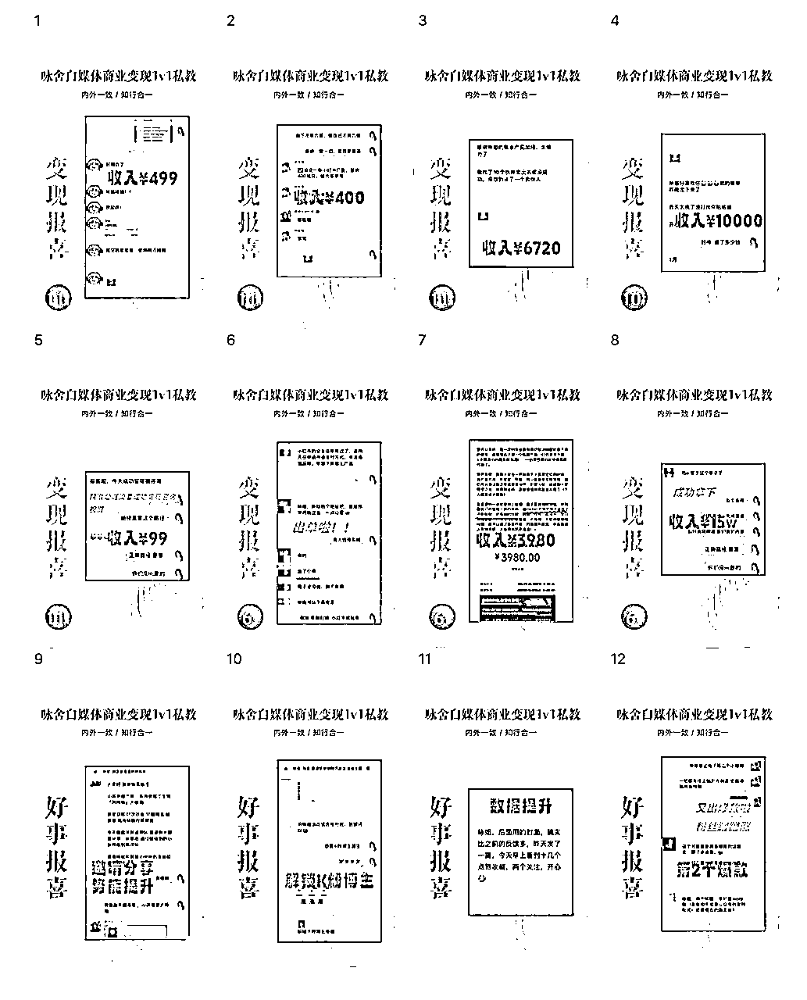

第三，展示个性特点和兴趣爱好。我喜欢阅读，习惯深度思考，也长期保持输出习惯。很多人正是因为这种持续的表达力而喜欢我。

最后是第三阶段：增量放大期。

在私域里，我通过“四件套”搭建营销事件，对用户进行多次激活。你可以把这四件套理解成四个不同功能的角色：

- 客服角色：通过🛰️1v1聊天，和来咨询的客户及时互动；
- 展柜角色：朋友圈就像你的产品展柜，负责展示你的价值；
- 圈子角色：社群就是一个社交圈，通过互动话题和内容分享，积累信任；
- 活动角色：👸号、视频号和直播用来做活动、发福利，再次激活用户。

私域生态搭好之后，再用一系列日常动作持续加热，比如每天发5条朋友圈、每天在社群输出、每天和5个人聊天、每周做一次直播。这样不断激活私域存量，销售转化就会一步步提升。

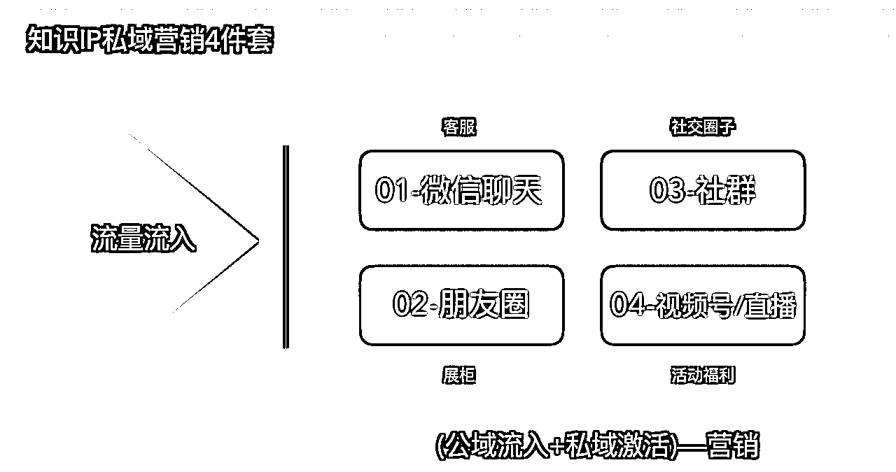

先说朋友圈：每天5条，科学布局文案、产品和案例。

梁靠谱老师曾经分享，她今天的成绩就是靠朋友圈日更5年、发了8000条内容换来的。她也一直提醒我，朋友圈每天至少5条，如果量都做不到，结果基本没戏。

我每天坚持更新，就是要通过内容传递一个信号：我在长期做这件事，而且不断拿到结果。

朋友圈文案有几个忌讳：

一是切忌自嗨。光抒发自己的情绪、引来几个点赞没有意义，你要让读者知道你到底在表达什么、指向什么。

二是放大痛点＋植入产品。痛点的背后是人性的弱点，比如赚不到钱、懒惰、认知不足、圈层不够等等。

三是适当秀肌肉。把用户证言和成功案例晒出来，用真实反馈刺激用户。当别人夸你的评价、做出的成绩被发出来，又能自然衔接产品时，这才算把反馈变成了朋友圈的转化素材。

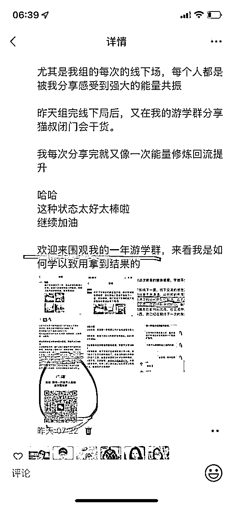

再说社群：每天互动＋制造话题＋主题分享。每天或每月定期发起主题内容，持续分享价值。

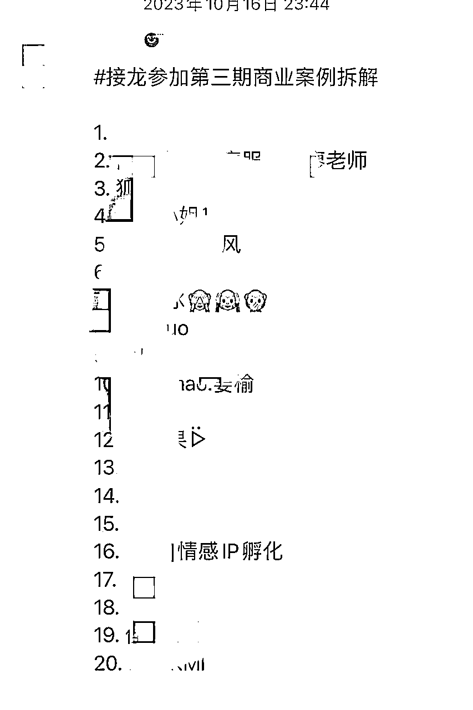

然后是每天5个人的1v1私聊。通过社群活动或朋友圈点赞找到切入口，主动关心对方的兴趣点，再往成交方向推进。

最后是👸号更新＋视频号直播。用主题直播分享去做内容宣传，让产品被更多人看到。

好，第一部分讲完了。下面进入第二块：私域销售里的常见卡点和技巧。

先看销售成交的6大卡点。

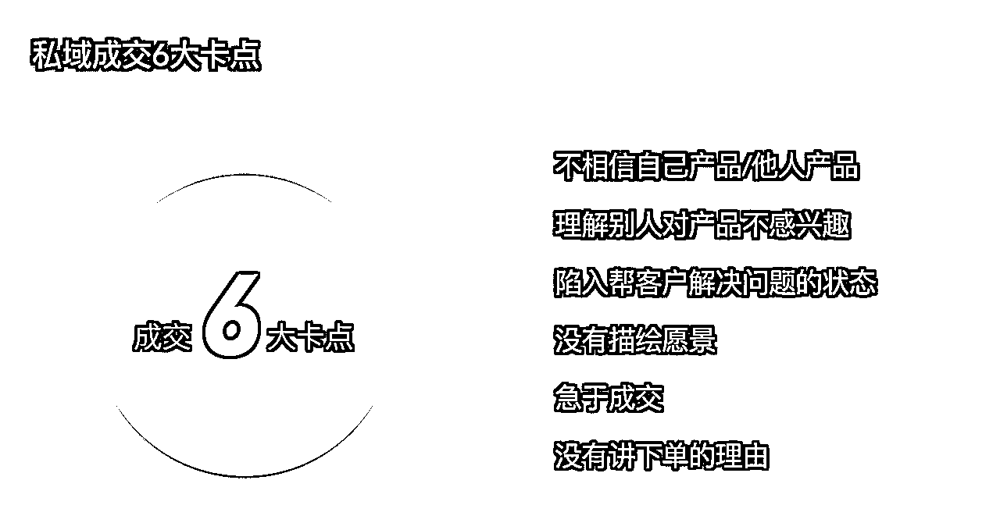

卡点一：不敢提钱、不敢收钱，本质是不相信产品价值。

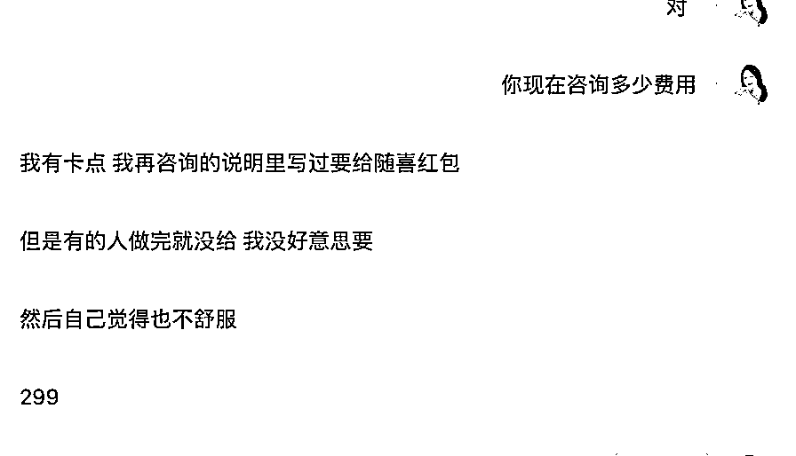

很多人刚开始做知识付费时，一谈到钱就紧张。核心原因，不是脸皮薄，而是不相信自己的价值，或者不相信产品能值这个价。

所以，早期你可以先把自己定位成一个学习者，让自己先变好；或者把目标放在帮客户变好、拿到结果上。当你真的帮助到别人，价值感就会升上来。

我的万元高客单价，是在第一个学员通过我变现2w之后才敢涨价的。当帮助的人越来越多，配得感会变强，你也会越来越敢于收钱、谈钱。

卡点二：轻易把“不感兴趣”当作拒绝。

客户说不感兴趣，并不代表真的没兴趣。你要判断一下：他是已经买了别家的产品？还是当下没有这个需求？这些都值得继续深挖。

你可以通过社群话题、案例分享，把感兴趣的人筛出来。有些人只在群里潜水，从不主动私聊；这时候你可以主动以关心的姿态去私聊，就能识别出哪些人可以继续推进成交。

靠谱老师有一个“100%进度条”的理念：当客户只走到20%的兴趣阶段，你自己先泄了力，那就等于退回原点。正确的做法是继续挖根源，把成交进度条往前推。

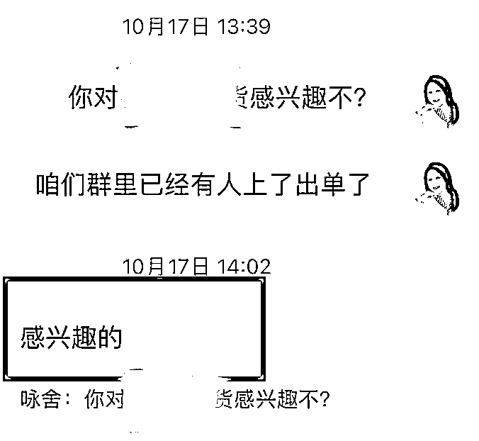

卡点三：一头扎进帮客户解决问题的状态。

有人一看到用户提问，就忍不住开始当免费顾问，全程帮对方解决问题。但过度的服务反而会模糊边界。你要明确：哪些问题是顺手帮忙回答的，哪些问题需要系统梳理、应该走付费咨询。

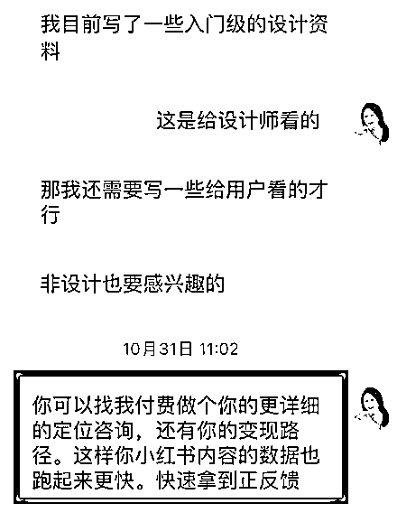

卡点四：只讲眼前，不描绘愿景。

成交过程中，你要放大未来的愿景。每个客户都希望能尽快拿到结果，希望未来能过上更好的生活，而不是更苦逼地熬。

你可以把发生在自己身上的结果，以及学员的类似案例拿出来，讲给他们听：跟着你，也会变得更好。也可以通过行业趋势，比如AI方向、视频电商等，帮客户描绘一幅未来发展趋势。

卡点五：急于成交，结果被对方带进框架。

客户一问产品，你就陷入一问一答的模式，言语间全是“快付款”的急切感。正确的做法是跳出对方的问题框架，稳扎稳打地挖出核心需求。

很多人前期挖需求容易卡壳，本质是样本练得太少。你只需要多聊、多练、多复盘，慢慢就能找到痛点在哪。

但要注意：痛点不要一下给太多。精准抓住一个核心问题就够了。比如收入问题，要么是流量不够，要么是定位不清，要么是产品体系转化不行。只要抓住其中一个关键点，成交率就能提升。

卡点六：自始至终没有给客户下单的理由。

聊到最后还没成交，往往是因为你没有给出一个“非买不可”的理由，对方还有疑问没有被解决。这时候，你应该引导对方把疑问说出来。

比如我有一个私教学员，谈单很久没成交，原因是想先拿到确定性的offer薪资再决定。这类“确定性要求”，你需要判断是否合理、能否满足。

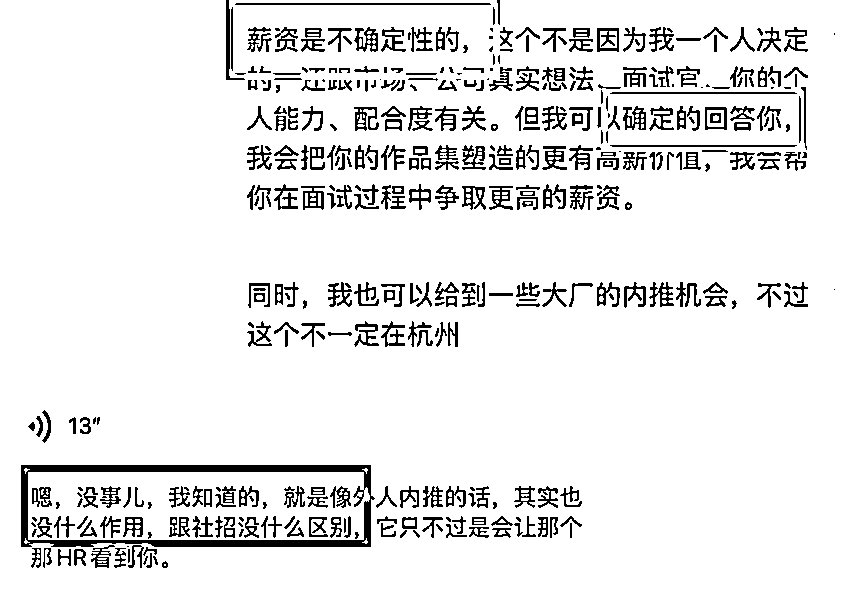

其次，你还可以给出限时优惠条件。比如当天报名立减200元，再额外赠送一些福利。

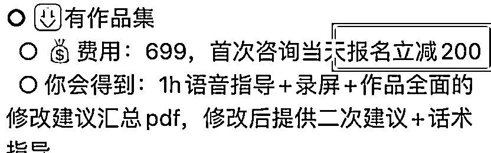

说完6大卡点，再看客户的4种决策心理。

很多人在谈单时听到“我再考虑一下”“太贵了”“你有什么不一样”“有哪些结果”“我已经买了别的课程”就会束手无策。其实这些都是临门一脚的信号，关键是你要会拆解和回应。

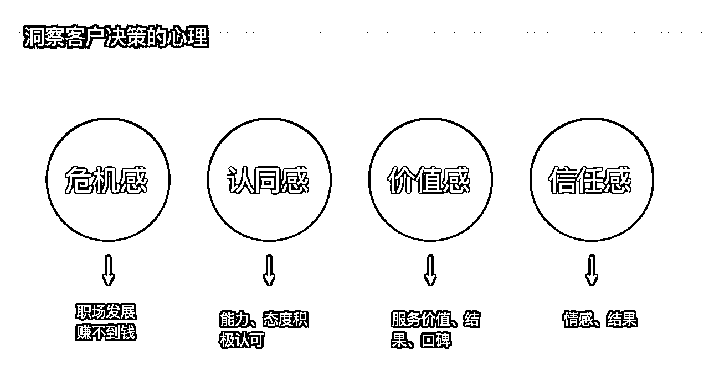

第一种：危机感决策。

去深挖用户焦虑和危机的根源：是不是在职场找不到发展方向了？是不是越来越找不到未来赚钱的路子？说到底，都是对赚钱这件事的焦虑。

第二种：认同感决策。

先肯定对方的能力、结果和态度。每个人都想赚到更多收入，你已经有了这么好的基础，差别只在于最后愿不愿意再往前迈一步，真正行动起来。

第三种：价值感决策。

不断塑造服务的价值、结果和口碑，减少客户的决策犹豫。当很多客户都在说好的时候，这个产品大概率是真的好。

第四种：信任感决策。

用个人品牌故事来塑造鲜活的个人形象。再小的个体，也有自己的个人品牌。

最后，再来看不同话术的应对策略。

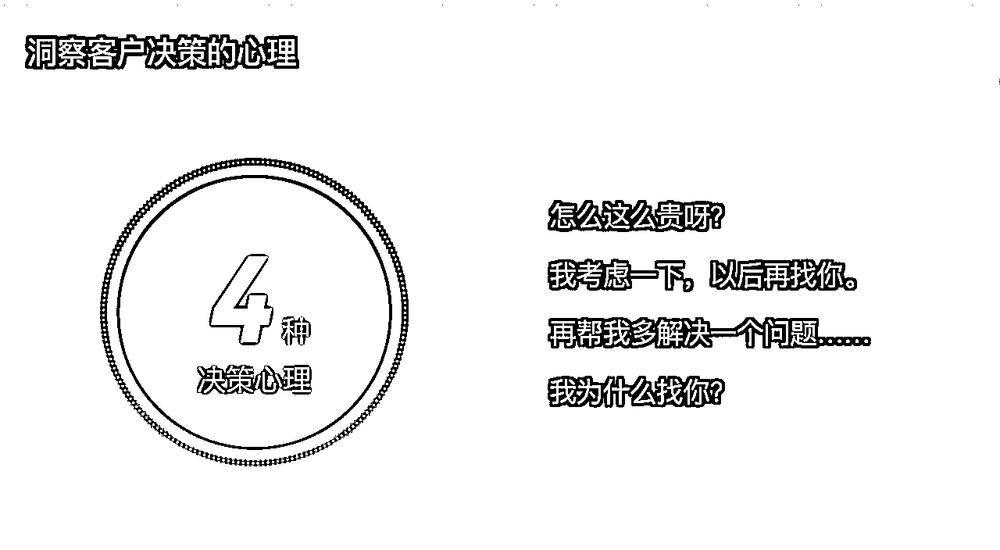

策略一：客户说“太贵了” → 用“锚定效应”＋“算账”。

遇到客户说1w多太贵时，别急着降价，先突出稀缺价值：背书稀缺、福利足够多、结果足够好，这些都是价值的支撑点。然后拿同类产品做对比：市面上同类产品都要5w，相比之下你的方案已经很实惠。

接着，帮客户算一笔账。比如365元的社群，相当于一天只花1块钱，就能获得价值3w的干货。

这些动作都能减少客户犹豫的时间，本质是站在客户角度，替他说出那句“我为什么该买”，给他一个下单的理由。

不过也要注意：如果客户的收入群体确实够不上高客单价，你可以顺势从高客单产品转向低客单产品，这样反而更容易成交。

说的核心，永远是在和客户的互动中，识别并满足他的真实需求。

策略二：客户问“你跟别人有什么不一样？” → 用差异化突出价值。

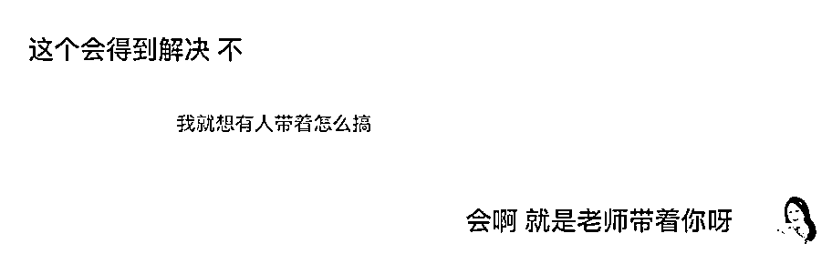

如果客户说“我学了很多都没效果”，你就告诉他，你的方法和别人的不同之处在哪，并介绍往期服务结果和服务特点。

当客户表现出疑虑，进一步追问：你具体担心什么？是执行力跟不上，还是对自己的信念感不够强？

比如我在一段聊天里，就特意强调“有老师带着做”，这句话刚好命中了他最担心的点，疑虑也就被打消了。

策略三：客户说“我已经买了别的课程” → 用反问，放大痛点。

你可以真诚地问：学得怎么样？拿到结果了吗？为什么没有拿到结果？

这一连串反问，会让他重新审视自己的选择，也会更想听听你的方案。

以上就是我从0-1做知识IP这一年，关于销售增长的完整复盘。希望它能帮你少走一些弯路。如果这篇文章对你有启发，欢迎在评论区告诉我，我们一起在IP这条路上走得更远。

你有没有遇到过这样一种学员：课程囤了一堆，笔记记了好几本，结果到了实战那天，照样原地踏步？

前几天，一位朋友就跑来跟我诉苦，说自己报的课全是录播，听着热闹，用起来没动静。

我直接告诉他：病根儿不在你脑子笨，也不在方法错。录播课只能给你知识，给不了你陪伴；真正的突破，靠的是有人在你身后，一步步盯着你落地、修正、拿到结果。换句话说，光有策略远远不够，关键在于“有人陪你死磕执行”。

再聊聊销售，很多人问我怎么判断客户动不动心。我的习惯很简单：先翻翻对方的朋友圈，看Ta是个什么性格的人。

如果遇上思考型客户，凡事都要权衡再三，这时候你得沉住气，不急不躁，别一个劲儿地逼单，让Ta自己消化就够了；

如果碰上主动型客户，做事干脆、目标感强，那就不用来回铺垫，直接把相似背景的客户成功案例甩出来，Ta心里自然就有底了。

这里面有个特别容易踩的坑——介绍产品的时候，千万别把你的产品从头到尾讲个遍。

你觉得自己有九个卖点个个能打，但客户根本记不住，也不关心。你真正要做的，是找到Ta最核心的那个需求缺口，然后用你的其中一个卖点，精准地补上去。就像那个客户，他真正在意的是“我能不能拿到结果”，而不是“你这圈子多好、老师多牛”。那你就直接告诉他：能！

说了这么多方法技巧，如果你还是迟迟打动不了某个客户，别急着怪运气，先回头看看这四件事：

一、你自己的势能够不够强，是不是这段时间成长速度太慢了？
二、朋友圈那家“门店”的展示够不够吸引人？你的案例、你的经验，是不是还拿不出手？
三、客户对你的信任，真的到位了吗？还是只停留在表面寒暄？
四、你戳的那个痛点，真的戳到Ta心缝里了吗？还是只是挠了个痒痒？

如果这些都还没做到位，那也不用焦虑。时间还长，把客户当朋友一样处着，别急着成交，等有一天Ta真的需要了，你刚好在，那就水到渠成了。

做私域，最核心的底线其实只有一句话：不被删除，不招人烦，不树敌。踏踏实实、真实地做自己，就足够了。希望今天的分享，能带给你一点启发。

为什么我对做个人IP这件事越来越上头？原因有两个。

第一，它是一个几乎没有天花板的方向。这一年我从想法到落地，把整条链路跑通了一遍，每梳理一次路径、优化一次关键节点，都能看到新的增长空间。这种“伸手就能摸到更大结果”的渴望，让我每天醒来都充满干劲。

第二，它让我遇到了一个更精彩的自己。这一路摸爬滚打，抗过了很多在职场里永远碰不到的坎，也一次次刷新了我对自己的认知。原来我还能这样活，还能这么长。

我一直相信：事上学，事上练，事上做。人生的厚度、宽度、长度，都是一件件事垒起来的。把自己修好了，才能帮更多人过好他们的生活。你贡献的力量越大，你存在的价值就越大。

今天就说这些吧。再次感谢理白老师的邀请，也谢谢每一个屏目前认真听完的你。下次有机会，咱们接着聊。