# 📕送礼赛道拆解：低粉账号也能吃到钱吗？

嗨，大家好，我是丸子。入冬以来📕风向标已连续中了三条，这次就认领了送礼方向来做拆解。今年刚从人大硕士毕业，主业勉强够用，副业折腾小半年后月入过万已经稳定三月有余，能长久就再来更新。

2024年的愿望是做个普普通通却很会玩很开心的人。赚钱对我的副业和商业实验来说很重要，所以即便错过了拆解的截稿时间，我依然想聊聊我眼中的📕、情绪风向以及藏在其中的生意机会。

Enjoy！

我选的是本次选题一，主要是因为我真的很爱📕，这个主题跟我有缘分，写起来也顺手。先说结论，📕送礼账号能不能赚钱？能，而且是YES。

但在同个赛道里怎么分一杯羹，关键看你手上有什么牌。下面我整理了三类玩法，既有普通人就能上的入口，也有给有供应链老板看的矩阵对标，还有跨平台选品与内容打法的思考。大部分观点来自我个人的体感，我今年刚毕业，商业上还是萌新，分析多基于直觉和感受。

欢迎专业的前辈来指正、补充数据，我们一起把这份拆解完善起来。坦白说我电商实操经验很缺，这份拆解很多靠脑补。

| 类别 | 变现路径 | 适合人群 | 变现潜力 | 难度 | 卡点 |
| 普通人起步的送礼号机会 | 软广植入 | 素人博主 | 按粉丝量报价，约粉丝*0.1 | 🌟🌟 | 执行力 |
| 以圣诞香薰为样本的📕礼物矩阵打法 | 📕电商带货 | 有供应链/内容敏感度高的操盘手 | 该香薰矩阵单月GMV最低56w，多为低粉爆款，无投流，利润可观 | 🌟🌟🌟🌟 | 选品与内容力 |
| 以线条小狗创意礼物为例，抖音60w GMV单品在📕如何复刻 | 📕电商带货 | 抖音做得不错想尝试📕的老手 | 📕基础建设相对抖音还在追赶，抖音爆品在📕仍可推，但内容侧重点必须调整 | 🌟🌟🌟🌟 | 有抖音经验且能完成平台迁移 |

# 普通人入局送礼号的切入点

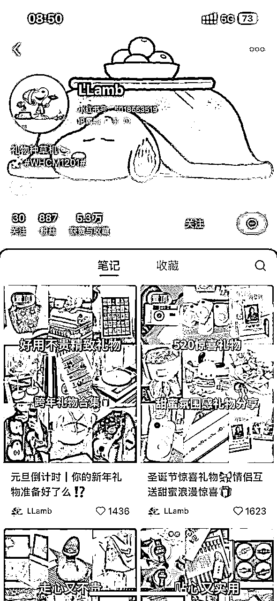

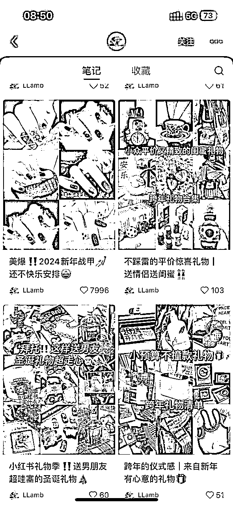

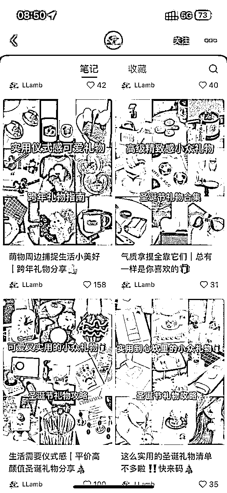

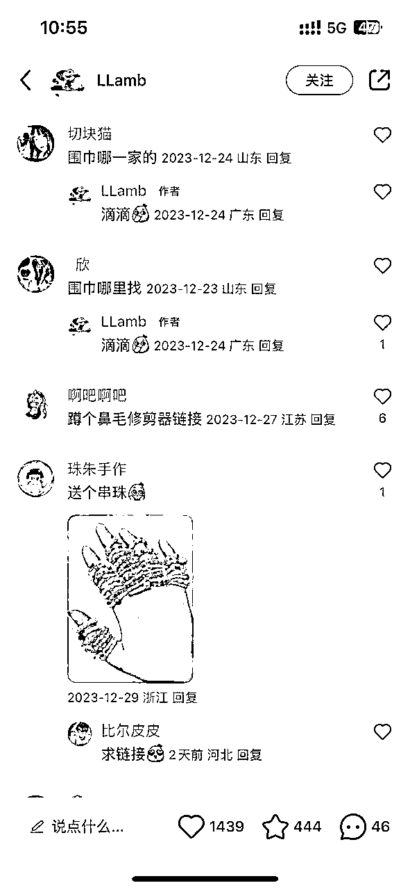

## 账号画像：

典型的低粉收割爆款号，粉丝800+却有多篇爆款。我31号回看时才600粉，几天涨了200+，评论区非常活跃，基本都是“求购买方式”“链接在哪”。

## 内容拆解：

选题方向：蹭节日节点，比如圣诞、新年、520等做礼物清单。

封面样式：九宫格底图+白字标题，黄油相机即可搞定。

配图逻辑：把主页爆款图平铺展示，每张图叠加少量文字即可。

文案风格：配合图片顺手写几句即可，不用太精雕。

## 变现情况：

12月底我私信确认报价，单品植入进礼物合集，合作价100元，对普通人来说门槛不高，性价比我觉得挺可以的。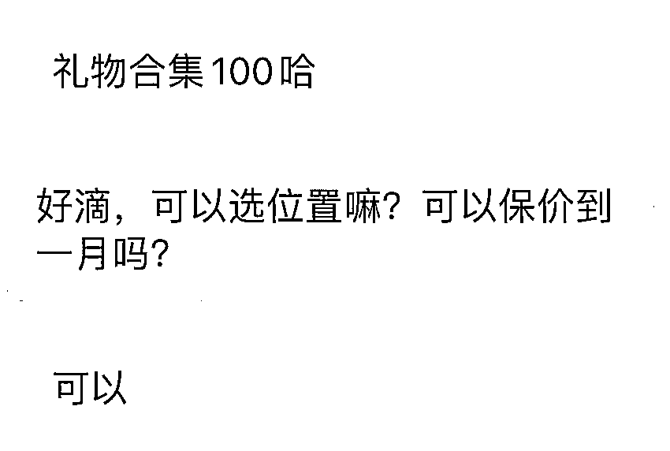

# 以圣诞香薰为案例的礼物矩阵玩法，月入56w GMV

这个机会也是圈友@罗破帽分享的风向标，他也中了。👉https://t.zsxq.com/15jkn4UuL

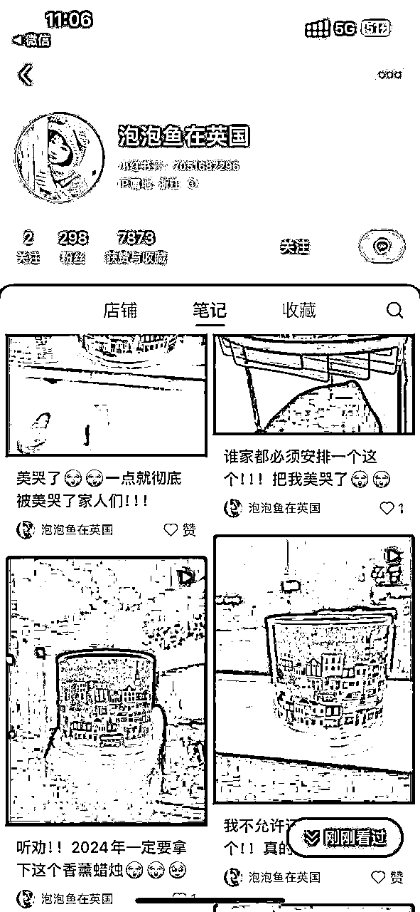

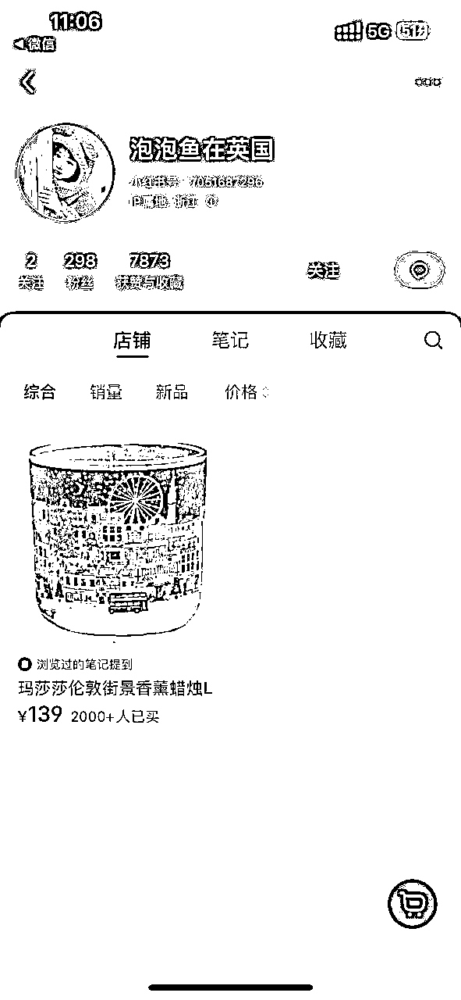

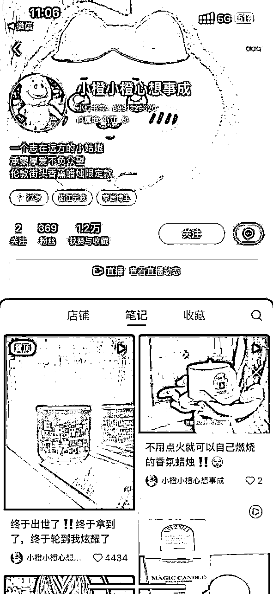

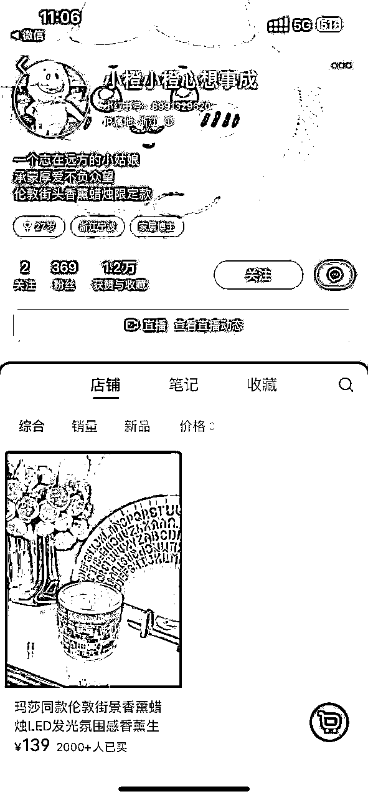

## 账号画像：

两个号都是📕低粉爆品号，粉丝不足500，却能单号带出2000+销量。从IP属地判断大概率是同一操盘手的矩阵，我还挖到他家其他痕迹。

## 内容拆解： http://xhslink.com/FfRdKy

选品思路：从需求洞察出发，给出解决方案。这里选了“契合圣诞氛围的香薰”。

封面创意：远景氛围照作封面，全黑背景突出香薰灯光，视觉焦点明确。

视频呈现：圣诞BGM，拍摄暗到亮的点亮过程，氛围和代入感极强。

标题文案：细节丰富、emoji密集，使用📕常见的种草话术。

## 变现测算：

1688同款约60元，单件利润约70元。按低粉无投流的保守估计，两个号共4000单，靠一个圣诞单品即可带来约28w利润。

实际远不止，因为：1. 矩阵账号不止这两个；2. 量大拿货价还能再压。

# 以线条小狗创意礼物为例，抖音60w GMV的爆品如何搬到📕

这个商机也中了龙哥盟的标👉https://t.zsxq.com/15zOM4moF

抖音的势能太强了，昨天我发的时候销量6w，24小时后已到6.2w……我震惊了。

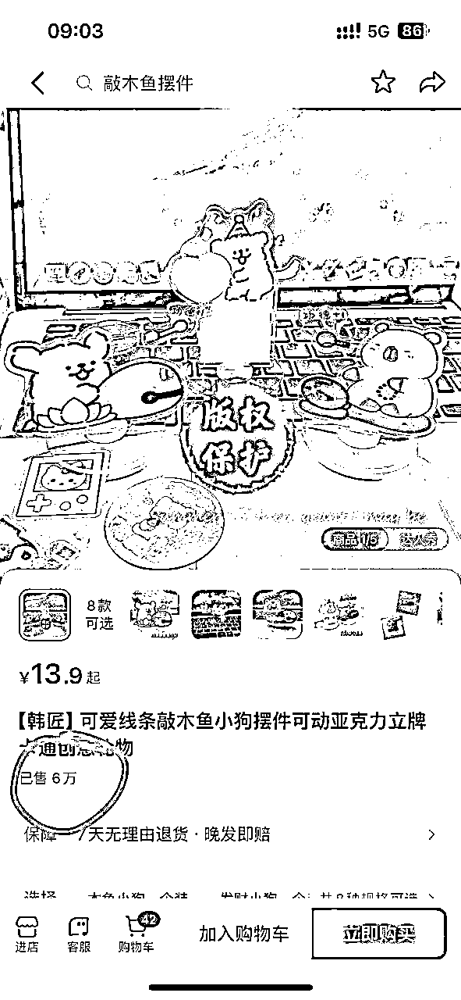

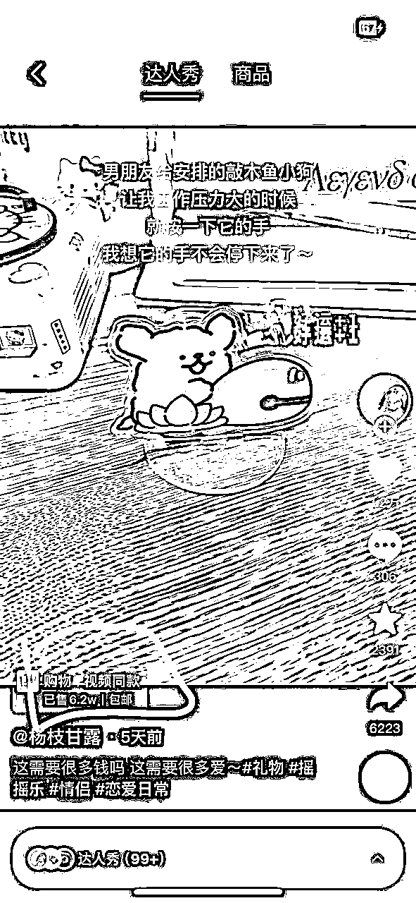

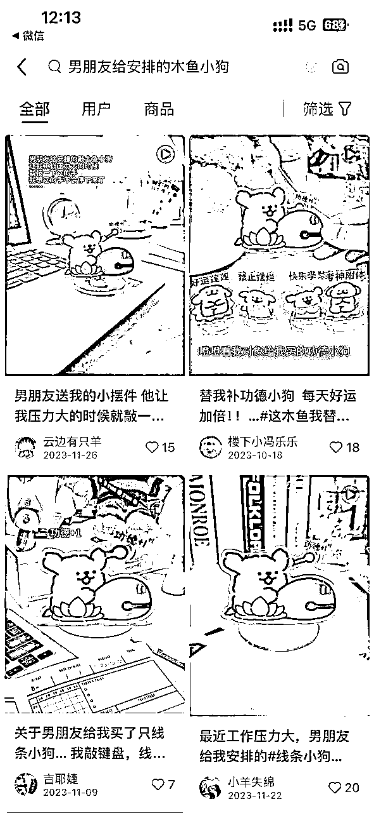

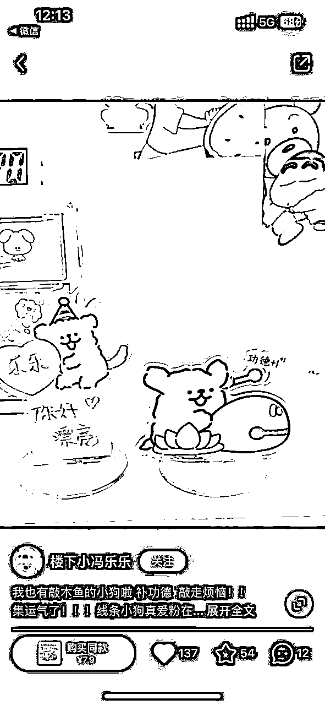

说实话我现在也分不清这个品到底是📕先火还是抖音先火，我的判断是：📕火的品如果抖音没做过，抖音能再做一遍；抖音火过的品如果📕没做过，📕也能再做一遍。

我自己实拍了一下，确实挺好玩的。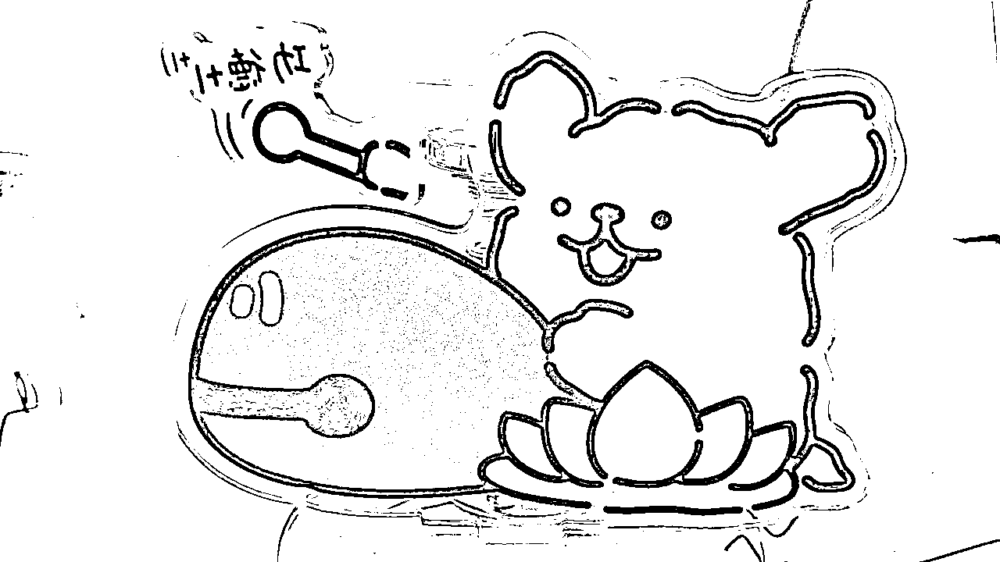

## 内容拆解：

同一个商品，在两个平台的内容主语完全不同。

* 抖音主打：男票给我买的xxx
* 📕主打：我自己买的xxx，我也有了xxxx

主语的微妙差异导致“男朋友安排木鱼小狗”这个方向在📕没起来，矩阵投放再猛，方向错了也白费。这背后是文化、女性意识觉醒、平台调性和社区文化差异。我现在有感觉但说不清，等理清楚再分享。

## 变现测算：

1688大概7元左右，单件赚5元，6w单就是30w。而且我看抖音趋势还在往上走。

* * *

# 结语

我在赚钱三年了，跟项目的时候扑街过无数次，但📕例外，我第一次做📕三天就出了百赞原创爆文。四个月做了一个7000+粉丝的号，变现过万，单篇笔记涨粉过千，这类爆文大概做了三篇多。当时的记录也发过赚钱，后来我倒霉就消失了一年。

今年毕业后找副业，开始带人做📕，效果还行，自己能做也能教一点，客户喜欢我，我也喜欢自己。现在在做📕咨询/代运营，半年后或许真能自称操盘手了。

越做越发现我能捕捉到低粉蓝海爆款了，我不是看大盘数据的，我靠直觉：觉得此子必火→验证一下→顺手发出来→又中标了。

我过去三个中标都长这样：

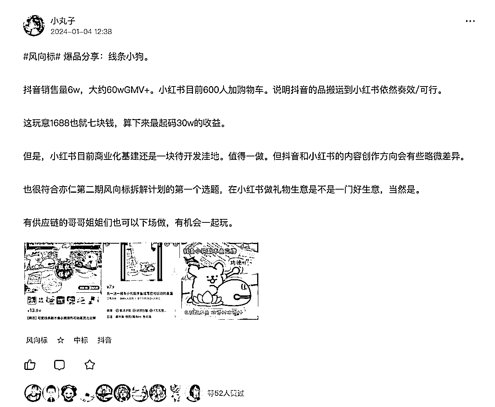

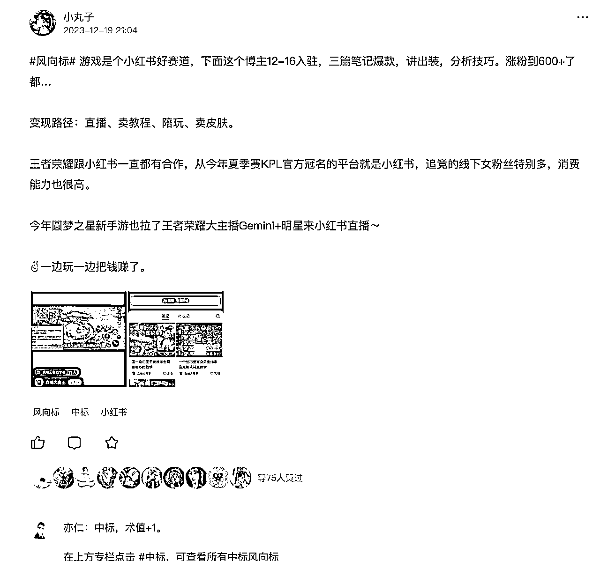

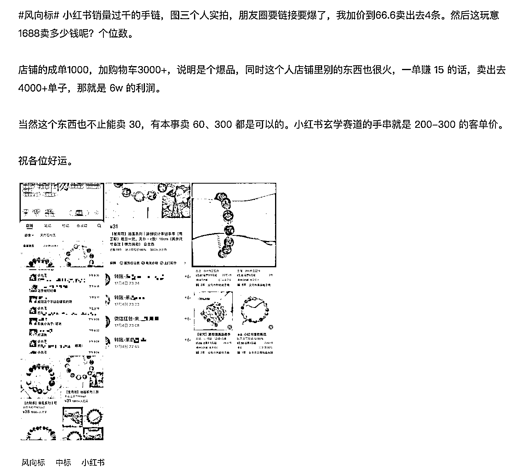

回到送礼账号，我的观点是：万物皆可礼物，只要你赋予它礼物属性它就是礼物。有货、有供应链，就能把货变成礼物，跟热点和人类的情感结合，就能卖出去。

这几个号能火，核心是绑定了圣诞/元旦节点，给出了解决方案。可是我们的生活不止一个元旦，还有下一个元旦，还有新年。龙年要来了，中国人对龙的偏爱是骨子里的，这个意象可以深挖。

节日也可以是人造的，比如赚钱的418。

比起研究生意，我更爱感知情绪。最近迷上山海经、打游戏，也活在我的年纪。我这个年龄段喜欢的东西，我都想体验一遍。抱歉拆解提交晚了，因为昨天刚去纹眉，新年想有个好彩头嘛。

错过了DDL却收获了意外，纹眉小店月GMV 200万，还准备开分店。躺在椅子上我想起金庸里张无忌对赵敏的承诺：我一生为你画眉，也只为你画眉。金庸为何选“眉”作意象？中国人表达爱意的方式是含蓄而温暖的。

办公室姐妹看完我的眉纷纷要链接，朋友也把屏蔽已久的客服🛰️解封了。大概我就是个平平无奇的种草达人吧。

古人论礼物：“江南无所有，聊赠一枝春”“桃花潭水深千尺，不及汪伦送我情”“洛阳亲友如相问，一片冰心在玉壶”。西方欧亨利的《麦琪的礼物》也说：愿用我最珍贵的东西换你的笑靥如花。

送礼送到心坎上，就是四两拨千斤。价值感知因人而异，有人视如敝履，有人视如珍宝。做内容可以用的爆款关键词很多，“给男朋友买什么”“探病送什么”“过年给领导带点啥”，关键词越细分，需求越精准，内容越容易被同圈层喜欢。

比如图三右下角，新年送导师礼物，12.27发的文案，现在接近千赞。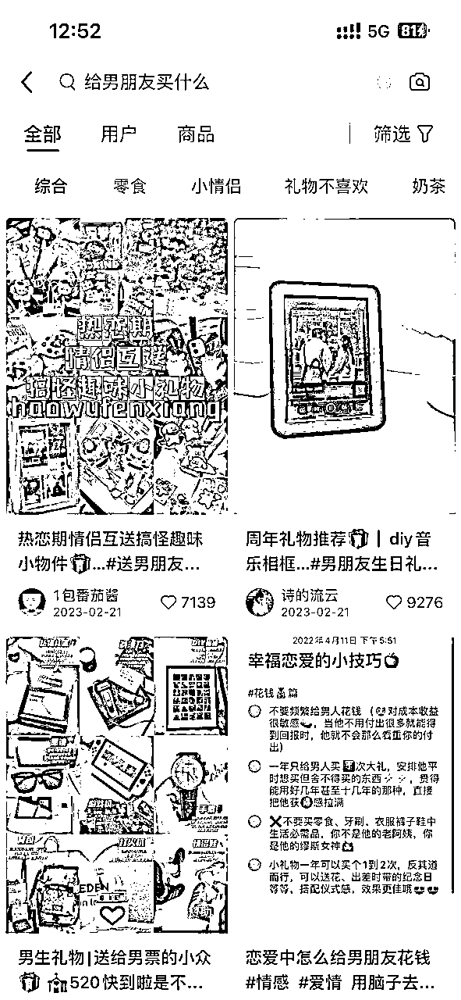

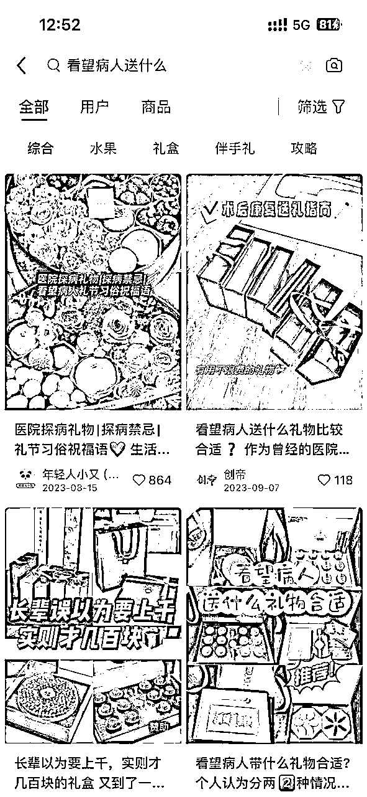

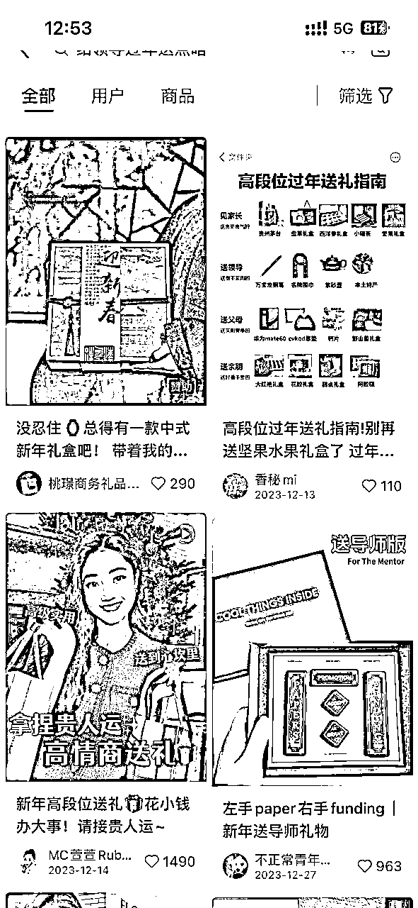

我很推荐大家来📕玩玩，这里很宠原创，宠有内容能力的人，也宠生活小确幸。如果你有很多小确幸，或者你是做有温度品牌，有温度的产品，欢迎来聊，我们一起在📕创作。

毕竟，出现在别人生命里，就该像一份礼物。🎁