# 📕做送礼号，到底能不能赚钱？——罗破帽拆解

# 一、供需两端都在放量

## 1. 需求端

### 市场体量
2018年到2022年，中国礼物经济整体盘子从8000亿涨到12262亿，年年向上；艾媒测算2024年会冲到13777亿，2027年有望突破16197亿。

礼物经济已经是万亿级赛道了！

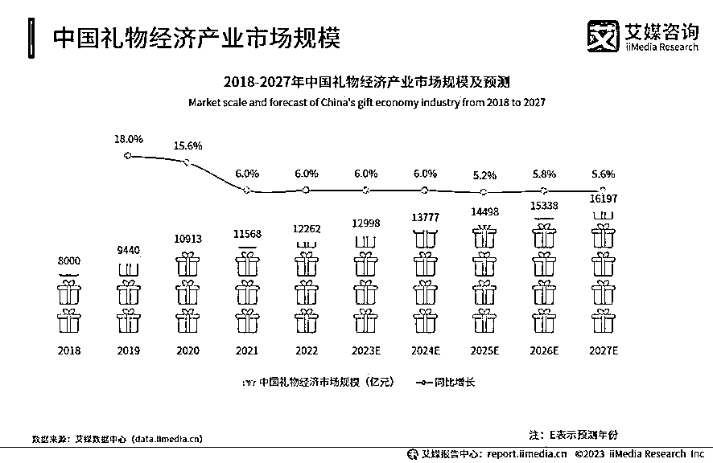

图片来源：艾媒数据中心

### 送礼场景
送礼并非只有过节，日常、商务往来、婚庆、节日节点全都是高频场景。

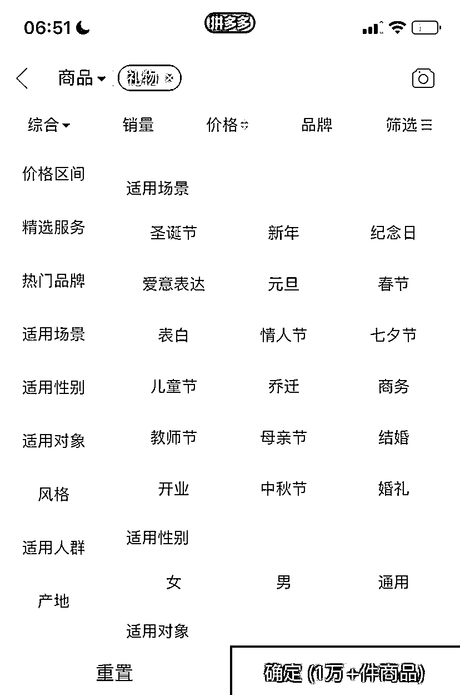

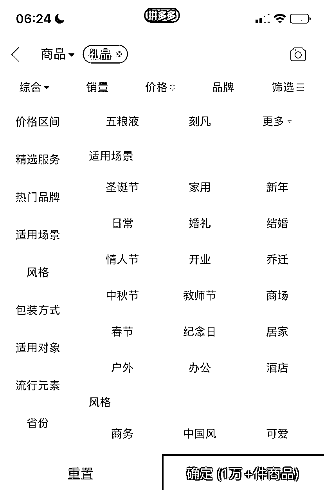

### 送礼人群画像
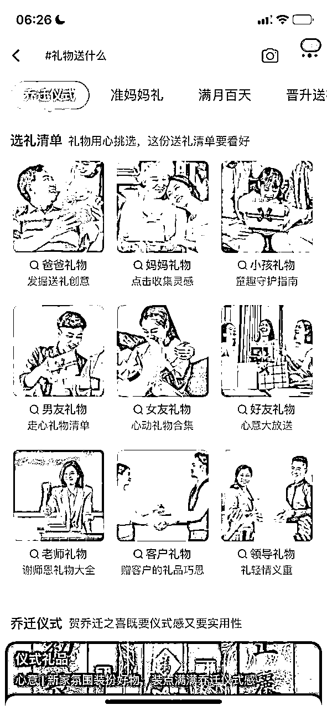

### 核心送礼动机拆解
* 送给孩子，是爱与陪伴的表达
* 送给朋友，是维系关系、增进情谊
* 送给恋人，是爱与归属感的投射
* 送给客户，是塑造被重视感
* 送给长辈，是爱、归属与尊重并存
* 送给老师，是尊重与感恩
* 送给老板，是彰显尊重与支持，进而实现自我价值提升

## 2. 供给端

### 行业流量规模
送礼品类跨度太大，第三方平台并没有单独的伴手礼模块，下面展示的是“饰品类”的流量大盘作为类比参考。按同样方法可推导出其他品类。

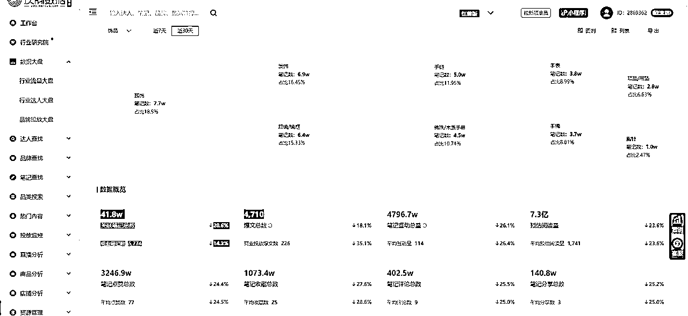

### 细分赛道热度
想知道哪个场景钱更多，看关键词搜索的“总参与人数”就行。人数越多，需求越旺。通过“伴手礼、礼物、礼品、送礼”关键词排序，能清晰看出各场景体量。

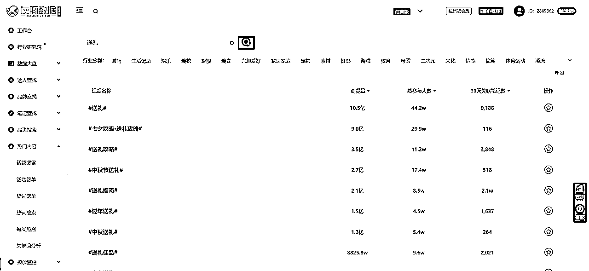

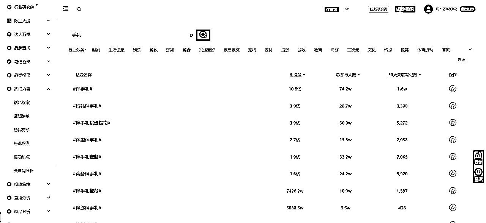

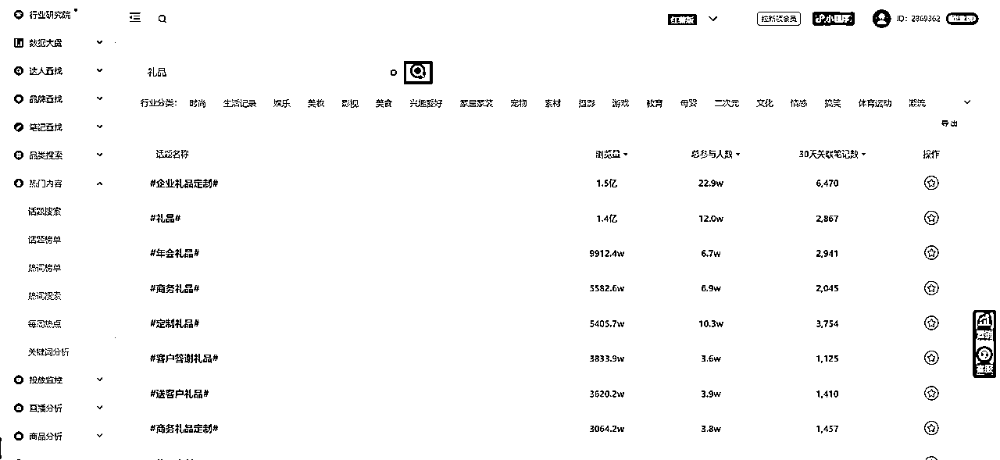

基于总参与人数的排序结果：
* 礼物：141.7w > 98.3w > 94.8w，即 生日礼物 > 情侣礼物 > 闺蜜礼物
* 伴手礼：28.7w > 24.2w，即 婚礼伴手礼 > 商务伴手礼
* 送礼：#七夕攻略·送礼攻略#、#中秋节送礼#、#过年送礼# 都属于节日送礼，话题属性不同，不宜横向对比
* 礼品：除#礼品#外，其余标签多为商务范畴，对比价值有限

综合来看，市场优先级约为：生日礼物市场 > 节日礼物市场 > 婚礼礼物市场 > 商务礼物市场。

需要说明的是，单点做一个赛道天花板很低。市场上成熟的伴手礼商家基本会覆盖3-4个场景，用来平滑淡旺季、提升总盘。

### 创作者规模与笔记量

* 创作者体量
每个话题页的数据由浏览量、总参与人数、笔记量构成。总参与人数排第一的是#生日礼物#，为141.7w。剔除普通用户和非从业者后，可大致反推该行业的创作者历史存量。

总参与人数 = 去重后发布过该话题笔记的历史总人数

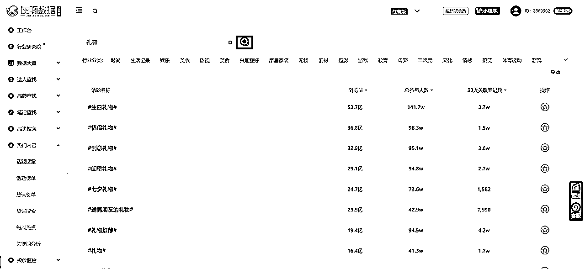

从消费频次看，生日送礼复购最强，因为老人、孩子、年轻人全都有生日节点，人群覆盖最广。
从客单看，旺季走团购更划算，淡季则靠高频复购续命。

* 30天活跃创作量
剔除非从业者后，以“30天关联笔记数”估算近一月仍在更新的活跃创作者人数。

研究近30天笔记量，本质是算清你要和多少篇新内容抢流量。

# 二、产品逻辑

## 常见礼品形态
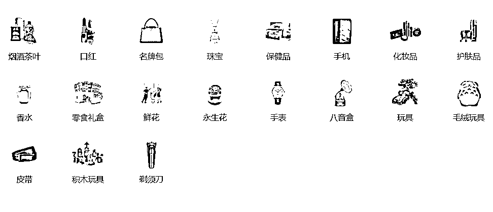

## 定制 vs 非定制
礼品分定制和现成。到底用户更爱哪种？从灰豚数据抓取3000个伴手礼博主的账号简介做词云，高频词第一位是“定制”。说明行业主流是定制路线。定制意味着客单价更高、利润更厚。

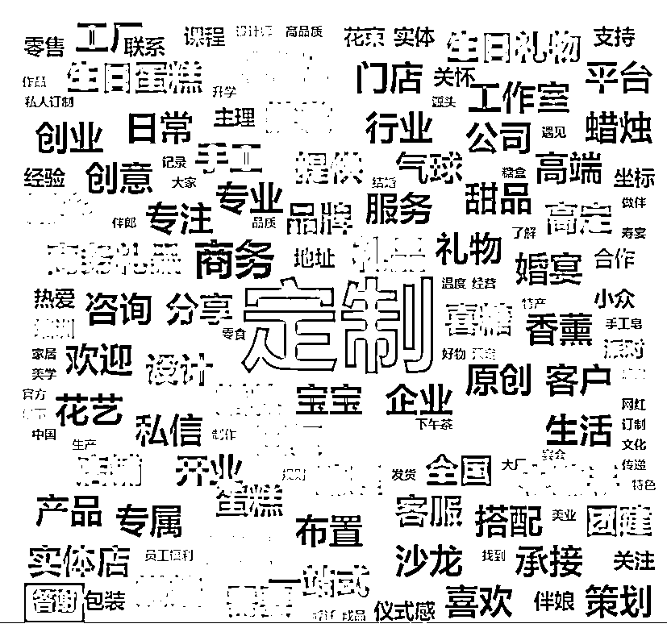

## 供应链形态
* 自建仓 + 云仓协同
适合资金实力强、体量大的企业，可做本地仓和跨区云仓配合。

* 代发货模式
a. 后端由供应商承接
达人负责前端获客，下单后需求转给供应商，供应商包设计、生产、发货、售后。适合无货源达人、纯线上商家。
b. 供应商负责生产发货
商家收到订单后，把已有的样品方案交给供应商生产发货。适合工作室、线上商家、实体店。
c. 代理模式
代理人负责引流，下单后需求先给商家，再由商家转给供应商生产发货。适合代理人。

# 三、流量与获客

## 获客渠道
* 线上：自营店铺、账号矩阵、代理裂变、多平台分发
* 线下：自然客流、异业合作

## 常用引流手法
* 昵称直接放🛰️号
* 发“Ta的瞬间”笔记挂🛰️
* 线下门店地址页留手机号/🛰️
* 简介@小号、主页挂小程序/🛰️
* 店铺客服沟通时发🛰️或引导用户先发🛰️
* 引流笔记置顶、群聊置顶🛰️、群公告留微

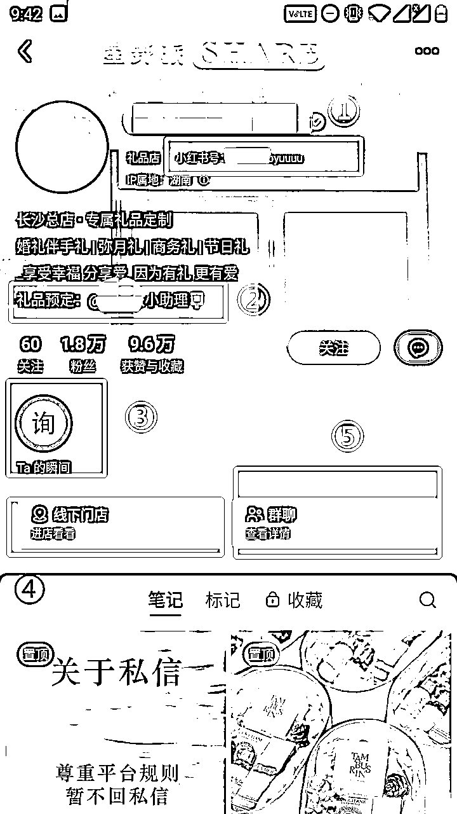

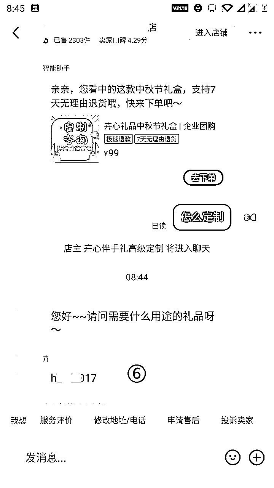

# 四、营销打法

### 内容营销
* 形式：图文/视频
* 单次发文：1条/2条/3条
* 更新节奏：定时更新/自由更新
* 内容类型：收益展示、产品种草、日常打包、学员实操

### 投放
### 私域运营
* 头像：品牌名
* 昵称：品牌名
* 简介：业务范围
* 朋友圈封面：门店招牌/业务范围
* 朋友圈形式：图文为主
* 朋友圈频率：4-6条/天
* 朋友圈内容：订单截图、收益截图、产品推荐、工作日常、生活日常

# 四、变现路径

* 线上店铺成交
* 私域成交
* 培训收费
  - 训练营
  - 1对1陪跑
  - 线上合伙人/代理人
收取代理费，前期线上带教，后期代理人去自媒体发内容，素材由商家/团队提供。前后端分离，代理人只负责引流，后端由商家/团队操盘，成交后代理人拿佣金+商品差价。
* 渠道费
单纯提供靠谱供应商名单，收取货源渠道费
* 加盟费

# 六、案例拆解

## 案例1
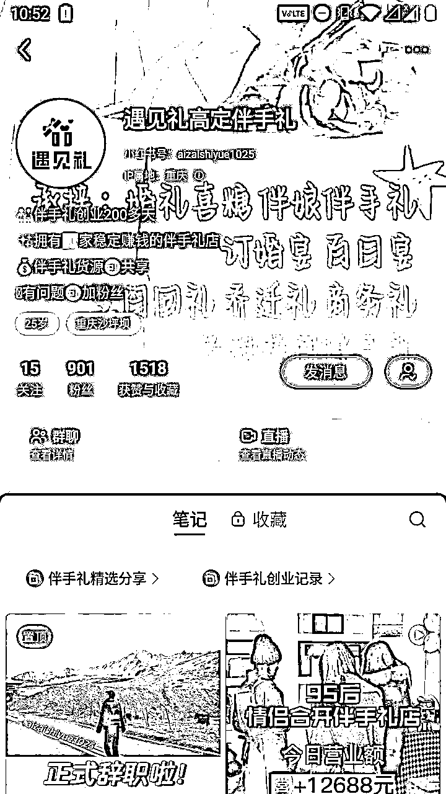

### 基本信息
* 店铺位置：重庆沙坪坝
* 店铺面积：40平
* 启动资金：6万
* 回本周期：约2个月，靠多位代理人爆单实现
* 人员：2人
* 开业时间：2023年6月9日
* 线上店铺：无
* 业务覆盖：婚礼、生日宴、商务、儿童、升学等伴手礼

### 运营情况
* 账号名：遇见礼高定伴手礼
* 粉丝：901
* 账号类型：个人号
* 呈现形式：前期图文，后期转视频
* 笔记总数：63篇
* 更新规律：不规律
* 首条笔记：2023年5月21日
* 内容调性：封面放收益图 + 情侣创业日常
* 矩阵：无

### 引流方式
* 置顶引流笔记
* 昵称改成🛰️号
* 建群引导看群置顶引流帖

### 收入测算
1. 线下自营
| 单月销售额 | 利润率 | 净利润 |
|  |  |  |

利润率参考：访谈10位伴手礼商家，普遍在35%-50%之间，具体取决于议价能力。

销售额与季节、人脉、客单高度相关，旺季高、淡季低。

新手刚入行无资源，首月销售额通常1W以内。以下数据来自入行半年以上且有核心技能的商家，请理性参考。

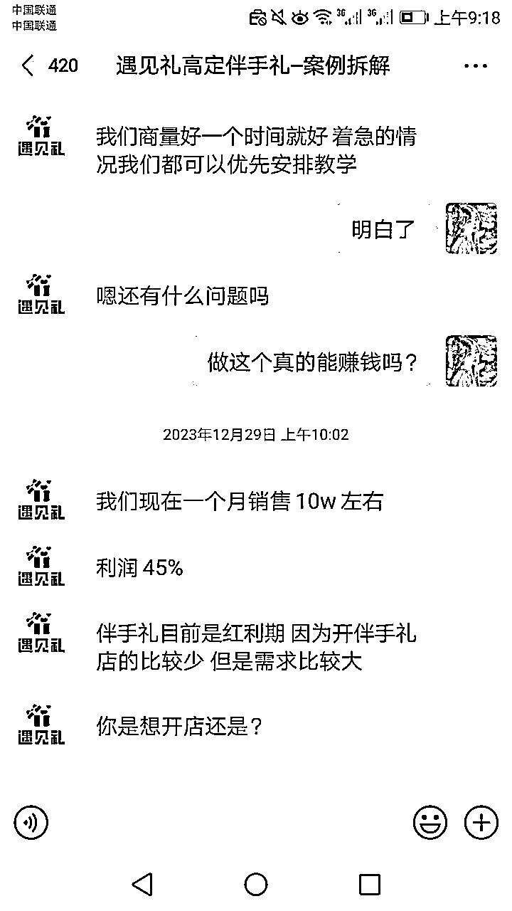

图1

图1显示月销10W。该商家具备“入行6个月+2年多私域经验+旺季”三个条件，12月10W销售额具有可信度。

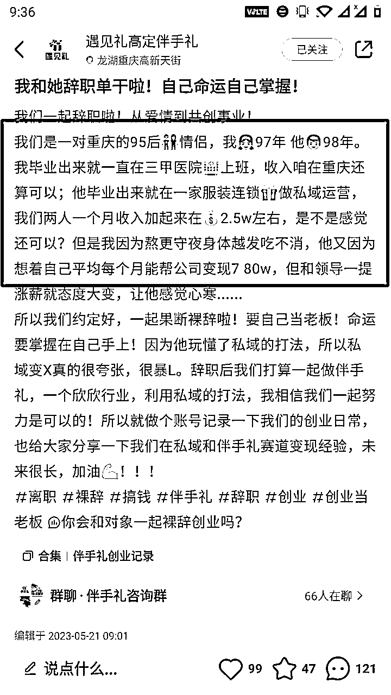

2. 培训收入
| 项目 | 单价 | 报名人数 | 收入 | 说明 |
| 线上合伙人 | 699元 | 30 | 10485 | 适合做代理 |
| 训练营 | 2999元 | 未知 | 未知 | 适合开工作室/开店 |
| 1对1陪跑 | 9999元 | 未知 | 未知 | 适合开工作室/开店 |

商家2023年6月9日开业，培训项目10月底才上线，截至12月底线上合伙人已超30人。以30人计，2个月培训收入约20970元，月均约15人。

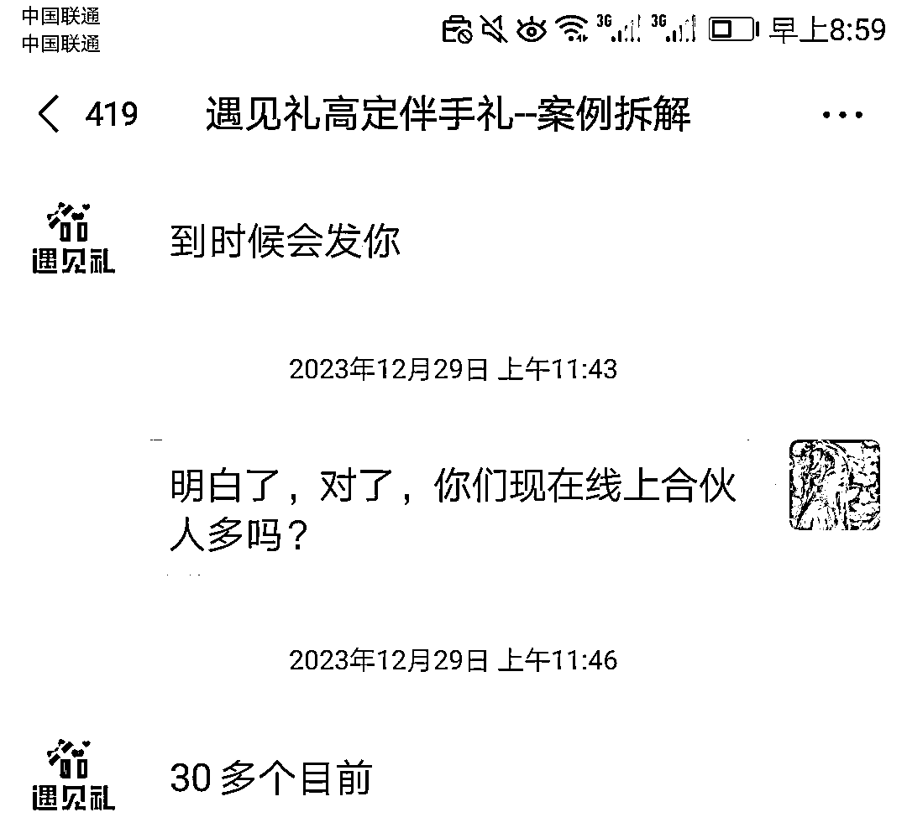

综合计算：
* 收入下限 = 月销售额 + 月培训费 = 35000 + 10485 = 45485元
* 收入上限 = 50000 + 10485 = 60485元

### 其他商家情况
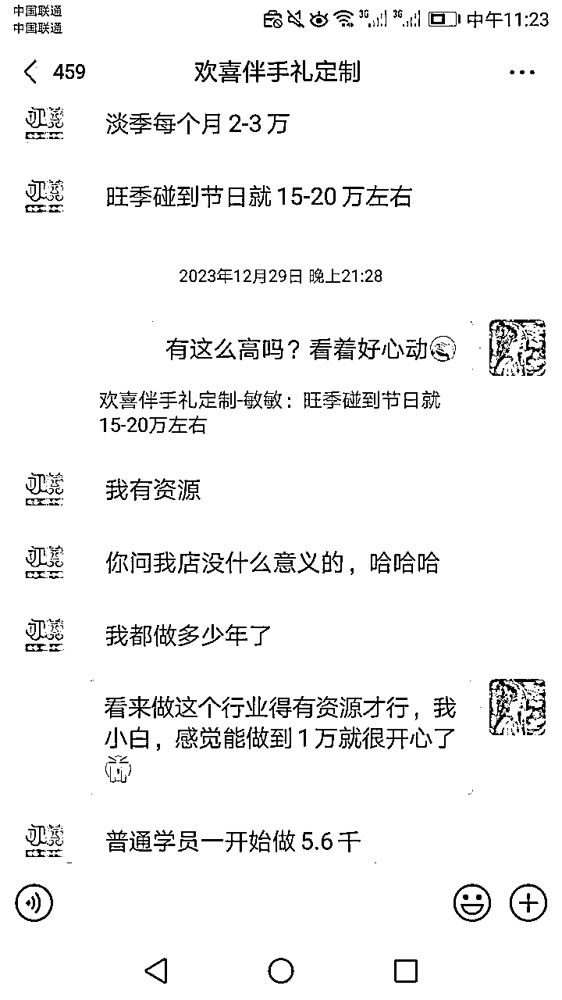

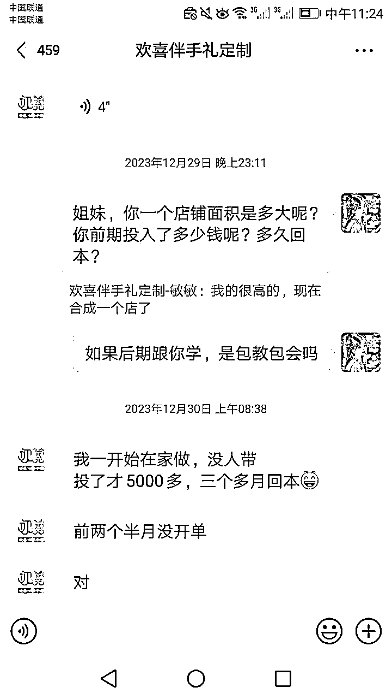

补充案例是为了让想入局的人更全面了解行业。事例商家此前做营销8年，后转伴手礼已3年，信息源自📕笔记，经聊天及朋友圈观察，可信度较高。

## 案例2
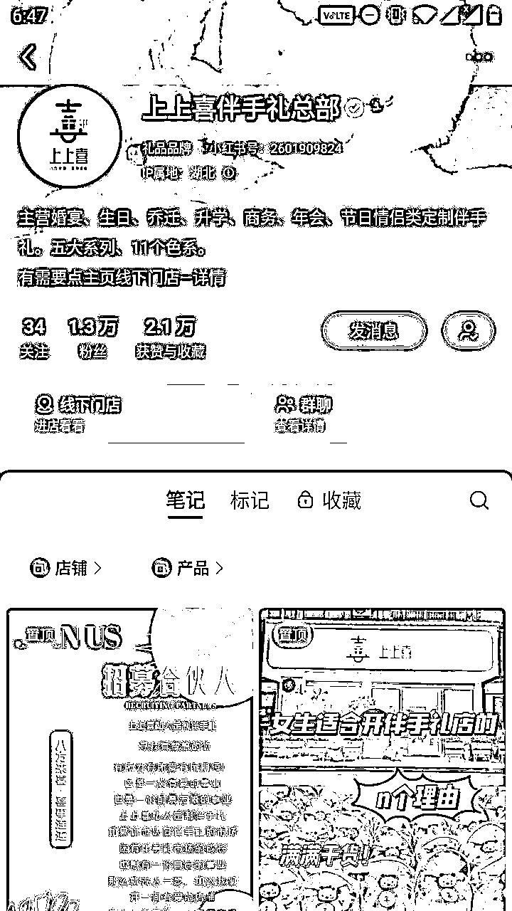

### 基本信息
* 公司位置：湖北武汉
* 员工规模：20-99人
* 性质：民营
* 注册资本：1000万
* 业务范围：伴手礼品、气球派对、空间花艺、个性定制

### 运营信息
* 账号名：上上喜伴手礼总部
* 粉丝：1.3W
* 账号类型：企业号
* 形式：图文/视频
* 笔记总数：436篇
* 更新频率：1篇/天
* 首条笔记：2021年6月13日
* 内容风格：学员日常、励志故事
* 矩阵：有

### 引流方式
* 加群聊
* 📕“线下门店”栏留手机号/🛰️

### 收入测算
| 名称 | 单价/GMV | 毛利 | 人数/门店数 | 收入 |
| 直营店 | / | / | 600+ | 未知 |
| 经销商 | / | / | / | 未知 |
| 加盟押金 | 19900 | / | 500+ | 9950000 |
| 供应链合作 | / | / | / | 未知 |

直营店与加盟店数据来源：

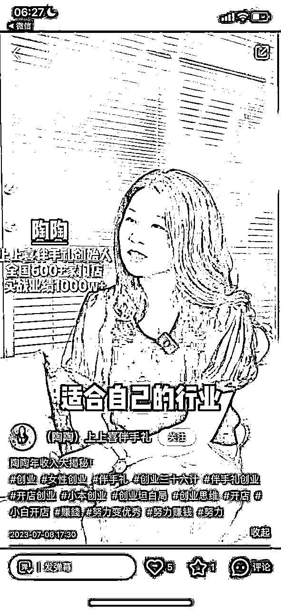

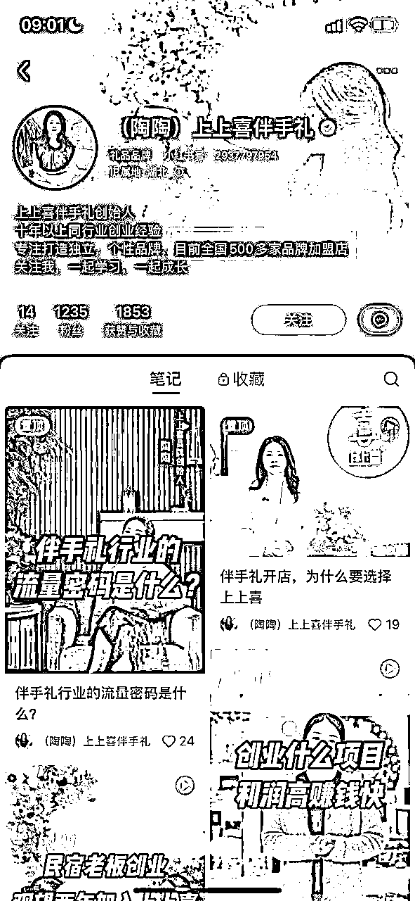

直营店与加盟店具体数量仍需进一步核实。

## 案例3
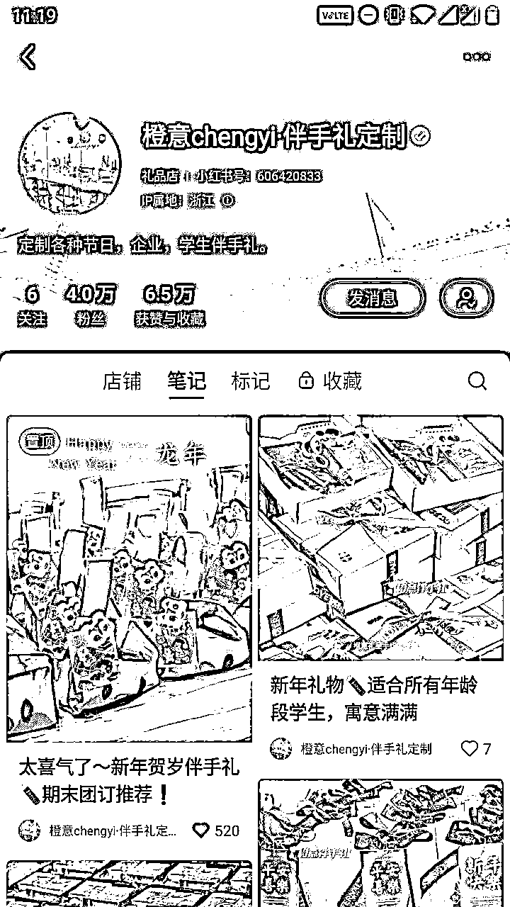

### 基本信息
* 工作室位置：浙江温州瓯海区
* 面积：40平
* 启动资金：未知
* 回本：未知
* 人员：3人
* 开业时间：2021年4月9日
* 线上店铺：有
* 业务范围：定制儿童伴手礼、学生伴手礼、节日伴手礼、企业伴手礼、婚礼伴手礼、手作

### 运营信息
* 账号名：橙意chengyi·伴手礼定制
* 粉丝：4W
* 账号类型：企业号
* 形式：图文为主、少量视频
* 笔记总数：420篇
* 更新规律：不固定
* 首条笔记：2021年5月2日
* 内容类型：产品推荐、日常打包
* 矩阵：有

### 引流方式
客户定制需求时，引导在店铺咨询栏留下联系方式/🛰️

### 收入测算
#### 线上自营
| 总销售额 | 利润率 | 纯收入 |
| 36374元 | 35%-50% | 12730.9元—18187元 |

线上店铺SKU近百种，已售1952件，累计销售额36374元。不包邮，利润相对可观，按行业35%-50%毛利区间测算。

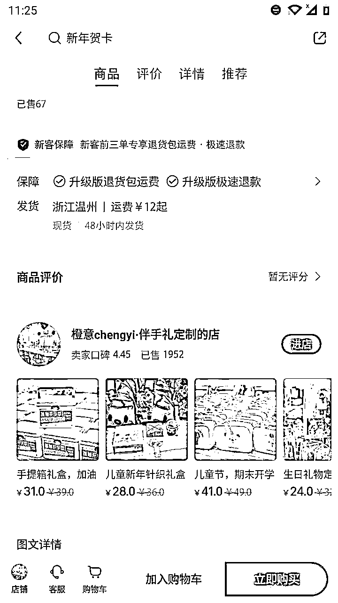

#### 线下自营
线下收入未披露，聊天的及朋友圈信息显示线下非常可观。主力是儿童伴手礼、学生伴手礼，设计由老板和女儿完成，生产发货由工厂承担。

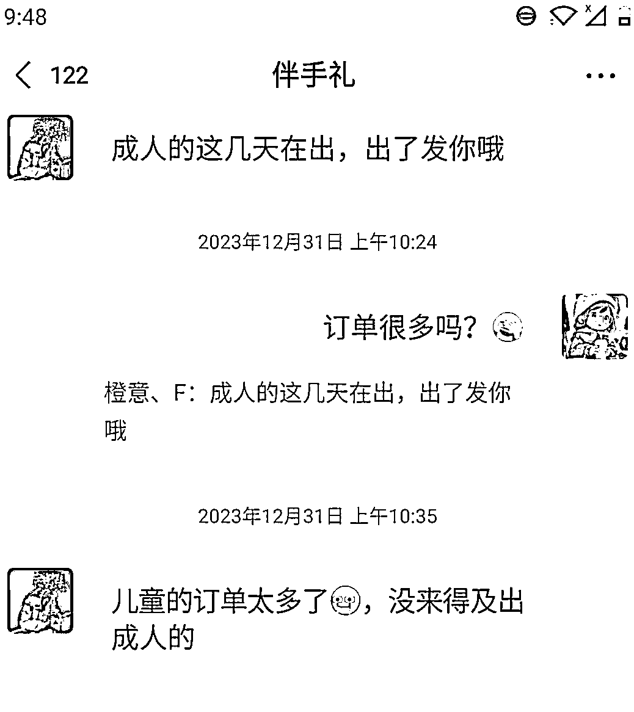

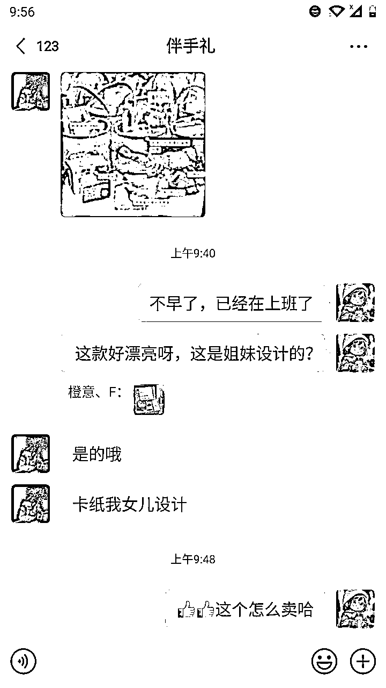

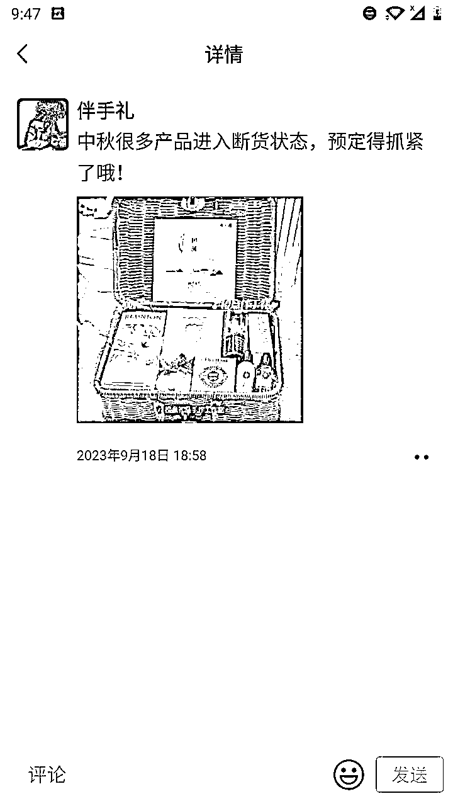

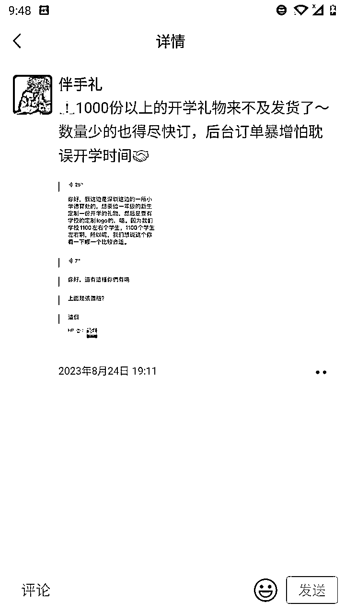

# 七、实操要点
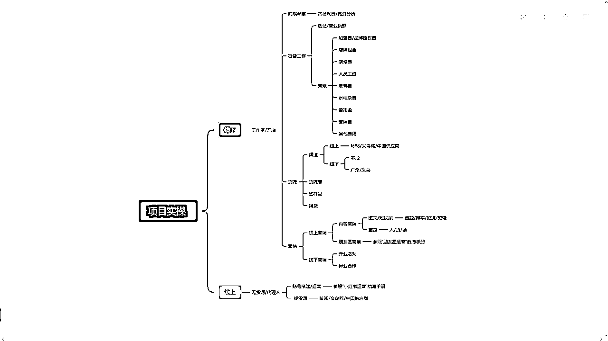

# 八、风险与建议

## 平台政策风险
📕目前严打导流，企业号也难幸免，除非进入白名单。与多位商家沟通后发现大家对主动留🛰️非常谨慎。客户要定制时，多走店铺成交或引导用户主动发🛰️。建议准备2-3个备用号，并学习同行的安全引流方法。

## 投入成本建议
新手切勿一上来就开工作室或线下店。建议先线上试错，与本地或异地商家合作。边学边做，跑通选址-开店-选品-铺货-营销全流程，再积累资源，为线下扩张打基础。

## 供应商选择
找到靠谱供应商是项目核心。刚入门时订单量少，如何让供应商愿意小单打样、小批量生产发货，是必须解决的关键问题。