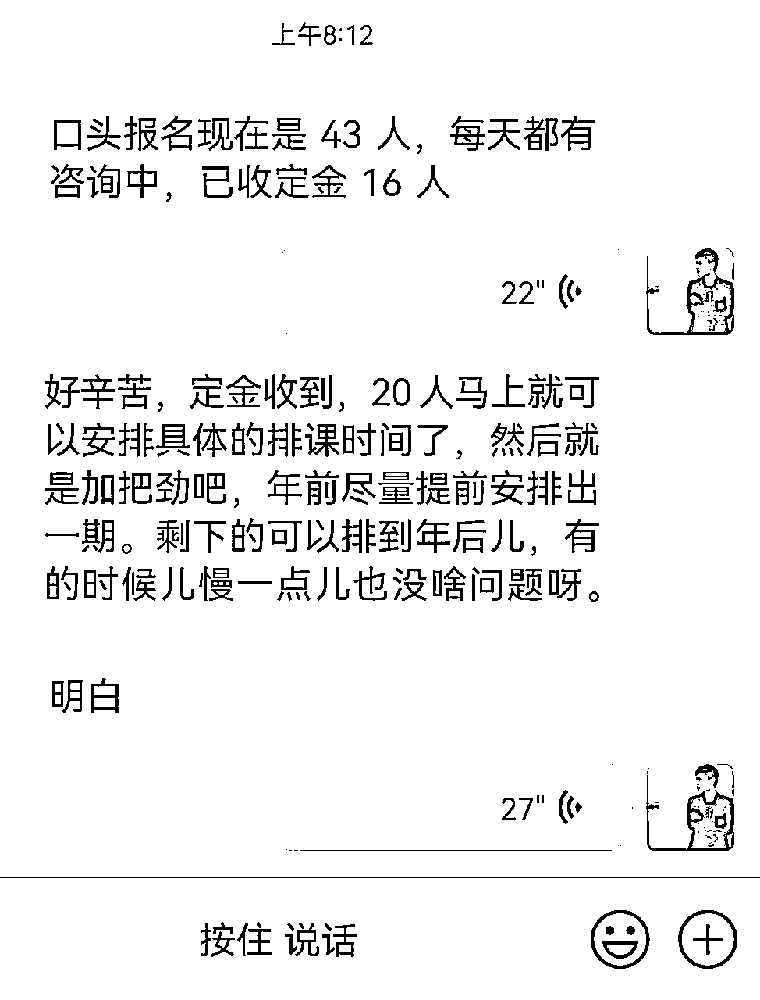
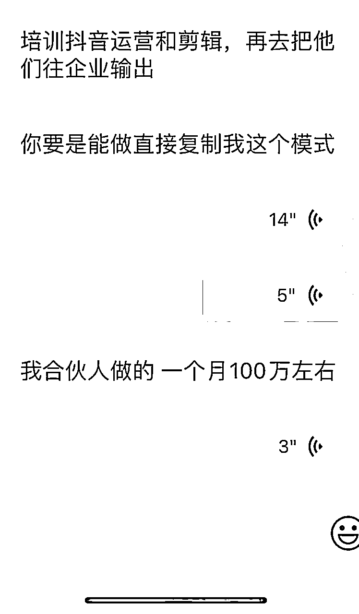
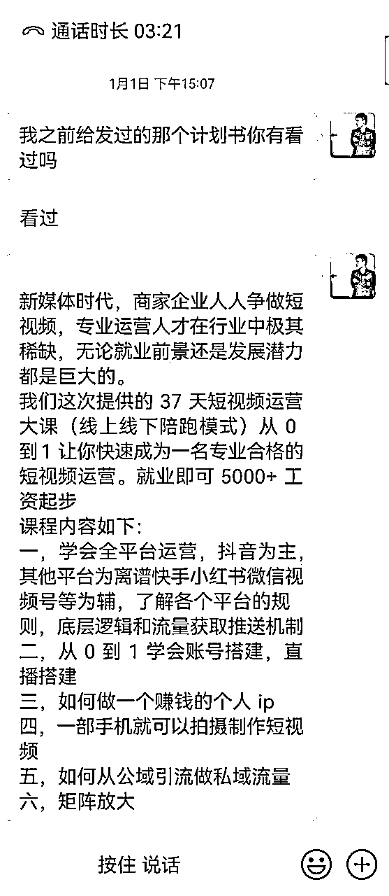
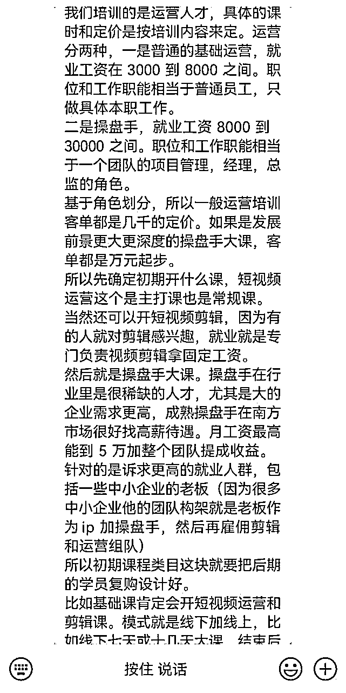
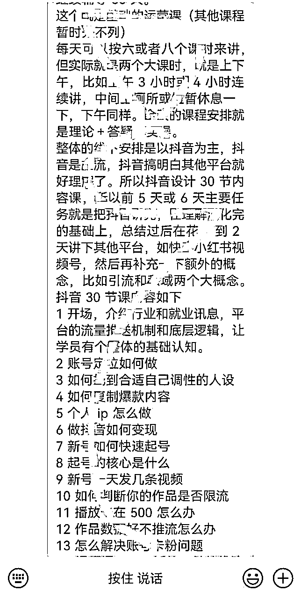
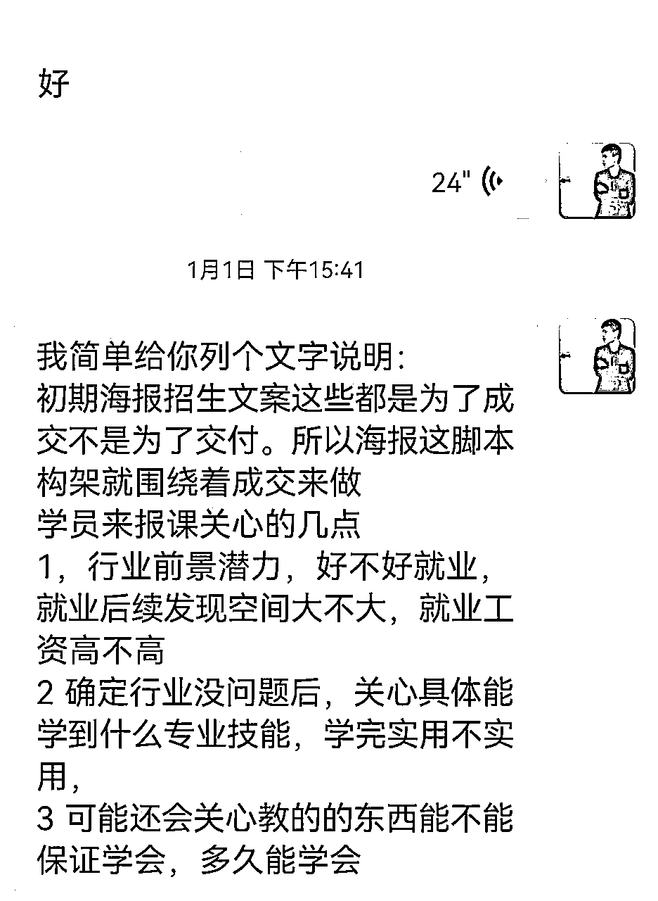

# 千万级利润项目：短视频教培就业

标题：把这个项目跑通后，我觉得它有机会做到年入千万

从开始琢磨到正式落地，前后花了两个多月，最近终于算是把整个模式给走通了。趁着热气还在，赶紧把干货掏出来，哪怕能帮到一个人也值了。

我现在做的这个事，叫“短视频运营就业培训”。通俗点讲，就是教人做账号、搞剪辑、当操盘手，然后把合格的人输出给企业。跟咱们平时聊的“网赚副业”完全是两批受众，这套东西面向的是想找工作、想转行的职场人。

目前客单价定在5000，交付方式是线下七天大课，再加线上一个月的陪跑辅导。现在口头锁定的学员有43个，交了定金预订的有16个，凑满20人就开第一期小班。可以说，刚起了个头。

为什么我敢押这个方向？一方面靠自己的判断，另一方面，更关键的是看了同行的实际案例。

最初知道这个赛道，是从一个现实里的朋友那听来的。他自己不做自媒体，是搞传统教培的，随手办了个短视频运营班，一个月就能赚几十万。他找我聊，也是因为老板们都在头疼一个问题：怎么用流量把原有业务放大。我听完心里一动——这属于闷声发大财的路子啊。回来以后，我又托人找线上做这块的朋友请教，折腾几轮发现，兜兜转转大家都认识，人家很爽快地把整个商业模式给我掰开揉碎讲了一遍。讲完我就一个想法：干。

真动手起来倒不复杂，就是照着有成绩的同行抄，再自己优化。一个项目要正常转起来，无非是产品、引流、成交、交付这几个环节；如果还想做复购和客单价提升，就得再加一个二次追单。把这几个点挨个打通就行。

先聊引流，目前这一块走得比较“野”，主要在58和Boss直聘上挖学员。因为跑的时间不长、样本量还小，太细的数据就不硬报了，直接给个方便大家算账的数：一个询盘成本大概30块左右，跟线上投流拿泛粉的成本差不多，转化率能过0.5，后面还会往上走。

引流渠道本身没多大技术含量，重点还是产品和销售。

产品这块，市面上没有现成的东西能直接抄，我们也是参考同行，再按自己的理解做了优化。

我设计的是“线下7天+线上30天辅导”的组合产品，基本把行业里能涉及到的知识点全装进去，用理论加实操的方式，培养综合型的短视频人才。这样学员毕业出去，实际找工作的时候基本不会卡壳。

第一期的产品结构，我设了三门课：短视频运营定价5000，短视频剪辑定价3000，操盘手大课超过一万，具体还没定。当下只开了运营这一门，后面等第一期跑完再把另外两门顶上来。这些课可以同时开，基础班也能往高阶班导流。

表面上就这几门课，其实里面又拆出了上百节小课，真正实战的东西都在这里面。小课内容反而不难搞，网上到处都是可以借鉴的素材，花点时间整理缝合一下就有了，完全不用自己从零憋。

产品搞定，接下来就是最关键的一步——销售转化。这一步离钱最近，也最吃功夫。

销售得围绕产品来做，主要抓两点。第一是成交背书：线上和线下侧重点不太一样，线上靠人设解决信任，线下靠机构资质、场地这些硬条件撑场面。这两样解决起来也不难，找机构挂靠或者直接合作就行。

第二就是话术。我们的触达链路是：先电话聊一轮，有意的加🛰️，然后再约线下见面。无论是招生海报还是聊天话术，核心都咬住学员的痛点和需求。成交以后，接着排课、做售后、再跟单。

接下来重点说说，我为什么这么看好这个项目的前景。

先看大前提，教培本身就是一个利润很肥的行业。有次跟朋友喝酒，他说他家孩子假期报了个兴趣班，十五天花了5000块，而且是在北方一个五线城市。当时我就心想，这行当有机会要参与一下。具体到这个项目，优势能列出好几条：

1、引流获客的确定性很强。我们去招聘网站上捞人，不像自媒体平台那样流量忽高忽低，算是有下限的生意，心里稳当。

2、人群属性不一样。就业培训面对的是想找工作的人，而市面上绝大多数知识付费都在卷“教人创业副业”，真正想找份好工作的人反而没人管。我这边还查过数据，各城市的就业局都有就业扶持培训项目，比如针对大学生的技能培训，政府出钱，机构出培训，帮待业青年免费再就业。这两年他们被问到最多的就是：有没有短视频培训？

3、交付率天差地别。教人赚钱这事吧，创业本身九死一生，所以这类课程很难有高交付。但就业培训不一样，训完基本不愁找工作，而且短视频行业工资不错，人才缺口又大，学员掏钱特别痛快。有时候你根本不用多劝，因为现在大家都认这个行业的就业前景，成交相对容易。交付也更轻，一个周期就一个多月，不像线上的项目动不动就要设置三年五年合伙人。

说到人才稀缺，真不是夸张：四五线城市连合格的普通运营都招不到，一二线城市连合格的操盘手都很难找。所以你们会看见很多企业老板自己跑到大博主那儿付费学课——他们不是闲的，是真招不到人。招聘网站上有的是高薪岗位挂了一年，还是一人难求。

还有一个有意思的现象：很多“聪明人”嗅到了这里面的机会，但自己水平只有半吊子，就跑去割老板韭菜。听说杭州是重灾区，有些老板自己不懂新媒体，那些速成班出来的人就现学现卖，满嘴理论空话把老板忽悠得团团转，一个月拿五六万工资。干几个月露了馅，再换个地方继续忽悠，老板们被反割得苦不堪言。

4、赚钱远不止开课这一条路。这个项目一共有三重收益：第一重是学员学费；第二重是给企业输送靠谱人才后，企业会给推荐返点，相当于两头赚；第三重就是终极形态——招商。据说这种代理费在10万到50万之间，不同地区不一样，本质就是复制一个一模一样的短视频培训分公司。而且完全可以套用线上项目的矩阵逻辑，先在一个城市跑通盈利模型，然后开直营分公司，把盘子铺到全国。

综合看下来，切入这个人群，可能又是一波大机会。

一句话总结：你能赚多少钱，首先取决于项目本身优不优质、上限有多高，这是基本盘；其次才轮到变现模式怎么设计。如果项目本身上限就很低，那无论谁来操盘，都翻不出多大浪花。