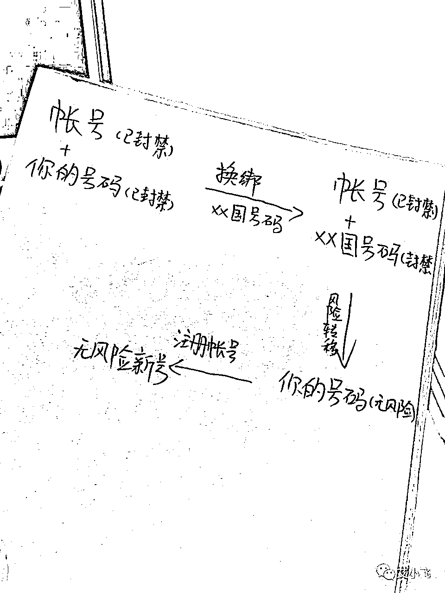
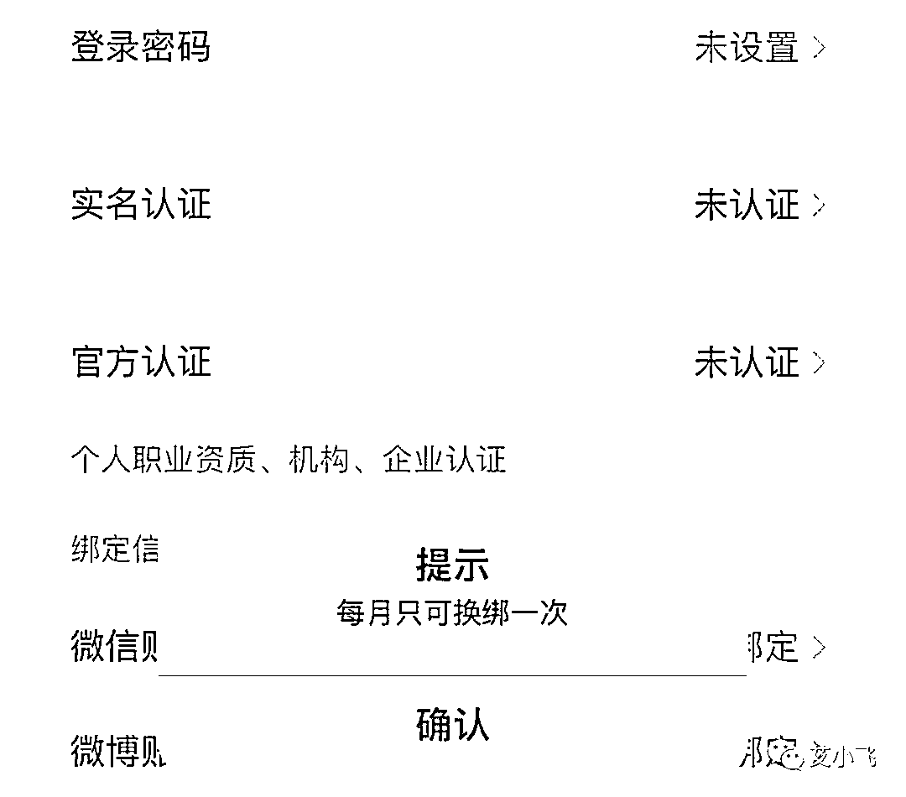

# 📕被永久封号，我是如何捞出号码重新注册新号的？

账号被永久封禁？这招能把手机号“捞”出来，重新注册一个新号！

我是龙哥，这几年一直在📕流量这条道上摸爬滚打。最近平台的风控明显收紧了，很多号主不是被限流，就是直接被封停，连缓口气的机会都没有。说白了，📕现在对低质量内容创作者已经失去了耐心，这批人既影响平台形象，又扰乱社区环境。这也是近期严打力度突然加大的根本原因。

第一次看到“账号已永久封禁”这几个字时，谁心里都不好受。我第一次被封也是凉了半截，但后来被封的次数多了，慢慢就麻了。因为我平时做矩阵号，手上同时要管几十个引流号，封号早就成了家常便饭。为了让自己省点心，我硬是摸索出了一套成功率相当高的应对办法。本来只是“业余研究”，结果被现实逼成了“专业”。这一年多，我什么奇葩状况都遇到过。

今天不聊虚的，直接讲干货：账号被永久封了，怎么少花钱、少走弯路，把手机号救出来，然后重新注册新号继续干。

先简单科普一下：现在📕的永久封禁分成两类，一类是【设备】封禁，另一类是【账号】封禁。设备封禁的解法，我之前专门写过一篇文章，那套方法能搞定市面上90%的封号情况；当然，如果你干的是违法犯罪的事，那就别想了。今天我们重点聊账号封禁，也就是怎么把被封账号里的手机号“救”出来，再去注册新号。

动手前先有个心理准备：这个方法只适合账号本身不太重要的朋友。因为号码一旦捞出来，老账号就永远找不回来了。如果你还指望着那个号继续用，下面这条可以直接跳过。

整体思路其实用一句话就能说清：把你被封账号绑定的手机号，换绑到其他国家的号码上，让风险落到那个新号头上。原来的手机号一旦被腾出来，就能拿来注册一个全新的📕账号。

一、手机号资源去哪里找？

资源主要分国内和国外两条路子。

国内的话，去淘宝、闲鱼直接搜“境wai号”“国wai号”，能找到一些卖号商家，价格大概10块钱一个，很便宜。也可以去👸号上搜一搜，能发现少量资源，一般是40元5个号；跟商家谈好价，让他帮你接一下验证码就行了。

国外的话，要是有🪜，可以到推特、小飞机上搜新加坡、马来西亚、日本、泰国这些国家的手机号，出来的资源一大堆，随便挑，也就几块钱。这类生意在国内算是擦边灰产，不太好找，所以有条件就往外网跑。实在找不到的话，也可以来找我，我可以把手头渠道分享给你。不过说实话，我之前拿货是40元5个号，性价比一般；如果你想要，我把他的联系方式给你，你自己去谈。

二、换绑要满足什么条件？

平台有个硬性要求：手机号必须注册满一个月，才能操作换绑。

如果你刚注册就被封了，那就只能先等等，等时间到了再动手。

三、号码捞出来后，有哪些隐性风险？

用捞回来的号码注册新账号，不是百分百安全。你有可能被隐性限流，也有可能再次收到封号提示，甚至有些功能也没法用。原因很简单：就在账号被封的瞬间，你的设备型号、手机号和网络信息，早就被平台记录在案。如果之前的违规行为特别严重，比如已经踩了法律红线，那就算用了刚捞出来的号码，新账号也照样会被永久封禁。但如果只是恶意营销、导流这类问题，而且又是初犯，那一般影响不大，新号发笔记的流量基本正常。

四、最后再唠叨几句

关于📕解封，其实还有非常多经验和门道。我的这些办法，全是一步步踩坑踩出来的，有些还花了不少冤枉钱。现在对我来说可能已经没什么价值了，但对还在为解封头疼的朋友来说，还是很有参考意义的。如果你觉得这个系列有用，记得多给我点赞。看到大家的反馈，我才有更多动力继续把“不能说的秘密”挖出来分享。

下期准备聊：📕永久封号后，怎么申诉通过率更高？到时候见。

我是艾小飞，一个专注📕流量的人。