# 以AI助力撰稿，配合职聊平台承接订单，月收益6000+的可行路径

各位伙伴好，我是饭饭。

赚钱龙珠社群的常驻分享者，目前聚焦在智能写作与电商两条线。

入圈后多次把实操复盘沉淀为精华内容，也带动不少同好落地见效，彼此链接越来越紧密。

近一年来生成式模型爆发，文字类变现效率被重新抬高。我个人从一人摸索AI代笔起步，到现阶段带领小团队，单此赛道年度流水已破百万元。

# 一、模式概览

底层逻辑很清晰：借助职聊类App投递资料，成为一家文字岗位的远程撰稿人，落笔环节全部交由语言模型完成。

该思路在圈内早有讨论，坊间亦多次提及某职聊平台存在大量文案外包需求。我们团队当时即刻入场，安排专人集中应聘各家内容公司，仅一个月就在该渠道跑出6000+的稳定流水，闭环被验证。

掌握好模型指令体系，扮演好专业远程写作者的角色，做到月入六千以上并不遥远。

当前市场空位很大：

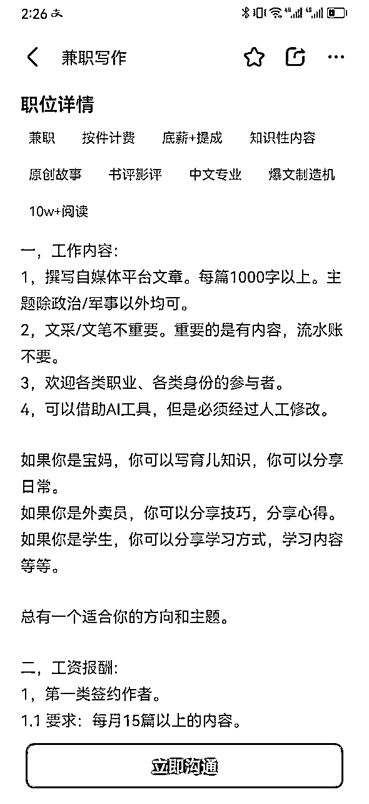

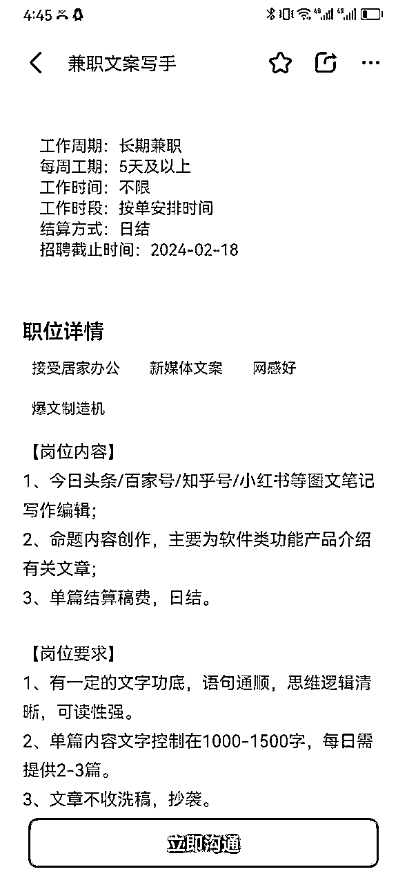

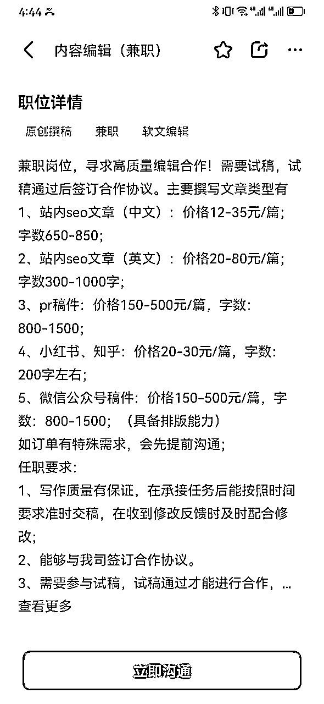

# 二、从准备到成交的操作序列

## 第1步：打磨个人资料

资料的美观度与完整度直接影响HR的回访意愿，具备文字经验的简历更容易过筛。

若缺证件照，可先行在线生成一张。

免费证件照制作

https://www.remove.bg/zh

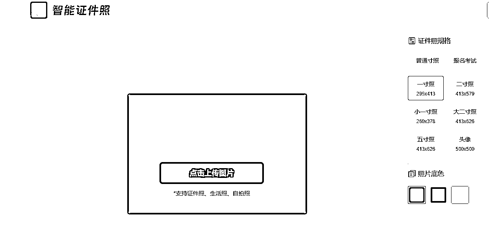

随后在网络上挑选一款精致的模板，将字段替换为自身信息，即可获得一份合格的简历。

更系统的简历打造方法，我已整理在另一篇笔记，点击蓝色文字即可查看：

## 第2步：安装注册职聊应用并完成实名

先行下载客户端

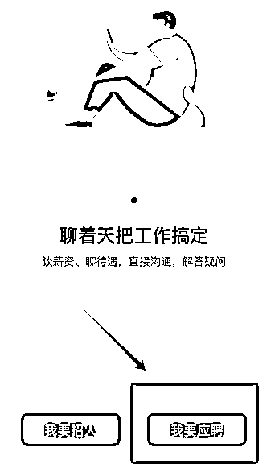

使用手机号登录，通过实名认证后即可使用。

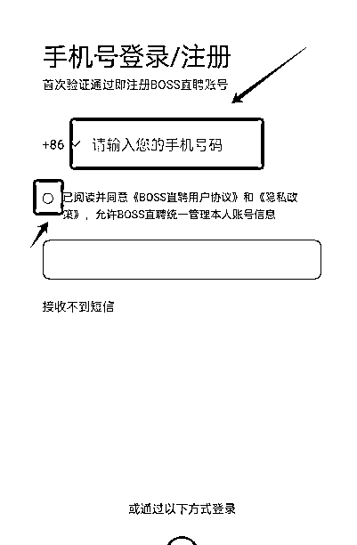

## 第3步：筛选岗位并批量触达

这是整套方法最关键的一环。

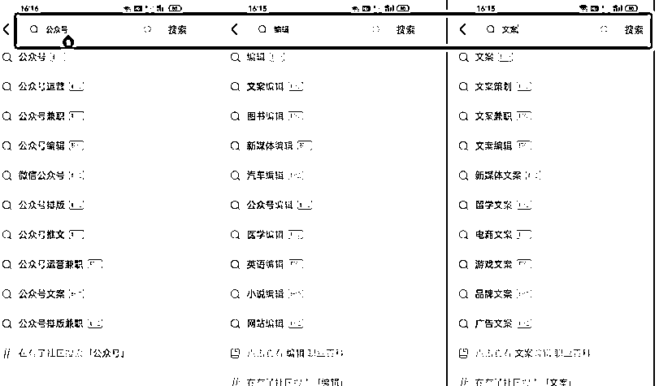

账号激活后，便可系统化地向企业发起应聘。既然产出依赖模型，投递策略需守住三条准则。

1. 仅瞄准文字型岗位
此类需求体量庞大，例如：
文案策划、内容编辑、广告撰稿、兼职撰稿、线上写稿、新媒体编辑、品牌文案、SEO优化、媒体编辑、社媒运营、公关撰稿、营销文案、广告创意、客服文案、商务策划、产品描述、站点编辑、行业报道编辑、内容运营、活动文案、品牌传播、数据文案、财经编辑、科技编辑、法务文档撰写、教育类写手、健康文案、电商运营、游戏剧情、体育编辑…等等。

2. 只投可远程兼职的岗位
多数企业会在招聘信息中标注需到岗坐班，这类直接放弃。我们借助模型写作，天生适配远程兼职。

3. 多维度咨询，撒网投递
不要受限于平台上可见的公司数量。文案外包需求非常饥渴，换一个关键词或城市即可筛出全新岗位池。每日投入更多时间投递，回复自然提升。

该职聊App的搜索页提供筛选功能：

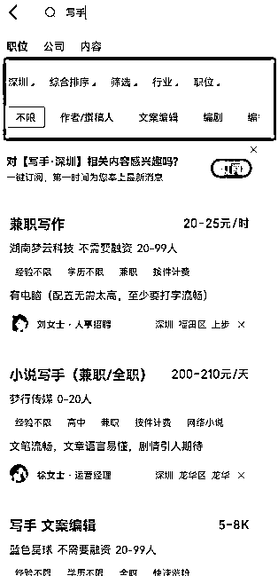

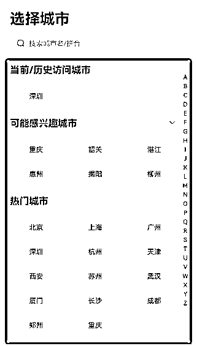

## 第4步：开启对话并提升回复率

在平台上看到招人的企业后主动私信，等待对方回应。

沟通时礼貌优先。我们早期的投递复盘发现很多人因细节失分：问候不礼貌、提问方式不当、简历缺照片、简历空白、简历与岗位脱节等。

规避上述雷区，回访率会明显提高。该平台的HR并非都会回复，保持正常心态即可，15%左右的回复率已属优秀。

当对方对简历产生兴趣，会交换微信进行试稿。试稿多数为无偿，目的是考察质量，部分企业会给予报酬。

提升回复的话术框架：礼貌问候 + 简短自我陈述 + 致谢收尾

常用表达：
您好，注意到贵司在招聘兼职写手。本人本科毕业，现为自由撰稿人，曾撰写短视频脚本、口播稿、今日头条号、公众号商业文案，文字功底尚可。

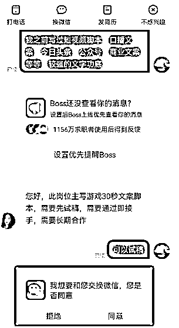

## 第5步：互换联系方式、接受试稿

该职聊平台允许在个人信息页预填电话与微信。

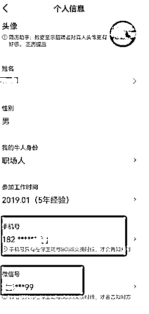

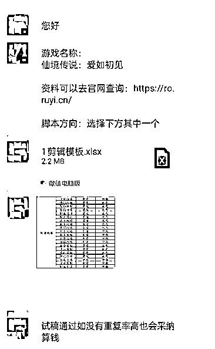

设置完成后，可在咨询阶段直接互换联系方式。加微信后按企业要求完成试稿即可。

试稿本质是面试。首次试稿务必研读需求，尽量提前或准时交付。通过一次试稿，后续订单会持续到来，尤其是批量派单的企业，通过的试稿越多，订单越多。

当然也存在试稿未通过的情况。原因通常只有两种：稿件不符要求，或同批候选中有人更优。不要直接放弃，保持礼貌争取下一次机会即可。

首次试稿注意点：可提前交付、严禁迟交。

# 三、落地中常见的坑

1. 甲方失联拖款
实操至今遇见两家企业在结算期失联。这种情况可直接在平台举报该账号。

2. 账号异常被锁定
避免频繁更换IP登录，也不要在聊天中大量出现敏感词。联系方式的互换统一走平台自带的交换微信功能。

3. 反复返工
定制文案被退回修改很正常。核心是审题。把甲方需求逐条拆解，不确定的点提前沟通，能大幅降低返工概率。

# 四、模型代笔实操示范

需要熟练掌握模型指令与技巧，选择合适的模型，了解参数调节与提问方式，从而获得高质量输出。可使用开源写作工具，这里以常用的GPT-3.5为例演示，亦可替换为其他工具。

1. 准备模型账号
星球内已有大量关于ChatGPT注册与使用的解答与陪跑，已有不少同好上岸，相关教程可查阅星球文章。

访问官网 https://www.openai.com/
无账号点击注册，按步骤填写信息创建；有账号直接登录。

随后充分利用模型提升稿件质量与产出效率，大幅降低写作成本并精准匹配客户需求。

2. 常用指令玩法【模板】

【设定身份 + 文本主题 + 核心词 + 框架 + 客户诉求 + 修改】

1、设定身份：现在请你扮演xxx角色，可将模型设定为任意专家角色，从而更好地呈现某类文章。
2、主题：在甲方告知需求时，会说明需要何种主体、类型的文本，直接告知模型所需标题或类型，若无明确标题，可把零碎描述丢给模型让其归纳总结。
3、核心词：若客户提供关键词，先列出，再让模型围绕这些词展开。
4、框架：每篇文章可先拟框架，基于框架撰写的稿件更严谨高效。
形成简洁自洽的逻辑，然后请模型带入编辑、读者等角色不断优化框架。
5、客户诉求：客户下单时会说明文章要求，按点整理后在指令中投喂，先扩量再精修。
6、修改：可分多轮，每轮聚焦不同重点，如结构调整、资料补充、风格统一、金句植入、错别字标点检查，直至满足客户。

当前模型本质上是大型语言模型，文字较为模板化缺乏温度，当作工具使用效果更佳。模型输出不可直接套用，需人工润色口语化。

指令细化技巧
例如客户仅说“希望文章阅读量高”，此为模糊诉求。需要自行把诉求翻译为可执行指令：搜索同类自媒体招商号的爆款逻辑，吸睛标题、有趣场景、真实案例、具体方法等，再喂给模型。

常用工具
BestPrompts 是一个指令参考库，遇到陌生领域可复制借鉴。
注册地址：https://bestprompts.cn/#/index

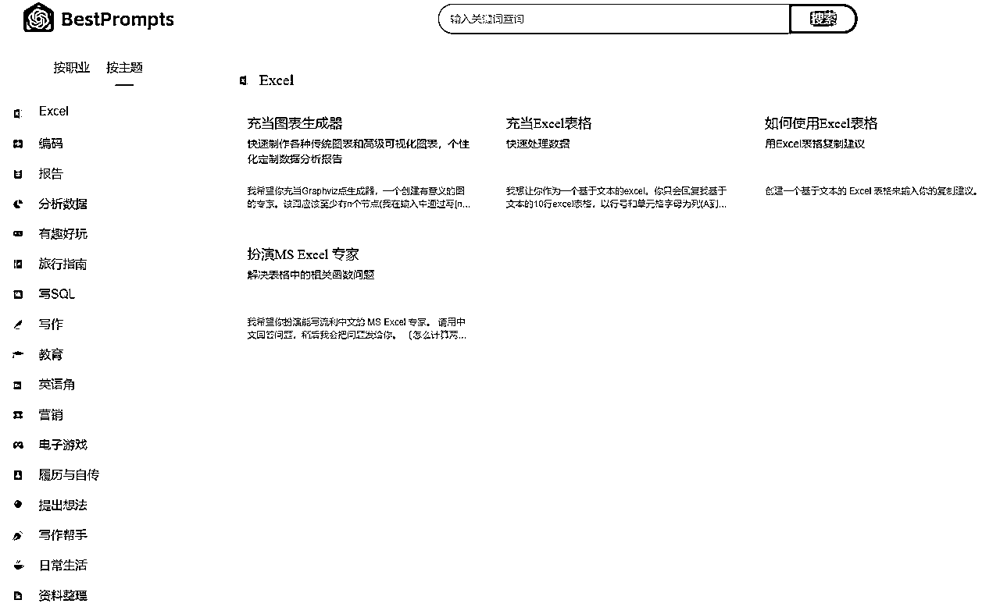

3. 实战思路演示

示例流程：
身份设定：你是一位叫小明的内容创作者，擅长各类型文章写作，善于与ChatGPT协作。
主题：“未来科技：人工智能与人类共生之道”
核心词：人工智能、未来科技、技术发展、共生关系、技术创新
框架：引言、AI进步与挑战、共生之道、未来展望
客户诉求：突出共生主题，强调正面社会影响，同时提及伦理风险，结构清晰语言简练
修改：首轮调结构、次轮补案例、三轮改风格、末轮精修错别字与金句

通用模板：【设定身份+文本主题+核心词+框架+客户诉求+修改】

案例1：撰写演讲稿
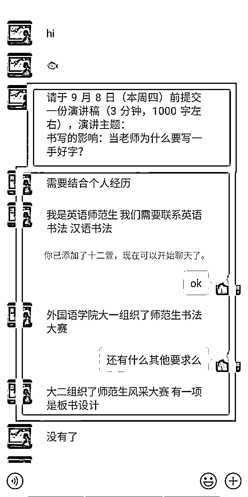

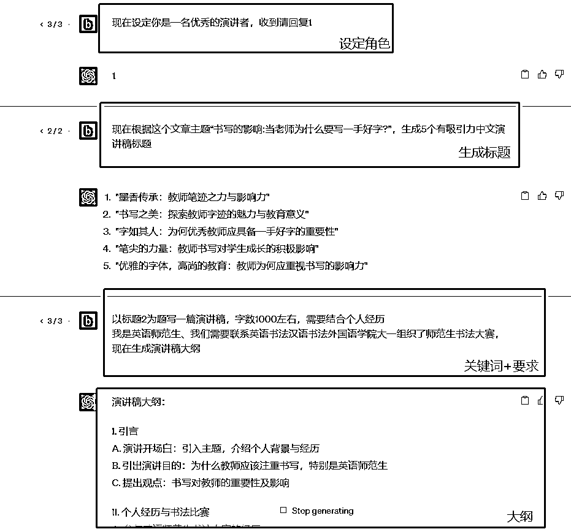

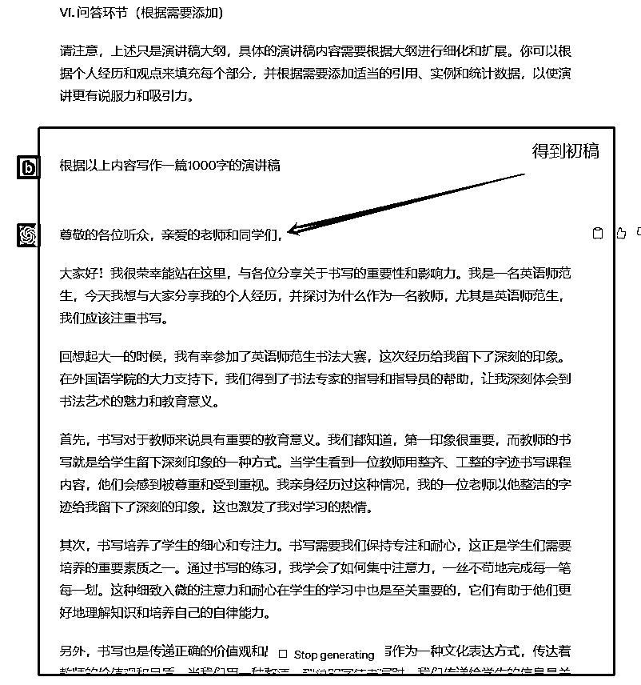

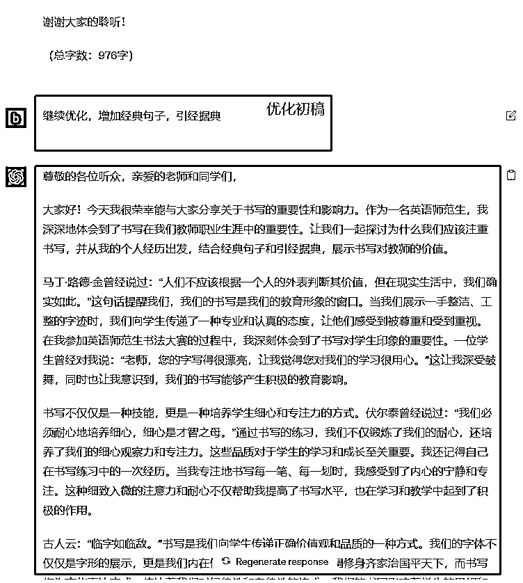

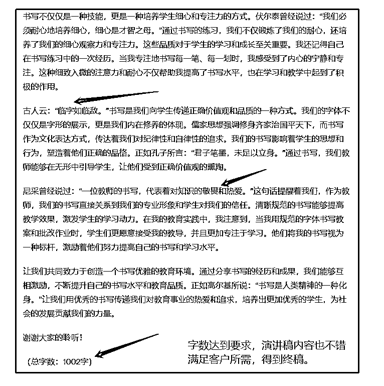

大部分文本都按此流程完成，熟练后耗时很低，只需掌握指令即可。

案例2：撰写商业计划书
客户需求如下：
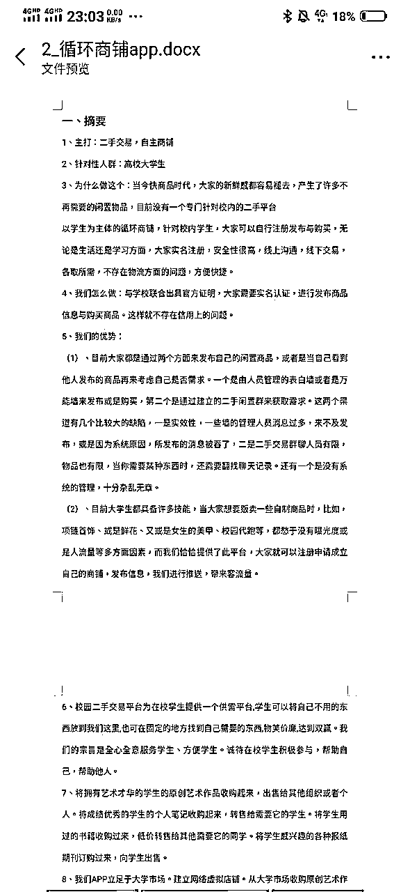

实操演示：
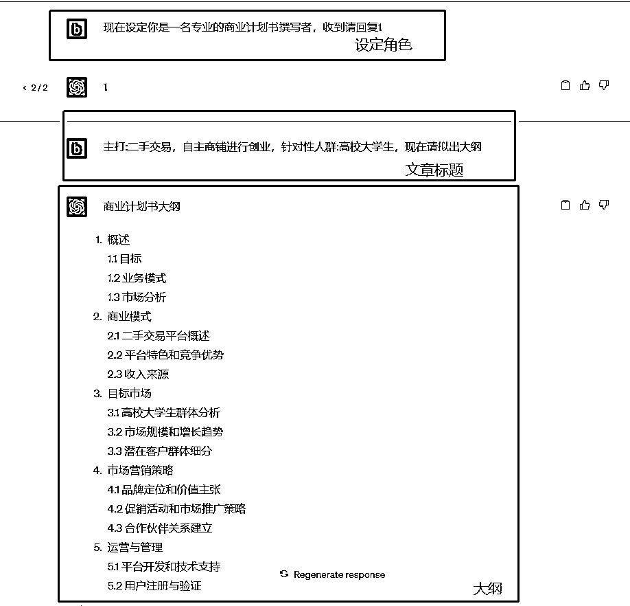

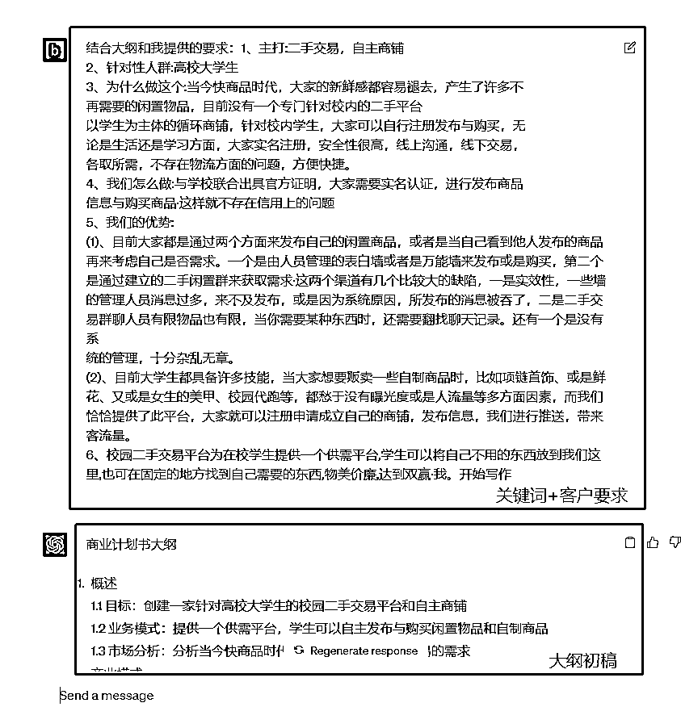

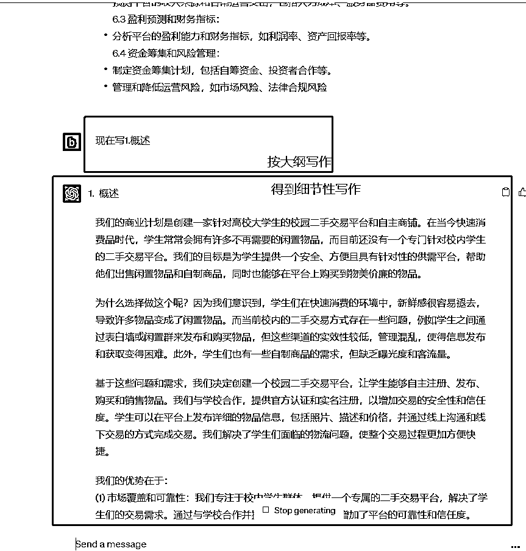

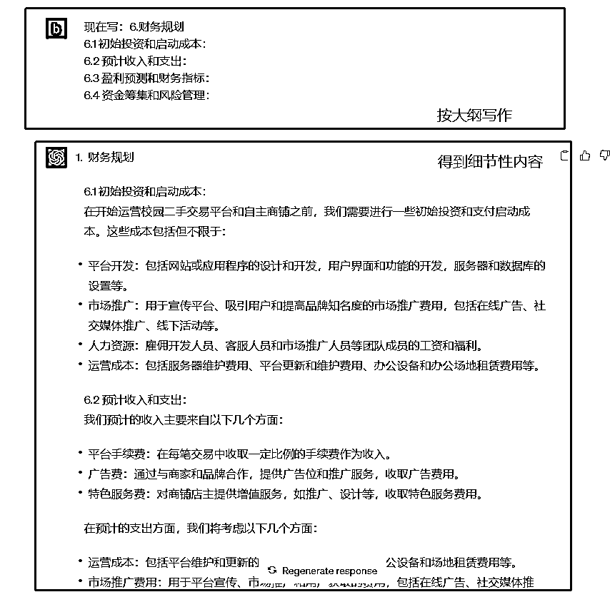

反复投喂指令，即可得到一份完整、符合预期的商业计划书。

# 写在最后

AI代笔赛道具备显著潜力。市场对文字的需求远超认知，而模型辅助撰写正是当前最简便高效的应用方式。身处智能时代，让工具为工具工作才是正解。

趁此窗口期，拥抱智能浪潮，一起挖掘“代”字背后的庞大市场。