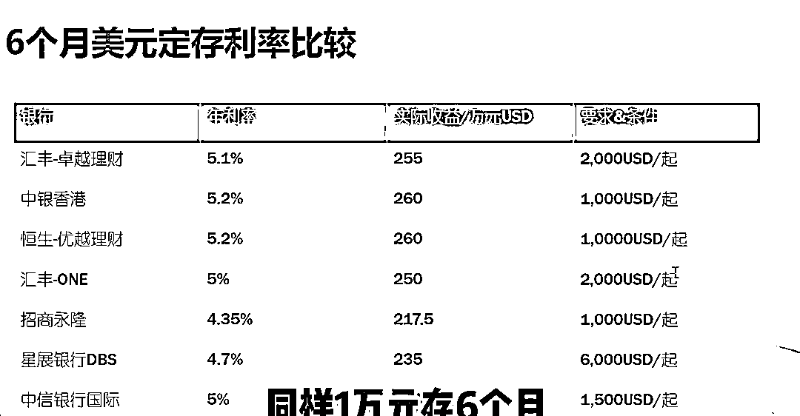
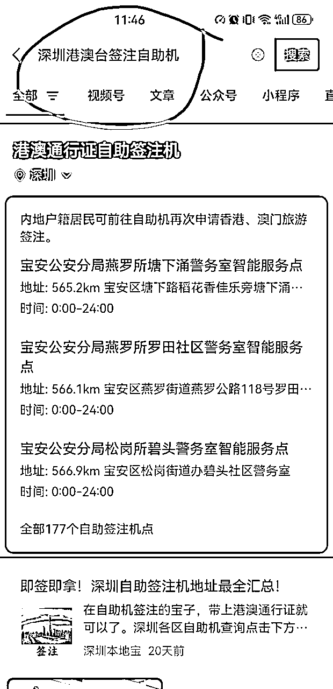
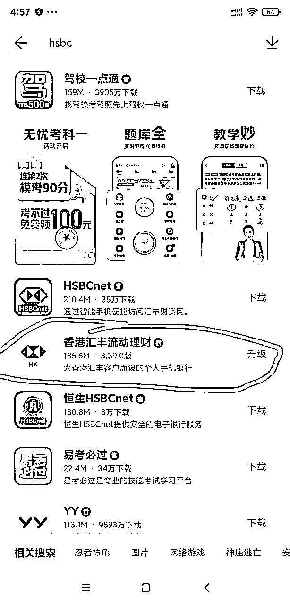

# 如何拥有一张香港银行卡

大家好，我是Andy，日常聚焦AI、出海、个人品牌与数码游民等话题，也在做海外留学与AI项目变现，主要经验集中在投放和私域运营。今天跟大家聊的是怎么拿到一张香港银行卡。

# 目录

1、为什么需要港卡？

2、开户前要准备什么？

3、四大银行实操遇到的情况

4、Clubsim香港实名电话卡

5、总结

# 一、我为什么要办香港银行卡？

香港虽然已经回归，但仍实行一国两制，是亚洲核心金融地标之一。对国际投资、外贸或留学人群而言，拥有一张当地账户能带来不少便利。

我办理港卡主要基于三类需求：

1、分散资金、提升安全
当下全球局势动荡，持有多币种可实现对冲。我个人长期持有虚拟货币，大陆交易本身合法，但变现服务违法，只能私下处理，容易撞上黑商，导致内地账户被风控冻结。多一个境外账户，等于是多一道缓冲。

2、结汇与外汇操作
人民币汇率承压，每人每年5万美元额度有限，用满总比不用好。炒汇门槛高、波动大，这里不做投资建议，请自行评估风险。

3、国际化资产配置
有港卡后可直接买美股、港股，开户时还能顺带开理财账户，银行自带投资工具。若需要券商，可再开富途、盈透等，把银行账户绑定即可。还能买美债，或做美元、港币定期存款。境外卡的投资限制远小于内地，但赚到的美元汇回内地仍受每年5万美元额度约束。

目前美元加息、人民币降息，利差明显。各大银行美元定存利率会动态调整，活动期甚至能看到年化8%以上的加息优惠，具体以官网为准。

# 其它常见疑问：

1、港卡能从币安等交易所直接提现吗？
理论上部分银行可行，但不推荐。香港与欧美银行风控更严，异常操作极易被封。哪怕是币安直提，本质仍接近C2C，风险不小。建议先通过熟悉的安全渠道变现，再转入港卡。

2、港卡能充USDT或在内地消费吗？
大部分不支持。虚拟币充值与内地支付场景基本不通。像Onekey这类虚拟卡目前使用体验更稳定，但微信已不支持绑定此类卡，支付宝则因人而异。境外消费是没问题的，例如用USDT支付ChatGPT、亚马逊云、YouTube会员、Twitter会员等。

# 二、开户前要准备哪些材料？

1、港澳通行证 + 护照
2、入境小票
3、大陆身份证
4、住址证明
5、常用大陆手机号
6、少量港币现金
7、提前装好各银行App

关于港澳通行证：现在团签与自由行签注已无实质区别，团签也能从深圳前往香港。内地直飞香港是否可行我未核实。若未办签注，可到深圳办理，微信搜“深圳港澳台签注自助机”可定位最近的自助点。连通行证都没有也能去深圳办，有人当天取证，有人需等两周，实际体验差异较大。

关于入境小票：仅在中国银行办理时用到，其它行基本未查。

关于住址证明：建议准备大陆银行或信用卡近三个月纸质账单，人人可得且银行认可。账单可申请邮寄，也可把电子版打印。注意账单上须有姓名和住址。

关于大陆手机号：务必开通漫游并能现场收短信，注册全程需验证码。想省漫游费可提前在淘宝买一张短期香港卡，过关即换，但办卡时大陆号码必须保持畅通。

关于少量港币：非强制，但建议备一点。办完卡后可到ATM存入，再让两张港卡互转一下，验证功能是否正常，有问题当场解决。

另外提前下载好App，能加快流程，也留下好印象。着装注意点，显得正规靠谱，避免给人刻板印象。

# 三、四大银行开户实操体会

# 1、中国银行（香港）

官网：
https://www.bochk.com/

App下载：
https://www.bochk.com/tc/more/ebanking/apps.html

安卓可直接下载APK，无需Google Play，安装Bochk和Boc Pay两款。Bochk为手机银行，Boc Pay类似本地支付工具，开户时柜员通常会要求安装。

中银是本次办理中唯一需要预约的，可通过微信公众号“中銀香港微服務”→银行服务→我要预约完成。

选择中银的原因：国企背景强，负责外汇管理，换汇汇率在我对比中最好，且无账户管理费。

注意事项：部分网点无现成实体卡，需4周内平邮至登记地址。未拿到实体卡前，勿遗忘App内设置的账户密码，否则需到香港柜台重置。拿到卡号后才支持线上改密。

# 2、汇丰银行

官网：
https://www.hsbc.com.hk/zh-cn/

App下载：柜员现场扫码，安卓若无Google Play，可用百度手机助手搜索“香港汇丰流动理财”安装。

选择汇丰的原因：定期存款利率有竞争力，且全球汇丰间转账免手续费，内地汇丰向香港汇丰打款也不收费，适合小额高频转账。汇丰是真正的国际化银行，能对接大量海外服务。例如同行朋友用富途炒美股，之前绑定新加坡华侨银行和招商永隆均需手续费，换成汇丰后免费。

汇丰One账户免管理费。

注意事项：部分网点可现场领卡，部分则邮寄至内地地址。

# 3、招商永隆

招商永隆为招商银行收购香港永隆后更名。内地iOS、安卓均可应用商店下载“招商永隆一点通”，可在境内先行开户，但需本人到香港任意网点激活。

内地开户视频教程：
https://www.youtube.com/watch?v=PoIXdHIXxK8

选择原因：我长期使用招商银行，使用习惯一致。永隆App与招行App体验相近，有招行卡的用户开通速度很快。但存款利率和汇率并非最优，普通账户需存1万港币否则每月扣100港币管理费。可尝试申请金葵花卡免管理费，官方称暂时免收，实际已免多年，后续是否恢复不确定。

注意事项：一般无法现场制卡，约两周顺丰到付寄回内地地址。

# 4、众安银行 Za Bank

官网：
https://bank.za.group/hk

App下载：
https://bank.za.group/hk/app-download

众安为纯线上虚拟银行，无实体网点，类似网商银行。香港多家虚拟银行中，众安功能最全、用户最多。用香港WiFi即可线上开户，作为备用卡很合适，且免管理费。

建议到香港后在App内申请实体Visa卡，官网提示内地无法申请实体卡。申请需要卡内有25港币邮寄费，可先用汇丰卡转账过去。我当时先往汇丰存入100港币现金，再汇至众安，操作流畅。

# 四、Clubsim香港实名电话卡

官网：
https://clubsim.com.hk

办卡之余还在7天便利店买了一张实名香港电话卡。因为部分海外服务注册时不支持大陆号码，备用香港号码可避免麻烦，也比漫游划算。此卡可实名，稳定性优于虚拟号，保号成本低，半年6港币，内地也能收短信。

# 五、补充信息

香港本地有一套名为FPS的即时转账系统，中文叫转数快。所有香港银行均接入，可用手机号或邮箱作为收款标识，转账免费且秒到。功能需在App内手动开启，默认关闭。

目前香港银行卡基本都能免年费开户，难度各有差异。但我判断门槛未来大概率会提升。此前曾全面放开，后因申请量激增迅速收紧，我就曾被拒。这次窗口重新打开，建议有需求的尽快办理。

另外，从香港去澳门再返回香港，仅消耗一次香港签注。

本文仅分享流程与体验，具体卡片特性、操作细节和使用注意事项，还需长期实操验证。欢迎交流，觉得有帮助请点个赞。