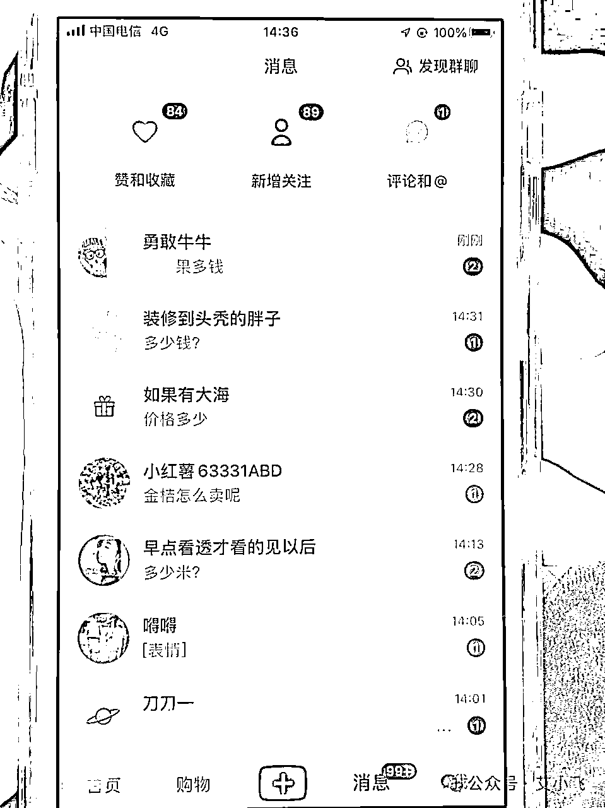
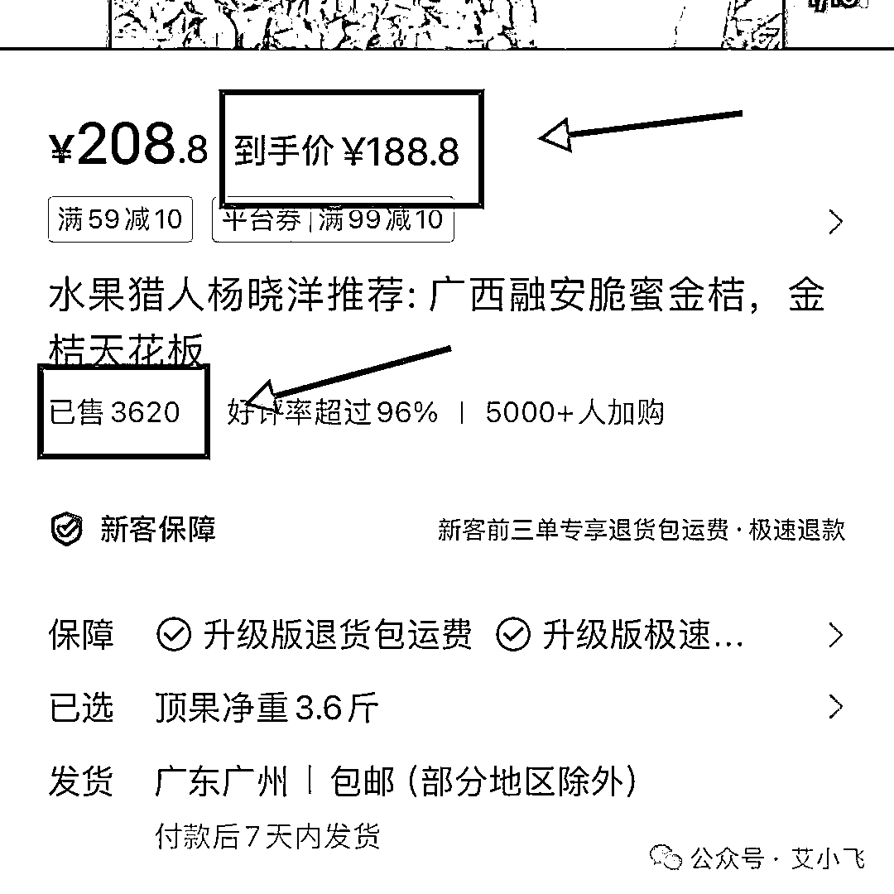
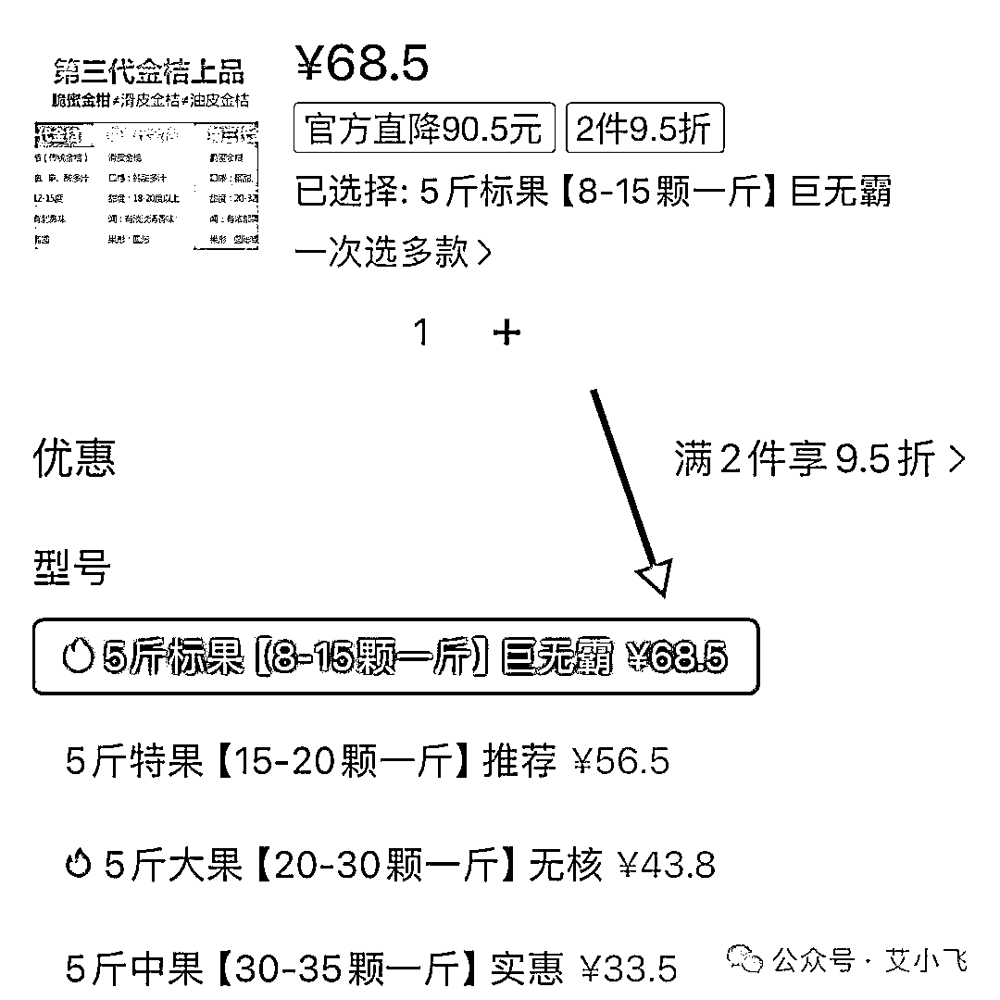
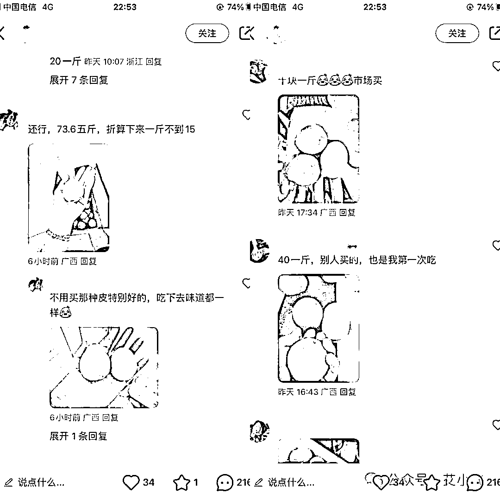
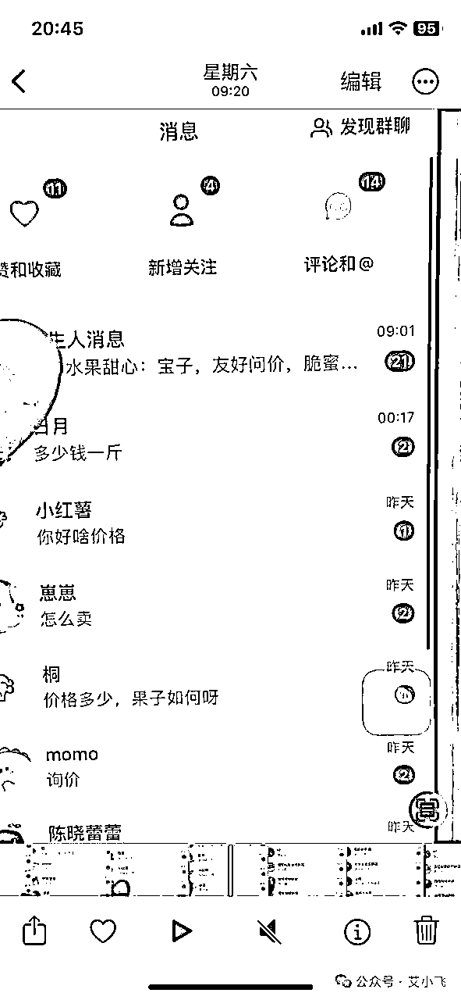
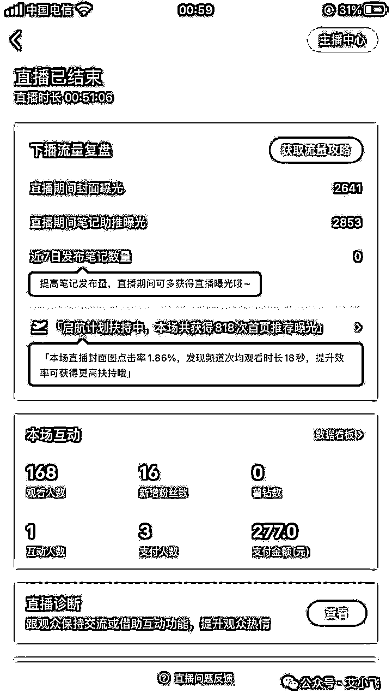
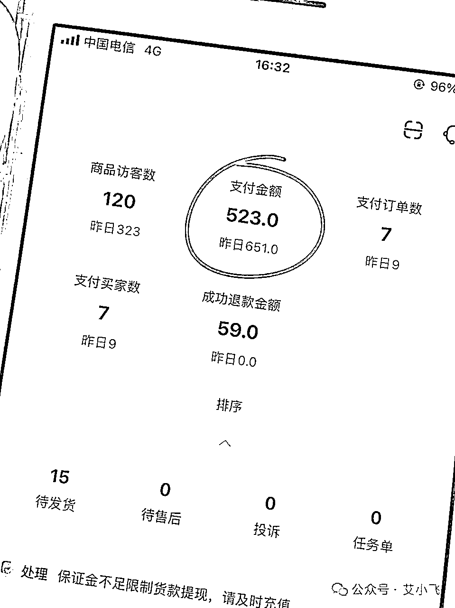

# 分享📕做电商日赚200的经验

各位好，我是龙哥。

隔了许久没跟大家认真聊搞钱的门道。今天抽空，把近期在这款种草App上赚到钱的实操经验，以及真实案例整理出来，献给各位。

我心里有数，还有不少朋友始终没碰上适合自己的路子，更别说借哪个项目真正赚到钱。这篇内容，就是特意为还在为“赚不到钱”发愁的人写的。希望在年前，你们能多攒上一笔。

## 一、手里的这盘生意

我做的这个品，跟节气咬得很紧——一种出自广西省柳州融安的金桔。

## 二、我是怎么锁定的

先交代背景。坦白讲，我早前经历了连续五轮选品翻车，前后试了5个品，全灭。那几日我闷头琢磨：到底哪类果子才值得押？

恰好那时，尔滨跟广西旅游话题双双破圈。我在想，这阵风能不能把广西的水果也带起来？加上广西水果那段时间反复出现在热搜上，我判断它会自带流量，于是我去网上查了一组搜索词：广西省卖价最硬的水果是哪样。翻完资料，除去榴莲，排在前面的，正是融安县出产的脆蜜金桔。

## 三、这果能有多夸张

熟悉它的朋友都清楚：本地连锁超市里，质量靠上的果子一斤开价60元；差一档的，也喊到20元一斤。网友一句神评论：除了价高，这果没槽点。

我图的就是这份高价——客单抬上去了，利润才有厚度。

## 四、利润有多厚

利润能薄的生意，我从一开始就不碰，那是在白耗日子。

利润怎么看？我上线搜索同规格金桔的行情，结果卖到了188元一份，销量已有3600多件。

转头去某多多看，同款进货价居然还不到70元。

差额有多大？链路跑通的情况下，一单净赚能接近120元——利润比进货本钱还高。这种货可遇不可求，所以我当机立断，就用它来跑测试流程。

## 五、打法拆解

其实动手前，我有个惯例：先把同行看透彻。

我在App里搜“脆蜜金桔”，这个词的搜索体量不小，买家需求也旺，但真正吃得透运营的商家，掰着手指头都数得过来。

这不就是空子么。做完能力与风险评估，我进入了测试。

### 1. 最初的模仿策略

记住平台的铁律：能成为爆款的内容，往往是被验证过无数遍的重复。想碰爆款，最快的路线就是移植——移植封面版式、移植标题结构、移植文案写法。

### 2. 标题与文案的采集

我先去App搜品类名，把热度榜前10名的标题、封面词和完整文案收进素材库。

翻了两轮，这个品类的玩家确实偏少，很多标题看着不带劲。于是我把范围放宽到脐橙、车厘子、榴莲等品类，照样取热度榜前10的标题，把水果名整体替换成金桔，套上去做测试。

### 3. 封面的思路

文案准备的活干完，就该处理封面图了。我那时手里既没有存货，也没有实拍图，为了控制风险和成本，只能先借别人的素材用用。

具体怎么个借法？里面门道很深。一个不留神，就可能被投诉、限流或者直接封号。

为了不暴露自己，我专挑那些产品吐槽区翻找。

在App上，大批女生习惯晒自己买到的宝贝，却没动力单独发笔记，于是留言板块成了她们的另一块阵地：晒实物、给反馈、倒苦水、提建议，什么都有。这也是我获取全新素材、揣摩用户潜在需求的黄金入口。凡是能吸引我的图片，都收进相册。一轮轮淘汰后，留下3至5张当封面备选，再用修图工具处理几道，把痕迹抹掉。一张低成本、低风险、还可能出爆款的封面，就这么出来了。

### 4. 首发测试的分寸

封面备好，就到了发笔记测试的节点。这步操盘，可以说决定生死。

首发内容数据好，后面的流量多半会稳定在一条水平线；首发内容数据差，哪怕标题和封面再唬人，后续也很难把流量拉起来。

所以我给第一篇笔记定的目标是：只做互动引导，先把热度顶起来，方便之后快速成交。

项目还在进行中，账号名暂时不方便暴露，但思路可以聊。

先讲个不算大众的冷机制：平台判定内容是否优质，凭的不是人工。人工一条条看，再多人手也忙不过来。系统真正依赖的，是笔记发布后的用户行为反馈，它会把内容先抛给一小撮人，比如100人，然后观察这100人里有多少点赞、多少关注。

假如100人看完，一个赞都没留下，而同赛道的对手拿了5个赞，那平台自然把后续流量拨给后者。这才是推流的真相：互动数据越亮眼，分发就越猛。明白了这个逻辑，我第一帖凭啥死磕互动，就很好理解了。

可互动怎么设计？又是一道坎。想让互动率高，就得发大家爱看的内容，顺着用户的喜好出牌，他们才肯买账。我蹲在留言区刷了120分钟，发现她们反复提的就是两个点：好吃不够，还得划算。那我就拼命暗示这果超值、性价比拉满，但就是不摆出具体价格，把胃口吊得老高，引诱她们主动留言询价。

这样操作，精准买家冒出来了，互动数据也上去了，后来的人看到前面一片追问，也会跟着从众来问，热度就这样一圈圈滚大。

我的笔记思路，说白了是拿捏人性——贪便宜、好奇心、怕错过、爱跟风。把期待感垫高，把价格藏住，她们越怕错过好价，就越想跑过来追问。我平时就爱研究人性。凡事顺着人性去做生意，结果都不会差；运营流量，同理。

### 5. 发完笔记之后

笔记发出不到一小时，问询的人一批接一批。

需求被彻底激活了，市场看上去有戏。那就加紧解决供应链的事。

## 六、售货模式的选择

当时摆在面前的有两条路：一是在平台开一家小店，做常规供货模式；二是把人引到🛰️私域，做无货源倒手。

不管走哪条，上游合作方都得先敲定。

### 1. 供货方怎么谈

我第一个盯上的，还是某多多。尽管上面浮夸宣传不少，但扛不住报价低。

我周转拿到了商家联系方式，逐个电话谈合作：能不能由商家按名单直接发货、货款走🛰️、订单不走平台。最后谈成了三家合作商。但对方也表示：某多多本来靠走量，像我们这种刚起步的散客，还要单独打单，价格没办法和平台一致。若要单独操作，每单得在原采购价上加10至20元。

起初我心里不舒坦，可盘完账，哪怕加上这部分费用，每单仍有稳定50%的纯利空间。比如50元进货、100元卖出，完全顶得住。先凑合跑吧。

### 2. 开店上架

最后我还是选了开店模式。开店本身的流程，去App搜一下就有大把教程，不重复。

这平台不错的一点，是不强制预交押金。实名认证个人身份后，就能直接挂牌卖货，对新手很友好。

那时笔记的热度还在攀升，询问的人不断涌来。

我店铺刚开好，稍作引导，眨眼就是5个订单。当时我忍不住感慨：这钱挣得太轻松了。5单核算下来，净赚150元落袋。

眼看着流量还在往上冲，我不想白白浪费，顺势打开直播，试着做二次收割。首播确实生疏，60分钟净讲些废话——聊我怎么想起卖金桔的。没想到她们居然爱听，还下单了3单支持我。下播的那一刻，我差点笑出声，这也可以？

那次直播共收到277元营业额，里面有一个利润格外厚的单子，我净赚150。除去笔记带来的成交，直播也成了重要助攻。前后不过36个小时，我加起来成交15单，纯利率50%。赚了多少，你们不妨拿计算器按一下。

### 3. 履约交付流程

有人下单，次日就要安排发货。具体怎么操盘？把客户订单信息汇总成文档，发给上游商家即可。

因为没见过面，彼此信任度有限，我们磨合出的模式是：货款当天结清，货品当天发出，谁也不亏欠谁。供货方直发完毕后，会把对应的物流单号反馈给我，我批量复制到店铺后台，等顾客收货、等平台结算。

项目做到这一步，后面还有续篇待写。到目前为止，靠这平台日入200元的经历，差不多都交代完了。

## 七、最后总结

从冒出想法到跑通全流程，前后不过72小时。我后台现在累计将近15单，揣进兜里的利润约莫500元上下。

不到三天进账500多，对还在找项目却一直没跑通的人来说，应该够眼馋了吧。这个生意启动快、门槛也不高。整套流程已经摆在台面上，想在年前挣点零花的各位，完全可以直接照着试。

项目还在继续推进，更细的干货暂且保留。下一期的话题，聊聊我是怎么撞上平台无人值守直播玩法的：靠直播一天能到手多少？我凭啥把直播看这么重？它给了我们什么启发？又该如何借直播的势，把手头的小生意滚成大盘子？

下回的内容，保证更带劲。

今天就说到这儿。我是艾小飞。

作者：艾小飞
如需转载，请提前说一声；搬运与抄袭必究。