# 用绿幕手播打爆抖音单品，小白也能上手的全套打法

## 一、关于我先交个底

大家好，我是龙哥，目前在苏州。37岁，互联网连续创业的老兵，走过的路是淘宝卖货、淘宝客、无人直播、半无人手播，再到现在的抖音IP直播和视频号直播。现阶段主攻抖音和视频号的带货与IP变现。靠着自己折腾，已经把100万贷款还清，2024年准备再冲一波。赚钱上看到一群年纪轻轻认知很高的伙伴，忍不住感慨“钱哥老矣，尚能饭否”。希望能跟大家多交流、多学习。接下来分享的内容，是我今年下半年在实际操作的项目——抖音单品绿幕手播带货。觉得有启发就点个赞收藏，我们相互认识一下。

下面进入正题：

## 二、项目长什么样

刷抖音的时候有没有见过那种画面：主播只露一只手，背景是循环播放的产品场景，商品在转盘上一直转。这种形式就是今天要拆解的单品打爆绿幕手播直播间。

目前跑得比较稳的品类是女鞋，佣金比例大概在20%-30%，退货率在30%左右。

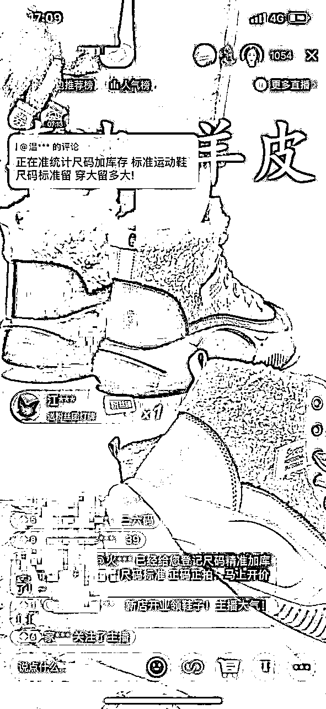

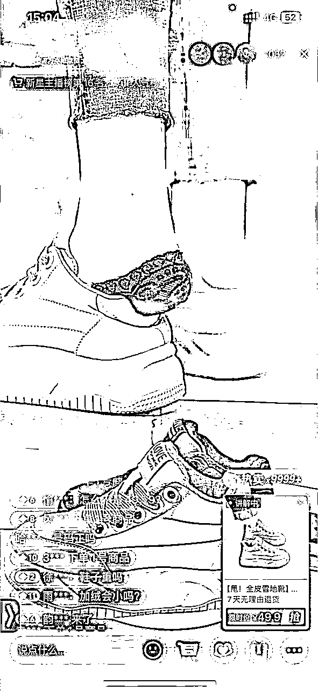

## 三、谁比较适合做

这类直播间最大的优势是画面冲击力强，进直播间的概率比普通直播高很多，很容易把实时在线拉起来。当曝光进播率能达到60%，人均停留超过30秒，就能稳定千人在线，形成羊群效应。叠加价格有优势的商品，很容易吃到抖音的免费自然流量。

特别适合刚了解抖音规则、想入局直播带货、但不想露脸、口才一般的朋友。整场都是读稿开播，对主播门槛很低。也可以当成真人直播的过渡，先熟悉规则、练口才、培养对流量的敏感度。

## 四、投入和回报怎么算

先说结论。硬件一次性投入大概6000元左右，运气好一次小爆就回本了。当然运气也是实力的一部分。普通玩家，单账号做到月入1-2万问题不大。熟练后可以多开账号错峰播，多账号的网线和主机是可以复用的，建议一套网络硬件不要超过3个账号。

我自己同期做了两个号，变现累计约30万。放两张图，一张是第一次单场GMV破十万，连续18小时不下播的记录，一张是上过带货榜的截图：

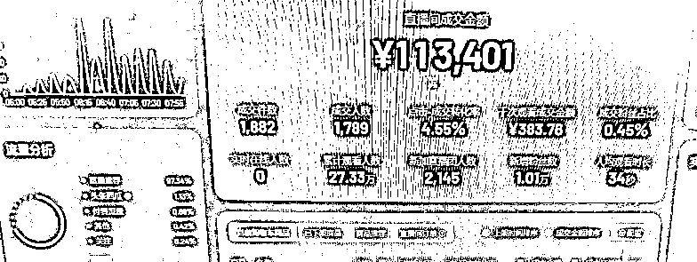

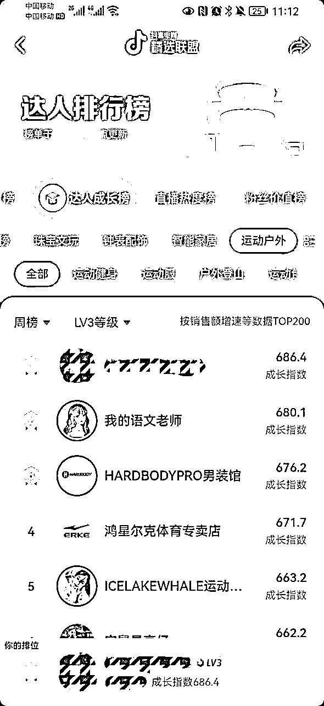

#### 4.1 硬件清单

##### 4.1.1 台式电脑一台 约4000元 可考虑租赁更省

最低配置要求：

1. CPU：i5十代 10400F 或十二代 12400F 及以上
2. 显卡：1050Ti 4G 起步，显卡太差直播画面会卡
3. 硬盘：固态500G
4. 内存：16G
5. 其他按需搭配即可

抖音直播伴侣对配置需求逐年升高，有条件的可以往上配。

##### 4.1.2 摄像头+支架 约800元

主流选择罗技C1000e，二手闲鱼600-700元，或者罗技C930，价格200-300元。

##### 4.1.3 麦克风一个 约100元

推荐品牌好牧人。

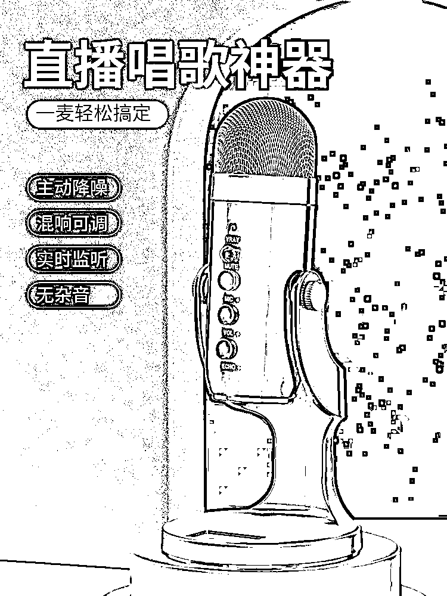

##### 4.1.4 绿幕一块 约100元

淘宝买一块，注意固定方式，一般钉墙上。条件受限可买硬质绿幕或配支架。

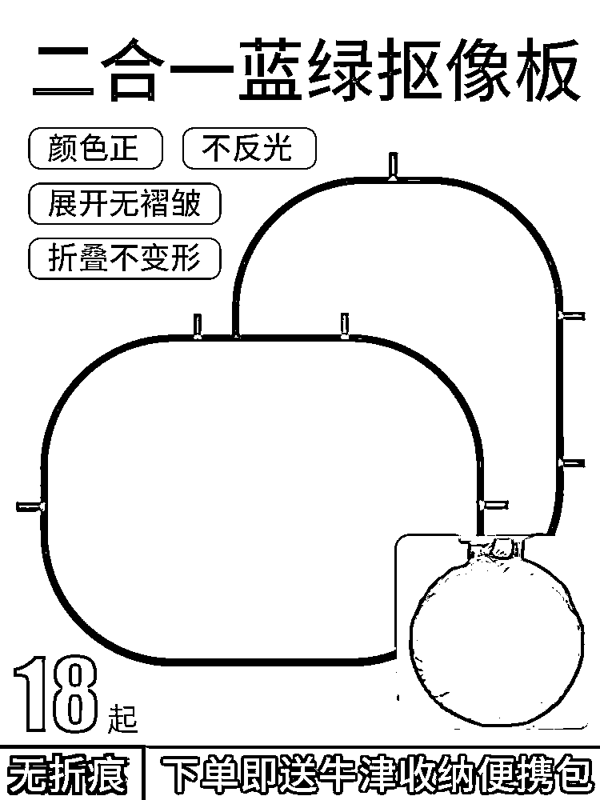

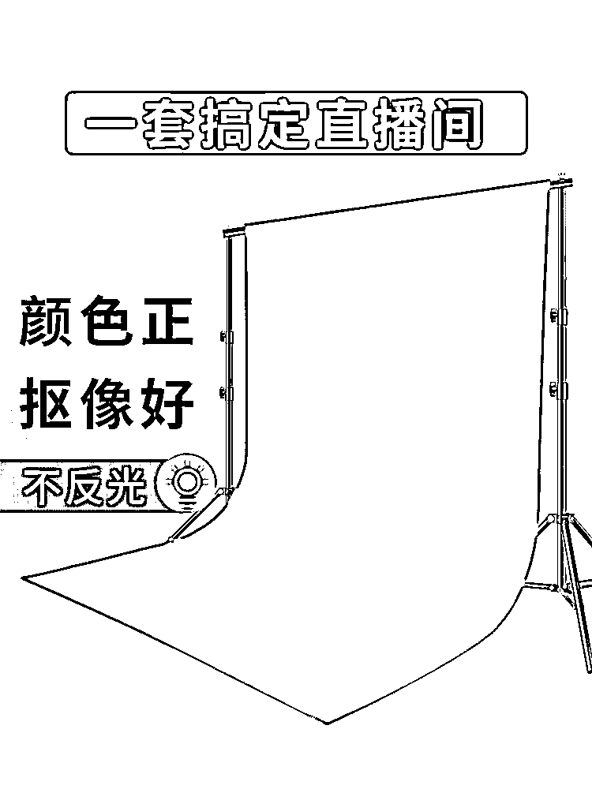

##### 4.1.5 鞋样一到两双 约100元

建议选36、37码，小码上镜更显好看。

补充一下为什么主推女鞋，尤其是女鞋做直播。直播间一旦打上标签，切品类很难。鞋子受季节影响大，春秋单鞋、夏天凉鞋、冬天棉鞋，款式层出不穷，平底、高跟、低帮、高帮都能轮着卖，品类生命力长。选好年龄段人群，账号生命周期更久，而且溢价空间大。我们卖的是50元左右的牛皮女鞋，颜值在线，转化率高。是否真牛皮，看商家资料里是否有标注，我们照实读就行，避免虚假宣传风险。

##### 4.1.6 展示转盘 约40元

直径20cm，25秒一圈，承重3公斤左右即可。

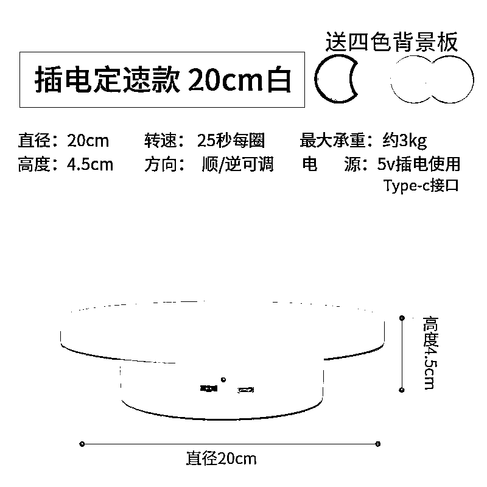

##### 4.1.7 补光灯 约100元

自家光线够强可以不用，不够就加个灯球、灯箱或补光灯板，选功率大的，目的就是让绿幕完全吃透背景。

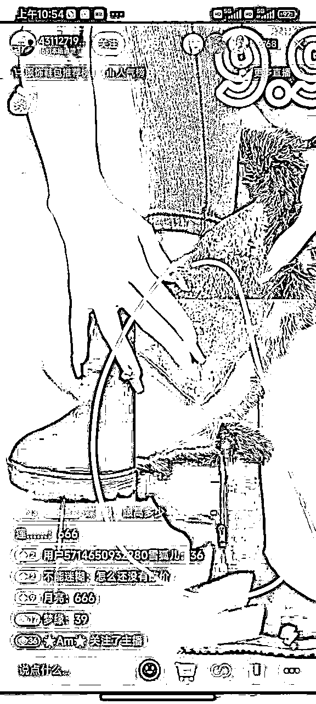

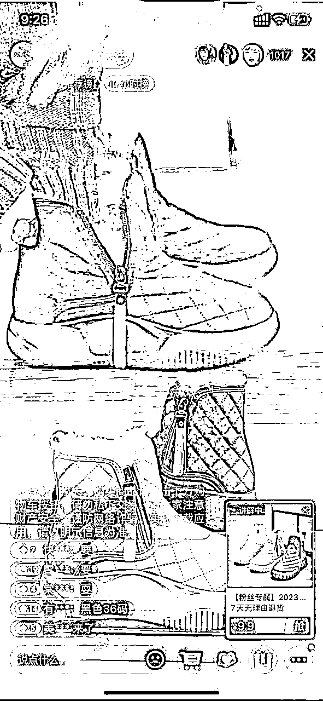

#### 4.2 人力配置

1-2人即可，夫妻档或小工作室最合适。稳定后一人也能跑。按两人分工说：

##### 4.2.1 主播

1. 负责摇手动作
2. 按稿件介绍产品
3. 人少时点名互动，提升基础氛围

##### 4.2.2 副播

1. 配合主播搭话，推节奏、喊口令，提升下单率。比如 5、4、3、2、1 上车，没拍到的抓紧拍，秒拍秒付别占库存
2. 简单投流操作
3. 拉时长时主副互换，给主播休息时间

话术我已整理在另外文档，副播台词用黄色标出。

## 五、直播间怎么搭

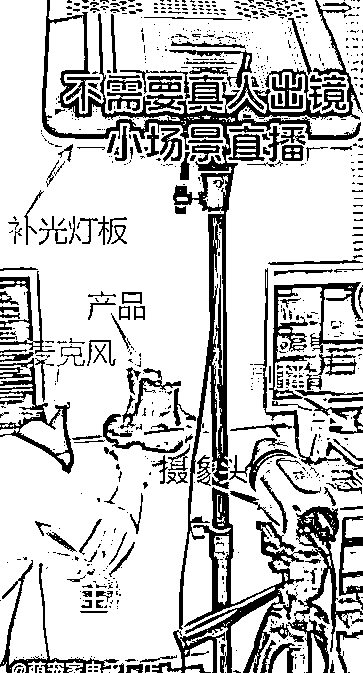

## 六、起号流程与关键注意

#### 5.1 新号注册

用从未开播的老号去开播权重更高。没有的话就新注册。新号首月有流量扶持期，正好利用起来。

注意：

1. 老号不是注册时间久，而是长期活跃、正常刷抖音、甚至有过购物的真实用户号。
2. 用直播伴侣开播，家人扫码也可以播，但提现问题建议用亲属账号操作更稳妥。
3. 想掌控提现和账号归属，可用员工号直播，需主号开通蓝V认证，适合批量做。

#### 5.2 养号

老号可跳过。新号建议养2周以上，避免被判定营销号。

核心就是模拟正常人刷抖音：

1. 碎片化时间刷
2. 看到好内容点赞关注
3. 地理位置有变化
4. 直播间购物
5. 偶尔发生活短视频

每天做一遍就够了。

要不要刷同行直播间养号？不用。看播标签和发作品的创作者标签是两套体系。

#### 5.3 开播与起号

这是成败关键，建议反复看。

##### 5.3.1 开播前准备

1. 刷千粉开橱窗，交500保证金。千粉约150元，建议官方渠道投千川涨粉更安全。
2. 15天内至少5天每天发一条生活类作品，这是开通直播伴侣的硬性条件。

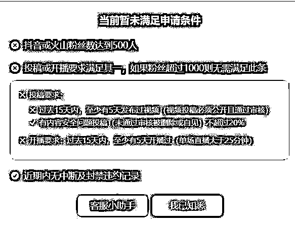

3. 重启直播伴侣，连接摄像头。
4. 调好音量，只调麦克风相关项。我实测麦克风输入音量60、增益-5、降噪-30。

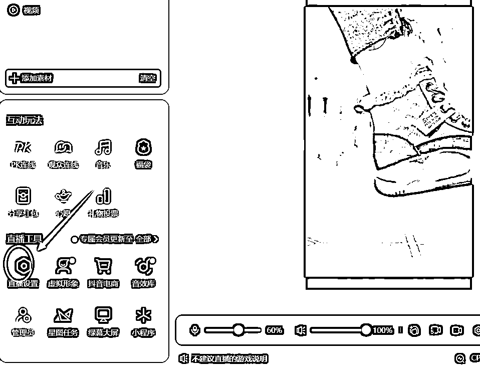

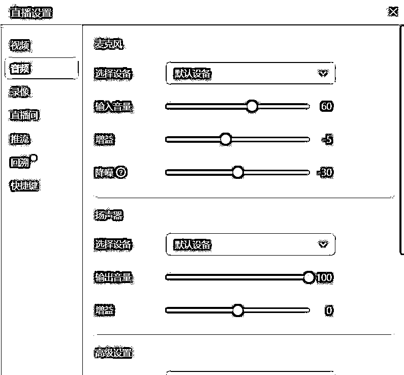

5. 确认商品链接与佣金无误。

##### 5.3.2 开播实操

1. 先投付费，小店随心推，选择成交+自然推荐，时长2小时，预算100-200元。
2. 副播刷热卖，只加到购物车到输入密码一步，无需真付款。一般刷到100单左右。
3. 以付费进人话术开场，峰值过后1-2分钟开始放单。
4. 学会看数据面板。自然流黄线为主时做浅层数据：停留、互动、涨粉。付费流蓝线为主时主攻放单成交。
5. 话术以15分钟为一轮，要会封单制造稀缺，封单后再补售后保障话术，降低售前退款。
6. 联盟商品放单封单怎么操作？直接在小黄车里删掉，放单时再从橱窗加回来。
7. 开播30分钟后看付费数据。以女鞋为例：
   1. 若场观400-800，涨粉≥4%，商点≥35%，互动≥6%，可继续跑付费，否则关掉。
   2. 人群对但数据不达标：停掉上一笔，重新投智能推荐+成交。
   3. 人群不对且数据差：停掉上一笔，重投成交+自定义年龄性别。

总结：首场建议播2小时左右。前1.5小时做数据，后0.5小时看付费数据达标与否。第三个半小时做成交，第四个半小时决定是否继续。2小时后若黄线抬头，可继续拉时长，只要黄线高于初始值即可。正常3-5场能起自然流。

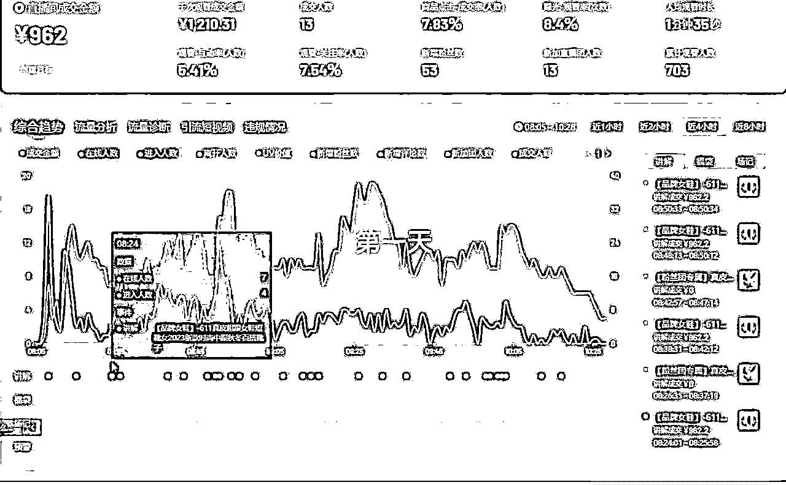

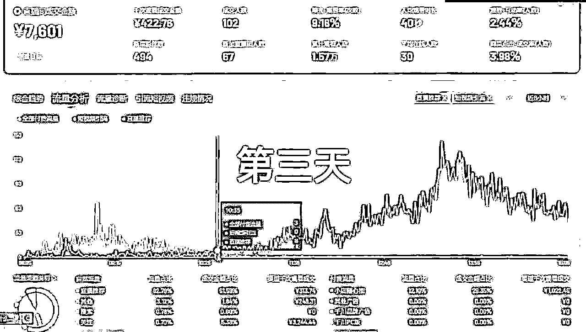

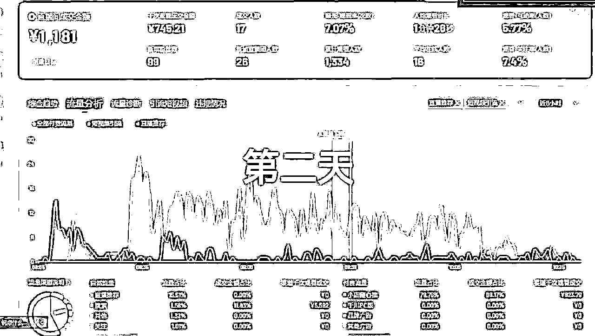

很多人担心付费压制自然流。实际不会，付费停了场观变小是表象。流量大则泛，小则精。付费的核心是快速打标签，撬动精准自然流，自然流一旦有成交就会获得奖赏。

#### 5.4 稳号

账号起来后，为保持在线或突破阈值会追加小店随心推。

流速快≥150/分钟，每三波放单投一笔100元成交+智能推荐。
流速慢，每1.5小时叠投一次100元成交+智能推荐。

#### 5.5 账号重启

违规后连续2-3天不推流，或新号播5场起不来自然流，可停播7天当新号重启，还不行再注销重注。

#### 5.6 常见问题与违规点

##### 5.6.1 绿幕背景视频从哪来？

精选联盟商品页相关视频或向商家索要，商家基本都有。条件允许自己拍更好。约1分钟，直播伴侣里勾选循环播放。

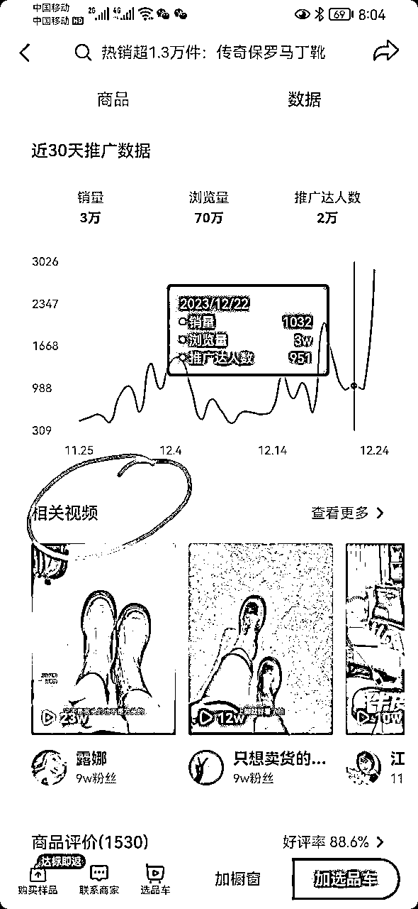

##### 5.6.2 怎么降低录播判罚

1. 对背景视频二次剪辑，混剪、关键帧处理。
2. 摄像头画面占比建议超过一半。
3. 样品到手后自己拍几个穿鞋动作，效果更真实。

##### 5.6.3 低质直播提示

这种形态容易出现该提示，实操不影响流量，可不处理。

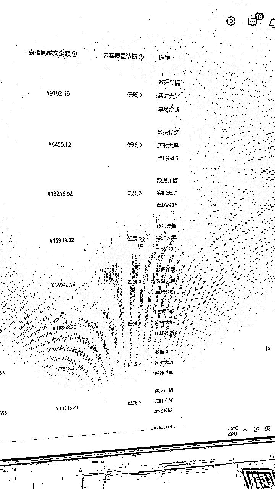

##### 5.6.4 憋单违规

不要以“上车”为前提让用户扣1扣2。小黄车里没有讲解的商品也会违规，应对方式：挂同类高价产品或让商家开专属链接。

##### 5.6.5 诱导互动/利益诱导

不要因果式要求关注亮灯牌，比如关注就加急发货或送运费险。出现该违规一般当场限流，建议直接下播。

## 七、项目延伸方向

绿幕自带高进入率的特点，可迁移到其他品类。例如：

小家电、无痕双面胶、对联贴等。

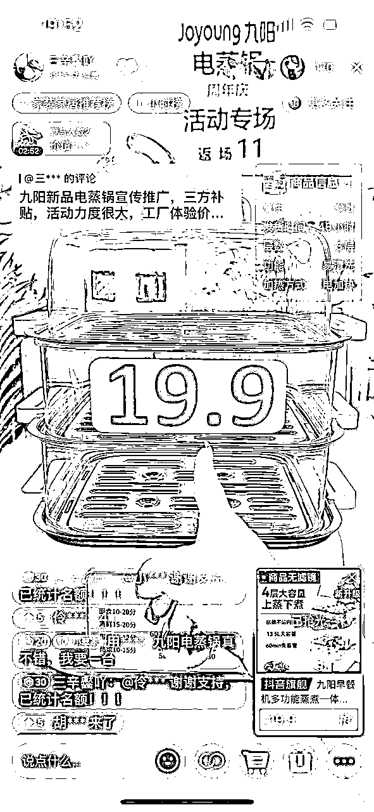

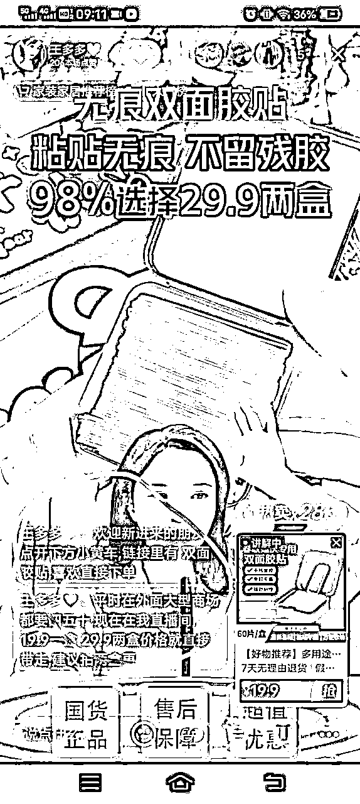

#### 1托100矩阵带货

绿幕直播不需要真实搭建场景，背景在电脑里做，一台电脑就能算一个独立直播间。所以有人用一个主播同时跑100个直播间，卖货+收徒。据说回本快，但需要资金、场地和技术攻关，目前我还没做，明年可能会尝试。该模式很可能复制到其他平台。

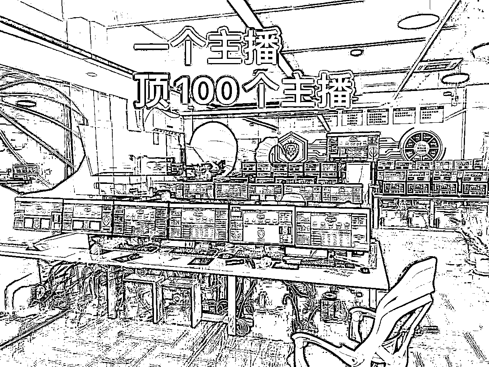

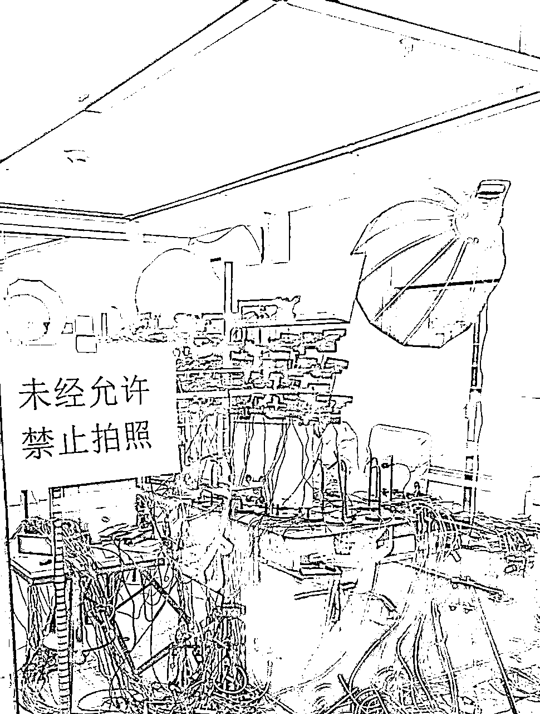

分享到这里。抖音直播带货我做了快两年，从无人直播到现在，废过30多个号。曾经追求各种技巧：正价起号、亏品起号、鱼塘起号、卡广场、七天螺旋、FAX起号等等。最后明白一件事：货是核心，货不行技巧全白搭。货对了，技巧才是放大器。希望这些踩坑经验对你有帮助。