# 新手👸号从0到1变现，常被问的20个问题合集

大家好，我是安七。七这个字，寓意踏实顺利。

应届毕业，第一年做到双百万。

百万级爆款写作者，带出过一批百万级学员，目前在龙哥盟👸号爆文航海营担任教练。

带课期间发现，某些问题会被反复追问。

教练们都很有耐心，回复也及时，但在线上难免有漏掉的时候。

于是我把航海营里最高频的20个疑问整理出来，方便后续的伙伴航行时能快速自查。

PS：航海手册里部分已有，这里做个补充，重复就当强化记忆。

也欢迎在评论区补充你遇到的坑和解法，我会陆续更新到文档。

一起龙哥盟。

# 一、👸号相关

# 1. 怎么注册👸号

官方指引：
kf.qq.com/faq/120911VrYVrA151009eIrYvy.html

文字流程：

①进入微信公众平台官网：
https://mp.weixin.qq.com/
右上角点“立即注册”

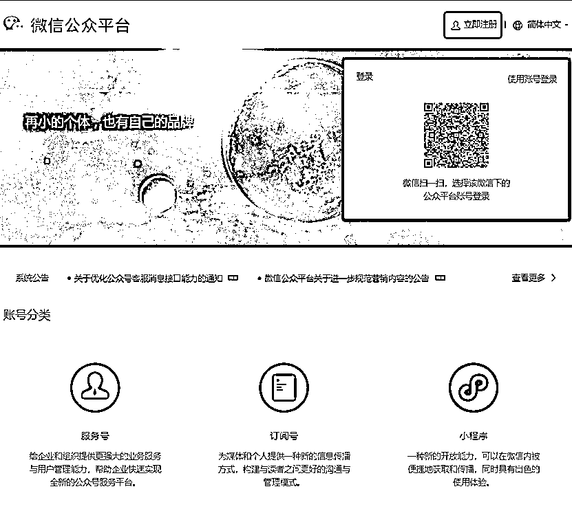

②挑选账号类型
个人运营一般选“订阅号”即可

③填写邮箱并登录邮箱查收激活邮件，输入验证码完成激活

PS：建议用未被使用过的邮箱。若提示“邮箱已被占用”

处理办法：

第1种情况：注册中断后重来，提示邮箱占用。

1）电脑端打开微信公众平台官网
2）用之前用过的邮箱账号和密码登录

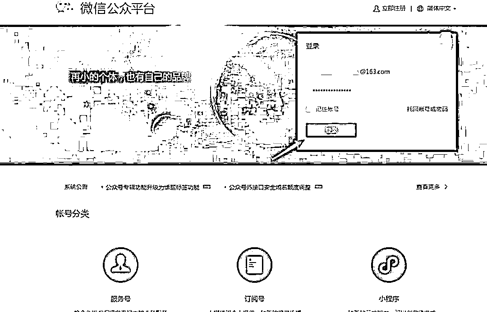

3）登录后挑选类型

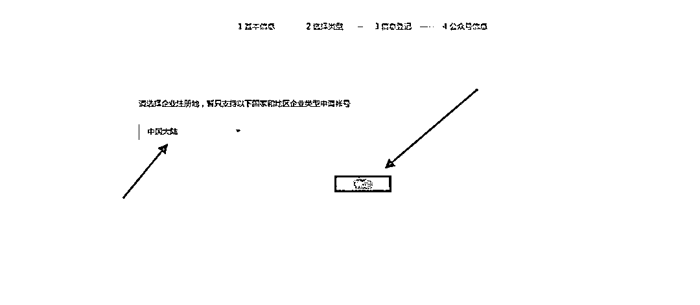

4）再次确认类型，点击继续

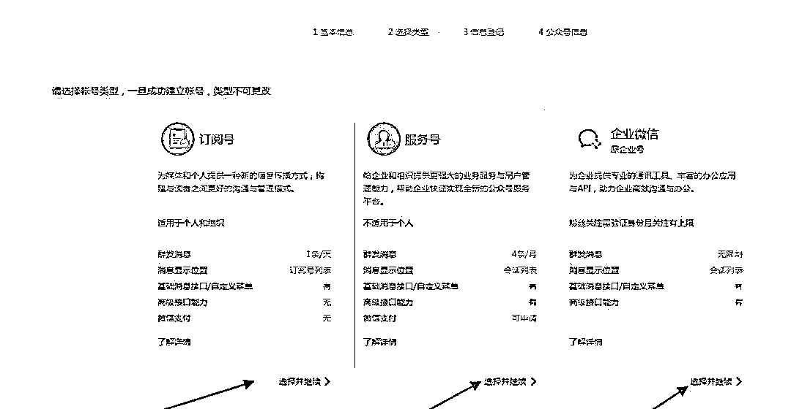

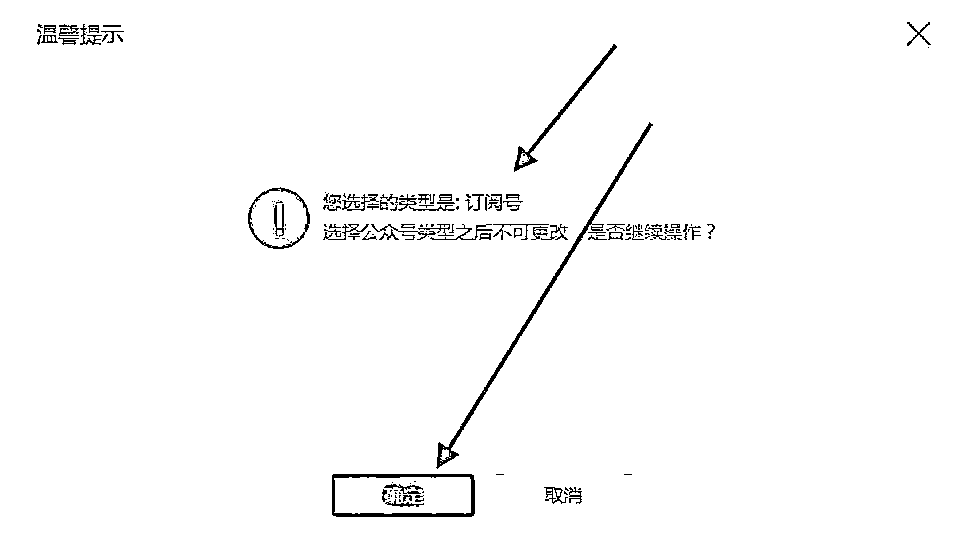

5）按提示完成剩余步骤。

第2种情况：提示占用，可能是邮箱已绑定其他微信产品。

查询方法可百度搜索“查看邮箱绑定的是哪种帐号”视频教程。

先核对输入的邮箱是否绑定以下其一：
1）已绑定开放平台的邮箱；
2）已绑定个人微信的邮箱；
3）已绑定企业号的邮箱；
4）已绑定订阅号、服务号的邮箱；
5）已绑定小程序的邮箱。

注意：同一邮箱只能绑定一种微信产品。

注册时提示占用，可先解绑或换邮箱再继续。

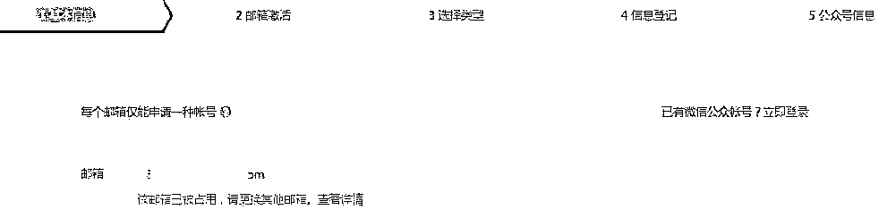

第3种情况：提示邮箱占用，找回密码却显示“您输入的邮箱未注册”。

若邮箱绑定了其他微信产品但未绑定👸号，则无法走👸号找回流程，需先解绑或修改绑定邮箱，再注册。

解绑方法可百度搜索“查看如何解绑邮箱”视频教程。

④选择类型与注册地
注册地可填工作学习地，也可填户籍地，都可以。

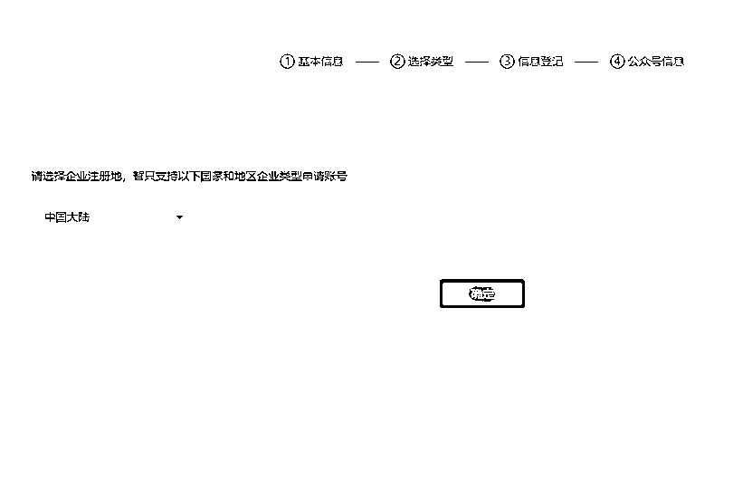

⑤了解订阅号、服务号、企业微信差异后选型
个人仅能注册订阅号

⑥信息登记，选个人

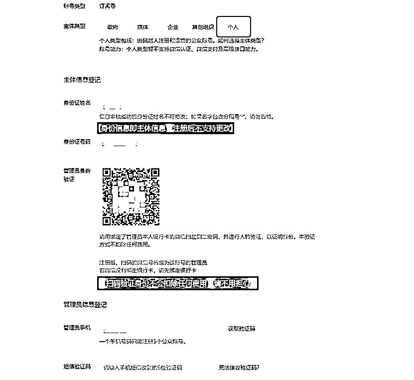

⑦填身份证信息、手机号

⑧填创作者信息
选填，我一般空着

⑨填账号信息，含👸号名称、功能介绍、运营地区

账号名称即👸号名，
想不出来可套用4个模板：
我是XXX呀；
叫我XXX好了；
努力中的XXX；
XXX在努力

领域通用。

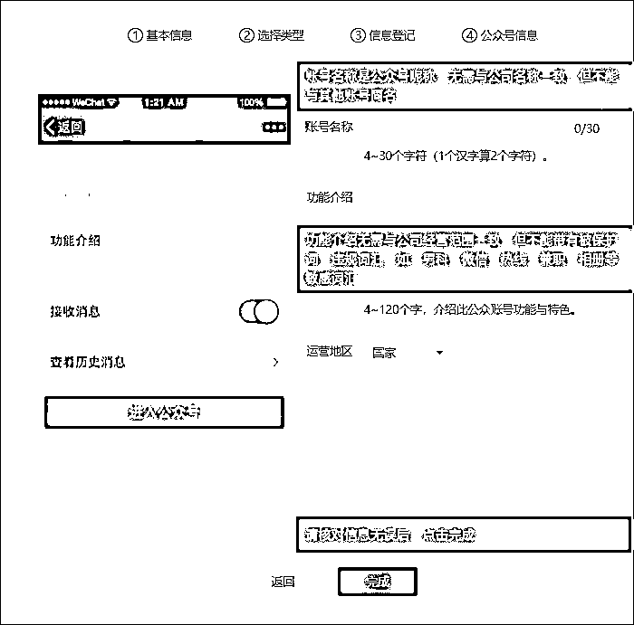

⑩注册成功！
可开始修改昵称、简介、功能菜单了~

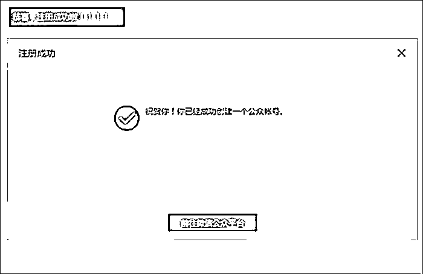

# 2. 👸号爆文赚钱的逻辑

有学员问得很好：发文章为什么能赚钱？

我们主打的👸号爆文，绝大多数收入来自流量主。也有接广告，但占比小，这里不展开。

理解方式：

各平台都在争夺用户，想把用户留在自己生态里，👸号亦然。

早期👸号对新人极不友好，是封闭系统，粉丝数基本决定阅读上限，不会分发给陌生用户。

后来平台发现这样不行，中小号没流量留不住，流失后平台活跃度下降。

于是规则调整：对新人也做推荐，文章有爆款潜力就先给点流量，表现好就持续放量。

这就是爆文流量的来源。

【变现闭环】
平台：留住用户，给流量挂广告
你：做内容承接流量
读者：内容有价值，愿意停留

三者形成正循环。

平台是否推荐不可控，读者是否喜欢不可控。
能控制的是提高内容质量，把握爆款规律，写出爆款。

阅读越高，文中广告曝光越多，平台为感谢你留人，会自动加大推荐和收益。

这样理解了吗？

# 2. 自动回复、关键词回复怎么设置？

操作步骤：

1.用电脑版微信登录公众后台
电脑浏览器搜“微信公众后台”登录
进入后

2.按图操作。
左侧点“内容与互动”
下方有“自动回复”、“自定义菜单”等。
我们要的是自动回复，展开即可。
按图走基本不会错。

我自己的关键词回复参考：

关注自动回复：
嗨，你好，我是安七，朋友你来啦【欢迎语】
可以先看这篇：
…………链接【我的故事文，拉近距离】
安七的号一般发：……等内容【告知输出方向】
专注…………有需求可联系我哦【业务推广】
一起共同成长、不断进步、最终成为更好的自己！
回复……可免费加入安七星球，每月2次提问名额【引导加好友或入星球】
回复……可加入交流群，加好友备注“交流群”
PS：若二维码过期，可加我微……我拉你
【这套话术偏进阶，起步阶段简单欢迎即可】

已读回复：
若没收到想要的内容，可加安七微信：
XXXX【备注：号】
私聊我吧

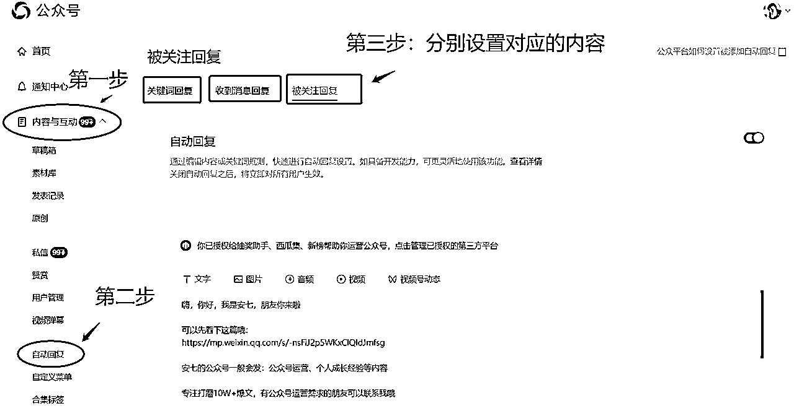

# 3. 一天只能群发一次，但一次可带8篇，怎么带？

如图所示👇
【写完一篇先存草稿，防止断网丢失，会崩溃】

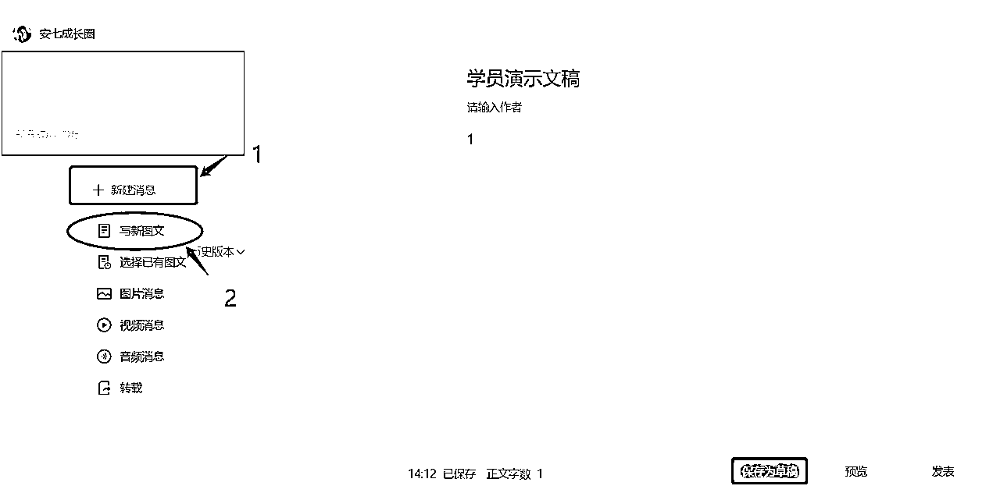

# 4. 👸号文章怎么加下划线？

问：我看到有虚线，我怎么没有？
答：长按句子/段落，会出现“划线”，点一下即可

问：为什么我的实线别人的虚线？
答：虚线是他人划的，你自己只能划实线。但你划的实线，在别人端显示就是虚线

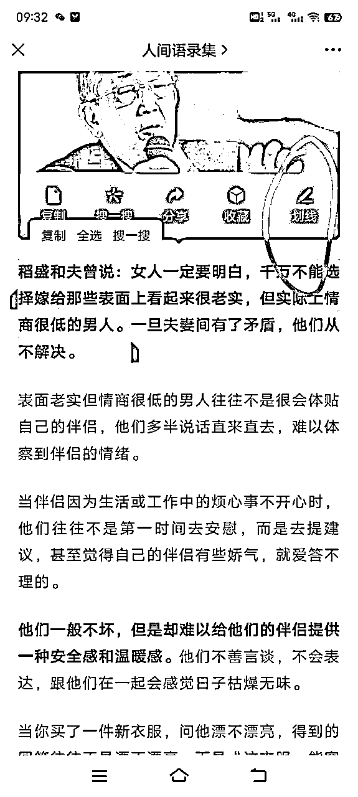

# 5. 排版易错点

1.一段控制在1-3行，别超4行。
电脑屏大，电脑排版1-2行即可，手机看约3行。段落过长密密麻麻。
2.不要手动敲空格想居中，看图：
手工敲不准还费时

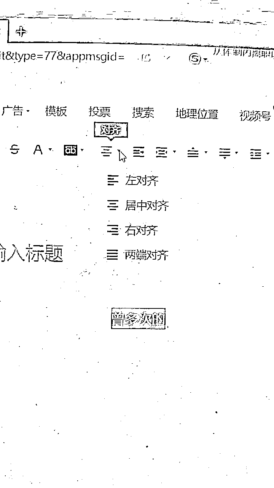

3.为什么段落空行过大？
有同学问找不到原因。
是不是手动画了空行？
问题在此：
直接起下一段即可，不用中间空一行。
全文写完再按排版公式统一调整即可。

4.为什么排好版，保存草稿、预览又乱了？

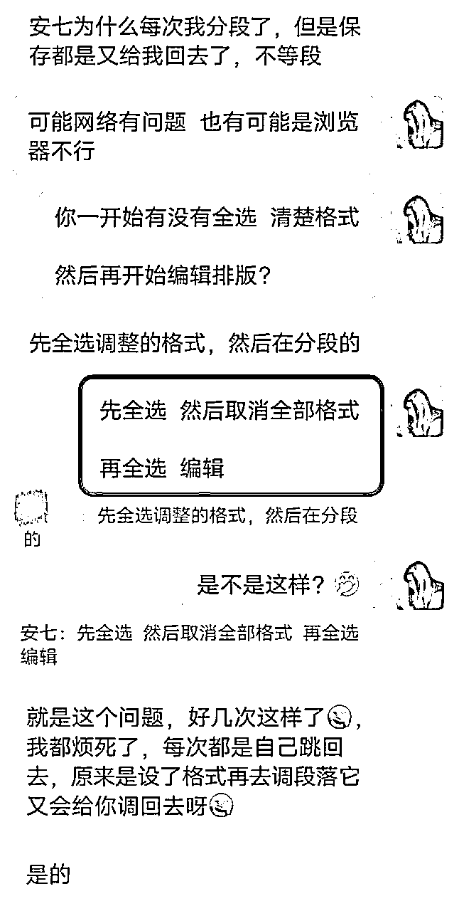

# 6. 文章原创度怎么查？

用“易撰”网页版
易撰查原创度方法👇
【微信扫码登录
每天免费3次
超量需付费】

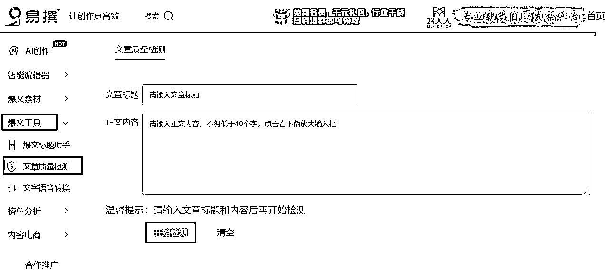

# 7. 结尾图点进直接到文章怎么做？

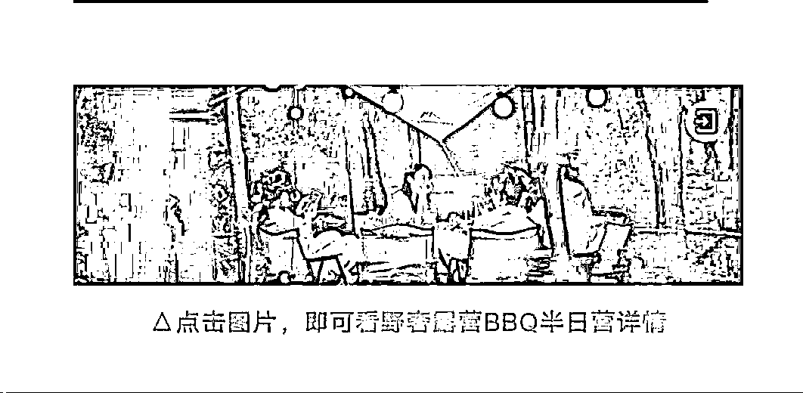

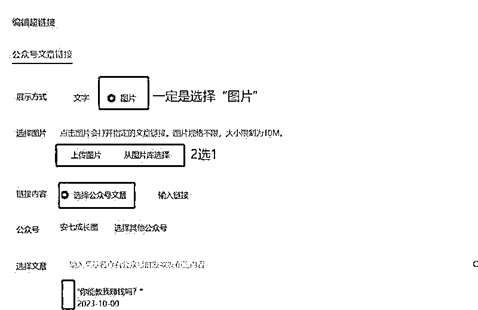

# 8. 怎么判断找的爆款适不适合自己的赛道？【标题如何改写？】

学员反馈，对爆款是否匹配赛道，以及标题如何借鉴，比较模糊。
统一说明：

1.先判断爆款的领域是否与自己一致
比如学员看到标题：“6大方法，让你睡眠质量越来越好【亲测有效】”
她赛道是“极简”类，与之不符。
属于生活习惯类，调性不搭。
想尝试可放两条去市场测试反馈。

2.爆款标题怎么改写？
最简单是改数字
数字务必改，改完后务必复制粘贴去搜索是否完全重复，有就继续改。

ps：
改写有技巧，想让标题更像自己的，千万别改掉【爆款关键词】！
什么是爆款关键词？
即标题里的人性词、痛点词、好奇词、暗示词等。

例如：
1、“6大方法，让你的睡眠质量越来越好【亲测有效】”
爆款关键词：睡眠质量
吸引力词：【亲测有效】
很多人有睡眠痛点，刷到标题再看到亲测有效，大概率会点。
你把睡眠质量删了，别人看什么？

2、“男生把持不住的23句睡前小情话”
爆款词：把持不住、情话
有若隐若现的性暗示，很有吸引力

3、“一本改变命运的奇书，央视强烈推荐！”
爆款关键词：改变命运、奇书
吸引力词：央视【强背书】

改写示例：
“吹爆这本改变人命运的奇/好书，央妈强烈推荐！”【举例】

# 9. 爆款关键词怎么分析？

建议建立“爆款标题库”，把同行的爆款标题扒下来，再提取关键词做分析。
分析多了就有感觉。
比如读书类关键词，多是人生低谷、好书、强烈推荐等这类人性词。

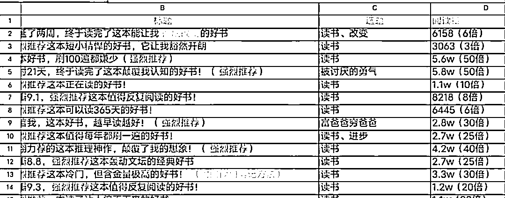

# 10. 👸号文章字数多少合适？

一篇最少900字，1200字较稳，最多别超1500字。

900字：可插1条文中广告
1200字：可插2条文中广告【无插画前提】
1500字：偏多但可接受，再多就长且密，完读率下降。

总结：1200-1500字最佳，别超2000字。太长没耐心，太短广告位不足收益下降。

# 11. 发文时间有讲究吗？

无绝对时间，只要不太早也不太晚即可。

别太早：早上五六点发，很多人未起床。
别太晚：超过晚上11点或11:30发，太晚用户偏爱擦边内容，正经文章关注度低。

# 12. 👸号配图哪找？

文档里有，但很多同学没找到，再统一说下，通用各赛道。

1.📕搜
想要什么效果搜什么效果，如极简类同行用温馨治愈风，就搜“治愈动漫图”
‼️博主简介未写“禁止二改二创、严禁搬运”等限制词可用。
‼️带水印建议换掉或自行去水印。
极简类常用：“魔女宅急便”、“哈尔的移动城堡”、“千与千寻”等

2.同行👸号盗图
文章写“图片来源于网络”，大概率可直接用。
注意别图文全抄，图换另一篇的，文模仿这篇，降低举报风险。

3.百度
版权纠纷少，注意水印。

4.堆糖
壁纸资源多，很多📕博主背景图来自这里。

# 13. 私信要回吗？

有同学爆文后私信暴涨，有好有坏，不知回不回。
建议：不回。
时间精力有限，好的看看乐一下就好。专门来骂的，关注完就骂，没必要计较。

后台评论留言想合作，建议在👸号菜单栏放上联系方式。
真正想合作的人会主动加你。只是私信问问的，无需理，我们核心靠爆文赚钱。
私信只有你可见，无需担心形象。

# 二、避坑指南

# 1. 为什么不要轻易暴露👸号名字？

从第一期训练营我就强调：
别轻易公开👸号名；
爆文号尽量别发朋友圈【IP号除外】；
晒收益图一定要马赛克👸号名

原因：人性。
爆了后总有人故意找茬举报，举报成功会被判违规，流量骤减，号可能废。
还有人会洗稿【做大了总会被模仿抄袭】。稿子被洗多了，系统会误判你自己的号。
误伤友军。

# 2. 对标账号别找每篇10W+的大号！

很多同学对标错了。
记住：对标要找新号、低粉爆款号！！！
千万别一上来对标大号，大号无参考价值。

怎么判断是不是大号？
1.看原创文章数
原创几百上千，多半是老号或大号
2.看创建日期
怎么看创建日期？

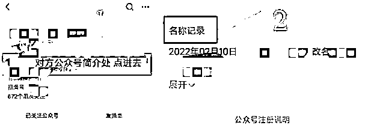

大号自带几十万上百万粉丝基础，不管写什么都有几万、10W+阅读，无可比性。

例外可借鉴：
老号此前阅读稳定在1-5W，近期突出一篇10W+，这篇异常值可模仿学习。

# 3. 文章被举报怎么办？

有学员第一篇对标前几天10W+，发出去没多久3个阅读就被举报。
原因是“滥用原创”，别人觉得内容像，直接举报。
举报成本极低，一键的事，写作者多多少少都遇到过。
还有标题一模一样被限制原创一天。写得太好被同行嫉妒反手举报……
举报很正常。
放平心态：“不被嫉妒是庸才”

常见问题：
1.被举报账号还能用吗？
能用。但别频繁违规，轻则限制发文，重则封号。

2.如何规避？
无法100%避免，但可降低风险。
①标题不要完全一样
看到有标题一模一样也能过，但别赌概率。
我一般做法：
a.找到近期爆款，对标题做删减改动，但保留爆款关键词
b.把改好标题填入AI调教指令，让AI重新生成内容
c.若AI生成内容仍太像，让它换角度重写
d.AI内容达到80%需求后，我再微调，有时可直接发
我手里一个号从未被举报，除标题有相似外，其余都是原创。反而很多人抄我，被朋友举报多次。

②内容框架不要一模一样
不只是换说法，里面的要点也要换。
素材可去📕搜，来源多。

# 4. 快捷转载键绝对不要开！

写完拉到底部会看到“快捷转载”选项，在标原创处。
要不要勾选？
答案：不要！！！
一键转载会分走你的流量。

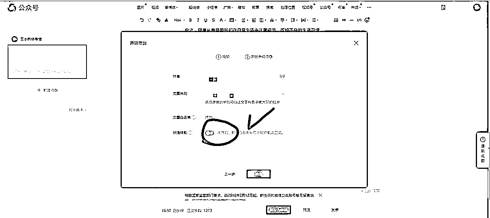

# 5. 发文前注意错别字、别转发朋友圈/社群

再强调一次。
发文后用自己微信预览一遍，检查错别字。
【👸号文章修改只能改20个字符，且只能改一次，标题不可改】
可给自己点赞、在看。但不要点广告，更不要转发朋友圈和群，也别让朋友帮忙点广告。
同一批用户反复点赞点广告，账号容易进入死区，进不了流量池。

ps：
尤其是用大小号轮流切换给自己点赞再看，更容易死号。
所以别自作聪明刷阅读量，也别总让固定朋友帮忙看。
发完就放着，顺其自然。

# 公号发文后，先别急着自己点开

文章刚推送完，第一时间冲进去刷数据，是很多人的习惯。但你越是频繁点开，越可能扰乱系统对你账号的自然推荐判断。

不妨试着克制一下，隔一段时间再看，看看有多少是真正来自自然流量的曝光。

毕竟发文后那几分钟里，频繁出现的是同一几个IP，反复刷新。账号的推荐模型很容易因此产生误判，判定为异常点击。被“养”坏的号，后期想拉回来恢复，代价很大，往往需要长时间的稳定更新才能慢慢修复。

# 一篇文章到底配几张图合适？

这个问题几乎每次都会有人问。

我的经验是：正文配图最好控制在3张以内，甚至完全不配图也完全可以。

很多人忽略了一个细节：👸号的广告展现是有位置要求，必须前后300字都有有效正文。

你一旦塞太多配图，就把本该放广告的位置挤掉了。最终导致系统判定无法插入广告位。

我见过不少案例，明明写了1500字以上，却被提示广告位不足。原因往往就是配图太多了。

# 额外分享几点实操心态

## 1. 心态要稳，没下雨前先把盆准备好

带这期航海训练的时候能感觉到，伙伴们的热情和执行力都不错。

大家掌握的套路其实都差不多，真正拉开差距的，往往是心态。

不少第一次做👸号、第一次写爆文的新手，会在前7天看不到阅读量就开始焦虑：“7天了还是0阅读，是不是没戏了？”

先冷静，这种情况太正常了。

做公号内容有很强的长尾效应，今天没爆，不代表账号起量后就不能爆。

我带过一个做育儿方向的学员，前期阅读量只有几十，坚持了十多天后，有一篇突然冲到10万+。

要不是她坚持住，这波红利就错过了。

所以记住：心态稳住，在流量还没来之前，把承接的能力先准备好。等雨下来了，才有盆接住。

## 2. 允许自己慢，但执行要狠

现在进入👸号赛道的人越来越多，竞争也在悄悄抬高。

以前一个号可能7到21天就能起来，现在拉长到30到60天都很常见。

一篇文章就爆，属于天选体质，概率极低，别拿自己跟运气去比。

大部分人都是普通人，前期没有数据是常态。先花时间打基础、做沉淀。

与其算计发布时间、算计爆不爆，不如把基础动作做到位：把方法论完整过一遍，然后照做。

说得再好听，也不如狠执行。执行时犹犹豫豫、半信半疑，最后结果自然也会打折。

## 3. 做原创，脚踏实地

焦虑往往来自对比。看到别人报喜，自己没动静，很容易怀疑方向。

但每个号的“爆款基因”都不一样。

前期先测你自己也感兴趣、不排斥的垂直领域，测一段时间看反馈。

如果头条一直不动，可以用二条去试水其他方向。

我有一个职场号，前半个月几乎没水花。我当时跟自己说再给它一点时间，后来慢慢就起来了，现在多篇10万+，10天就能破万。

结果都是试出来的，不是想出来的。

说到底，做公号就是为了变现。但变现是有前提的。

我见过一些号一直起不来，一问就是纯洗稿赌概率。这种做法对账号是消耗。

这期航海的核心主题就是原创。优质内容才能穿越流量周期。

当然，你的内容越好，被抄的风险也越高。如果你发现自己的号被频繁搬运，也别灰心。被对标说明你做对了。

这也是学习如何保护账号的过程：比如关闭👸号码搜索、保留IP访问，爆文当天达到10万+后，甚至需要有取舍地删文。

与其盯着一个号被扒，不如把这套好用的模型复制到新号、新领域去再做一遍。

以上都是过来人的实操体会，供大家参考。

我是安七，让你安心的幸运七，欢迎交流。