# 百度网盘会员也能变成赚钱工具？这个信息差玩法，值得认真看看
作者：龙哥

## 开篇：一次意外的收入，让我发现了新门路

先聊个题外话。大家平时用百度网盘多吗？我反正是重度用户，几乎每天都要打开。可就是这个工具，非会员的下载速度真是让人抓狂。上传文件倒是飞快，但到了下载环节，不管你家里宽带是100M还是200M，速度照样能给你压到每秒钟连100KB都不到。下个大一点的文件，耗上一整天是常有的事。

想快一点？行，开通会员吧。在线解压要会员，转存大文件要会员，扩容也要会员。官方标价，一个月30块，一年298。说实话，这价格可真不便宜。但对于真正有需求的人来说，再贵也得咬牙掏钱。所以那时候我就在想：要是能便宜一点就好了，比如一个月25？一年258？其实这就是无数百度网盘用户的真实痛点。

不过，也正是这个痛点，藏着一个很多人还不知道的赚钱机会。

事情是这样的。大概8月中旬，我随手分享过一个百度网盘的链接，也没太当回事。一个月后，无意间点进网盘里的"分销中心"，发现里面赫然躺着一串金额。

当时截图就是这个样子：

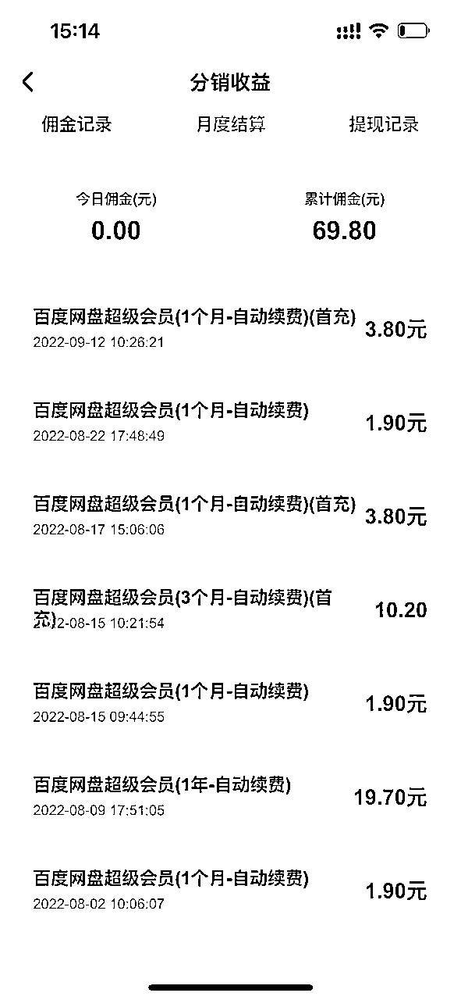

说实话，第一反应是"这又是商家的什么套路吧"，没太在意，顺手点了提现。结果刚点完，弹窗就跳出来一条打款记录。

记录在这里：

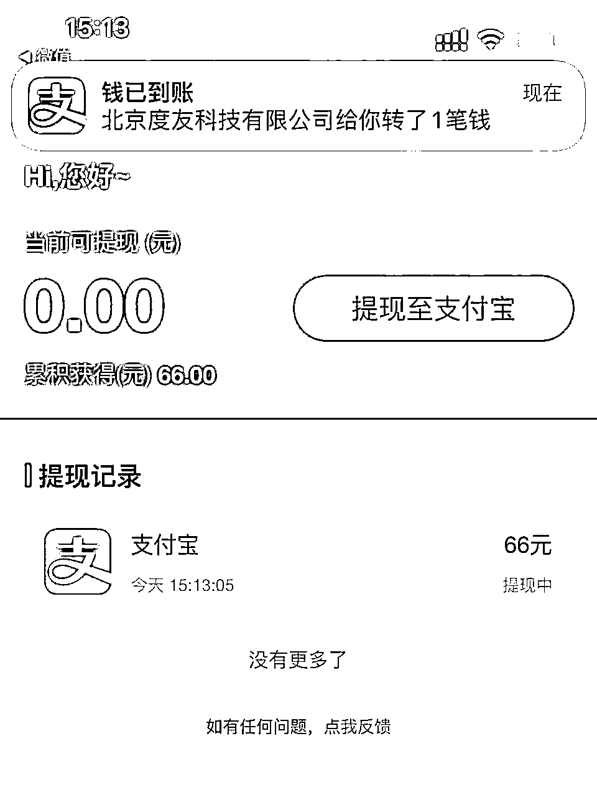

点进去一看，66块钱真真实实到账了。

到账截图：

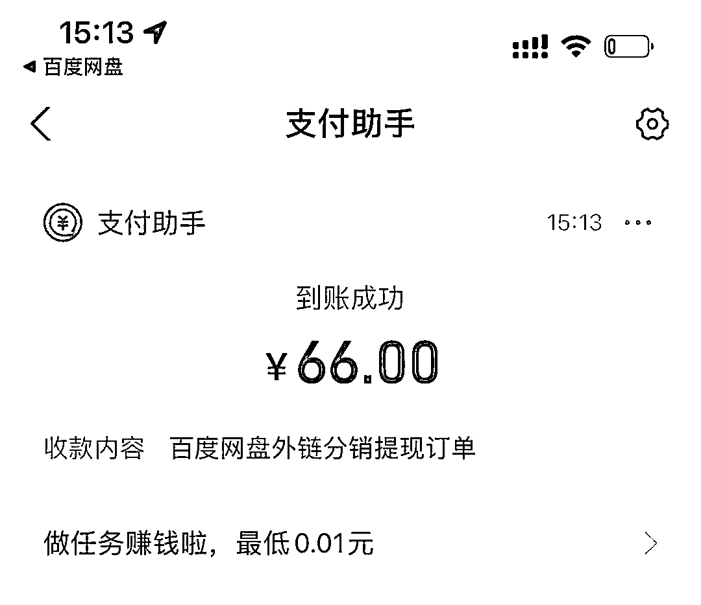

这下我有点坐不住了，平白无故给打钱？就因为我分享了一个链接？开始我还以为是那种拼夕夕式的套路，差一点就让你提现成功，结果永远差那么一截。后来确认了一下，真不是。

搞清楚之后才明白，原来只需要参与会员分销就行。说白了很简单：通过盘盟的官方签约入口，成为签约的盘主，这个免费。至于那66块，就是我分享出去的会员订单带来的佣金。

可能你会疑惑：别人为什么要找你买？这个问题我也好奇过。之前一直想不通那些低价官方会员是哪来的，一个月18，一年188，比官方便宜这么多。现在真相大白了——渠道就在这里。我之前一直傻乎乎地在官方原价充值，30一个月、25一个月都充过，一年298、最低258也花过，回头一看，纯纯地被信息差收割了一波韭菜。

这事儿就是这么个理：不知道，就永远是消费者；知道了，不仅自己能省钱，还能变成一门生意。

我之前在官方买会员的记录：

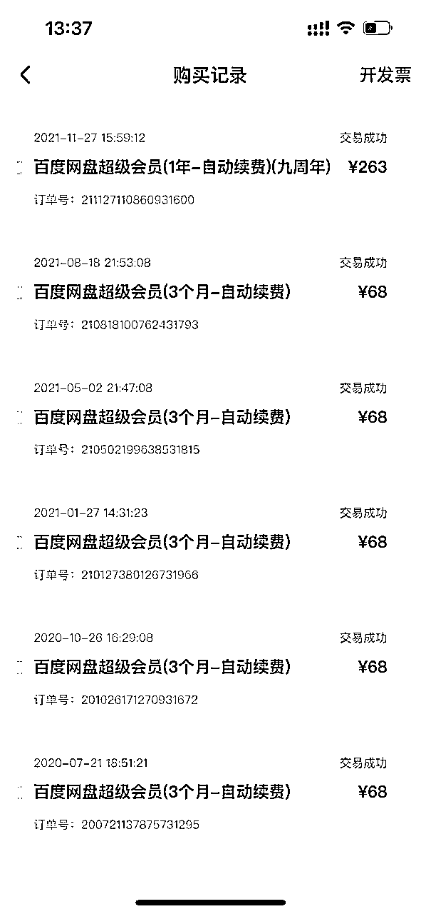

## 认知决定收入，这句话永远不过时

很多人问赚钱靠什么？一部分答案就是四个字：信息差。你掌握了别人不知道的信息，你就有变现的可能。今天你看到了这篇文章，知道了百度网盘盘盟这个项目，你就比别人多了一条赚钱的路子。至于最终能赚多少，还是那句老话：赚钱多少从来不是由项目决定的，而是由人决定的。

别把希望都押在项目本身，要多提升自己的认知水平和执行能力。你想想，捏死一只蚂蚁难不难？轻松得很，因为那是降维打击。一个高中毕业生去做小学题目，是不是手到擒来？道理完全一样。认知高了，差距就出来了。见的多了，学的多了，懂得多了，遇到啥事都知道怎么应对，这才是能赚钱的底层逻辑。

## 什么是百度网盘分销CPS

先补个概念。CPS，全称按实际销售付费，是一种按成交结果结算的推广方式。放到这里，CPS分销说白了就是"网盘淘客"——你帮忙卖会员，卖出去拿提成。

那百度网盘会员具体有哪些权益？大多数人可能只知道下载不限速，其实远不止这些。平台本身就不多赘述了，简单列一下：

百度网盘VIP分成两种：

超级会员：最高5TB存储空间、极速下载、在线解压、视频倍速播放等。

会员：2TB存储空间、极速下载、在线解压等。

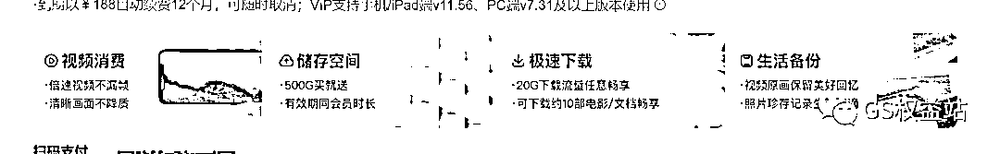

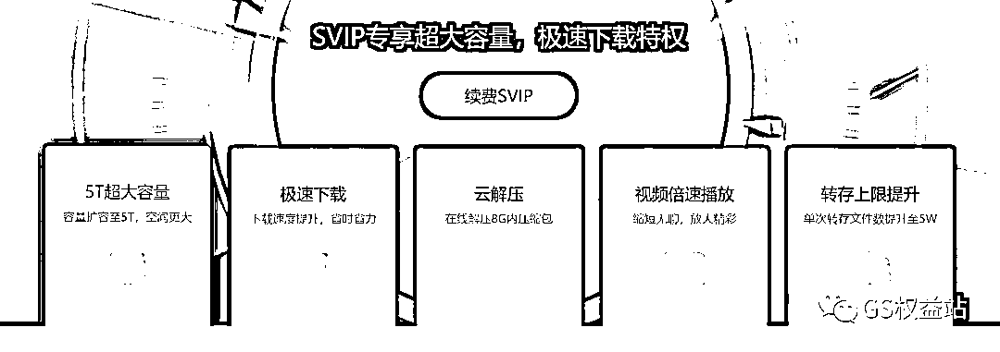

## 官方价格，为什么区间这么大？

来看官方定价体系：

VIP会员：
- 月度：25元/月
- 季度：55-75元/季
- 年度：188-248元/年

SVIP超级会员：
- 月度：30元/月
- 季度：55-88元/季
- 年度：202-298元/年

还有一种GS权益虚拟卡券：
VIP：
- 月度：14元/月
- 季度：44元/季
- 年度：149元/年

SVIP：
- 月度：19元/月
- 季度：51元/季
- 年度：182元/年

看到了吧，价格区间跨度不小。这就是互联网典型的"千人千面"策略。不同的用户身份、新用户还是老用户、连续包月还是单次购买、不同渠道不同场景，价格都不一样。这道理不难理解——同一个商品，在不同平台不同人面前，卖出去的价格本来就可能不同。

做生意的都知道，决定一件商品最终成交价的，往往不只是商品本身，还有服务体验、附加价值这些东西。而正是这些差异，才给了我们低买高卖赚差价的空间。

还有一个所有做买卖的人都躲不开的常识：你的目标客户永远不可能是全部人。哪怕你只锁定一小部分精准用户，做好他们的生意，就足够你吃了。

当然，也会遇到这种人，跑来问"你卖得比闲鱼还贵？"怎么应对？三句话：第一，低价引流永远是最低成本的获客方式，高毛利成交才是商业本质，低买高卖亘古不变。第二，你永远满足不了所有人，这是必然的。第三，如果真有人价格比你低，你要做的是提高自己产品之外的附加价值，用服务体验来溢价。

举个例子，同一件衣服，1688、淘宝、拼多多可能都是同一个货源，但价格就是不同。平台属性是原因之一，更重要的是，客户不可能都聚集在同一个平台，他们的信息渠道、购物习惯天然不同。

有点跑题了，这段话纯粹是有感而发。回到正题——就像刚才说的，你的商品不可能适合所有用户。如果来找你买的人发现官方活动价比你更低，那就让人家直接去官方买，等下次没活动了再来找你。

说到底，互联网上的生意和线下的传统生意没有本质区别，核心就是八个字：低买高卖，信息差变现。只要打通"低买"的渠道和"高卖"的销路，一个项目就能跑起来了。

很多人赚不到钱，根子上是眼高手低。看项目介绍觉得"不过如此"，可真到实操环节，啥也没干。动起来，钱才会向你靠近。

## 怎么成为一名盘主？

有人可能会问：渠道便宜这么多，别人为啥不自己开？答案还是信息差。有人连这个入口都不知道，甚至还有人拿这个入口来收费。现在我把"低买"渠道公开。

签约方式总共有三种：

方式一：去官方联盟获取推广链接。

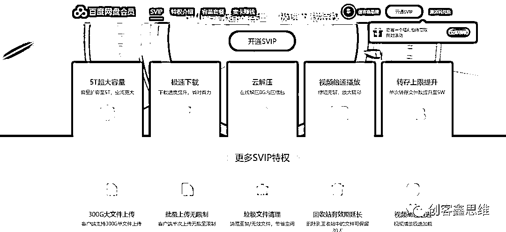

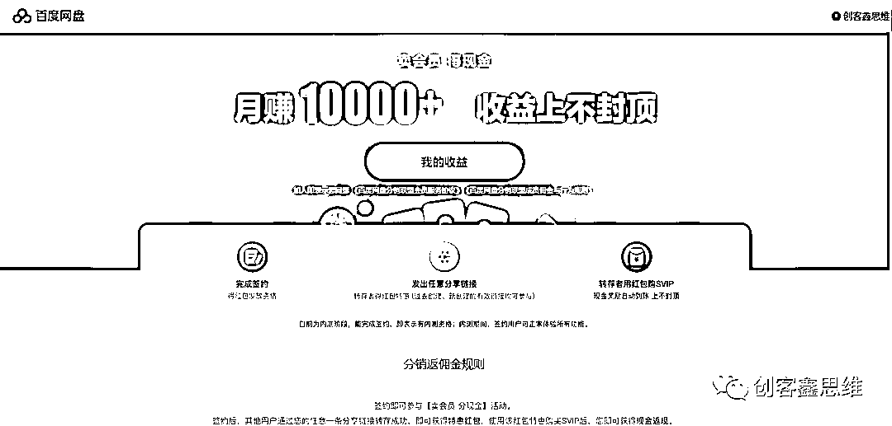

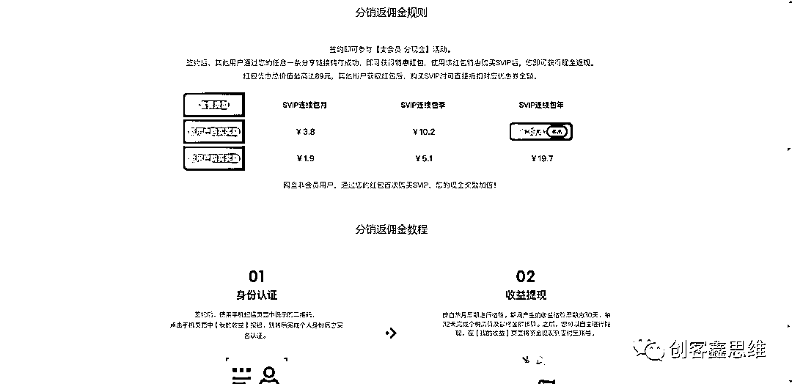

按官方流程一步步填写资料就行。

方式二（推荐）：🛰️搜索"百度网盘联盟"👸号，关注后点"我要赚钱"，选"卖卡赚钱"，登录自己的网盘账号完成签约。签约后拿到的价格非常香，比如官网298的年卡，这里只要188。

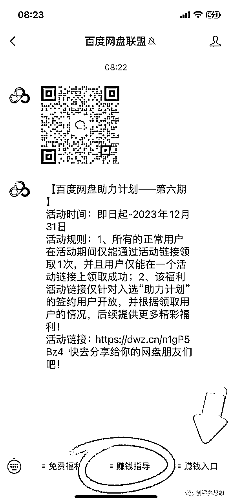

方式三：打开百度网盘APP，从"我的"进入"分享赚钱"，选推广方式完成签约，成为盘主后同样拥有分销权限，卖出去就有佣金。

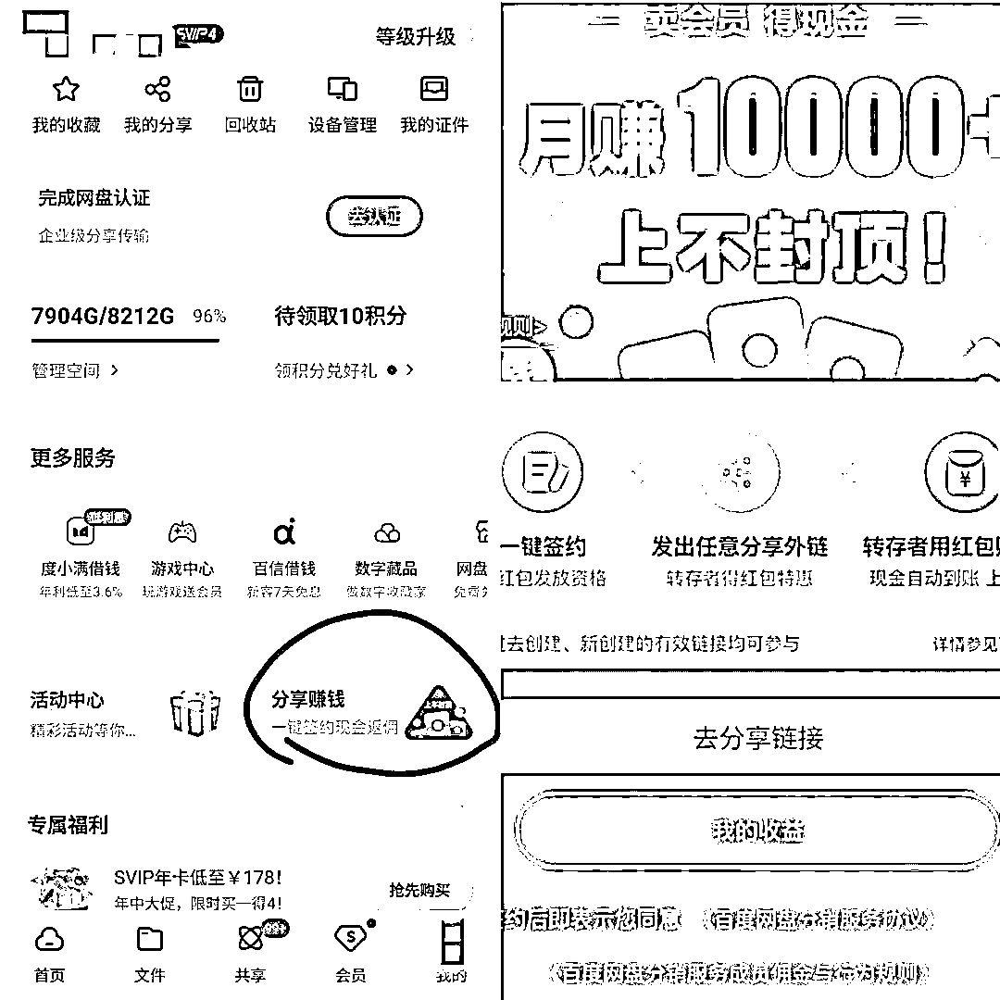

## 邀约盘盟，拿双重佣金

这里有个进阶操作，可以同时拿两份收入。具体怎么做？

第一步，准备两个百度网盘账号。

打开【百度网盘联盟】👸号，右下角【赚钱入口】，点【方式1海报卖卡】，用【账号1】登录。然后进入【我的】-【我的盘盟】，点【邀请加盟】。这里需要邀请10个人通过你的链接或二维码注册。

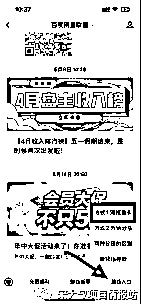

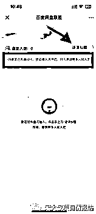

注意了，这10个人里面，有一个必须是你准备的两个账号里的【账号2】。剩下9个随便凑，家人、朋友、网友都行。把链接发出去，告诉他们既能省钱还能赚钱，一般都能拉得到。

第二步，在【百度网盘联盟】👸号的海报赚钱入口，登录【账号2】。注意必须用【账号2】。拿连续包年卡举例：点【分享赚钱】-【复制链接】，把链接发到🛰️自己聊天框，打开链接，通过手机号验证码登录接单用户的账号，然后直接支付连续包年。平时价格197，618活动价178。

这一步里，【账号2】能拿到卖卡佣金19元，【账号1】能拿到邀请好友提成10元。

有个关键提醒：如果登录后不显示连续包年，需要用户手动在APP里把自动续费关掉。

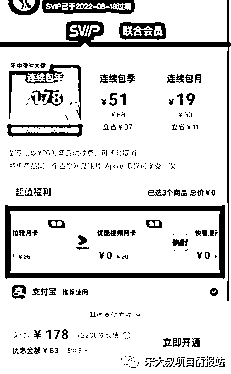

关于自动续费，具体操作路径如下：

✔🛰️：钱包-支付设置-自动续费

✔支付宝：设置-支付设置-免密支付/自动扣款

✔百度网盘：我的-最下方帮助与反馈-续费管理

买完后可以自己在🛰️或支付宝里解除自动续费签约，如果想让下一年继续自动续费，不解约也行。

还有一点：连续包年现在会送优酷月卡。综合算一下成本：197减19减10减8，最终实际成本160元。月卡和季卡同理。到这里，"低买"渠道就彻底打通了。

至于"高卖"，思路就太多了。某博、某吧、某乎、某书、某鱼，找到精准社区或论坛，做活动推广宣传。想做低价冲量，去闲鱼上架，一单利润控制在4到5块，一天出20单，稳稳100块到手。想做高客单价，走🛰️朋友圈私域，产品有了，变现方式自然就有很多。

这个项目操作难度不大，时间灵活，想干的话现在就动手吧。下面分享几个适合新手上路的玩法。

## 三个新手友好的变现方式

### 玩法一：闲鱼

需求摆在那里，闲鱼上自然就有供给。很多人都在闲鱼卖百度网盘会员，而且价格确实比官方原价便宜不少。

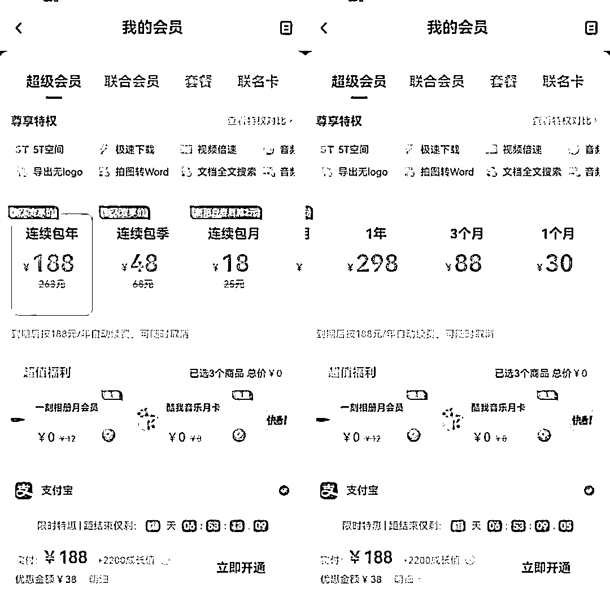

价格为什么人人不同？一方面是互联网的"杀熟"机制——账号注册越久、用得越频繁，官方给的价格反而越高；新账号或很少用会员功能的账号，价格反而低一些。

另一方面，官方自己也推出了全民分销机制。只要你是签约盘主，就有专属推广链接。

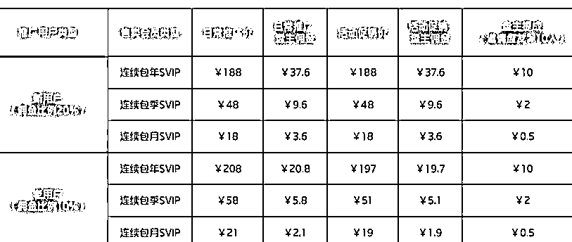

举个例子：年费会员标准价188，减去37.6的盘主佣金后，实际到手150.4。这个模式跟淘宝联盟、多多团长类似。别人通过你的链接买会员，你就能拿到平台给的推广收益。

操作上很简单：把链接挂到闲鱼，标得比官方低一点点，自然就会有人来。毕竟愿意来找你买的人，图的就是省钱。比如闲鱼上很多同行的定价，对比官方便宜不少。你卖出一单能赚24，买家省了钱，你赚了钱，双赢。

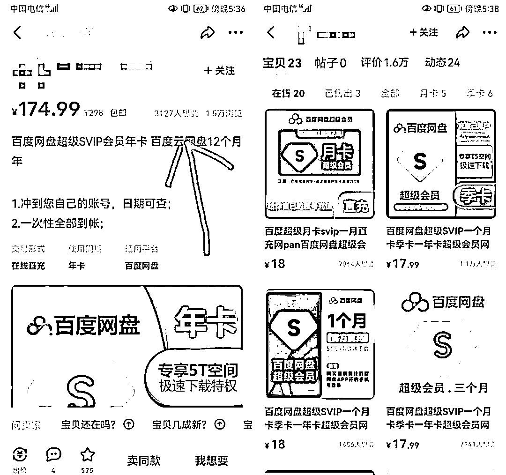

至于闲鱼上架的具体细节：文案、图片从哪来？你用自己的手机打开闲鱼，搜索一下"百度网盘"，看看同行怎么写的，照着总结提炼就行。最简单的方法，就是参考同行，把关键词布局好，每天定时擦亮宝贝，做好基础优化，平台会给自然曝光。把一个账号跑明白了，后面再批量多开几个号。

上架之前，务必先看看同行的文案和价格区间，再想清楚自己怎么定价，顺便避开一些风险。

实际操作中，有两种交付方式：

第一种：成为盘主后系统会生成分享码，客户通过你的链接自行下单，订单完成后你再按约定给客户返红包就行。

第二种：客户在闲鱼拍下后，你在自己设备上登对方的账号帮忙操作。这里提醒一句：最好等对方确认收货再操作，或者操作完立刻催确认收货。不然遇到白嫖党，操作完直接申请退款，你就白忙活了。

第二种方式千万要记住，别踩坑了。

放个数据参考：闲鱼上认真做这个项目的，一天稳定出20多单，一单利润至少20块，一个账号一天几百块很轻松。这个项目对小白来说非常友好，几乎没有壁垒。

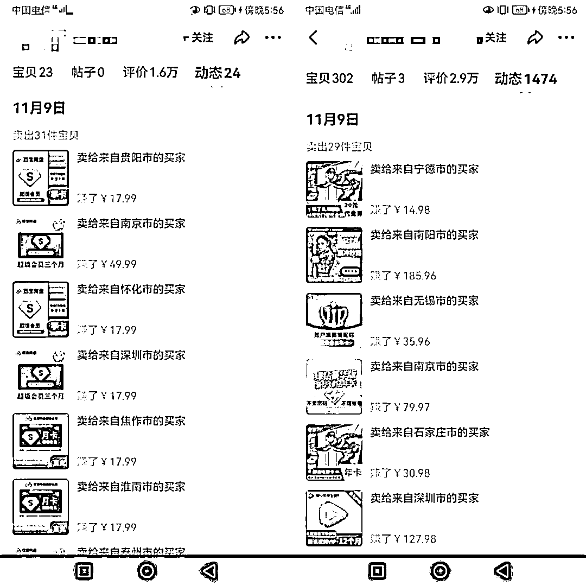

### 玩法二：📕

当你手里有了低价产品，接下来就是找人的问题了。一个思路：准备一些电影、电视剧、学习资料之类的资源，混进一些活跃的聊天群，在群里积极互动，适时免费分享资料。

重点来了：开通分销功能后，你分享的资料里会自动嵌入推广链接。别人保存资料时如果权限不够、需要开会员，充值后你就有佣金。这就是软广传播的威力。

而且，别人一旦遇到网盘空间不够或者下载太慢，大概率会通过你分享的资料里那个跳转链接完成充值。

具体可以按这个路径来：

**1. 注册账号**：手机号注册即可，建议选女性身份，年龄25-35。昵称可设成"XX妈妈"、"XX老师"、"XX小学资料"之类。头像用女性真人照片或动漫图。注册后不要急着发笔记，先正常刷个两天，分几次进去看一小时左右内容，把号养一养。

**2. 确定方向**：前期只做图文，不做视频。想好做哪个年级的资料，然后去抖音或📕找同类的热门话题，参考着做。

**3. 找素材**：素材渠道很广，同行内容、百度搜索、👸号、拼夕夕都能搞到。

**4. 二次加工**：素材到手后要加工，增加原创度。PDF格式先转成Word，调整字体大小、颜色，甚至改背景色。这样能有效避开重复内容。

**5. 发布**：每天发2到3条笔记，前期坚持日更，保持活跃度。一个账号尽量只定位一个年级。

**6. 导流**：笔记评论区的留言要引导私信，把用户慢慢引到🛰️，🛰️号记得用谐音或者图片形式处理。

**7. 成交**：可以配合虚拟资料产品来卖。客户购买后，直接发网盘链接给对方。很多时候，对方保存资料时确实需要会员，与其让人家在官方买原价，不如在你这儿省个几块几十块。站在客户角度，你这是帮了他，他会从心底感谢你。说实话，我之前也不知道这个信息差，原价充了不少冤枉钱。

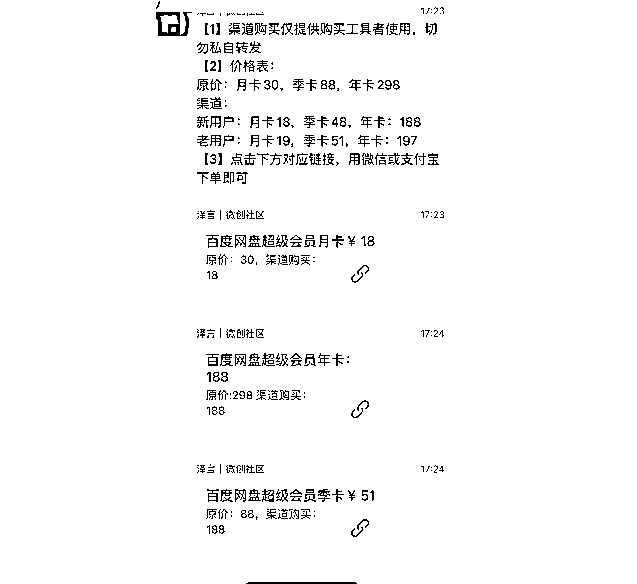

这个玩法的好处在于：不需要硬推。你分享资料的时候，佣金已经嵌入其中了，别人要用自然会充，你只管坐收佣金。当然，上面提到的笔记方法也能提供更多选择购买的渠道，记住，价格低永远是王炸。

### 玩法三：知乎（同样是变现场景）

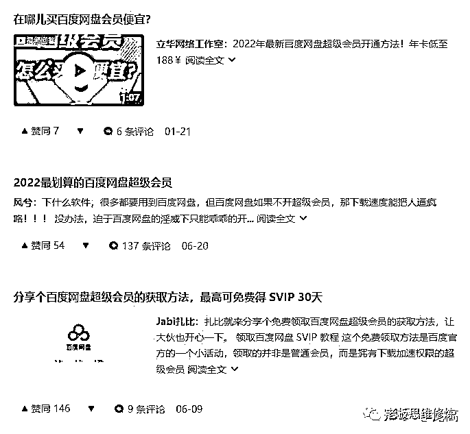

## 提现流程，一步步操作

**1.** 🛰️搜【百度网盘联盟】👸号，点【赚钱入口】，进【海报卖卡】。

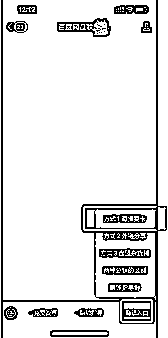

**2.** 登录自己的账号，点【我的】，然后点【去提现】。如果里面有金额，说明已经有人通过你的链接买了会员。

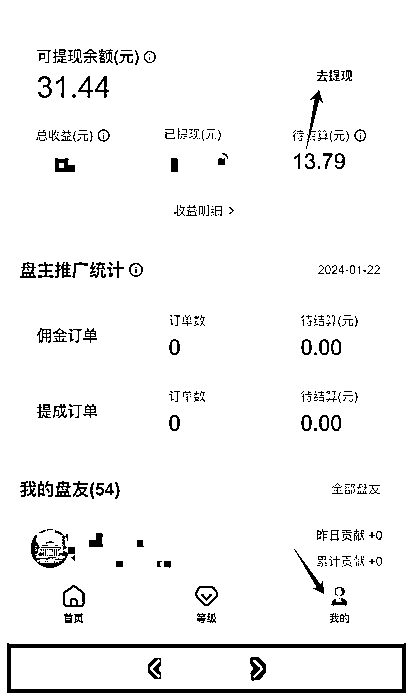

**3.** 点【提现】后会让你填支付宝账号，填自己的，确认提现。

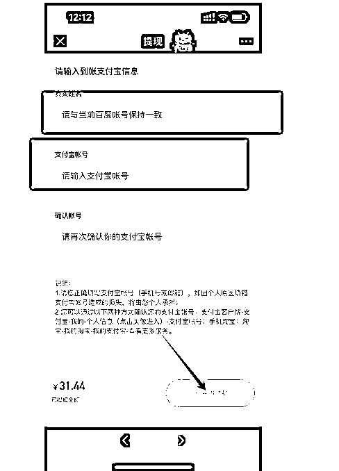

**4.** 填完账号点提现即可，基本都是实时到账。下面是一些提现成功的反馈截图：

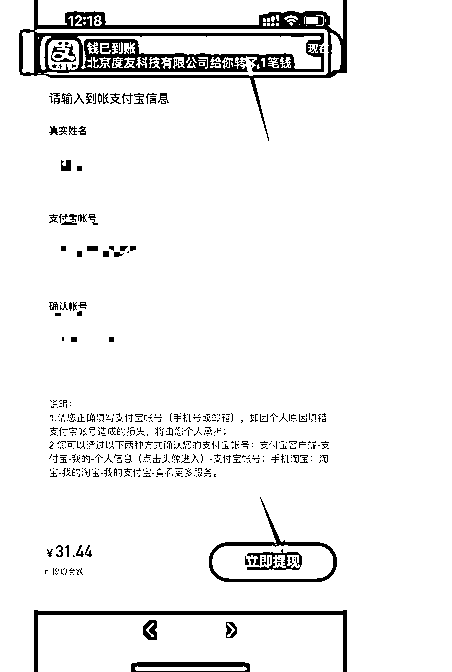

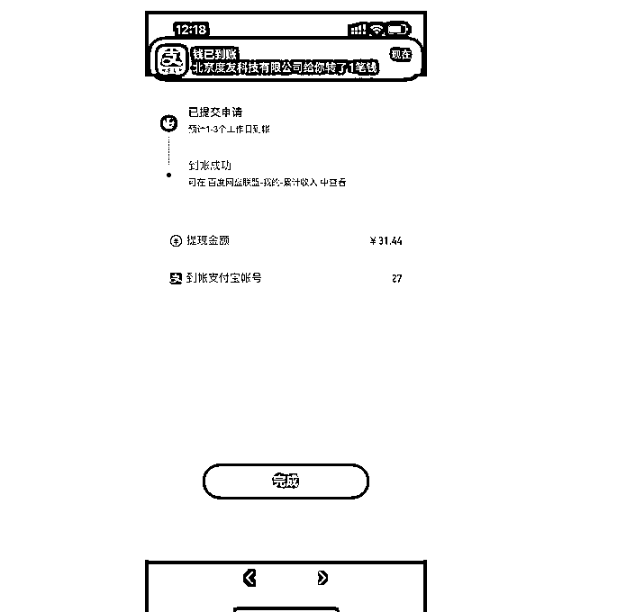

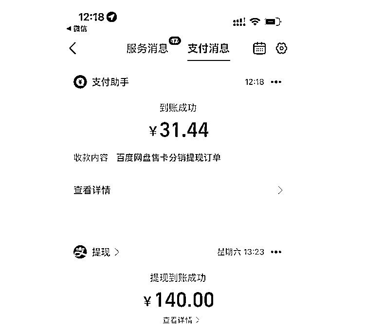

## 最后说两句

这个项目，核心逻辑就是利用信息差把"低价会员"这个产品卖出去。不需要投入资金，没有囤货压力，新手完全可以从零开始。难得的是变现路径非常清晰：签约盘主、获取低价、分享出去、赚取佣金。至于最终能做多大，全看自己的执行力和认知水平了。

机会摆在这儿了，剩下的就看你自己了。

从签约成为盘主、开通佣金权限、到落地的实操思路，再到钱打进账面，全链路我都摊开了讲，并且配上了自己的操作截图供对照。

如果你目前还没跑通一个可规模化的变现模型，或者对下一步该从哪儿切入感到模糊，这条轻量化的赛道很适合先做一次实战演练。它的价值不在于短期体量，而在于能让你快速把从引流到成交再到入账跑通一遍，拿到一次可感知的确认。

很久之前在一篇笔记里读到的一段话，印象很深：

“不管情况如何，先把第一笔收入拿到手。第一笔到账是认知上的转折点，有了这一次可验证的回响，你才会真正相信，除了固定薪资之外，还存在别的创收路径。这一笔收入足以把获客、交付、变现串成一条可自运转的链路，之后的工作就是思考如何精进、放大并让这种良性循环持续下去。任何规模化结果，都是从最初的起点累积起来的。”

署名泽言，愿来年各位都能在财富创造上得心应手。