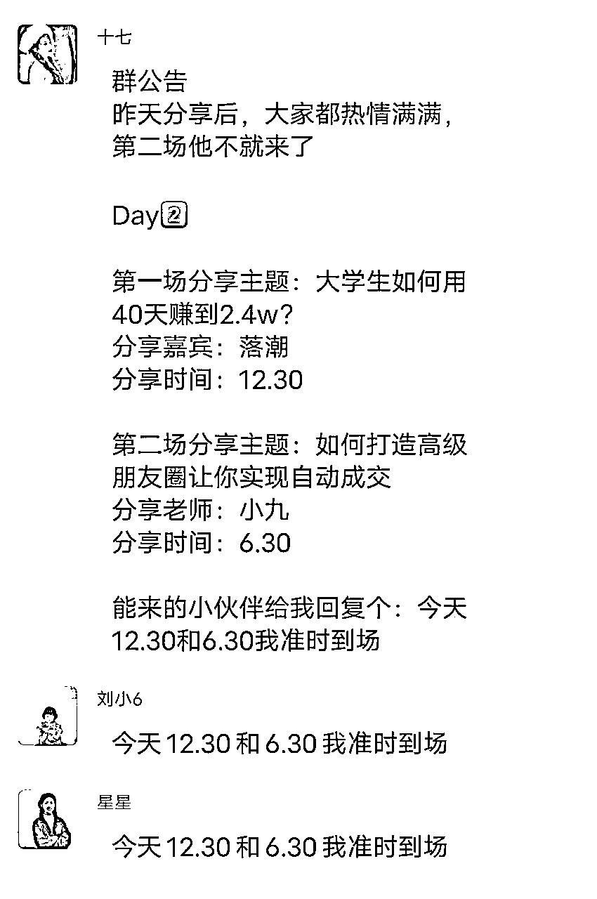

# 一个月操盘5场发售，营收31w➕，不同品类产品发售逻辑，尽数送给赚钱圈友，让你转化无忧！
作者：龙哥

这一个月，我前后帮别人操盘了5场发售，总营收干到了31万多。不同品类的产品，打法其实完全不一样。今天就把这些实战经验一次性拆解给你，尤其是正在做知识付费、训练营、社群的朋友，建议先收藏再慢慢看。

先说一个核心认知：发售不是把产品扔到群里就完事，而是一整套“物料+节奏+应变”的组合拳。你准备得越细，后面就越省力，转化也越顺。

## 一、发售前，物料至少备齐这些

### 1. 产品搭配：高低客单组合卖

不要只卖一个产品，最好是一个高价品带一个低价品。比如：

- 1999的私教 + 199的陪伴群
- 6000+的高级班 + 3000的普通班
- 4000+的课程 + 365的年度社群

高价产品拉高预期，低价产品承接犹豫用户。另外，一定要给发售群里的人准备专属福利，这样大家进群的意愿、群里的活跃度都会明显不一样。

### 2. 海报要准备四类

第一类是发售海报，上面要有：主标题（你的人生蜕变故事）、副标题（这3-5天能给大家带来什么）、讲师介绍、每天的分享主题、进群福利、群二维码。

第二类是倒计时海报，核心是戳用户的痛点，让他觉得“这个问题再不解决就亏了”。

第三类是产品海报，直接展示你要卖的东西。

第四类是直播海报，如果你打算开直播，海报上要写清楚“这场直播解决什么问题”，再加上直播间福利，让人有期待。

### 3. 福利要分层设计

进群福利：别抠门，先把好东西拿出来。有人担心白嫖？不用怕，你的目的是筛选真正愿意听分享的人。

邀请福利：邀3人送什么、邀5人送什么、邀10人送什么，一定要做裂变。发售不只是为了卖货，更是为了往私域引流，流量滚滚来，生意才能滔滔不绝。

复盘福利：很多人进群后不一定回看分享，给个小福利，鼓励大家去复盘，也是给分享内容一个“必须看”的理由。

下单福利：下单后接龙，接龙再送一份福利，给用户一个晒单的仪式感。

### 4. 公开课分享稿要分两部分

第一部分讲个人经历：自我介绍（名字、年龄、主业副业、成绩）+ 分享初衷 → 讲低谷期 → 讲转机和改变 → 讲现在状态 → 最后鼓励大家。核心是让用户觉得“他跟我差不多，他能成，我也能成”。

第二部分讲干货：别怕用户学会就不买课了。恰恰相反，你把真东西给足，用户对你的预期才会拉高，下单才更果断。干货结构：开头发红包暖场 → 理论+案例+实操 → 引导提问 → 最后顺滑引出课程。

正式发售前，还要准备几种话术：群公告、新人欢迎语、裂变福利语、控场话术。

群公告里写清欢迎语、发售时间、福利、群规；新人欢迎语让新进来的人不懵；裂变福利语要简洁有力；控场话术是防突发状况的，比如有人捣乱、抬杠，你要有预案。

## 二、发售节奏，按这个走

### 预热期：至少提前3天

第一步，找你熟悉的KOL聊合作，谈好分佣。第二步，在朋友圈、👸号、星球、社群等所有私域阵地提前铺垫，营造势能。如果你本身流量不大，这一步千万别省。第三步，发售前3天，朋友圈集中发海报，每隔30分钟发一条，然后删掉，就像“快闪”一样，确保很多人能看到。同时让KOL和操盘手在群里下指令：引导大家加老师🛰️领福利、拉人进群二选一拿福利，顺手发几条可直接复制的朋友圈文案。

预热期间，群里有50人左右就下指令，或者等群安静一点再下。别反复刷屏，会让人烦。每天固定时间发倒计时海报，给用户心理预期。

### 正式发售期：每天按节奏走

每天的基础指令有6条：提醒听课、提醒加老师领福利、提醒裂变、提醒复盘、提醒明天继续听、给后来的人做总结复盘。发售没结束，指令不能停，这是操盘手的基本素养。

DAY1：中午发公告，艾特全员晚上听课，推出名片。分享前发红包暖场，提醒大家加好友领福利。分享过程中多设计互动点，多发红包，把场子热起来。结束后提醒大家复盘有礼，爬楼，朋友圈继续吆喝。

DAY2-3：前面步骤一样，结尾要丝滑引出新产品，引导付款接龙，给付款用户一个仪式感，比如专门在群里恭喜一下。群冷下来后，再引导大家爬楼看内容。

最后一天：前面还是一样，但节奏要加快，最后来一波“群聊结束后涨价”的逼单环节。如果要开直播，就同步直播间链接，直播间的福利、抽奖、红包，都要导流到快闪群里，打通联动。

## 三、发售期的互动技巧

发消息多带点互动钩子，比如“在的宝子扣666”“共情的扣1”“想继续听的拍拍我”。别只是一味输出，要让用户动起来。

## 四、突发状况，这样处理

- 有人发广告：如果是兼职类广告，直接表达厌恶，然后提醒大家专心听分享。
- 有人发水滴筹卖惨：别让他带节奏，用其他话题带过，比如提一个问题，表达对分享的期待。
- 同行打广告说能赚钱：表达厌恶+提醒大家这是“杀猪盘”，然后正向拉回。
- 有人质疑课程或老师：先承认老师确实也是商业分享，但紧接着强调“免费听到现在的干货已经很值了”，再感谢老师和嘉宾。
- 有人说“反复提醒加🛰️太打扰”：建议他屏蔽群消息，同时解释这是为新成员准备的，再正向带节奏。
- 有人私自爆粉：直接踢掉，并在群里公示，提醒大家注意。
- 炸群：立刻加群成员好友说明情况，重新拉人进新群；群主和管理员必须换人，原来的不要再担任；别再用同样的话术发指令。
- 封号：马上用小号换头像顶上，跟用户说明情况；操盘手引导大家添加新号，并额外补一份福利作为歉意；为了账号安全，不要再给信号群主和管理身份。

## 五、不同产品，发售重点完全不同

其实核心分两类：离钱近的（项目、营销、成长类）和离钱远的（健康、教育类）。后者没办法靠一次发售就引爆，得用不同的策略。

### 教育类：做长期规划，静水流深

先说大学生群体。他们资金有限、资源多、觉得自己也能自学，所以面对知识付费第一反应是观望。没关系，顺着人性来，别逆着。

- 公开课时间要足够长，至少5天，每次主题一定要具体，比如“四六级听力技巧+实操打卡”“CPA金融资产讲解+习题演练”，让用户真的能带走一点东西。分享时别藏着掖着，反而要掏干货，把好感度拉满。
- 福利一定要够多、够好、够全。大学生很喜欢这类小福利：免费网课、真题PDF、打卡营体验卡等等。他们会为了这些去转发、拉同学，走量就是王道。
- 可以多做几次发售，但不用每次都卖课。比如定期做考研资讯、新题型解读、学习方法分享，每隔一个季度搞一次。这不只是促活，也是让你持续出现在用户视野里。

再说少儿教育启蒙。宝妈们往往需要“看到别人家的孩子有效果”才肯行动。所以发售重点是：

- 人手一定要足，靠两三个人炒不热场子。多拉僚机，营造晒娃、分享进步的氛围，引发模仿心理。
- 公开课要偏实操，别讲一堆大道理。比如“亲子XX打卡公开课”“萌娃XX实操体验课”，让家长直接上手，尝到甜头。
- 朋友圈规划要放长线，定期回访、督促。家长看到孩子实实在在的变化，才会真心推荐你。

### 健康类：给价值 + 直播 + 答疑

我帮一个做刮痧课的姐姐操盘，线上课一天卖了110单。核心就是：平时多在群里更新干货，建立信任；关键节点设促销活动，把气氛炒热；下单时给足仪式感。

### 其他品类：干货 + 直播 + 案例

分享几个我操盘过的案例：

- AI带货：3天，直播+社群，客单价6000+，GMV15万
- 文案营销：3天，直播+社群，客单价1999，GMV5万+（因为限名额，很快满员）
- 👸号爆文：5天，社群，客单价1599，GMV10万+，长尾流量不断
- 成长陪伴类：4天，社群，客单价388，GMV1万+

这类产品发售核心有三点：

1. 干货给足。分享稿3000字，别用1000字宣传、2000字水内容。要真能落地，用户看到价值，才会下单。
2. 结合直播。直播时讲清楚课程优势和用户痛点，给出痒点；过程中抽奖、逼单、答疑，时间可以长一点，尽量多触达用户；但别急，累了喝口水，稳住心态，动作不变形。
3. 要有案例。不管是哪个赛道，好的案例都很有说服力。介绍案例时要说清楚人群画像、操作步骤、可复制性，给其他用户预期。

## 最后，说几点操盘心得

第一，把老板的产品当成自己的产品。操盘前我会把产品体系、介绍、交付模式全部看透，不懂就问，直到烂熟于心，这样写文案、做物料才抓得住重点。

第二，不要怕麻烦。每一个物料、每一段话术都要反复和客户确认，保证信息同步，别让后续动作卡壳。

第三，保持冷静。炸群、被举报、封号、有人捣乱，我都遇过。越到这种时候，越要稳住，处理完又是一条好汉。

第四，把每一位老板都当成贵人。发售不只是交易，更是交朋友。一个赛道有很多人做，但每个人走过的路、攒下的案例，才是真正值钱的东西。

以上就是我这几场发售下来的全部实战心得。2024年，祝你的产品也能卖得轰轰烈烈。