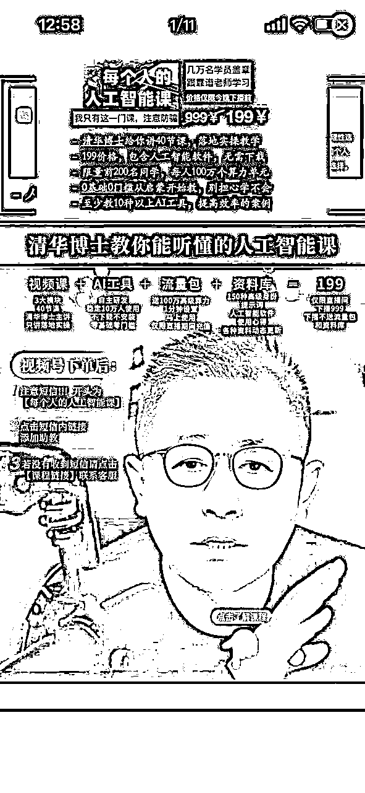
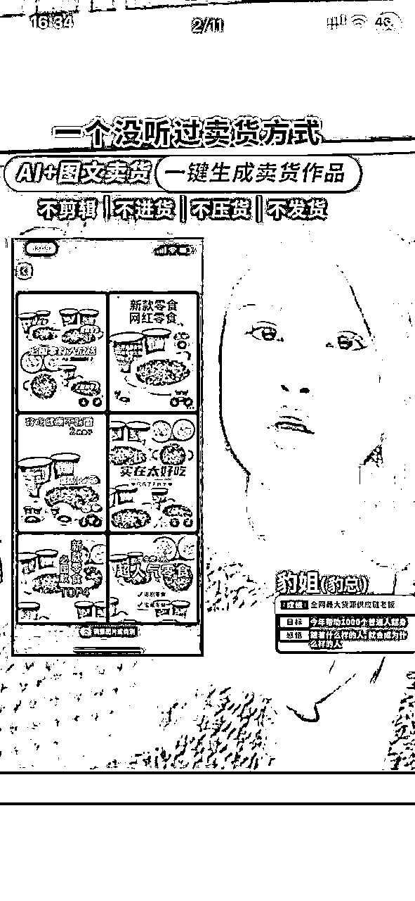
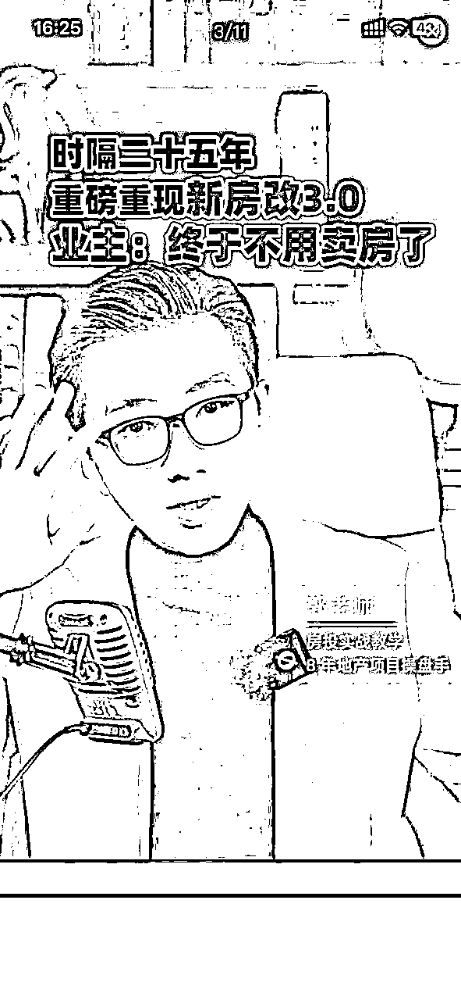
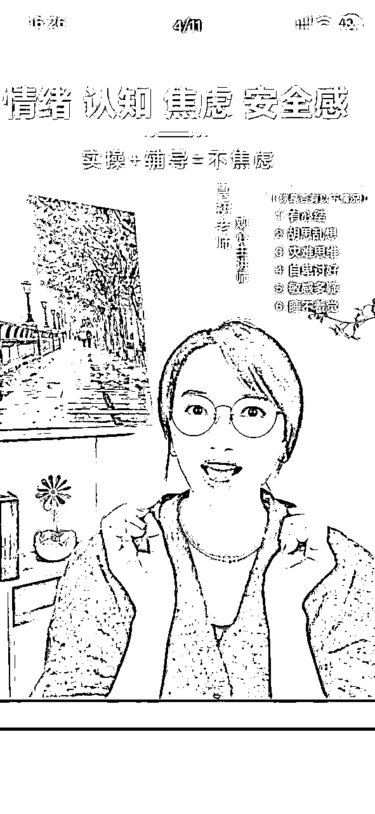
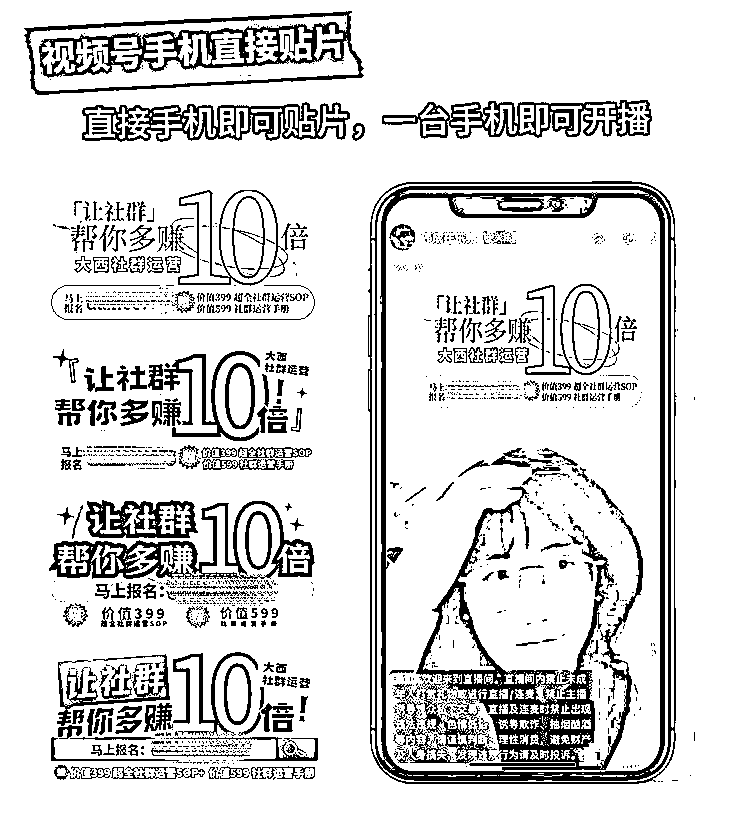
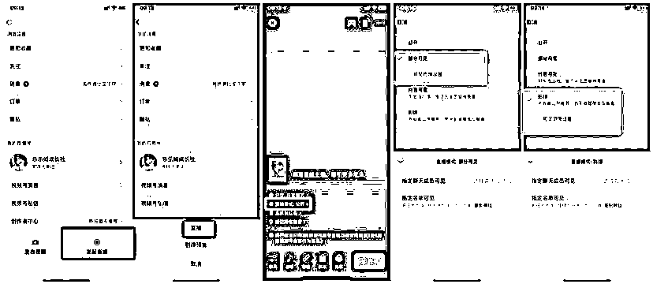
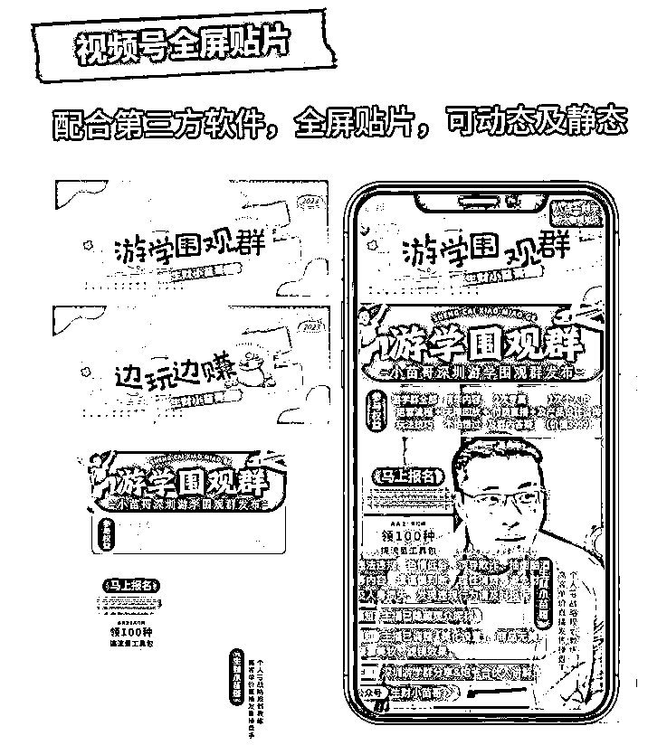
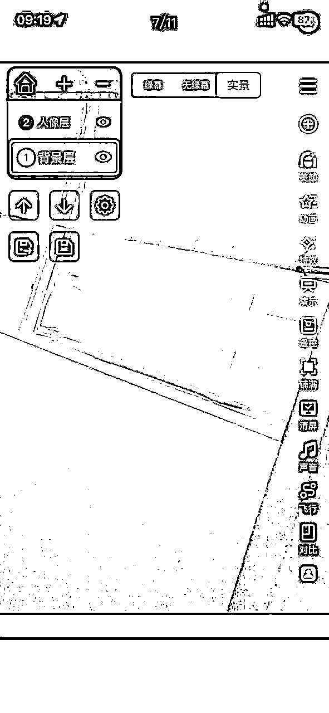
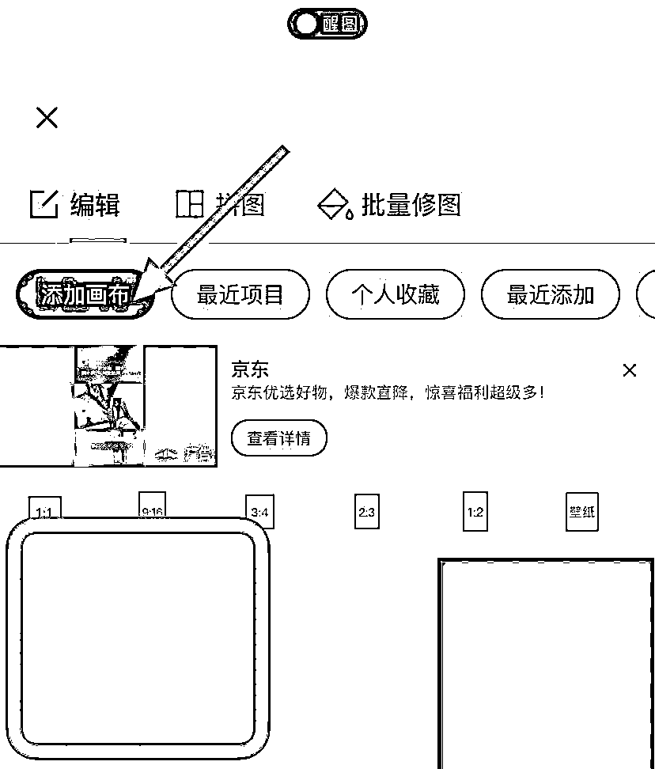
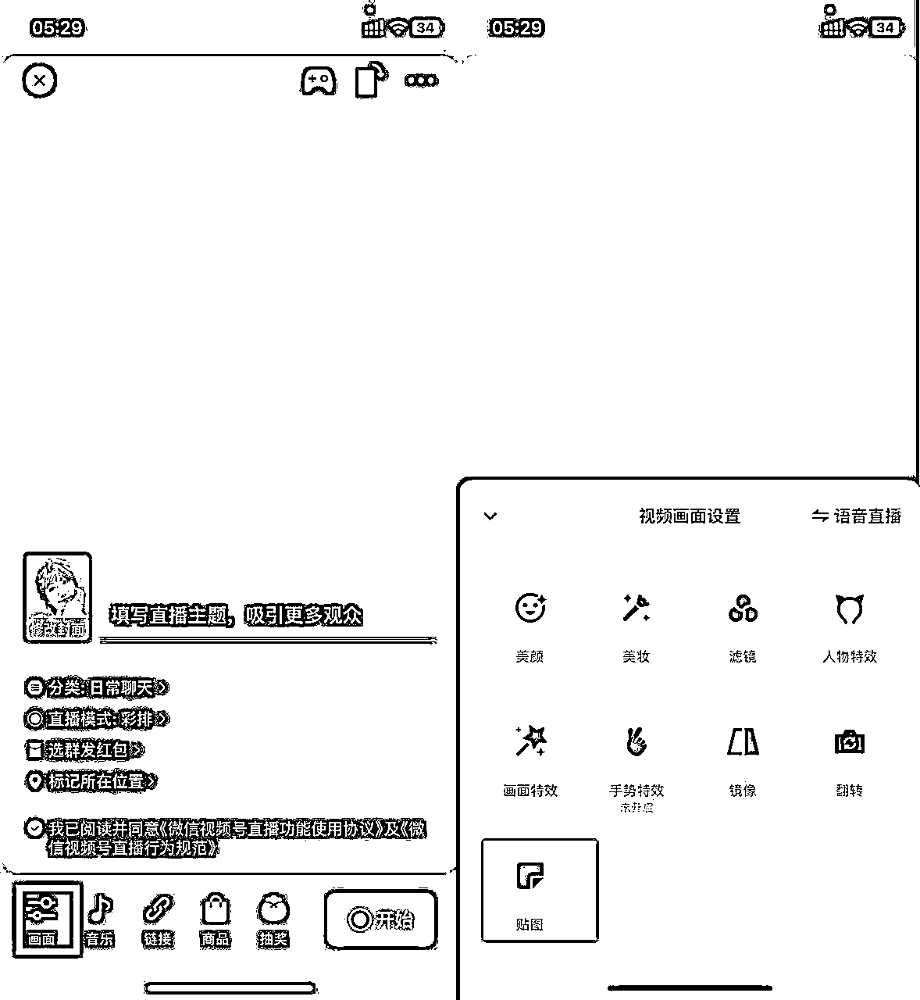

# 让你的视频号直播间瞬间“吸粉”的秘密武器

视频号直播间没人气？赶紧给直播间挂上这块“吸睛招牌”！

哈喽，我是爱学习也爱设计的二胎全职宝妈包包。

你是不是也经历过这样的尴尬：直播时又唱又跳，结果在线观众一只手数得过来？要知道，视频号虽然有封面，但观众不点进来根本不知道你在聊什么。所以，你急需一个能让人一眼心动的“秘密武器”——直播贴片。它不是一张普通的图，而是直播间的“门脸”，是决定路人要不要点进来的关键一步。

一、设计贴片，记住这四个要点

第一，主题要一目了然。不管是教学、游戏、美妆、健身还是闲聊，都要让人在一秒内get到你的主题。

第二，配色要够抢眼。用高饱和的撞色或你独有的主题色，让贴片在一堆直播间里“跳”出来。

第三，文字要短而有力。别堆长篇大论，一句话甚至一个关键词就足够，比如“今晚吃鸡”“美妆教程”“健身挑战”。

第四，要有专属印记。放上你的卡通头像、招牌动作或者常挂嘴边的口号，让大家记住内容的同时也记住你。

二、官方设备怎么玩

微信官方在手机上就能加静态贴片，不过苹果和安卓的操作略有不同。记得把标题做得精短简洁，效果会更好。

做好之后，可以先点“直播”里的“部分可见”或“彩排”，再用第二台手机查看效果；不满意就长按贴片拖到底部垃圾桶删掉，重新加一张。

有一点要留意：官方每次只能传1张静态图片，直播中也可以随时删除和更换。

三、想要更炫？第三方软件了解一下

如果你希望贴片能铺满全屏，可以试试OBS、直播加加（苹果安卓通用）、直播伴侣等软件，不过有些是收费的，下手前一定看清条件。

第三方软件能带来三大惊喜——

① 动态视频贴片：用一小段视频当贴片，比静态图抓人得多，还能把直播最精彩的片段亮出来，让观众还没进直播间就感受到你的热情。

② 场景随意切换：直播内容一变，贴片也能跟着换，比如户外直播时切到户外实景，回到室内又换成室内画面，趣味性和互动感直接翻倍。

③ 全屏霸屏效果：全屏贴片让用户刷视频号时一眼锁定你，上下左右还能塞进更多细节，直播间曝光率肉眼可见地上涨。

四、贴片怎么做

静态图用电脑就选PS，手机上可以靠美图秀秀、醒图、可画。 只要能做出透明背景图层的工具，都能上手。

五、手机端上传姿势

先把微信升级到最新版，然后点击“直播”，在底部栏找到“画面”，点“贴图”，把贴片拖到合适位置，再用手指拉动放到最大就搞定啦。

最后说两句：视频号直播的红利期已经到了，贴片设计就是你在这个风口上站稳脚跟的硬核装备。它是观众对你的第一印象，设计到位，人气自然来。花点心思，让你的直播间脱颖而出吧！

对了，如果你不想自己动手，包包也推出了直播间贴片定制设计服务，还有个人IP社群定制表情包服务，有需要随时找我哈。

只要把上面这三招用好，下一个直播间人气王就是你！