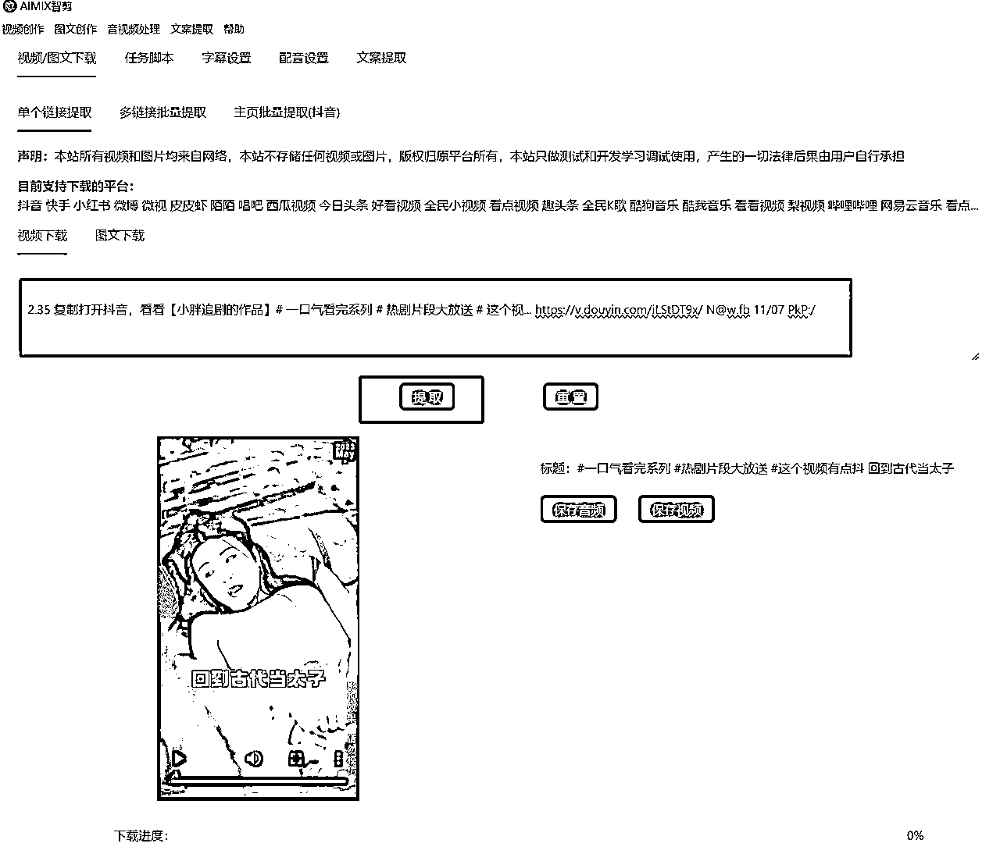
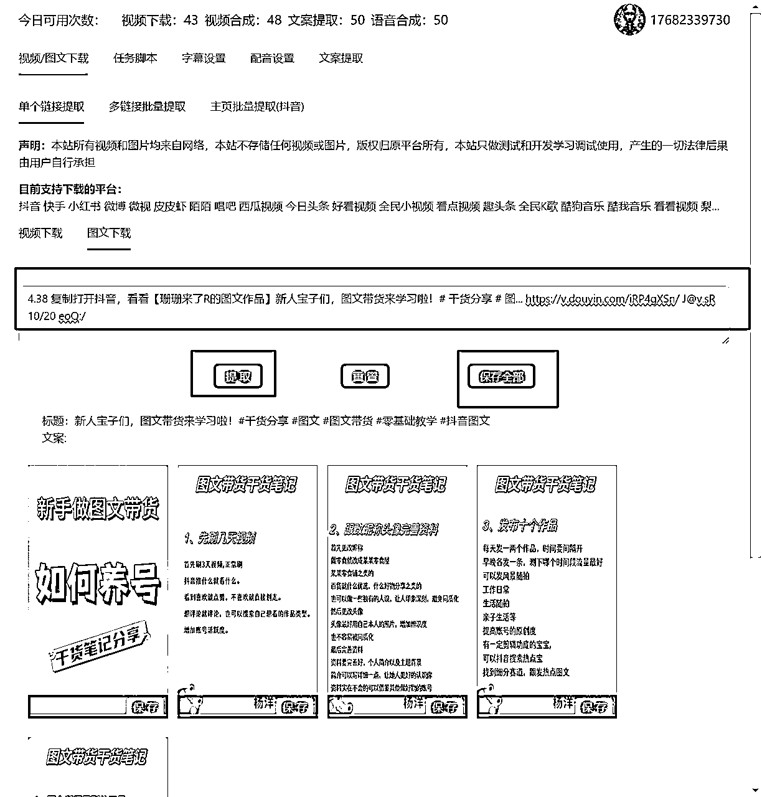
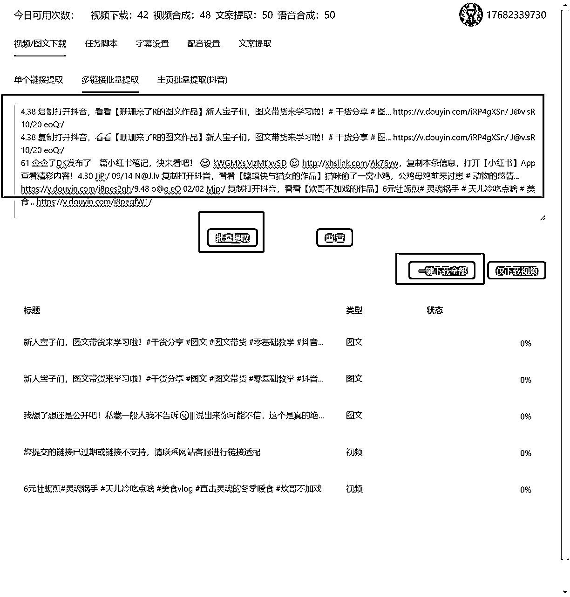
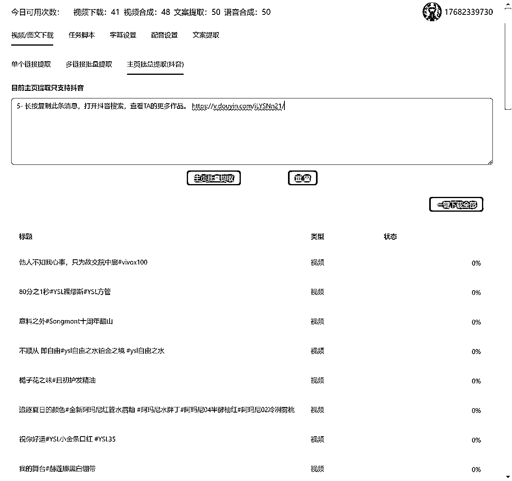
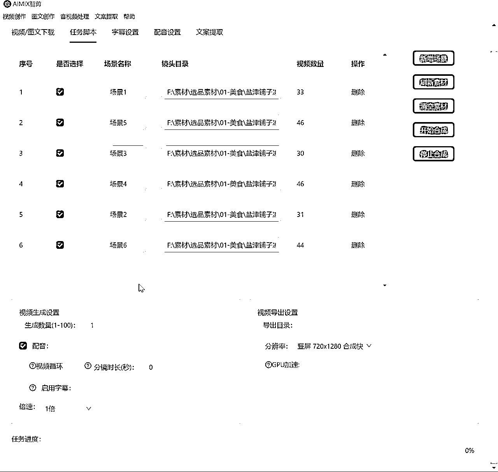
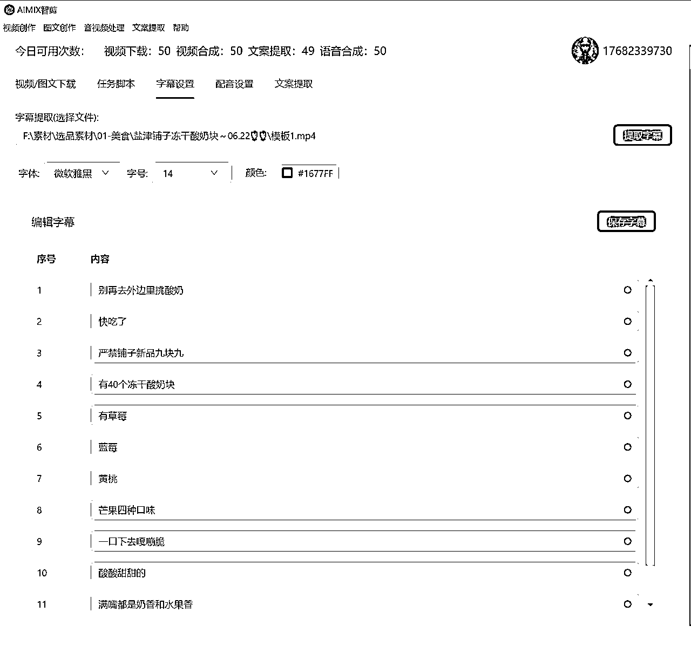
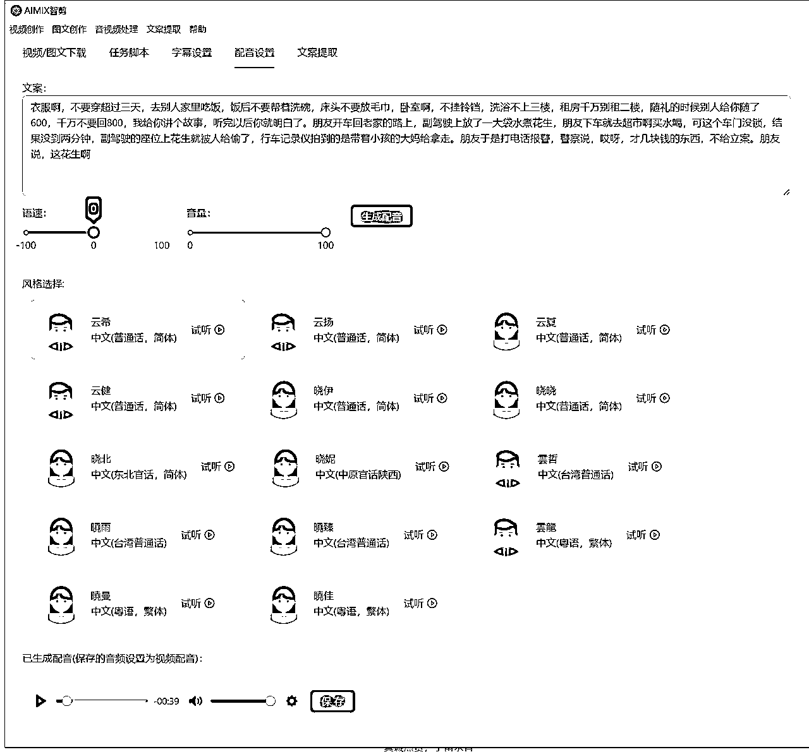

# AIMIX短视频混剪软件的一些更新，支持批量去水印下载

AIMIX短视频混剪软件更新：批量下载无水印素材更方便

各位圈友，我是小辉AI教练，目前在AIGC领域创业。距上次发帖过去一个多月，这段时间一直在忙软件功能和体验的优化。最近又攒下几个实用更新，来跟圈友同步一下。另外，新录制的AI入门课《AI零基础变现实战课，搞定10+变现场景与AIGC必备技能》也已上架。

产品的剪辑原理和基础操作之前写过帖子，这里不再重复，需要回顾的圈友可以翻看历史内容。

短视频创作里，素材环节很关键。自己去收集和处理素材既费时又费力，所以我们专门针对这个场景做了产品化设计。最新加入的“图文/视频提取”功能，可以从网络平台抓取视频和图文，还能批量去掉水印后保存到本地，方便二次创作。但提醒大家，不要直接搬运，一是容易违规，二是可能侵权。

视频合成方面，这次把底层代码重写了一遍，核心处理库也升级到最新版，并加入了GPU加速。单个视频合成速度直接提升100%，体验更顺畅。字幕和配音设置也做了优化，操作起来更顺手。文案提取则独立成单独功能，后续还会增加批量提取和图片文案提取。

素材库方面，我们计划推出一个在线素材库，提供原创素材，并加入智能分镜等素材梳理功能，帮助大家建立自己的创作素材库，剪片时更有底气。

下面是最近几个版本更新的具体内容：

1. 图文/视频提取
- 单条链接抓取：

- 多个链接批量抓取：

- 主页一键批量抓取：

2. 视频合成任务优化
- 一次最多生成100个任务
- 新增视频循环，用循环视频匹配音频长度
- 每个分镜的时长都可以单独设置
- 新增GPU加速：

3. 字幕设置体验优化，支持保存到本地：

4. 配音设置与保存交互优化：

5. 文案提取默认不再带时间戳

软件下载官网：https://aimix.pro
Web端使用：https://web.aimix.pro
产品介绍：