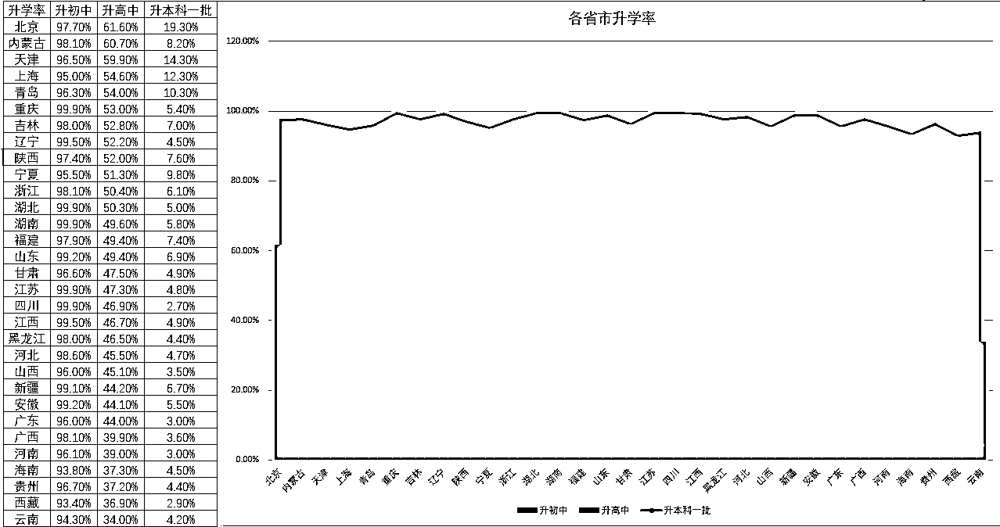
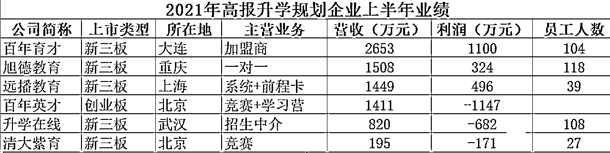
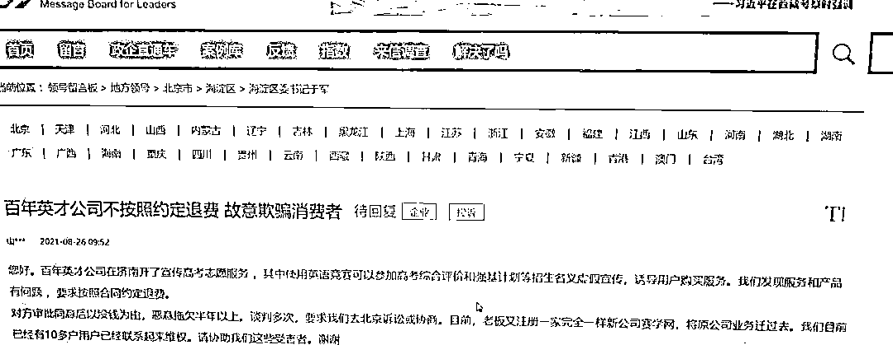
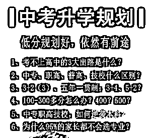

# 风向标拆解第2期：K12升学规划，卷点正在往哪走？-Bob
作者：龙哥

升学规划到底在规划什么？

简单说，它是一套系统化的教育设计，用来帮孩子把学习、兴趣、职业这三条线绾在一起。它不只是冲分刷题，更是在选课、找方向、做判断的全程陪跑。

它的核心目标是让孩子把教育潜能用足，同时把“想做什么”找出来。当方向确定了，学习才不是瞎跑。

怎么做？无非几件事：先把孩子摸透，兴趣、学法、成绩、职业倾向一体分析；再来给课程做匹配，选对学科组合；边学边评，定期复盘进度及时调方案；再把职业探索给上，实习、志愿经历都要算进去；最后是持续的学业支持和心理疏导，尤其在申请和考试的压力期。

当这套体系跑通，孩子在同一起跑线上就能抢到先机，迈进理想学府，为长远发展打底。

而K12本身，就是从幼儿园到高三十二年的成长期。这一段不只是知识的堆砌，更是习惯养成、思维塑造、社交能力的关键窗口，对认知发展和未来路径影响深远。

# 中考高考的数据在说话

中考端在膨胀。2023年全国中考总人数1500万，比上一年多了100多万。2021年秋季入学人数超1700万，按这个基数推演，2024年中考人数会比2023年再多200万。

高考端同样在走高。2023年全国高考报名1291万人，同比增加98万。2006年出生人口1580万，在校生约905万，对比2023年净增约36万。粗算2024年高考人数在1320万以上。

看出生队列更清晰：2015年1655万、2016年1786万、2017年1723万、2018年1523万、2019年1465万、2020年1202万、2021年1062万、2022年956万。叠加参考率推算，高考报名人数将在2034年也就是2016届18岁时达到约1700万的峰值。

所以内卷什么时候能停？只等人数下滑可能还得再等十年以上。

录取率则决定了“卷”的形状。

义务教育阶段的升学相对顺畅。小升初基本全通过。

初升高是第一个硬分流。北京和内蒙古中考升学率超60%，天津、上海、青岛、宁夏、陕西、吉林、浙江、重庆、湖北、辽宁十地超50%，12个省份在40%左右，另有6省低于40%。整体看近半数孩子进不了普通高中。教育部明确的中考职普比大体相当，也意味着只有一半名额走普高，另一半要去职高。部分省份允许复读，部分省份不允许。

本科一批录取率最高的五个地方仍是北京、天津、上海、青岛、宁夏。

# 升学规划的价值在哪

在教育改革逐步落地后，高考已不再是唯一的改变命运动车，中考的分流效应被放大。国家和人社部门在教育资源和就业现实下，要求职普比例调到五五开。2023年教育部已明确给到政策信号：坚持高中阶段教育普职大体相当，为社会提供必要的技术劳动力，经济才能稳。

一旦政策落地，中考后将有约50%的孩子失去普高和重点高中机会，被分流到职业教育。

竞争越激烈，升学规划的刚需越强。它不只是应对考试，而是一套完整的教育设计，覆盖选课、兴趣塑造、能力提升。找到最适合自己的学习路径，既能赢在学术，也能守住个人兴趣和长远发展。

通过规划，孩子能更清楚自己的强项和爱好，制定更匹配个人特点和职业预期的学习路线。还需提前掌握各高校录取规则，有针对性地准备考试、参与课外活动，提升录取概率。

在同质化竞争中，一份清晰的规划是差异化的武器，也能有效降低学生和家长的焦虑，让整个教育过程更系统、更高效。

# 市场现状与挑战

K12升学规划的市场到底是什么样？以下内容参考自👸号“升学有方”姬老师2021年的梳理，虽有时间差，但行业数据更新慢，仍具参考价值。

## 高报升学规划的现状

2021年，高报升学规划行业已走过近20年发展史，商业化运营已有十年左右。选取百年育才、旭德教育、远播教育、百年英才、升学在线、清大紫育六家代表性公司半年报来看。

赛道主要形态有一对一规划、加盟体系、填报系统与数据卡、学科竞赛与背景提升、招生中介，另有生涯测评、选班排课等衍生业务。加盟和填报系统利润率最高可达40%，传统一对一规划净利约20%，而学科竞赛背景提升和招生中介亏损明显，主因疫情影响下校宣讲停摆，业绩受损。

## 大机构转型的坑

双减后不少教培机构想转入高报赛道，但并不合适。高报升学规划与学科提分逻辑完全不同，准入门槛低，有“庞氏式”扩张嫌疑。行业整体规模约百亿，并非千亿蓝海。真正需要规划的高中生只占全部高中生的20%左右。

以2015年成立的百年英才为例，被立思辰即现豆神教育收购后，自2020年起受自主招生取消、强基计划上线、竞赛白名单收紧影响，背景提升业务受限，加之疫情无法进校，出现巨额亏损并触发退费风波。

百年育才在2020年同样巨亏，后砍掉全部直营，关闭各地分公司，全线转加盟渠道运营，今年才扭亏。现加盟市场基本被百年育才占据，百年英才关闭直营后转型难度进一步加大。

## 行业前景与竞争格局

高报升学规划属于低频、高并发、重服务且强地域属性的业务，直营模式成本太高，基本不可行。行业已进入红海，恶意营销、相互诋毁常有，教培机构若要转型需谨慎，更适合作为增值服务而非主营。

新高考全面落地两三年后，升学规划的刚需高峰将见顶，未来主要在存量里厮杀。风口过后，日子会更难。

## 机会点

中考五五开，高考七三开，两个节点需求都强。2014年上海、浙江首批试点新高考，目前全国已有半数以上省份实行，河南在2021年加入。生涯教育仍处婴儿期，新高考从顶层设计上放大了生涯教育的重要性，将其融入学校管理和目标预设，已成为改革的必经之路。

## 关键政策

*   国务院关于深化考试招生制度改革的实施意见 国发〔2014〕35号
*   教育部关于加强和改进普通高中学生综合素质评价的意见 教基二〔2014〕11号
*   国务院办公厅关于新时代推进普通高中育人方式改革的指导意见 国办发〔2019〕29号

# 案例拆解：升学规划怎么卖

## 直播卖课：抖音-吉老师生涯规划

基本数据：关注2896，粉丝11.3万，获赞5.2万。

内容表现：从2023年2月10日首发至2024年1月2日共发118条，最后一条在2023年10月24日。平均点赞420，评论25，收藏183，转发164，最高点赞3.3万，评论1014，收藏9171，转发1.1万。

直播轨迹：2023年1月28日首播，至2024年1月2日累计426场。2023年11月3日后主题集中为“初中考不上高中怎么办？中职...”共108场；10月中旬主打“一对一连麦解决初中升学问题”共37场；10月中旬还有中专职高技校升学、付费直播中职升学规划等。8月至10月以中职规划为主，共60场；7月下旬聚焦中职升学规划和家长预习；其后持续免费连麦答疑。

作品与直播对比可知，该号获客核心在直播。

频率：近期每天两场，每场约2.5小时，1.5小时后上课程链接。

变现：以198元课程为主，单场GMV约2500元。12月播57场，月入14万以上。

面谈核实后，核心路径是直播带货，橱窗可忽略。所有客户都会拉入私域，继续推高客单产品，实际收入远高于直播GMV。关注数2896，按198元计算已产生57万+营收。

运营打法：十余年生涯教育经验，郑州重点高中特聘生涯规划师，两所中职校董，《中学生生涯规划》主编。专业人设+直播淬炼，具备随时上播和即时种草能力。

每场先用六个话题聚人并引导关注，讲到中段上链路，强调限量，引导“着急”的先拍，“不急”的继续听。后续多次补单逼单，转化效率高。

## 视频卖课：抖音-爸妈指北

非升学规划但知识付费打法可借鉴。

基本数据：关注346，粉丝88.9万，获赞537.4万。

作品425个，自2020年5月1日起更至2024年1月2日。平均点赞1.1万，评论299，收藏1363，转发2002，最高点赞133.8万。

变现：抖店产品已下架，抖音课程专栏有2个视频无购买入口。置顶视频通过小鹅通售卖《规则和爱》，98元，3649人订阅，营收约35.7万。视频号同款6237人购买，营收约61.1万。📕店铺300+人购买，营收约2.9万。

打法：国家二级心理咨询师人设，用剧情演绎亲子场景，核心阵地视频号，抖音和📕同步分发。

图文卖课的可能性较低。业内人士反馈升学规划用户在纯图文场景转化困难。小白可先从图文入手积累行业知识，熟悉话术框架。

附件：阳光高考网 https://gaokao.chsi.com.cn/