# 没有一句外语也能读懂全世界：靠翻译工具把语言墙拆掉

【昵称】AI 同行侠-文卓

【微信】394710556（请备注来意，不闲聊，朋友圈空空如也）

【标签】AI+翻译家

【自我介绍】

◆ 2023年，专注于AI Prompt策略研究及商业应用，从零开始，完成AI落地应用的积累，并实现最小MVP。

◆ 2024年，深耕基于Prompt的AI+翻译赛道，累计为客户翻译科技类英文单词700万+，网文小说70万+，译前排版2万页+。

【我提供的资源】

1、PDF、Word文档等译前排版服务（保留源文档数学公式、图片、表格等格式）

2、摆脱机器味的书稿AI翻译服务（多国语言翻译为中文）

3、个性化翻译解决方案（如面向欧美用户的网文小说，中译英本地化翻译）。

4、赚钱精华文章：免费体验龙哥盟入口

在全球化已经成为常态的今天，能否跨语言沟通，已经从加分项变成了刚需。可现实是，精通一门新语言往往要投入2000小时以上，相当于每天5小时、一年不间断，这道门槛把很多人挡在了信息之外。

我的英语从小到大几乎没及格过。2023年3月第一次用GPT时，我不会编程、不擅长写作、英语也一塌糊涂。但就是从那个零基础的起点开始，我现在可以畅通无阻地读英文课程、看资讯、刷视频、啃论文文献，并且把学到的东西直接转化成业务结果。

比如我用GPT辅助写作做出了一套SOP精华文章，能无障碍跟进官方视频课和文字教程，结合提示词技巧服务客户落地，实现变现。现在AI相关项目的月收入已经稳定破万。说白了，身边的小需求就是别人的痛点，用AI把别人的痛点解掉，钱自然就来了。我能做到，你也可以。

今天这篇就聊聊：在互联网上，如何借助翻译工具做到实时破壁阅读，读书、办公、交流都不再受语言限制。

特别提醒：正式合同、重要文献建议用 GPT-4 或 DeepL 翻译 API，准确度和稳定性更好。日常刷视频、看资讯，微软翻译、谷歌翻译的免费版本就足够用了。

全文分成三部分。

# 一、用翻译工具把成长加速

## 1、出海即出坑：不懂外语会碰到的 6 个真实卡点

1.1 学习受阻：想啃 OpenAI 官方提示词教程，全是英文，硬啃费劲，效率极低，难免泄气？

1.2 单子飞走：做自由职业想接海外客户，客户对服务很感兴趣，却因为语言对不上沟通失败，最后被能多语沟通的对手截胡，窝火不？

1.3 机会错过：网上看到一个高度匹配的工作，唯一要求是会一门不太熟悉的语言，结果因语言被刷掉，郁闷不？

1.4 信息滞后：想第一时间吃到 OpenAI 官方消息、AIGC 行业动态，却只能看二手搬运，时效性被拉开，焦虑不？

1.5 邮件踩雷：收到外语合同、收购邀约、广告投放邮件，看不懂细节就错失改变命运的合作，后悔不？

1.6 社交尴尬：在 X、WhatsApp、Mastodon 等平台和海外伙伴聊天，因翻译偏差把友好和幽默变成了误会和冷场，揪心不？

种种困境都在说明一件事：语言壁垒会直接拖慢个人成长，想走向全球，先把这堵墙拆掉。

## 2、用对工具的 6 个正向变化

2.1 学习提速：借助翻译工具，可即时理解数十上百种语言的资料、课程、论文，知识面和视野迅速打开。

2.2 工作更顺：能快速读懂、回复多语言邮件、报告和文件，专业度与响应速度双提升。

2.3 转化率上涨：读懂不同文化背景客户的真实需求，沟通更到位，信任感更容易建立，成交和复购随之提升。

2.4 竞争力增强：掌握工具使用方法，对外贸、跨境、教育等岗位是硬核加分项。

2.5 信息源更广：直接触达外语新闻、研究机构报告，抢在别人前面获取情报。

2.6 跨文化连接更顺畅：和全球网友、同行实时交流，圈子自然扩大。

翻译工具本质上是数字时代的助力器，能让学习资源更丰富、工作流程更通畅、全球视野更开阔。随着大语言模型和机器学习持续进化，翻译的准确性和实用性只会越来越强。

# 二、翻译工具实战场景

对我们做AI的人来说，沉浸式翻译插件可以在网页上实时把文字和视频字幕同步翻成中文，中英对照下理解更快、吸收更牢。关键是——实时。

## 1、网页文字资料实时阅读

以 OpenAI 官方提示词教程为例，原址：https://platform.openai.com/docs/guides/prompt-engineering

翻译效果见下图：

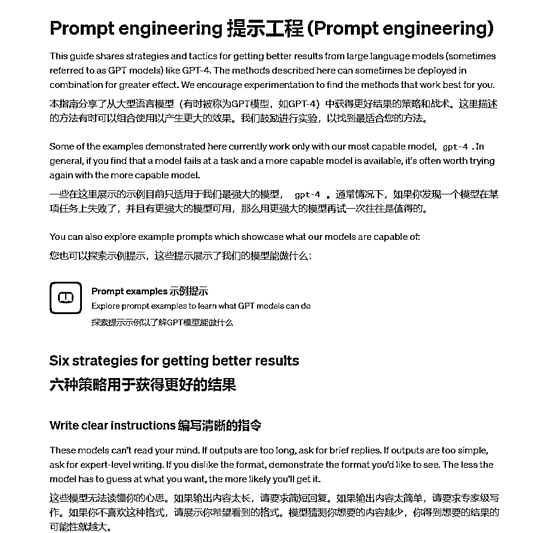

## 2、PDF 文字资料实时阅读

以 OpenAI 官方提示词教程 PDF 为例：

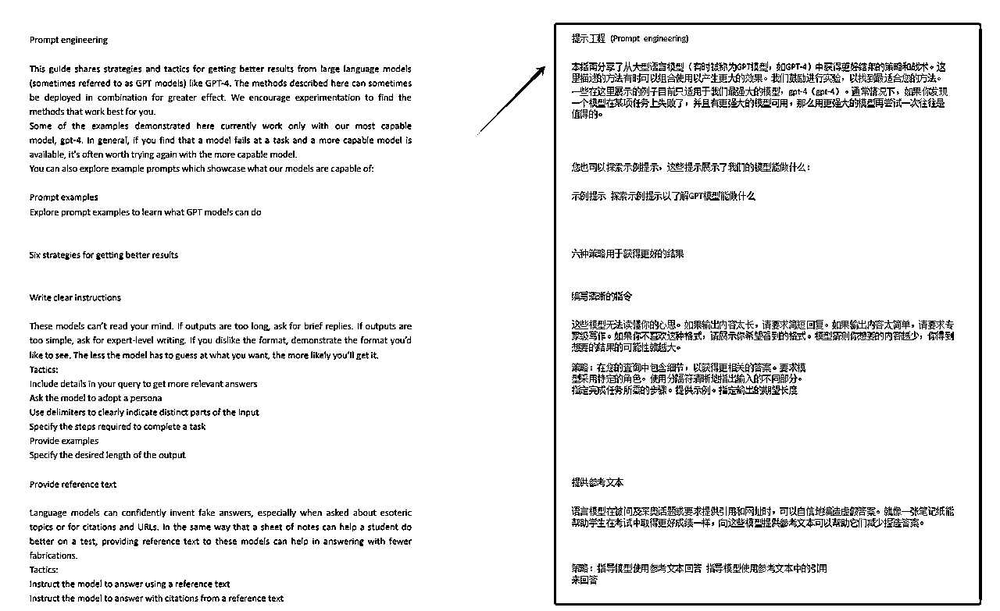

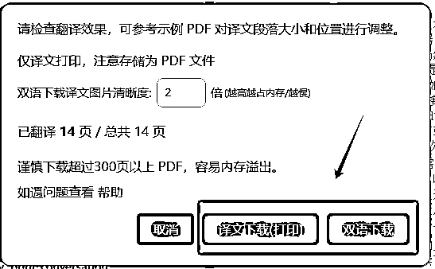

## 3、网页视频实时阅读

以 YouTube《OpenAI 开发者日：主题演讲回顾》为例：

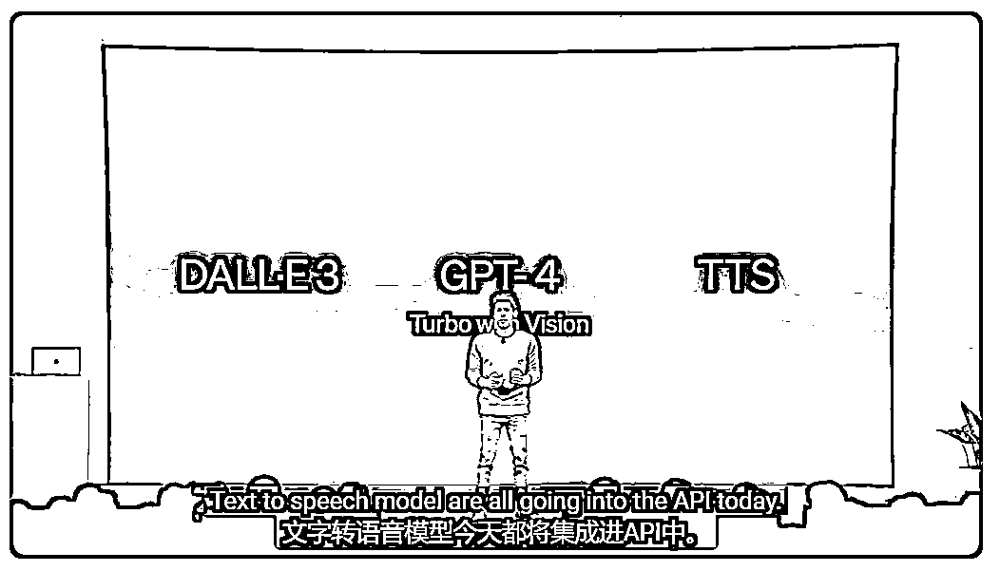

## 4、社交与官网资讯实时阅读

以 X 上 OpenAI 发布的动态为例：计划从近千名申请者中挑选 10 个团队，授予 10 万美元，用于设计、构建和测试基于民主方法管理 AI 系统规则的方案。

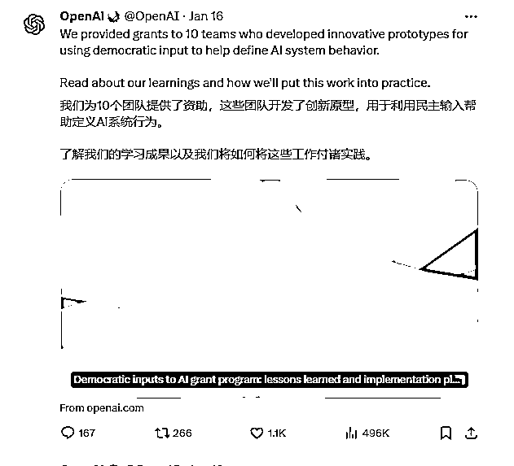

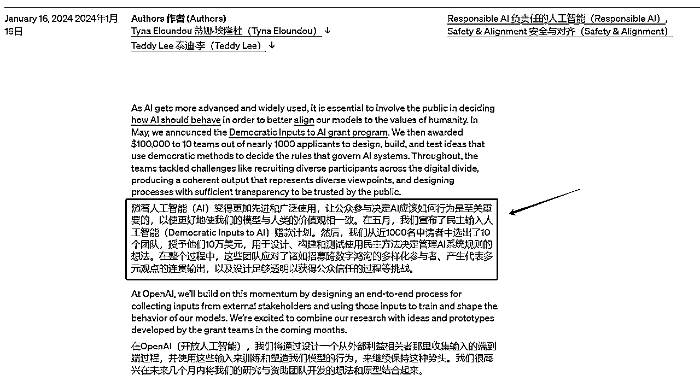

## 5、本地字幕文件翻译

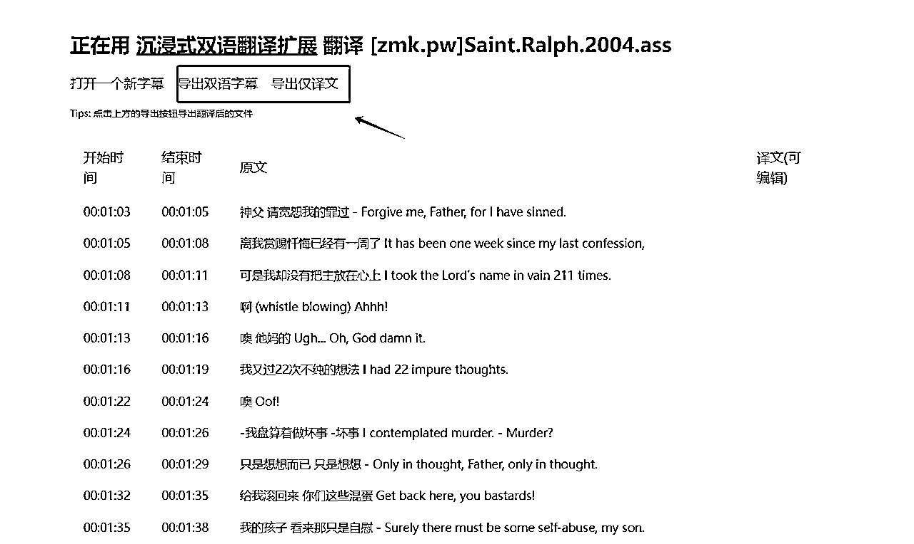

## 6、本地 HTML/txt 文件翻译

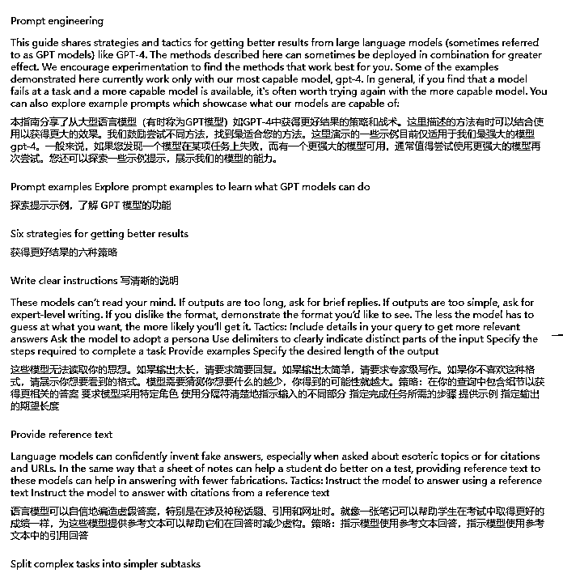

## 7、手机输入法边写边译

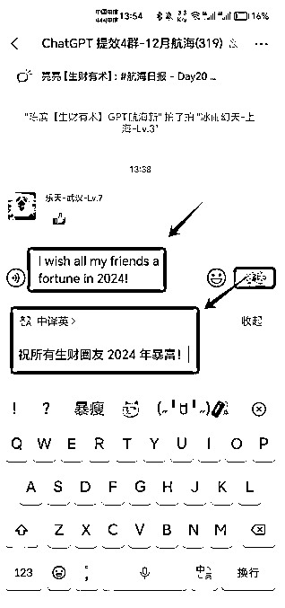

# 三、实操指南

## 1、安装沉浸式翻译插件

### 桌面浏览器

* 微软 Edge 浏览器： Edge 商店沉浸式翻译

* 谷歌 Chrome 浏览器：Chrome 商店沉浸式翻译

* Firefox 火狐浏览器：Firefox Addon 商店沉浸式翻译

若无法访问谷歌官方商店，可直接下载最新沉浸式翻译 Chrome 浏览器 zip 安装包，解压后在地址栏输入 chrome://extensions，打开扩展管理，开启“开发人员模式”，选择“加载已解压的扩展程序”，载入解压文件夹即可。

### Safari

* 点此进入苹果 App Store 商店安装

## 2、插件使用说明

### 2.1 找到入口

浏览器右上角点击图标进入设置页面。

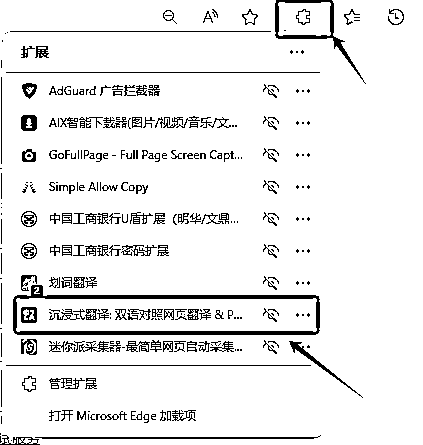

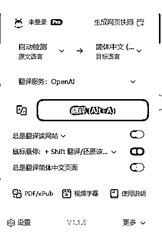

直接点击网页右侧悬浮图标快速翻译，或在网页上右键选择【翻译网页/显示原文】。

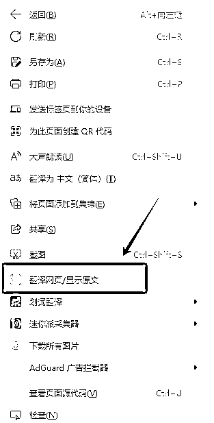

### 2.2 登录注册账号

非会员也能用，微软翻译和谷歌翻译免费。会员的 OpenAI 翻译源为 GPT-3.5，效果不如自购 OpenAI 和 DeepL API 稳定。登录主要是为了保存 API key。

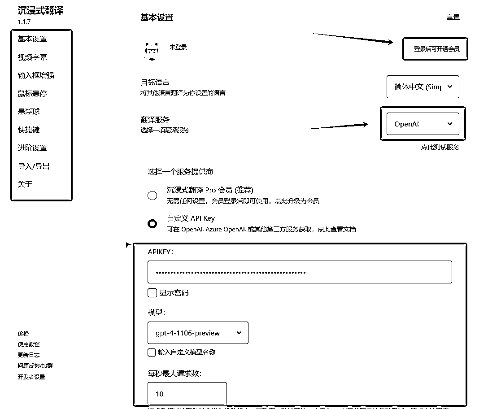

### 2.3 配置 OpenAI 或 DeepL 的 API key

重要资料建议接入。

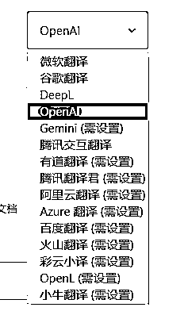

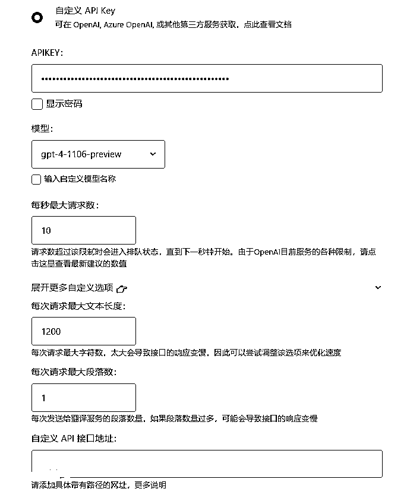

### 2.4 输入框即时翻译

在任意输入框输入中文后，默认连按 3 次空格即可翻译为目标语言，可在设置里改快捷键。

切换语言可用代码，例如：

/ja 你好吗？ → お元気ですか？

/ko 你好吗？ → 안녕하세요?

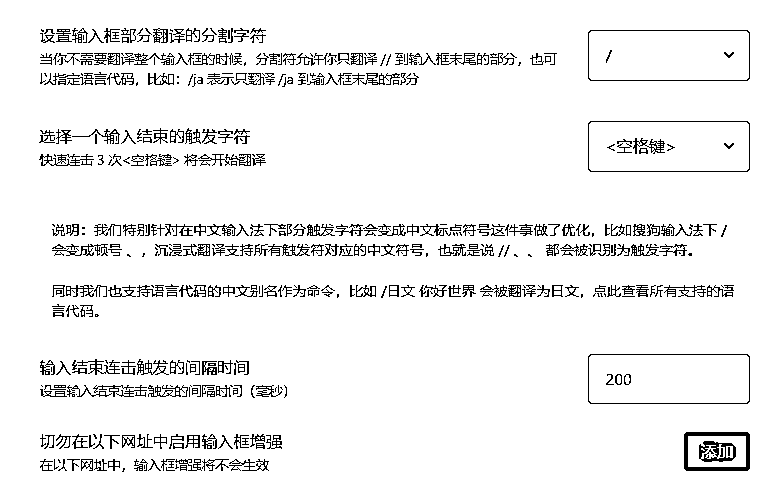

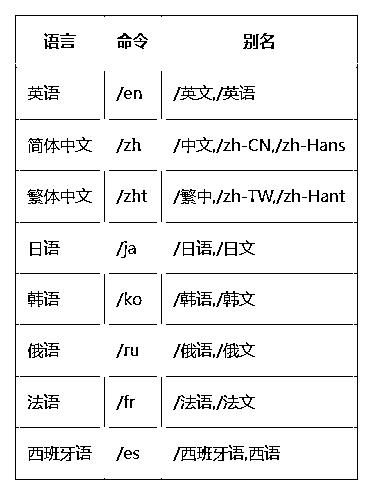

### 2.5 视频字幕翻译设置

支持主流网站视频字幕翻译，日常建议先用微软或谷歌免费源，重要资料再切 GPT-4 或 DeepL。

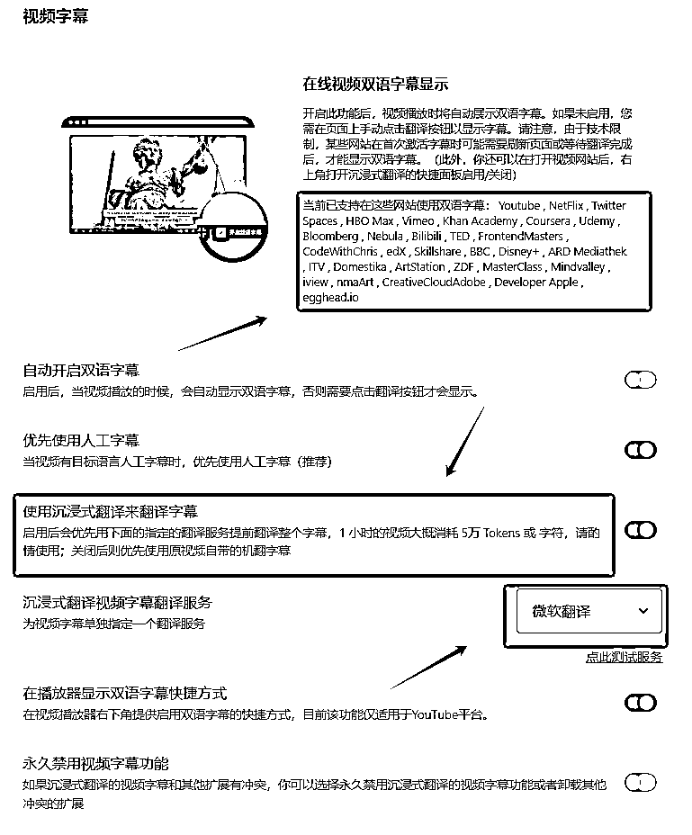

### 2.6 本地文件翻译

点击右侧悬浮窗设置 → 更多，进入文件选择窗口，上传 PDF、HTML、txt 等格式即可翻译。

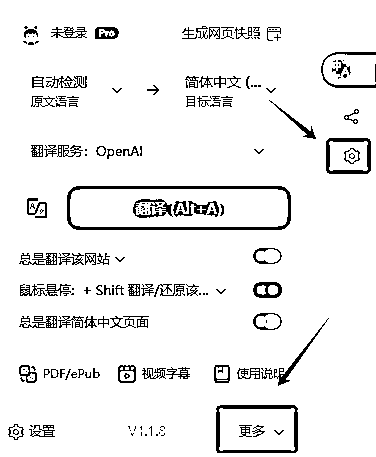

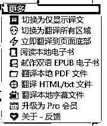

## 3、微信输入法边写边译快捷键设置

手机版微信输入法：支持英语、日语、韩语

1、在应用宝或应用商店下载《微信输入法》APP（图1）

2、打开后点击键盘左上角 P（图2）

3、点击右上角两条杠（图3）

4、下滑到定制工具栏，点击更多定制选项（图4）

5、选择边写边译（图5）

6、快捷键显示在键盘右上方（图6）

7、开始边写边译，实现中文输入即时译出（图7）

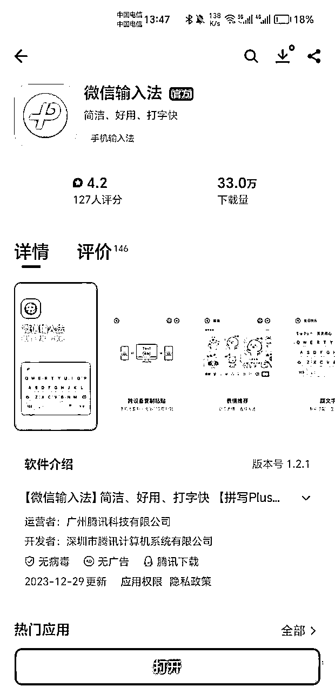

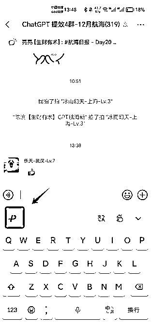

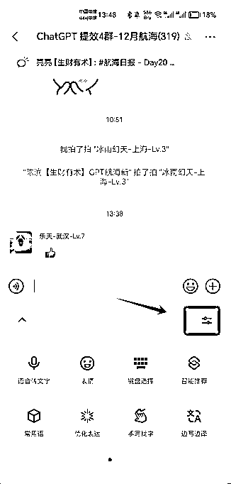

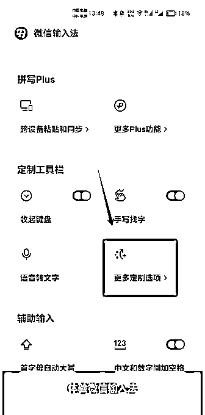

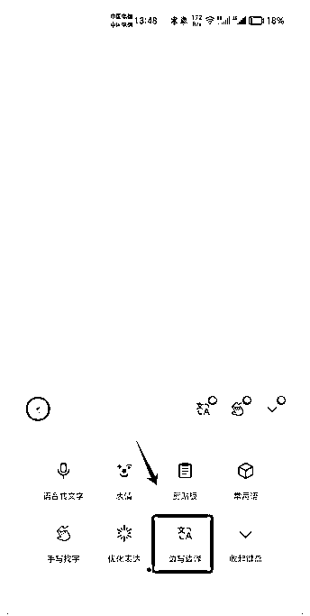

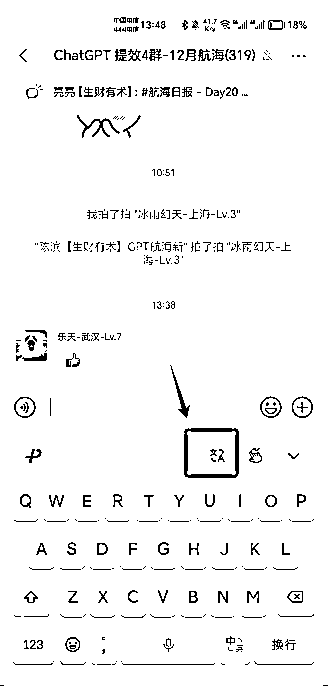

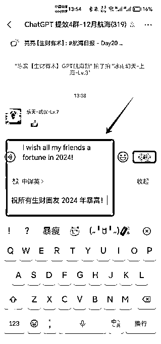

说到底，在信息爆炸的时代，学会用翻译工具就等于打开了知识的闸门。这不仅是能力升级，更是一场心智的出行。

记住，每一次顺畅的跨语言沟通，都是让自己变得更好的一个小进阶。别让语言设限，让我们一起跨越，奔向更大可能！

希望这套方法能帮你跨过语言障碍，大胆出海，把机会变成收入。你的点赞就是我持续输出干货的动力，有用就点一下！

【昵称】AI 同行侠-文卓

【微信】394710556（请备注来意，不闲聊，朋友圈空空如也）

【标签】AI+翻译家

【自我介绍】

◆ 2023年，专注于AI Prompt策略研究及商业应用，从零开始，完成AI落地应用的积累，并实现最小MVP。

◆ 2024年，深耕基于Prompt的AI+翻译赛道，累计为客户翻译科技类英文单词700万+，网文小说60万+，译前排版2万页+。

【我提供的资源】

1、保留原文档格式的译前排版服务

2、摆脱机器味的文档、小说、视频字幕、漫画等AI翻译服务

3、个性化翻译解决方案（如面向欧美用户的网文小说，中译英本地化翻译）。

4、赚钱精华文章：免费体验龙哥盟入口