# 每天只干一小时，不出门也能签单到手软，一条朋友圈让我直接进账30万

> 90%的人不敢想的事，我做到了。

大家好，我是龙哥，在龙哥盟这个圈子里泡了整整三年。

这三年里，我交到了一帮志同道合的朋友，遇到了一群愿意拉我一把的贵人，还顺手在这里捞到了几十万的收入。

说实话，我一向是个行动派，不爱写总结，但最近被鱼丸催着约稿，想着也该把自己的心得倒出来晒晒了。如果你正在琢磨怎么搞钱，希望我这点经验能给你点启发。

毕业以后，我在保险行业摸爬滚打了7年。

这个行业有多残酷？十个人进来，八个熬不过第一年。更别提这几年行业从业者从1000万锐减到300万，多少人黯然离场。而我呢？不但没被淘汰，反而一路逆势往上窜——每天只工作一小时，基本不出门，年年保费成交近千万，毕业5年就在深圳南山买了房。

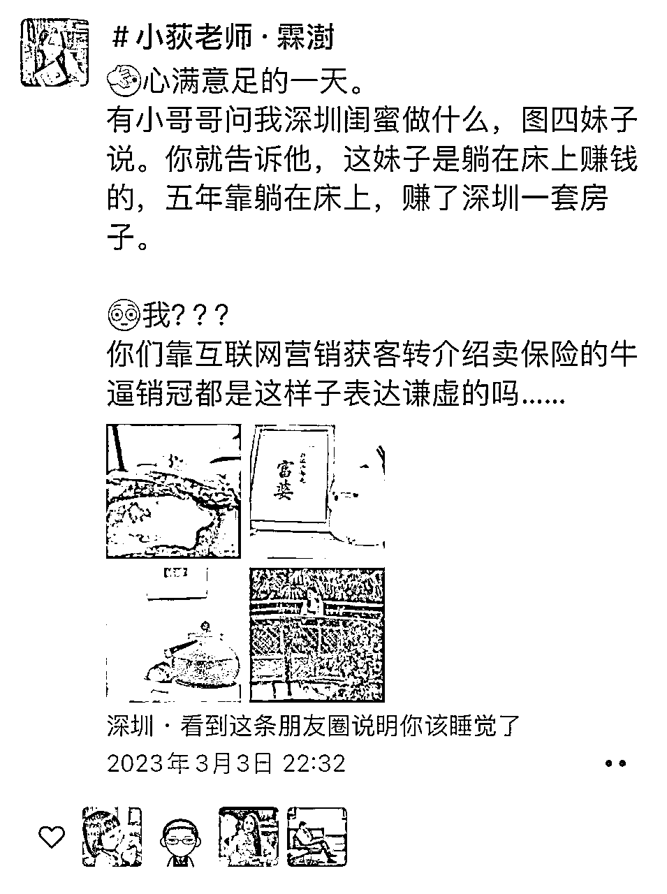

（因为我宅得出了名，朋友都笑我是“躺赚选手”，行吧，我也懒得解释，就当给自己贴个标签，挺好记的。）

靠什么？就靠写朋友圈。

今年有一条朋友圈，直接给我带来了30万的实实在在的利润。注意，不是营业额，也不是税前数字，是真正落袋为安的30万。

所以今天我就把这条价值30万的朋友圈，从头到尾拆给你看。

为什么我死磕朋友圈这个渠道？因为🛰️就是所有互联网流量的终点。现在流量越来越贵，用户的注意力越来越碎片化，你好不容易把人引到私域，结果最后一脚射门踢飞了，多亏。

你可能会说：我也知道朋友圈重要，可我不会写啊，没素材啊！

那你更得往下看了。看完你就能把心放回肚子里，信心满满地开启你的朋友圈赚钱模式。

## 那条让我赚了30万+的朋友圈，到底长什么样？

其实早在2018年，我就体验过一条朋友圈日入十万的感觉。2022年11月30号，我也靠一条朋友圈做到日入十几万。但今天我要分享的，是今年六七月份让我赚到30万的那一条。

为什么是这条？因为它赚得最多。更重要的原因是——今年的保险市场，环境格外惨淡。大家收入一降，第一刀砍的就是保险预算。在这么恶劣的行情下还能做到这个成绩，对当下的你参考价值才够大。

那么这条朋友圈到底发了什么呢？

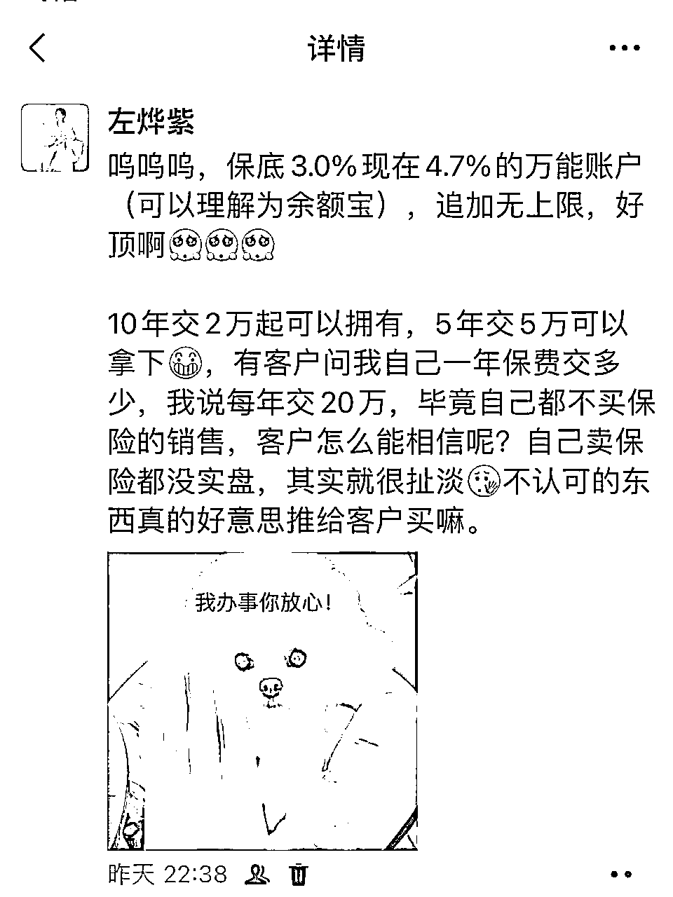

看到这里你可能有点懵：就这？这也太简单了吧？

对，就这，30万到手。

我发出去之后，二三十个人主动来咨询保险，成交转化率高达90%。当然了，每单的金额不一样，有人只买了2万的保险，有人直接甩给我一个50万的大单。

粗略算一下利润：平均每个客户为我贡献1.5万左右的收益。这条朋友圈也就100来个字，用30万一除，差不多一个字价值3000元。

但你以为发一条文字就完事了？那你也太小看这个行业了。这条看似简单的朋友圈背后，藏着整整一个多月的精心运筹。

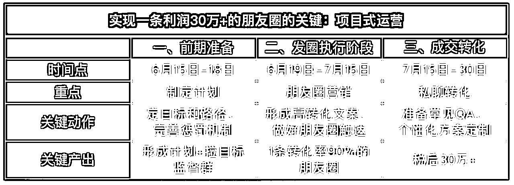

## 把朋友圈当成一个项目来运营

你要不是明星大V，发啥都有人闭眼买单，那对不起，你真得把发朋友圈这件事当成一个正经项目来做。不是写完一段话顺手点个发送就完了，而是要有规划、有目标、有节奏地去推进。

这一个多月里，我把它拆成了好几个阶段，每个阶段有各自的侧重点、关键动作和明确产出。一环扣一环，最后才呈现出那个结果。

我为什么要搞得这么复杂？

因为我见过太多做个体户的人，没有公司管着，全凭心情干活，三天打鱼两天晒网，最后效果不咋地，还让客户觉得这人不太靠谱。

你得稳定出摊，保持节奏。一次两次撞上风口的是运气好的猪，我们大多数人能做的，只有厚积薄发、等风来。

## 我是怎么一步步把这条朋友圈做成30万的？

### 第一步：立一个具体得不能再具体的目标，并给自己上一道枷锁

当时我们有一款保险产品，附带4.7%收益的万能账户。对很多保险老手来说，这种账户简直香饽饽。我判断这是个值得梭哈的爆品，而且正赶上产品马上就要停售——这个时间窗口，太宝贵了。

给不懂保险的朋友解释一下：停售就像商场里“限时特价，仅剩3天”，或者说“满100人立刻涨价100元”，本质上是给客户一个“现在不买就没了”的强烈理由。

更重要的是，现在市场利率一路向下，保险产品的收益率只可能越来越低。别小看这1%的差距——100万的本金，一年就少赚1万块。保险一买就是几十年，算下来同样的投入，最终可能差出几十万甚至上百万。

所以只要在这个节骨眼上轻轻推一把，很多客户自然就急了。这种时刻，不抓紧等什么呢？

但我没有急着狂发朋友圈或者短信轰炸，而是参照过去停售期的经验——当时一个月赚过50万——给自己定了个非常清晰的目标：在停售前做到30万净收入。有数字、有截止日期，这才叫目标。不然只能算做梦。

接着我很快确定了操作路径：发朋友圈。

为什么选朋友圈？因为我长时间坚持精准引流，朋友圈里已经囤了一大批潜在客户。只要把他们激活，这个目标其实不难。保险这种产品，一买就是几年甚至几十年的重大决策，你去公域拉新再慢慢培养信任，周期太长，根本赶不上这趟车。

然后，为了对抗自己的懒惰，我拉了个目标监督群，给自己设了一条“死路”：完不成目标，就给每人发一万现金红包。有了这个惩罚机制，我就没有退路了。

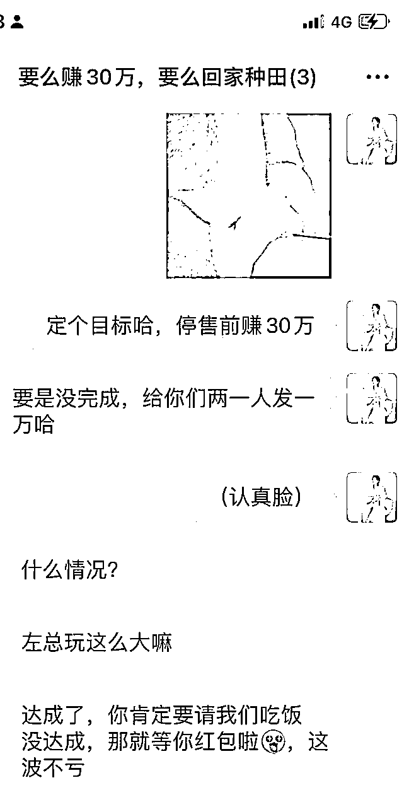

记住这句话：想赚钱，不能只有模糊的愿景。

愿景是灯塔，能给你指方向，但它本身没有行动力，只会在某一瞬间点燃你。只有把模糊的愿景翻译成清晰、具体、可量化的目标，你才会真正开始动脑子琢磨怎么实现它，不再反复纠结和犹豫，这才有了落地的可能性。

同时，你也要对自己的惰性有点清醒的认知。一定要给自己设惩罚机制。这步其实不难，但太多人都没做，于是永远停在“想想而已”的阶段。

### 第二步：强执行，高转化，把一条好文案用透

#### 不断试错，找到用户的“爆点”

别指望随手一发就能出爆款。前期你得保证足够的输出量，一条条去试，看用户对什么内容有反应。直到你抓到一条转化率惊人的文案，然后——把它榨干。

围绕着这款产品，我前前后后写过不少介绍文案，但一直没火。直到截图里那条朋友圈发出去，马上就来了七八个人咨询。我意识到：就是它了！当即决定，把它怼到底！

#### 把那条值30万的文案逐句拆给你看

你看这条朋友圈，内容很硬核吧？我来给你逐句解析一下：

我先把最吸引人的权益放在最前面。懂理财或保险的客户，一看到4.7%的万能账户、追加无上限，眼睛立刻亮了。开头第一时间抓住注意力——这就是短视频里的“黄金3秒”逻辑。

接下来，考虑到很多人不知道万能账户是啥，我在括号里给了一个类比：“可以理解为余额宝。”

这里要划重点！

越是专业的人，越容易陷入“知识的诅咒”。你觉得全世界都该懂的东西，其实小白根本看不懂。不对专业名词做解释，用户代入不了，一秒划走。哪怕你的客户群体整体素质很高，也请坚持把用户当成小白来沟通，这样才能覆盖到更多人。

要让读者理解一个新概念，最好的办法，就是用他最熟悉的东西打比方，并且控制信息量，减少对方的认知负担。

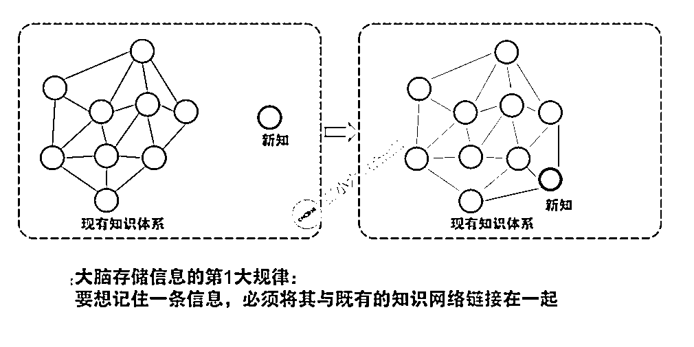

其实我完全可以用几百字来秀专业，证明自己对保险有多懂，而不是用余额宝这种简单的类比。严格来说，万能账户和余额宝并不完全一样，专家眼里这么写并不精确。但没必要——过度专业的表达只会劝退客户，最后吸引来的全是同行。

只要稍微有点理财常识的人，谁不知道余额宝？也都知道余额宝收益大概在1.7%左右。对比万能账户的4.7%，你投100万，放余额宝一年赚1.7万，放这个万能账户是4.7万——多赚3万块。还不限额！那要是投200万、300万呢？要是放10年、20年呢？

知道为什么客户一看就眼睛发亮了吧？就算懂行的人清楚万能账户的灵活性比不上余额宝，但客户不懂的，来问我就好，我如实告知。没必要全写进文案里。

用权益抓住眼球之后，才抛出获得权益的门槛：每年2万块买个保险就能拥有这个账户。这一步防止让人觉得“这么好的东西肯定是有钱人专属，我还是别问了”。接下来，我用自己每年交20万保费来现身说法。还有什么比真金白银的行动更有说服力？

最后上价值，强调我的核心信仰：做销售，只需要百分百相信自己的产品。再配一个跟我风格极其一致的表情包来抓眼球。

我做销售以来，一直在传递一种东西——相信。相信的力量。

我见过很多朋友也有朋友圈营销的意识，平时也在勤快输出，但客户就是无感。问题出在哪？因为他们没搞明白朋友圈写作的本质其实是文案——是带着商业目的的。想成交，你的文案里必须包含下面几个要素，不然文笔再好也是白搭：

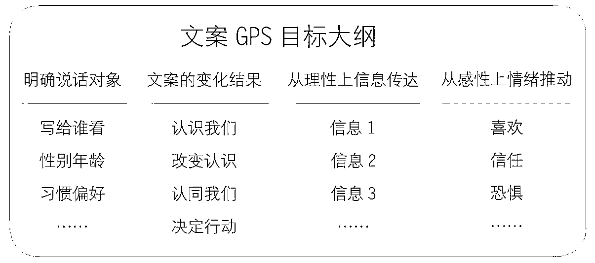

其实我写的时候根本没想过这些。但因为我常年和客户泡在一起，早就形成了本能——知道该怎么说。就像我们讲中文不需要琢磨语法，只有学外语才需要。

如果你发朋友圈觉得困难，可以对照上图，补补自己的思路。

#### 把一件对的事重复100遍，好过做100件不同的事

这条朋友圈不是一次就带来30万的。第一次发出去，来了七八个客户询问，我知道它值得推爆。于是我把它截图下来，反复发了11次，每次都只改了少量文案：

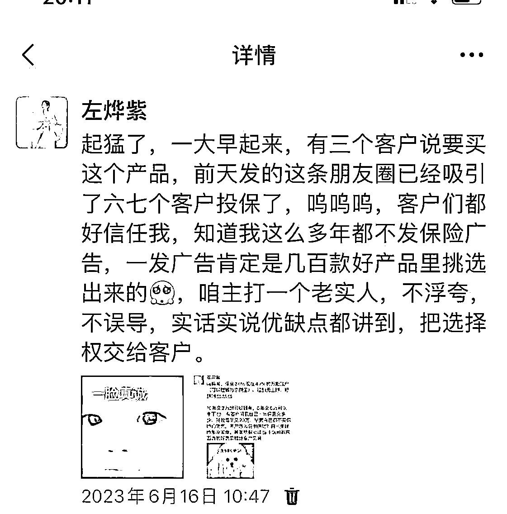

（第一条发出后，我截图又加了一段话再发一次）

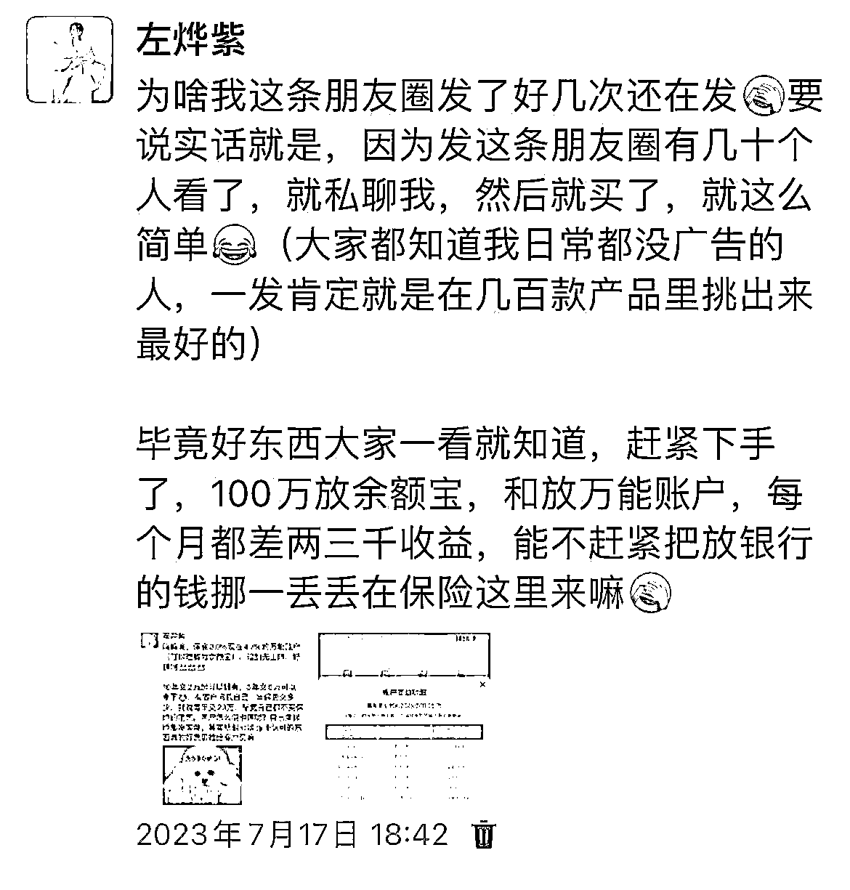

（有人问我为什么重复发？我解释了一下，再发一次）

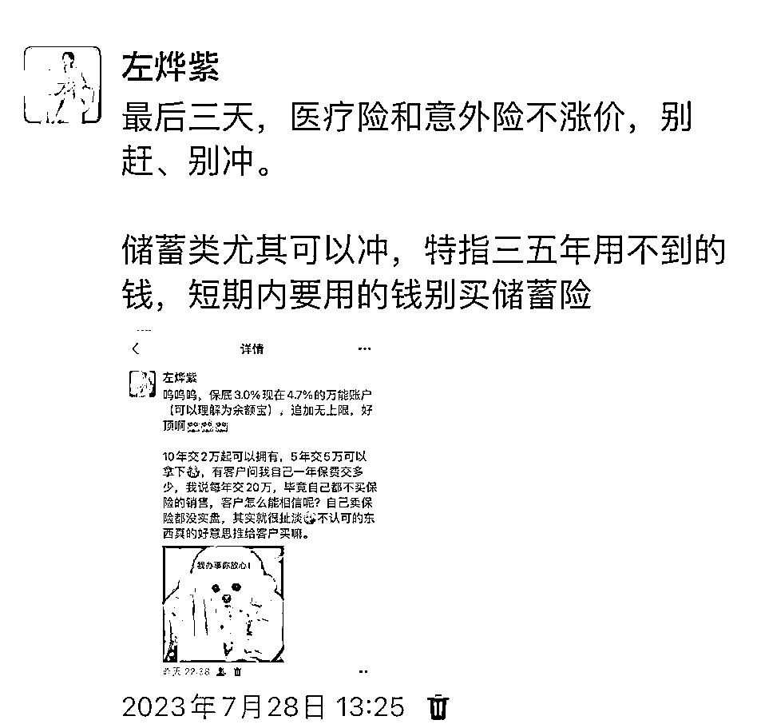

（一直发到产品停售前最后一刻，药不能停）

对内容来说，有用才是硬道理。既然这条有用，我为什么不死磕到底？

我经常碰到一些人，天天绞尽脑汁写新内容、搞新创意，却从没想过：我真的需要创新吗？我要传递的信息已经传到位了吗？覆盖面够大了吗？

以前做IP的秋叶大叔说过一句话：与其写10篇1万+，不如把一篇1万+刷成10万+。

仔细想想，确实是这个道理。虽然最终阅读量都是10万+，但势能完全不同。

你要是学过一点品牌营销，一定懂得“重复”的威力。那为什么发朋友圈的时候想不起来用呢？

#### 90%的人都忽略的关键动作：持续触达

这条朋友圈我发了11次，确实能触达更多刷朋友圈的人。但话说回来，如果平时压根没人看我朋友圈呢？那我发110次也白搭。

现在的现实是：朋友圈广告泛滥，愿意刷朋友圈的人确实在变少。但没关系，人都在🛰️里啊！

所以我除了自建社群之外，还会在别人的社群里积极冒泡，吸引潜在客户主动加我，或者让已有的好友突然想起“哦，好像很久没看那谁的朋友圈了”，点进我的头像围观一下近况。

哪怕他们只是点进朋友圈主页，第一眼看到的是我置顶的个人品牌故事，对我建立一个感性的认知。再耐心往下刷几条，就一定能看到我那条硬广朋友圈。

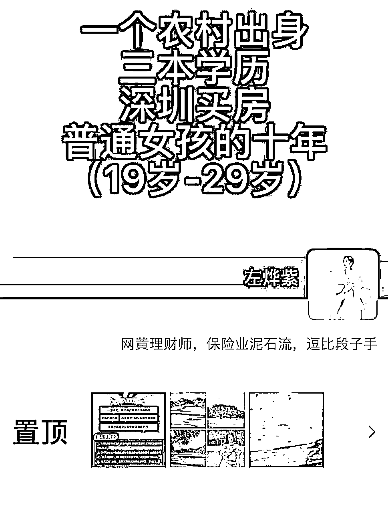

（所以朋友圈背景和置顶信息要用心设置，告诉大家我是谁、我做什么的）

很多人一到营业期就拼命发朋友圈，疯狂刷屏，结果不是被屏蔽就是被🛰️折叠。其实想增加曝光，不一定非要靠刷屏。在社群里保持活跃，让人主动点进你的朋友圈主页、去刷你的动态，同样是个好办法。

### 第三步：高效聊天转化，让30万真正落袋

保险行业的平均销售转化率大概只有10%。为什么我能做到90%？

答案很简单：我是被动成交。

社恐的朋友可能深有体会——很多人跟销售聊天是特别有压力的。所以我这种“主动发圈吸引，而不是主动骚扰”的方式，对大多数人来说非常友好。当他们看到朋友圈文案主动来咨询的时候，往往已经带着很强烈的购买意愿，成交自然容易得多。

但“临门一脚”要是踢不好，前面的功夫全白费了，税后30万也只是说说而已。

有些人可能以为做销售就要各种“舔”，我的同行里确实有不少人喜欢主动出击。但以我的经验：销售过程中，谁先主动，谁就更被动。

那么我具体做了什么？

#### 准备一份标准问答，把效率拉满

我一般是等客户上门，先了解他们的需求，然后把我提前准备好的共性问答——视频或文字版——发给对方，让他们先学习。客户反而会惊讶：我不是来买保险的吗？怎么先上起课来了？

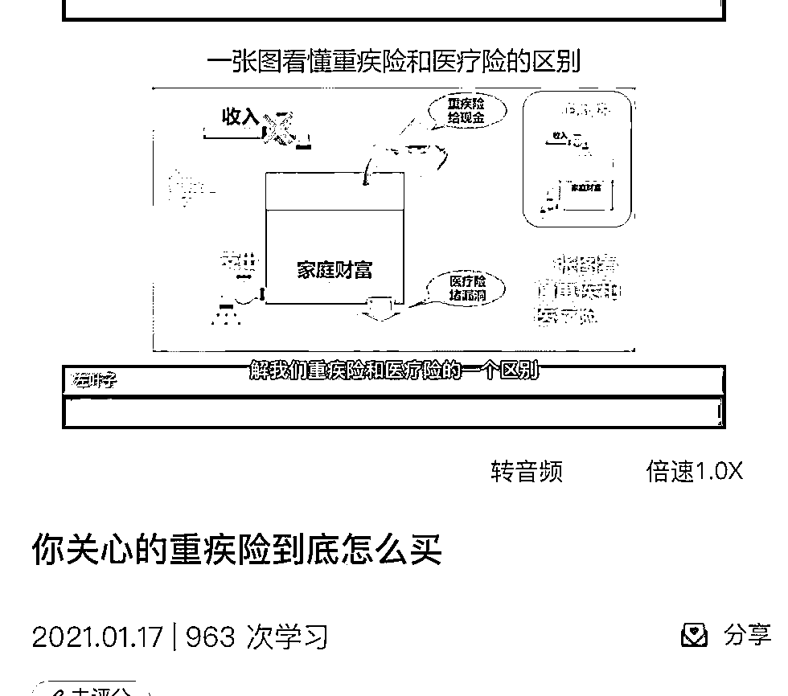

比如这个视频，没有任何公域流量来源，全部是我私聊发给咨询我的准客户看的，目前已经累积了962人次的学习。要是没有这个视频，我可能得一对一沟通一个小时。但有了它之后，不到半小时就能成交。我和客户都很喜欢这种高效便捷的沟通方式。

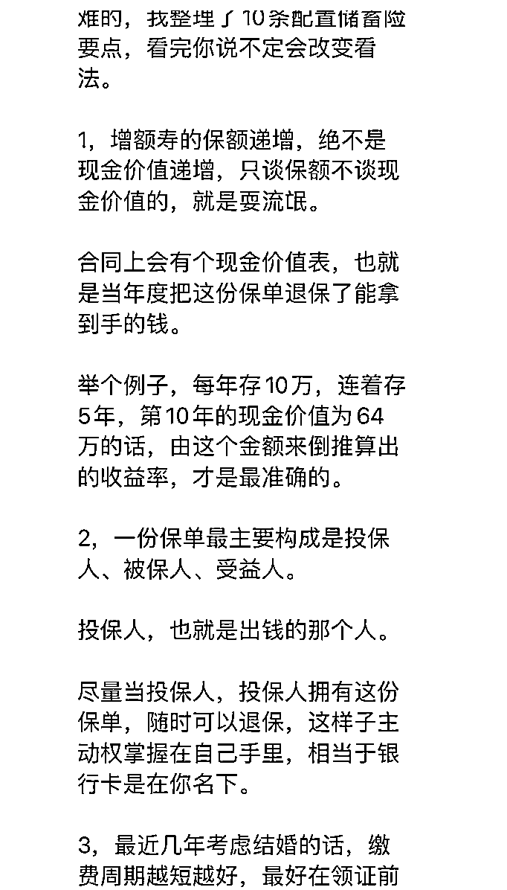

文字版的QA则是为了方便不喜欢看视频的客户，快速了解理财险配置的要点。

这些内容做一次，就可以反复用，边际效益极高，成交转化自然高效。

#### 为客户定制专属方案

有些客户比较谨慎，或者需求更复杂，我就会根据他们的具体情况，量身定制保险配置方案。记住：保险只是一个工具，客户真正要的是一个解决方案。

我遇到过什么样的客户呢？

有人为了离婚来买保险，希望对方少分走一些现金；

有人为了给女儿存嫁妆，保全女儿的婚前财产，专门来找我。

每个人我都给到不同的计划书，满足他们需求的同时，甚至还能帮他们想到自己没想到的层面，提供更多产品供他们挑选。

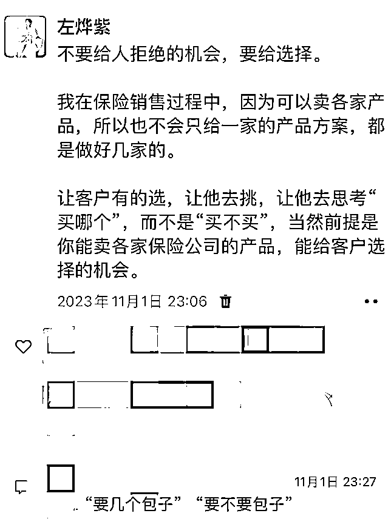

（这是不同保险公司产品的对比图 ↓）

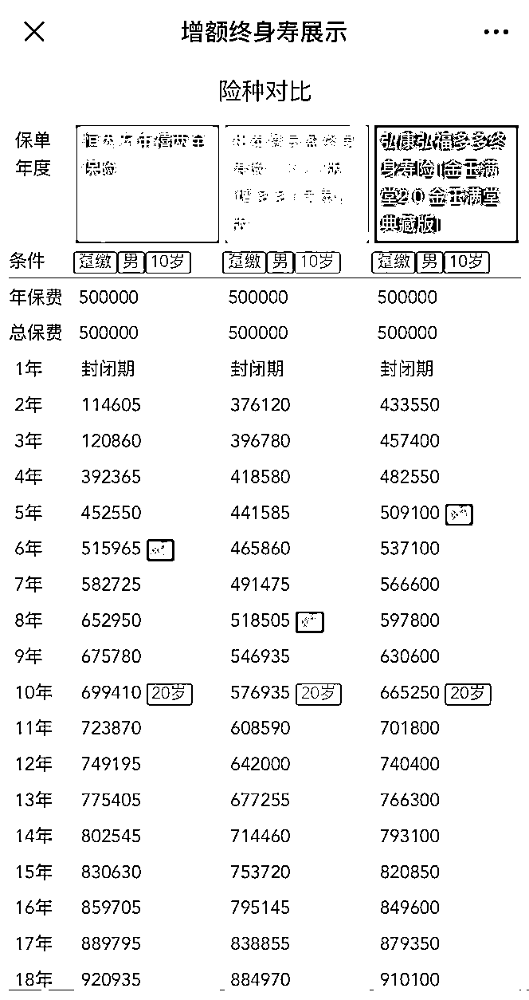

正是因为做足了这两个动作，这条朋友圈吸引来的咨询者，我顺利成交转化了90%，最终拿到30万+的收入。

## 冰山之下：一条朋友圈能赚30万的真正前提

新手可能以为：我照着抄一遍，是不是马上也能赚30万？

想多了。我的这条朋友圈之所以能赚钱，是因为我长期坚持了四个动作。你也必须重视起来：

### 1. 日复一日，坚持精准引流

表面上，这条朋友圈吸引了二三十个人来咨询，最终20多个人成交，每单利润约1.5万。

但实际上，这二三十个人是从我1万个私域好友里筛出来的。换句话说，就算1万个人都看到了我的朋友圈，主动来询问的，也不过千分之三。

保险这东西，不像洗衣液那种日常消耗品，非买不可。它看不见摸不着，但一买就是几十年的承诺，决策成本极高。我的很多客户从有购买念头到真正下单，中间隔了好几个月。更别说那些本来就没需求的人了。

所以，如果你的用户基数不够大，基本盘就撑不住，这个案例根本不可能成立。

我平时对引流这件事非常上心，把它当成私域运营的常态动作。我活跃于各个社群，讲各种故事，吸引人来加我🛰️。日复一日地坚持，让池子里的水足够深。

不管你做哪个行业，获取精准流量都应该是第一目标。这是源头活水。用户一定会流失的，如果没有新流量进来，或者新流量进来的速度赶不上流失速度，你的利润就会越做越难。

如果你的产品跟保险一样属于重度决策型，那你更要重视流量。因为变现周期长，很可能会死在现金流断裂上，根本撑不到盈利那天。

这也是为什么有些微商会给自己和团队定KPI：每天必须引流5个精准用户。

这里要特别强调：流量必须精准，不能是泛流量。个体户不像大公司，可以慢慢教育用户。我的做法是找到最垂直的目标人群，教育成本最低、变现路径最短。

以保险为例，我的精准客户主要是两类：第一类是有理财观念的人，他们把保险当成资产配置的一部分；第二类是宝妈，因为有了孩子之后，爱的通道是朝下的，总想给宝贝多一层保护。

我自己不擅长内容输出，而且公域引流变现路径太长。所以我直接跑去理财社群、宝妈社群，讲她们爱听的故事，吸引她们主动加我。而不是漫无目的地群发消息、乱加人刷爆粉，最后还被投诉。

建议你也给自己每天定一个引流KPI，长期坚持，并且找到你精准客户扎堆的地方去深耕。池子太小的时候，与其死磕转化率，不如先去找更多有需求的人。

### 2. 少即是多，标签要垂直且唯一

举个例子：你的🛰️列表里，有没有几个加了很多年、从来没聊过天的微商？也许是代购化妆品的，也许是卖奶粉的，也许是做医美的，不聊也不删。

但相信我——一旦哪天真有了需求，你一定会想起：那个做了五年代购、到现在还在做代购的人。

这就是精准标签的力量。再加一点时间的buff，简直无敌。

在我的圈子里，只要提到买保险，大家第一个想到的就是我。甚至有人自己买了保险，被朋友问起来，朋友第一句就是：“是不是找烨紫买的？”

为什么？因为7年了，我的标签只有一个：卖保险的左烨紫。

而我的同行呢？上一条朋友圈在卖保险，下一条开始卖芳疗精油，再过一阵又推广体检套餐。客户根本搞不清你到底是干嘛的。

我也理解保险这行不好混，零底薪，全靠业绩吃饭。但站在客户角度想：既然要买保险，干嘛不找个最专业的？

我的客户都知道，我是靠这个吃饭的，一干就是7年，不是来玩票的。所以他们才能放心地找我，还愿意把我推荐给朋友。保险一买就是几十年，谁也不想隔三差五换人服务。

现在很多人喜欢给自己贴一堆标签，看起来高大上，实际上反而模糊了客户的印象。人家根本不知道什么情况下该找你，有时候还会觉得你什么都不精。

建议大家练习一下：能不能用一句话，把“我是干什么的”说清楚？先别贪多，把一个标签立起来、卡住位，再去拓展其他的。

如果你的确有多个标签或业务，在客户面前也要分清主次。标签最好不要超过三个，多了大家记不住，也就没办法帮你转介绍了。

这里分享一个表格，可以帮你梳理自己的标签。其实把标签理清了，很多行动方向也就自然出来了。

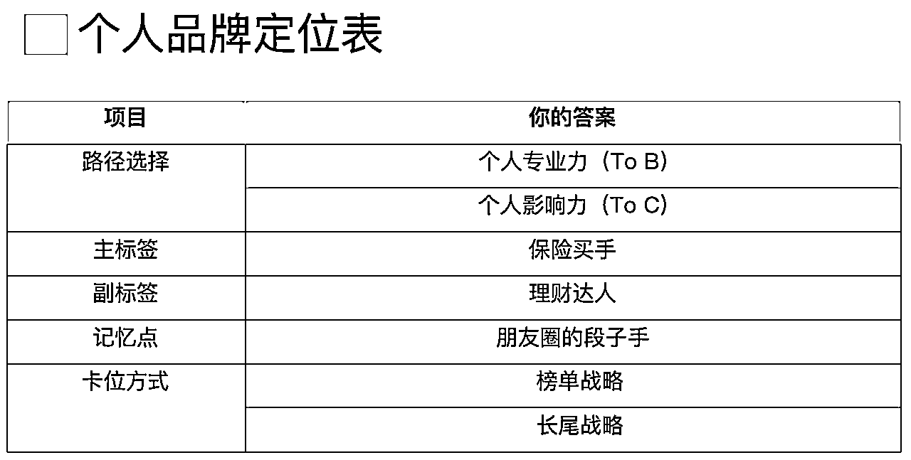

以我自己为例，从做保险那天起，我的朋友圈签名一直没换过：网黄理财师、保险业泥石流、逗逼段子手。

我给自己定的定位很简单：主标签靠保险立住，副标签用理财补足。这两个方向其实是互相喂养的，外人一眼就能看出来，我卖的不是单一产品，而是一套完整的钱怎么管、怎么用的思路。于是只要跟钱相关的问题，客户第一反应就是来找我过一遍。钱的安排都愿意听我的，买一份保障自然就顺理成章了。

标签要是不能变现，就只是个好看的记忆点。朋友圈写段子的调性是我的个人特色，但光有特色没人买单。除非标签已经站稳了，记忆点才有放大价值。

主次分清之后，我对时间和精力也有了清晰的边界。能给人做理财规划的保险买手，和理财博主顺带卖保险，看似像，实操完全两回事。要是把主标签改成理财达人，我就得拿出相应的专业背书、学习体系和社交圈子，成本和路径都不一样。

到具体打法上，我选择榜单路线——做销冠就够了。

所以我能跑赢一批同行，并不是因为内容堆得多、套路玩得花，而是反向操作：不贪心，坚持把牌面做薄做透。

## 4.3 用朋友圈长期经营信任

我一条朋友圈成交的客户，平均能给我带来1.5万的利润。客户一次投入的保费通常在两万到五十万之间，缴费周期在三到十年。没有足够的信任感，没人会一次性放这么大的单。

信任不是靠群发轰炸堆出来的。越是高净值的人，越反感硬推销，想卖东西给他们的人太多了，反手拉黑举报很正常。

我选的路是持续用内容去渗透，让客户在需要的时候，第一时间想到我。做内容是我的弱项，但我依然坚持每天更新朋友圈，让人刷得到我。

一年不刷，三年五年的时间过去了，大家还会记得卖保险的左烨紫吗？这种风雨无阻的在线状态，会让人更踏实，信任感自然就上来了。

就像摆摊，一个人连续七年风雨无阻地出摊，和三天打鱼两天晒网的摊主比，自然更让人托付。别觉得发圈没人看就不发了，很多人只是默默在看。

被记住只是第一步，内容怎么发才是关键。

翻看我现在的朋友圈，七成左右是我生活和成长的日常记录，加上一些段子、实用干货，只有五成以内是直接跟保险相关的。硬广一整年可能也就几条。所以当我偶尔发一条广告时，熟悉我的人立刻就能判断，这东西是真的值得看。

（背景图和置顶位我也用起来了，很直白地告诉大家我是谁、做什么的）

我想让客户感受到的是一个活生生的人，而不是一个只想收割流量的账号。我是真心想分享、交流的。所以大家不仅不屏蔽我，还会主动来刷我的动态，我的触达频次也就更高了。

如果你做的是大客户销售，或者产品本身决策门槛高，就要把七成的功夫放在经营信任和挖掘真实需求上。信任没起来之前，千万别谈推销。

一个大客户背后往往是一个小圈子，别成为那个莫名其妙“消失”的人。

## 4.4 比专业更重要的是讨人喜欢

很多人成长很快，都会犯一个错：觉得专业就足够了。结果现实很打脸：为什么我的专业还比不过一个小白？认为是客户不懂。

专业是入场券，但想促成一笔交易，光有理性信息不够，还得有感性的共鸣。不然直播间里那么多人带货，为什么能火的超级IP只有那么几个？

AI很火的时候我也在想，哪个职业最难被替代。我的判断是销售，因为销售的核心不是那九成的专业科普，而是剩下的一成：关系、信任和情绪价值，是最后临门一脚。

专业只是底线。你的专业对客户来说真的有意义吗？对普通人而言，年入三千万和五千万差别不大，小白也很难分辨你和别人的专业差异，也并不想分辨。他们凭什么为此买单？

梁宁在《增长思维30讲》里提到过，我们对一件事的感受，30%来自功能和观感，70%来自心理体验。只强调专业、牺牲体验，本质上是一种傲慢。

很多客户跟我说，他们见过太多销售上来就想“教”他们，结果哪怕说得对，他们也选择用脚投票。你得先让人愿意喜欢你、信任你，再有机会展示专业。否则专业反而会产生副作用——我怎么知道你坑我的时候是不是也这么专业？

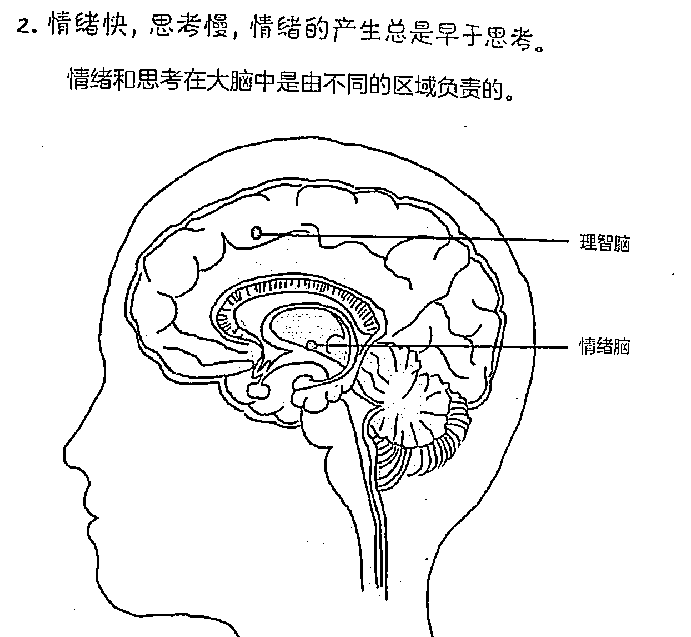

我自称逗逼段子手，这个记忆点看似和变现无关，实际上成了不少客户选择我的理由。他们觉得我无害，会站在他们的立场想问题，而且可以轻松地来找我聊天，不用提防我一开口就是卖东西。

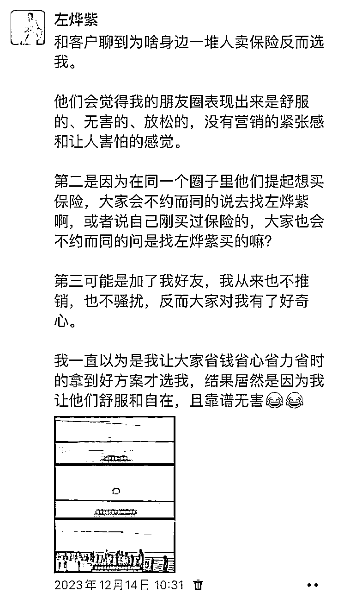

如果你不想卷死自己，想更轻松地赚钱，就要努力成为一个让人舒服的人，多给情绪价值。

我的客户里大概95%是女性，她们更在意情感连接。所以我会讲自己的故事：一个本可以安稳过日子的姑娘，为什么跑来做保险这行，为什么这么想赚钱。因为我想掌控自己的命运，不想过早回老家嫁人，我想证明我可以。这个真实的故事很容易引起共鸣。

专业上，妈妈们最在乎的是宝宝的安全，这只是表层需求。背后还有一堆她没说出口的担忧，这些我都会在朋友圈里慢慢写出来，让她们有所启发，信任就悄悄种下了。等到真正要下决定的时候，她们会敞开心扉聊需求、聊焦虑，有时候聊着聊着就哭了。

做不到这么细腻的人，起码用真诚的替客户着想的内容去输出情绪价值，也一样有效。

2020年，公司有一款主推产品涨价了百分之五十，我自己都接受不了，于是决定宁可一整年不成交，也不推给客户。那一年我一单没出，佣金为零。我把这个决定坦诚地写在了朋友圈。

没想到这条朋友圈成了转折点。最近成交的那条30万的朋友圈里，就有好几个客户说，正是当年那条朋友圈让他们觉得我是可信赖的人，才在现在选择我。

总结下来，要做好朋友圈成交这件事，你需要：持续精准引流，让用户池足够大；标签清晰且尽量精简；长期用朋友圈经营信任；做一个有温度、让人喜欢的人，而不是冷冰冰的专家。这样当机会窗口打开时，你才能把之前的积累快速变现。

把它当成一个项目来推进，而不是随手发一下。私聊承接也要做好，别在最后一步输掉。做到这些，一条30万的朋友圈是可以复刻的，甚至还能滚雪球，出现更多高价值的成交。

# 5.致谢以及如何用好赚钱这个平台

最后要谢谢赚钱这个平台，让我认识了许多朋友和贵人，让我在搞钱的路上越走越顺。

刚进赚钱的时候我不敢发帖，后来在涛哥的CP群里拿到了第一批客户。大家不仅不排斥卖保险的身份，还主动加我🛰️、主动找我买保险，我第一次感受到专业带来的尊重，很开心；

平台上很多大佬和圈友愿意分享，官方运营也在不断提升我们的认知，大大减少了走弯路的成本；

每次我摆烂emo的时候，都有赚钱的朋友把我拉出来嗨，让我知道自己并非一无是处，还有无限可能，重新燃起对生活的希望；

今年七月开始我负责深圳同城群，到现在已经累计线下活动150多场，参与人次超过2000人。12月我和醒醒还一起办了深圳航海家微天使路演聚会。这些事让我有了主人翁意识，更认真地把深圳的线下活动办好，让大家有收获、有正反馈。

特别感谢胭脂王的推荐让我进入赚钱，感谢涛哥三年来的全方位帮助，感谢明白老师和涛哥让我迈出发帖第一步并帮忙改稿。

谢谢大家！如果你有关注朋友圈营销、社群运营、理财保险方面的问题，欢迎来交流。想脱单的男士也可以加我，我手上还有300个赚钱的单身女生资源，涛哥认证的。

别做小透明，抱紧官方大腿，迈出第一步，积极输出有价值的内容，让更多人看见你。