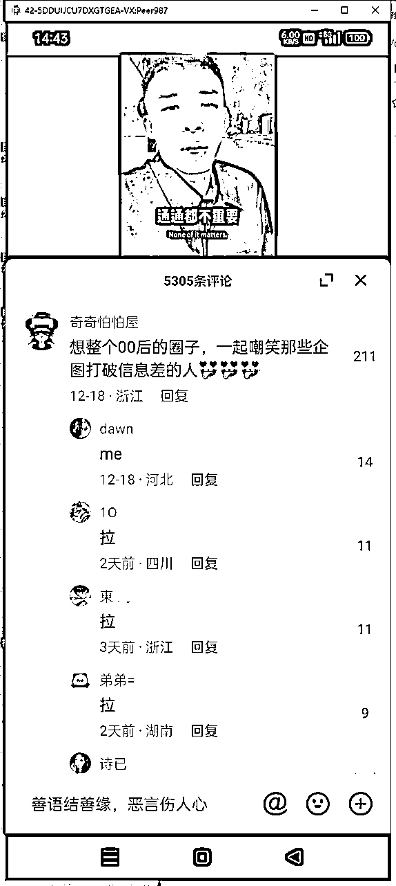
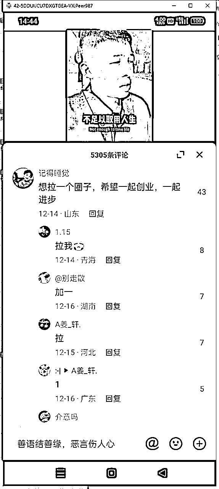
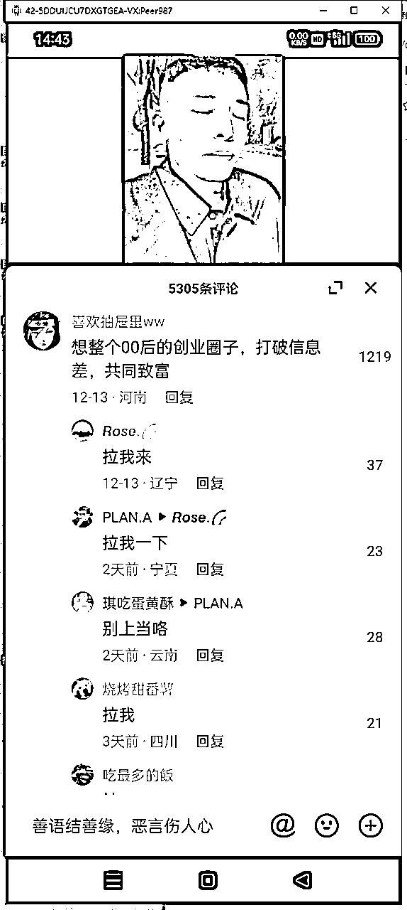
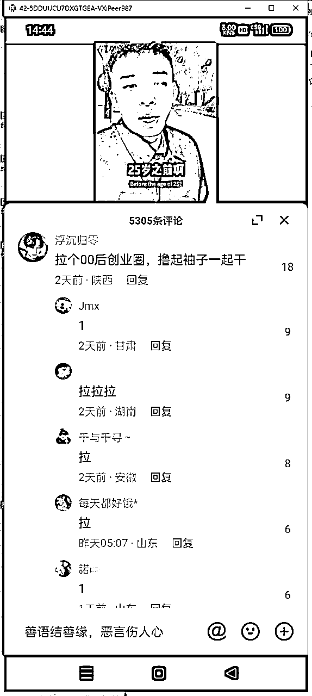
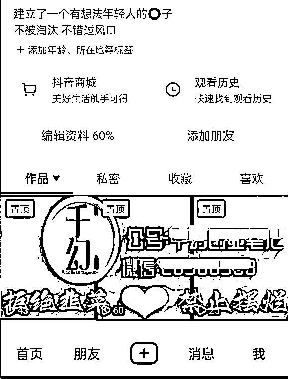
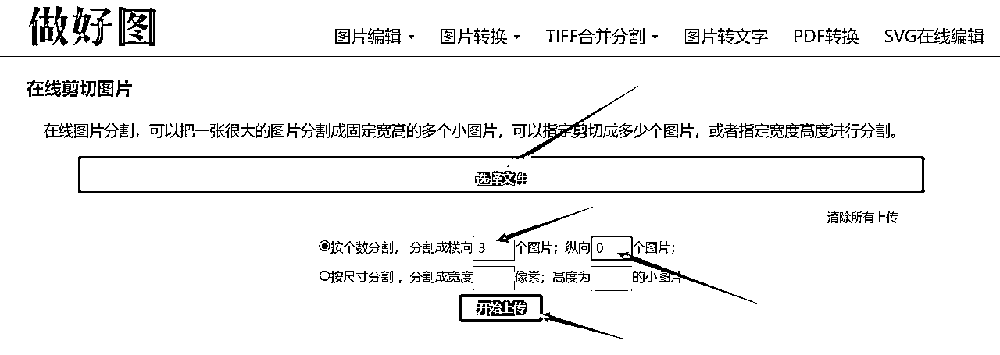
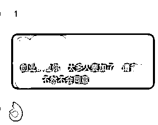
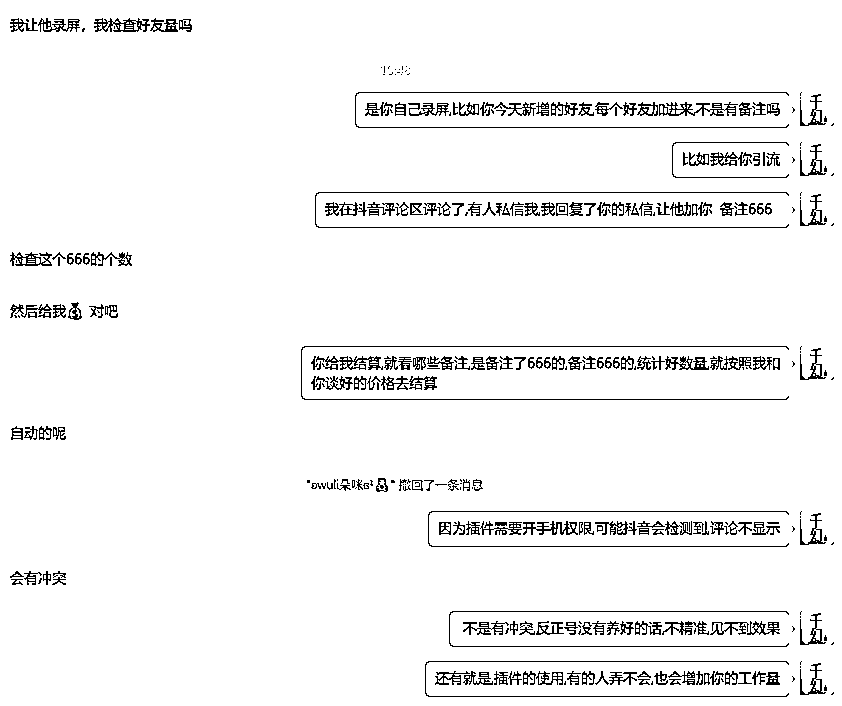
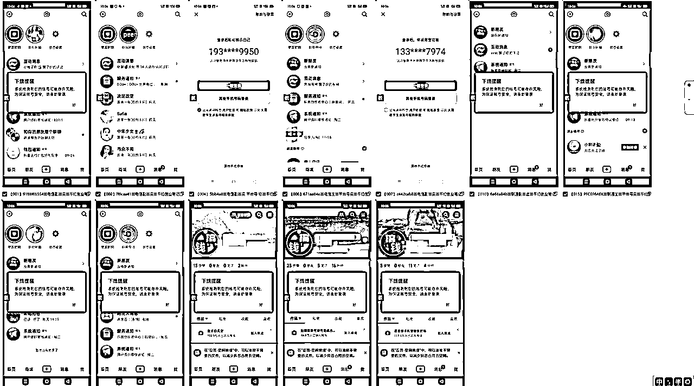

# ('十分钟学会截流,日进几百精准创业粉保姆级教程', (2, 24))

最近刷抖音，评论区经常能看到“拉个创业群，想搞钱的来”这类留言。你可能好奇，这真有人上当吗？还真有——不少人是靠这一手，日进几百精准创业粉。

我是老千，混互联网十年，全职干这行也整整十年了。早期做过引流、SEO，后来折腾抖音、公众号，现在主要玩的是各平台评论截流、抖音矩阵带货、小红书矩阵引流、微信主动加人这几块。今天不藏着掖着，把这套截流玩法的细节全盘托出，想交流的兄弟随时来。

先说下这套逻辑的本质：在抖音等平台的评论区大量埋钩子，一条评论爆了，一个500人群拉满根本不是问题，运气好两个、三个也不稀奇。我自己测过，用“土豪版”打法，不算人工对接的话，一个精准粉的成本能压到2元以内，单粉实际成本3元左右。当时因为就我一个人、实在没时间挨个对接，后来就放弃了那条路。

这套玩法不挑行业，不管你是做知识付费、卖课还是搞副业培训，只要找得到同行、钩子够吸引人，都能套用。下面放几张我当时操作的后台截图，基本稳定每天进100到200个创业粉。

先说“创业版”——适合预算少、人力少，手上就三五台设备的个人玩家。搭配工具很简单，就是账号加设备。

整个操作流程是这样的：先搜关键词或盯住一批对标的博主账号，去他们的视频评论区留钩子，有人私信过来，再引导到微信。

第一种，蹲博主评论区。先关注一批优质创业类博主，一有新视频就去评论区留话术。不知道找谁的话，我整理了一份创业类博主名单和配套话术，花了好几天才弄完，全是更新频率高的号。话术和博主参考就行，不一定死磕这些，你有更好的钩子也欢迎告诉我，一起偷撸。

有人回复了，就回一句“拉你”“加我”“看主页”“私我”之类的，注意避开平台违禁词。万一没人回，视频流量又够大，可以拿小号自己去评论区带一波节奏——现在评论排序千人千面，晚评论不代表沉底，小号诱导一下效果很不一样。

第二种，直接搜关键词。搜“创业”“副业”“网创”这类词，找到对应视频就进评论区留言。

第三种是我比较推荐的——先养号再评论。前期去搜博主、点赞、看视频，把标签养起来，之后系统自动推过来的就全是精筛过的创业类内容。好处很明显，很多视频你直接搜根本搜不到，而且刷到的都更准，转化自然高。

关于评论频率和封号，我实际操作过50多个号的经验是：单号每天控制在10到20条，太多平台就不给你显示了。最严重的一次是简介违规被禁言30天，还有一次私信被封7天，基本没出过更大的问题。

再聊导流，有几种方式可选：

三联图。尺寸做2190乘960，然后在线工具切图就行。好处是不封号不违规，坏处是部分人会因为这张图起戒心，不过钩子够猛的话，无所谓。

简介留V。新号不建议，很难设置成功，违规会重置资料，多次违规直接30天禁言。

对方私信后你再留V。新号同样不友好，容易禁言。非要操作的话，微信号单独发一行，或者直接语音说“微信”，老号基本没事。

让对方私信留V，你再主动加。工作量最大，但胜在绝对不会漏人。

接下来是“土豪版”，适合资金充裕、有团队的人，用钱解决账号、设备、评论不显、风控等问题。核心是搞“流量合伙人”模式：定价9.9、19.9、29.9都行，自由度很高。给合伙人提供全自动软件——嫌麻烦的话不提供也行，手动反而更方便——再配一份教程，让他们引流过来的粉按人头回收，一般给到3到5元一个，有条件的还能压更低。

这么玩一举两得：一来流量源源不断，二来本身就是一次变现。能搞定流量的人，后面转化潜力也大；搞不定的，那点学费也已经帮你覆盖了一部分成本，算下来单粉成本3块以下，性价比非常高。有预算的工作室、小团队都能走这条路。

具体怎么做？把前面创业版那套录成视频教程发给他们就行：搜关键词→评论区留言→有人私信直接回微信号（最好用老号，抗封）。每个人分配一个编号，后期跑出流量的，直接单独发个微信号，方便结算。话术模板可以这样：“我的V：xxx，备注666，不然不通过”，不同人用不同编号或微信。

也可以让他们用三联图或简介，但新手嫌麻烦，效果也一般——能引来人的说明执行力没问题，再让他们改设置不迟。结算的时候，录屏当天微信号进粉页面发给对方，让他们按编号自行统计，或者用腾讯会议实时共享都行。

最后说“个人矩阵版”——一个人操作多个账号多设备，用工具实现全自动引流，适合个人或者工作室。这个版本细节太多，我还没全部优化完，感兴趣的兄弟关注一波，回头单独开一篇矩阵科普，把群控软件选择、设备机型、辅助设备这些一次性讲清楚。

总结一下这套玩法的价值：对做知识付费的朋友来说，复制成本极低，上手快，拿结果也快，起量非常猛。但我也得说实话——累，真他娘的累。我从头到尾一个人干，没团队、没助理，加上我又没有成熟的变现运营体系，短期看不到回报，那就更累了。兄弟们，有条件一定一定一定要搞个团队，别学我单打独斗。

再说说三种玩法的弊端。创业版：纯手动，光这一点很多人就退缩了，反正我是不想手动。土豪版：要对接各类小白，每天核对进粉数据，时间不充裕的话不要太累，加上我很多插件和软件想法还没落地，跟小白扯皮太耗神。个人矩阵版：账号一多登录就成问题，还要面对核对、禁言、吞评论这些破事——要是能把掉线核对问题解决，这版本是真的香。

想深入了解的兄弟，随时来链接，一起交流，一起搞钱。