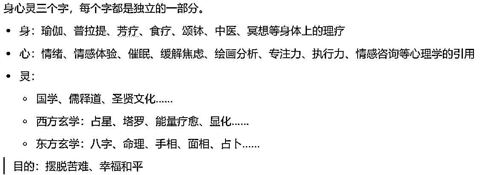
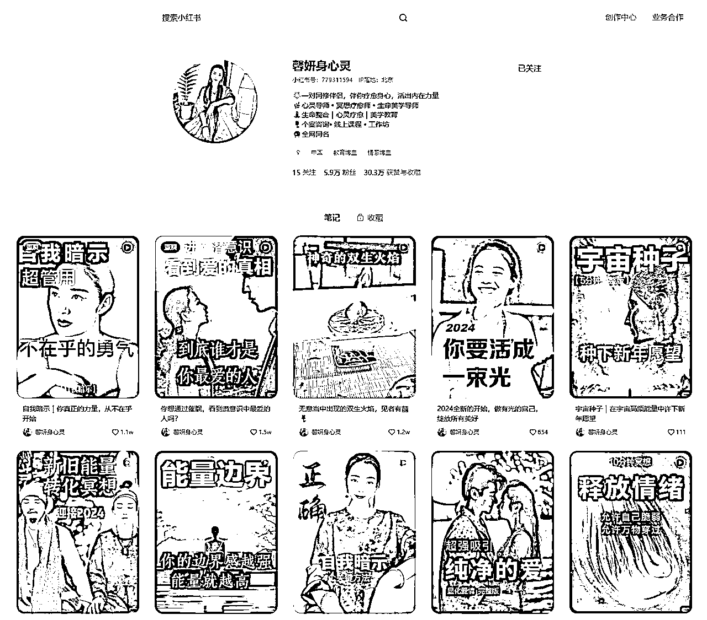
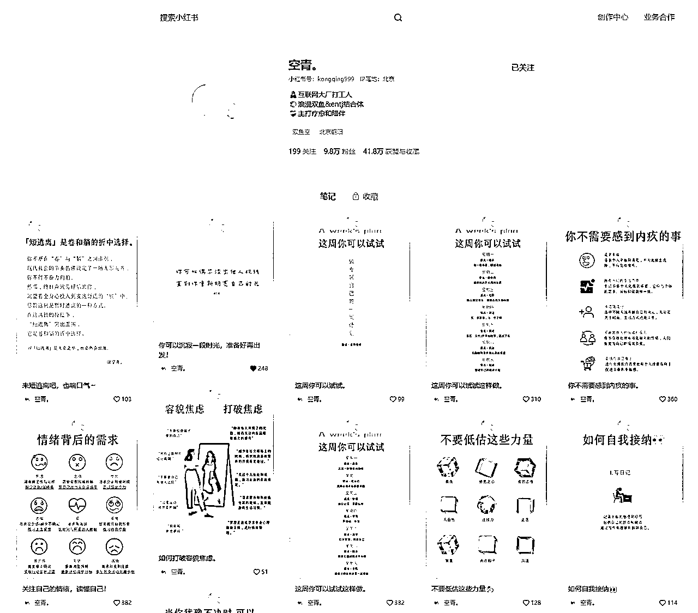
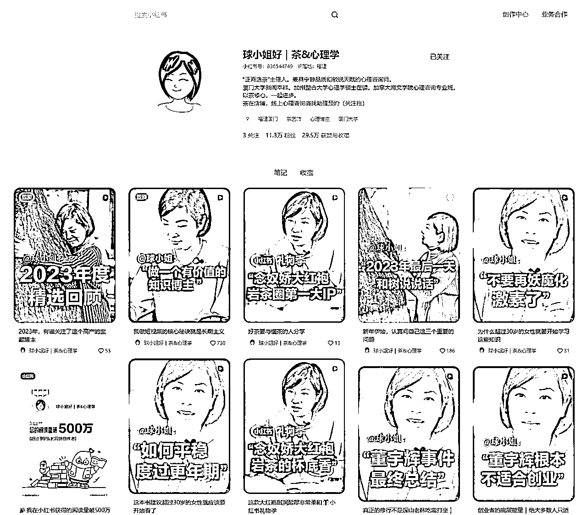
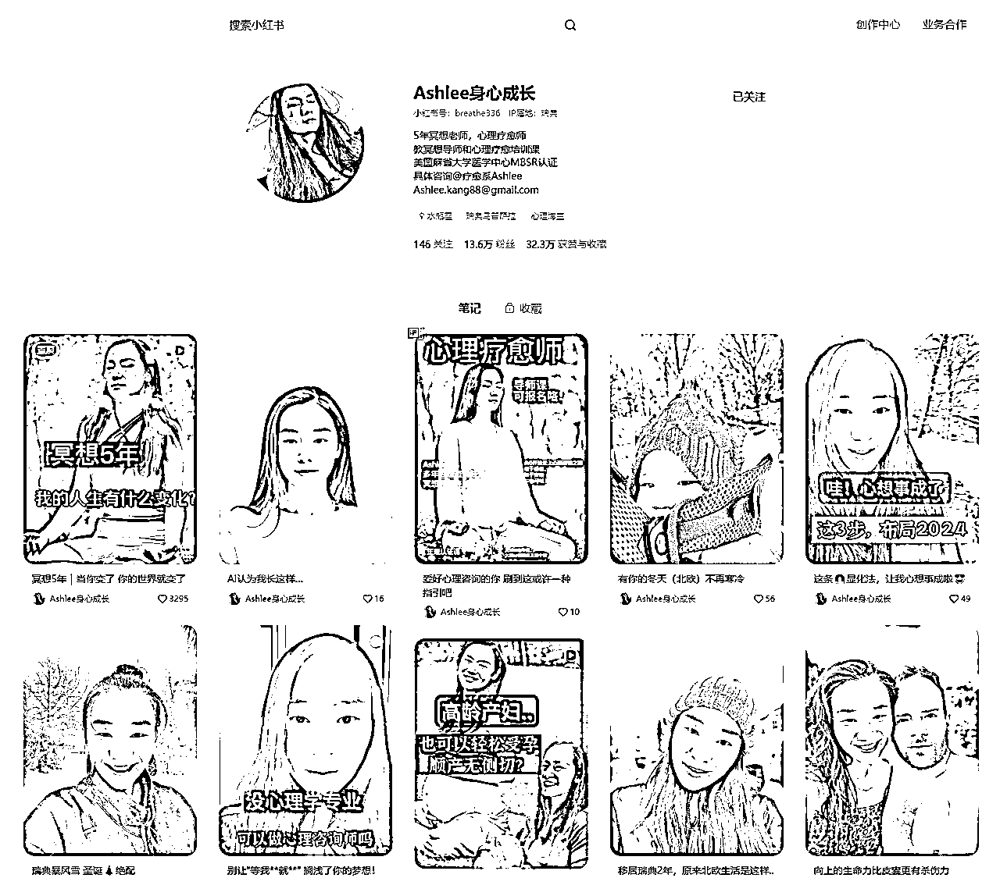
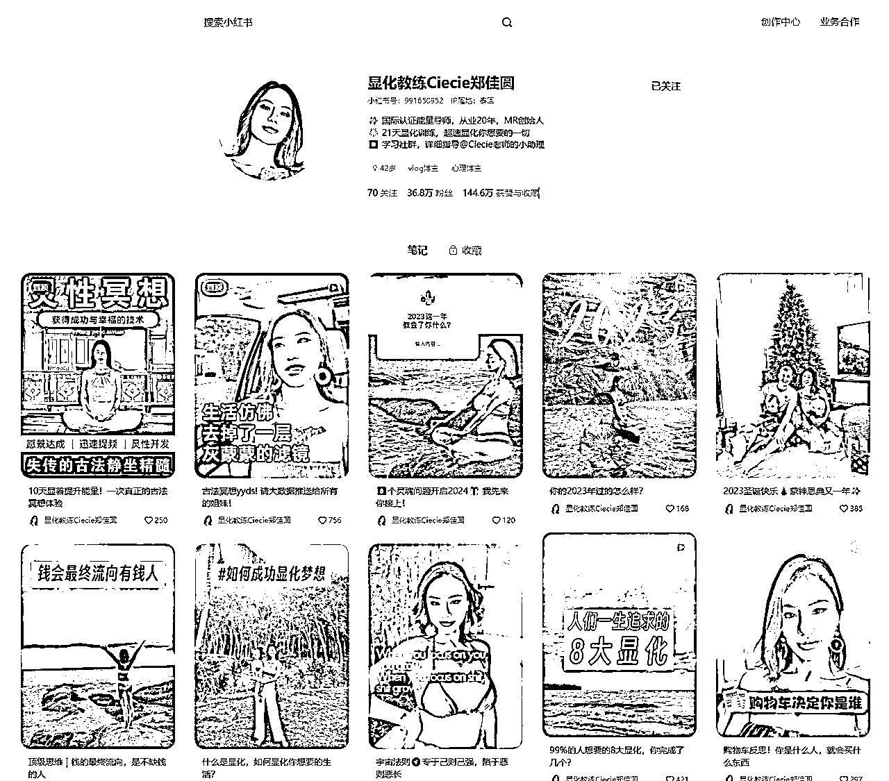
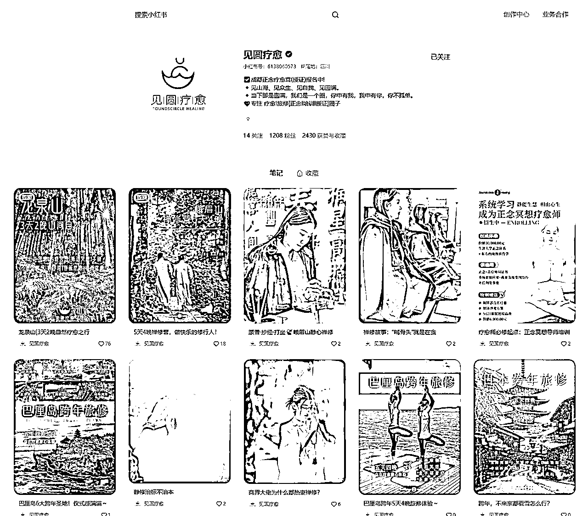
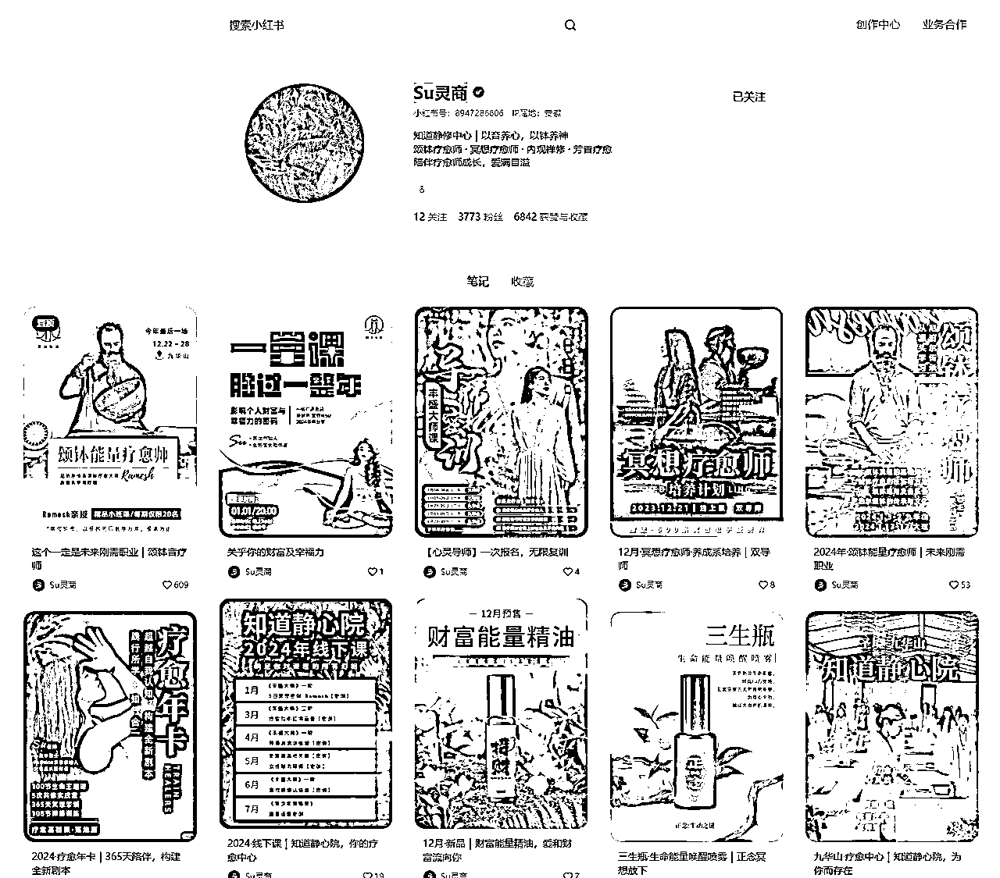

# 风向标拆解第2期｜小红书身心灵账号如何变现赚钱——拆解华尔街之狼

> 来源：[https://qc7u7ru59d.feishu.cn/docx/HtTAdpRpDowFawxyo2DcUv9znif](https://qc7u7ru59d.feishu.cn/docx/HtTAdpRpDowFawxyo2DcUv9znif)

注：以下案例中的人还没通过我的好友，通过之后我会把后端的产品和利润计算补上。大家先凑合看，见谅。😭😭😭

# 1、身心灵赛道到底涵盖哪些内容

# 2、实操打法

## 2.1、图文混剪+视频混剪起号

适合刚想入场的萌新，能迅速拿到反馈，非常利于冷启动。

### 2.1.1、案例一

*   账号名称：馨妍身心灵

*   特色亮点：

*   优势：

*   全程无真人露面。
*   制作门槛低，用图文视频拼接就能吸流，特别适合做矩阵放大。
*   流量来得快，号能很快起来，有正反馈。
*   劣势：

*   缺乏真人代入，信任感建立困难，天花板低，大额成交难搞。
*   内容制作：把知乎、微博上的文案搬运过来，或直接让GPT写好，用自己的声音配读。
*   变现产品：1v1个案咨询、线上课程、工作坊

### 2.1.2、案例二

*   账号名称：空青。

*   特色亮点：

*   优势：

*   无需露脸。
*   剪辑操作简单，以图文为主引流，方便做矩阵复制。
*   流量高，起号快，能快速获得正向反馈。
*   劣势：

*   没有真人出镜，信任感弱，上限有限，高客单成交困难。
*   内容制作：
*   挑文案配创客贴模板
*   模板风格要偏温馨治愈
*   变现产品：
*   疗愈陪伴营，21天定价399元。通常体验一次后就能照着复刻。
*   变现效果没有预期中理想。

总结：前期可以用这种方式起盘，等流量起来了再转真人出镜做IP。

同类参考账号：

*   百岁老人养生计划、
*   格格|美业创业者——身心灵+美业

## 2.2、用真人IP出镜做大单

想要做高客单赚大钱，一个IP必须同时具备信任感、影响力与成交力。不露脸很难建立信任，所以想赚钱必须真人出镜。这是核心原因。

建议把身心灵和其他垂直赛道结合，打差异化定位。

操作要点：

*   IP的气质感很重要，拍摄环境也得讲究，氛围感是这个赛道的刚需
*   IP本人要有输出表达能力
*   表现在线不强也没关系，可以一句话一句话慢慢录
*   选题直接抄同行爆款

真人IP的放大逻辑：

*   压缩单条视频制作时长，单号起来立刻做矩阵铺量。
*   做口播类内容，文案外包，演员只记大概意思就能上镜。日更30条并非难事。
*   IP本人每天开播，直播素材交给剪辑师做切片分发。

### 2.2.1、案例一

*   账号名称：球小姐好｜茶&心理学

*   定位：身心灵+茶

*   变现产品：茶室到店预约、1对1心理咨询、橱窗带货

*   利润测算：

### 2.2.2、案例二

*   账号名称：Ashlee身心成长

*   定位：身心灵+冥想

*   流量方式：短视频+直播

*   变现产品：

*   引流产品：6门线上课

*   利润产品：
*   利润测算：
*   引流产品：利润约5.5w左右。
*   利润产品：

### 2.2.3、案例三

*   账号名称：显化教练Ciecie郑佳圆

*   定位：身心灵+三胎妈妈+冥想

*   变现产品：

*   引流产品：灵性冥想课程

*   利润产品：
*   利润测算：
*   引流产品：客单68，销量473份，利润3w。
*   利润产品：

## 2.3、卖铲子模式——教别人成为疗愈师

### 2.3.1、案例一：

*   账号名称：见圆疗愈

*   流量路径：小红书吸粉，公众号和朋友圈承接。

*   变现产品：

*   疗愈师体系化线下培训，可免费复训，附带陪伴群。涵盖正念疗愈、铜锣颂钵疗愈、催眠疗愈、禅修。客单4680。
*   音疗师证书，客单1200元。
*   利润预估
*   营收：
*   线下课：每月2场。单场12人，客单4680，共112320。
*   音疗师证书：按参与人数一半计算，即12人，客单1200，共14400。
*   后续可能转化，按2w计。
*   成本：自己做流量，后端配1名老师，2场6k。场地费2场4k。
*   月度净利润：13万6720。
*   优点：用户关注后会主动私信联系方式，降低了触达成本。客单价皆为高价。
*   劣势：账号全是硬广，无人设，无人情味，甚至没有线下课实拍。优化空间很大。
*   若加上真人IP属性，变现能力会更强。

### 2.3.2、案例二：

*   账号名称：Su灵商

*   变现产品：颂钵疗愈师培训、冥想疗愈师培训、芳香疗愈师培训、多个城市线下课、疗愈年卡、30天财富觉醒

*   优点：均为高客单产品
*   劣势：全账号都是硬广投放，没有人设温度，甚至无线下课画面。可改进点很多。

# 3、身心灵IP账号的终极解法

图文视频混剪起号 + 真人IP出镜 + 卖铲子培训 三线并行，搭配引流款【低客单线上课】+ 后端盈利款【高客单线下课/陪伴社群】+ 培训款【教人入行，超高客单】。只要坚持迭代优化短板，成果自然会出来。