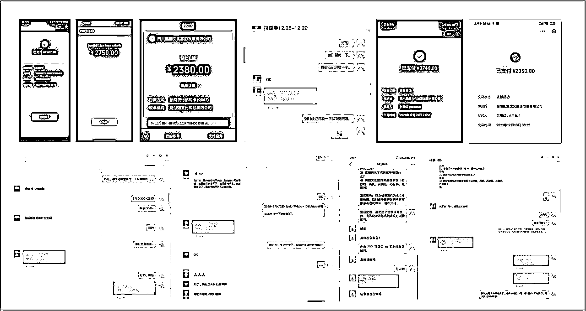
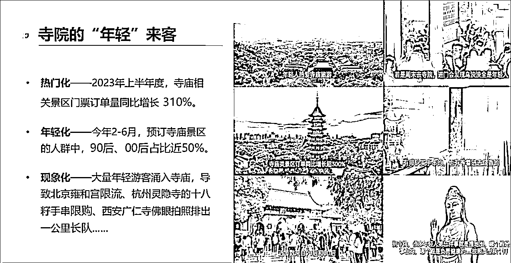
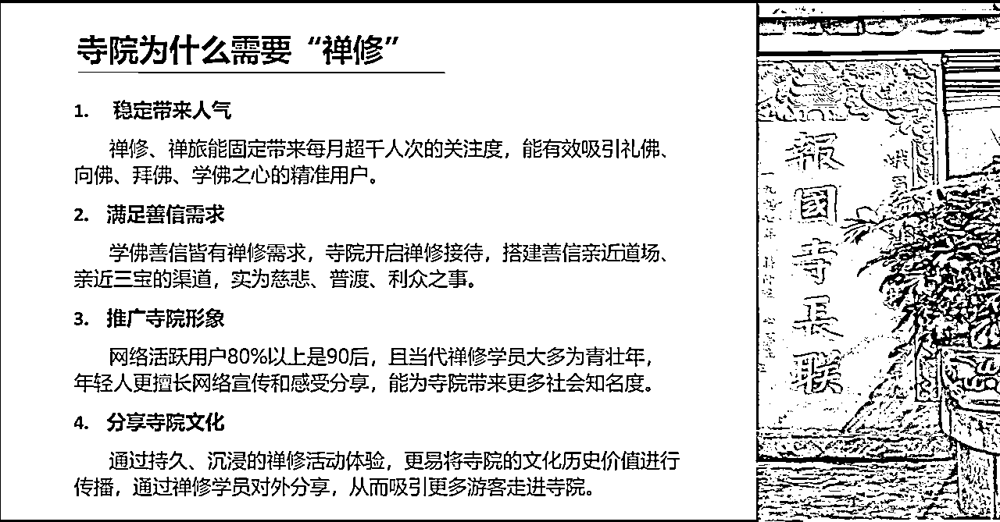
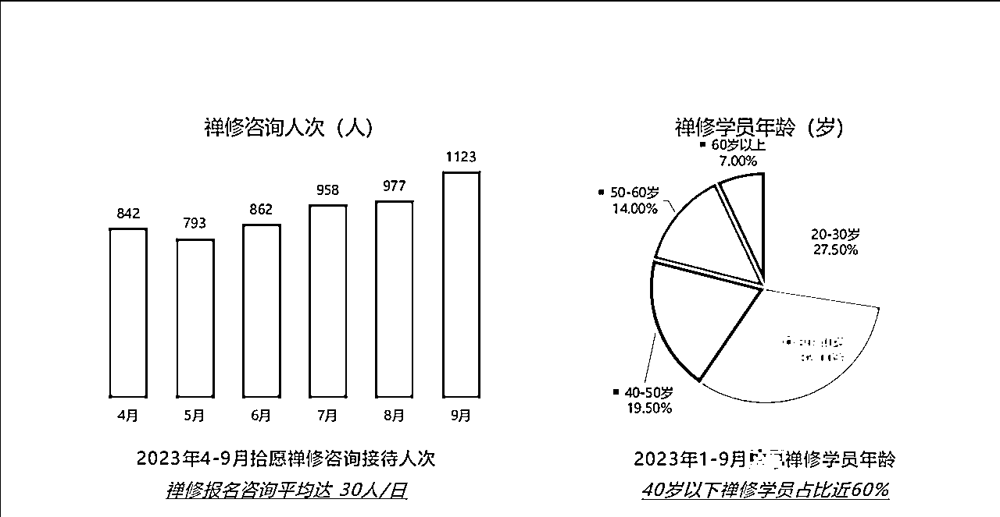
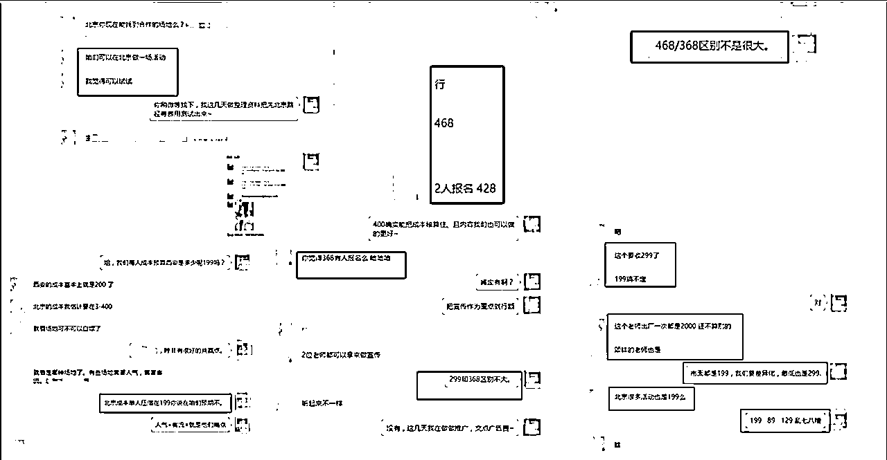
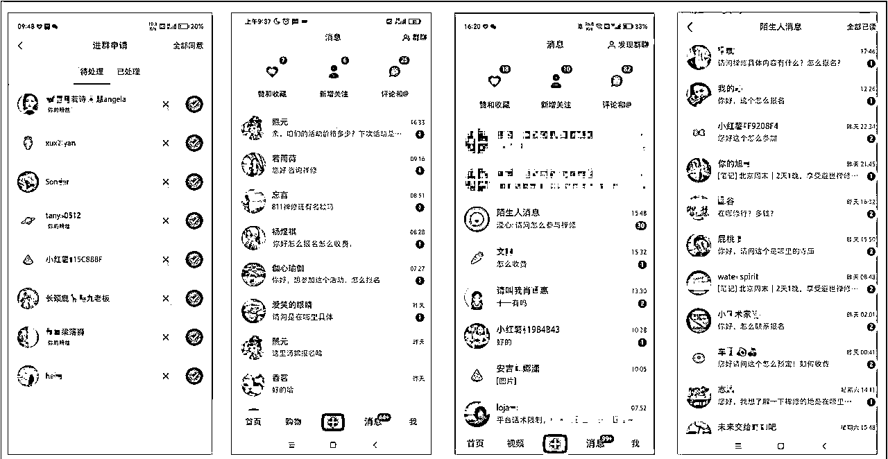
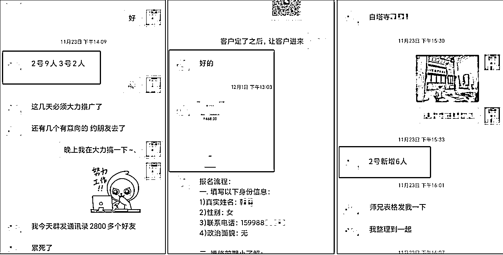
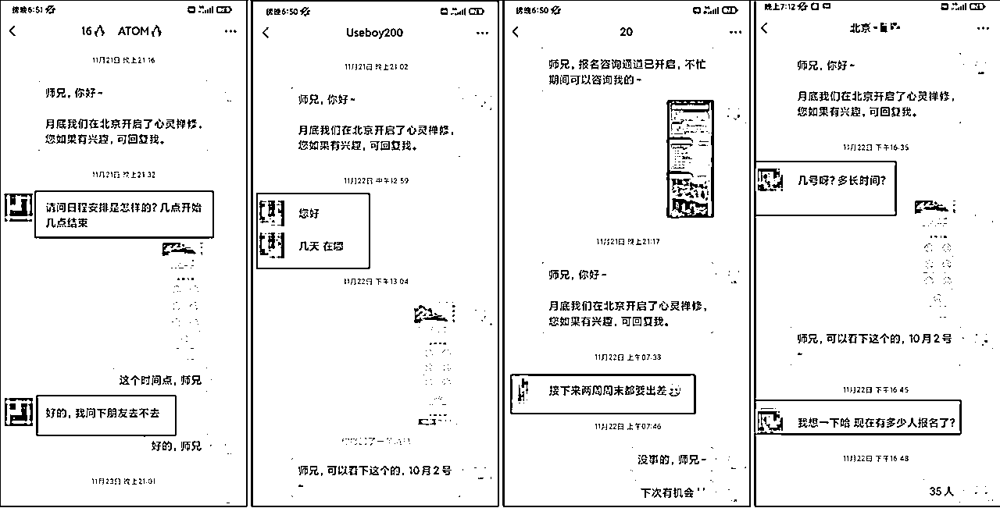
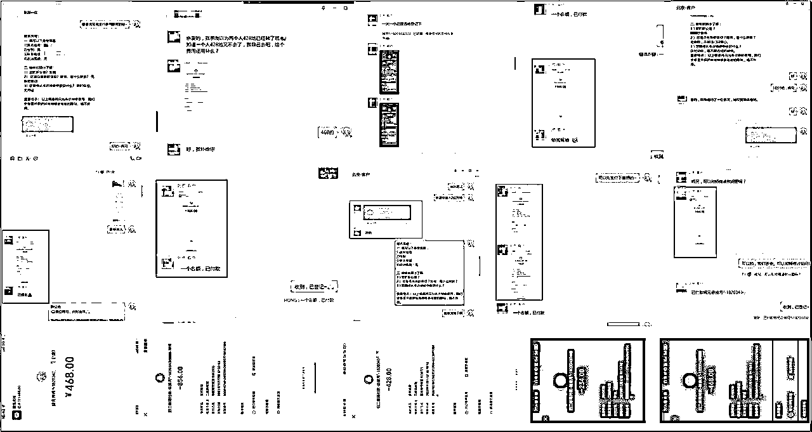

# 小红书做禅旅，一周到手7万+的从0到1实操拆解


## 一、开场自我介绍

大家好，我是拾月。11月时我在赚钱社群里复盘过一次，分享过自己用30天在小红书做禅旅引流最终变现5万+的经验，包括一些谈单上的小技巧，感兴趣的朋友可以去翻看。

基于上一次的经验，这次团队完整复刻了一波，拿到了小红书精准引流超200人、最终变现7万+的战绩。下面我把当时的数据截图和成交记录一起给大家过一遍。




* * *

## 二、项目拆解

### 1. 赛道趋势

今年疫情解封后，出行市场迎来报复性反弹，寺庙游也一跃上了热搜。大家都在说“上班与上进之间选上香，做题与作弊之间选做法”，虽然是段子，却很真实地反映出年轻人当下巨大的精神压力。

随着互联网加速，注意力越来越碎片化，越来越多的人渴望找一个安静的可停留空间来做身心修整，这也直接推动了禅修商业化的兴起。接下来我会展示团队内部做的用户画像和真实调研数据。







* * *

```
2.产品规划
```

寺庙游的玩法大家已经不陌生了，真正的关键是怎么把寺庙里的禅修搬进城市。起初我们也没有清晰的方向，于是决定先做一次小规模测试。

首先是城市的选择。北京、上海、广州是第一梯队，消费力都在线，最终锁定北京。不是上海广州不行，而是北京的资源更集中，我本人也在北京，协同效率更高。

时间线大致是10月底启动筹备、改文案，开营时间定在11月25日，初步预期人数40人。

实际交付68人，远超预期。筹备过程中踩了不少坑，下面分点讲。

01. 怎么找到合适的寺院师傅

这是最核心也最难突破的一环。想做城市禅修活动，直接去寺院找师傅，很多时候连门都敲不开，更别说师傅愿意出面。这本质是信任问题，分享两个有效沟通心法。

一定要靠熟人背书。第一次见面就带着商业目的去，基本没戏。先以拜访的名义登门，第二次沟通再轻描淡写提需求，保持非功利的姿态，师傅那边会有松动。

换位站在寺院角度去谈。如今很多寺院都有禅修营、祈福周边等业务，先通过公众号官方渠道加他们志工，帮忙售卖一些产品，哪怕利润薄点，目的就是先建立信任。

02. 活动方案怎么定

【方案一：两天一晚】复制之前旅修的逻辑，高客单价。调研后发现成本太高，转化门槛高，民宿+寺院+活动难以整合，预算也超，于是放弃。

【方案二：一天活动】可行性更高，但在午餐素食上卡壳。市场价14-20元/人，我们预算内可接受，场地给的报价80-100元，超支严重，只能重构。

【方案三：半天活动】避开住宿和午餐这两个坑，选一个黄金时段交付。最终定为13:00-18:00，既不拖沓也不仓促，时间可延后2小时。综合成本、体验和收益，这个方案最匹配。

* * *

### 3. 价格体系

定价太低没利润，定太高没转化。价格是基于三点取舍的：目标人群与后续转化空间、同行市场价、自身核心竞争力。

第一次拍脑袋定199，一核算直接亏损，马上否掉。

第二次参考西安团队经验，他们268才打平成本，我们试了368，利润几乎为零。

第三次做了竞品调研，市场集中在360以下，竞争激烈。最终把价格锚定在468/人，既能筛选出高净值人群，也为后续转化留空间。

定价演进路径：199 → 268 → 368 → 最终468。沟通记录如下。



* * *

### 4. 流量获取

价格和时间敲定后，核心就剩下获客。我们用了三条线：小红书公域、朋友圈私信、私域代理分销。

01. 小红书

没有黑科技，核心是账号沉淀和对用户语言的熟悉。10月底开始持续发招募笔记，内容围绕咨询和引流展开。约20天时间，累计引流200多人，单个账号中途被限流一次，后续转化约30人。

更具体的运营方法可以看这篇：https://t.zsxq.com/15yt4pKjg。



02. 代理分销

单靠自有账号发内容，人力跟不上。于是组建了分销团队。11月15日启动代理招募，截止月底分销渠道成交18人。

分销来源主要分三类：老客户推荐、同行互推、主动找上门的创业者。做过瑜伽疗愈的老师，参加完活动后很愿意推荐朋友顺带赚点分销。以及在小红书或线下结识的同赛道团队，久了就成了朋友资源池。很多创业者本身就在寻找项目，会主动来谈合作。



03. 私信跟进

朋友圈本身不直接产生转化，它的作用是种印象。真正转化靠的是私信沉淀。在发完朋友圈后，立刻给当地潜在客户发私信，哪怕当时对方没空，忙完后回复率很高。通过私信我们又成交了约15人。

另外一个提醒：把客户引到微信后，如果手上没有立刻能转化的项目，先把人沉淀到统一的流量池里群内预热，不要直接一对一丢单。



* * *

### 5. 群内转化打法

转化前我们手上有两个精准群，每个约100人，共200人左右，计划在11月18日集中收割。

转化前一天安排内部人员在群里做预热，上午开始发提前写好的话术，比如“报名名额”“开营提醒”等。等正式公告一放出，立刻把下单截图发群里，形成从众效应，评论区只要有人带头跟单，后续会自然跟上。



* * *

### 6. 线下交付

交付是重灾区。当天到场38人，其中部分是老客户，目的性很强，就是来找师傅交流。于是当天开设了两个场地，一个做初体验，一个做VIP深度体验，分流后体验感明显更好。

当天遇到的问题我拆成四块复盘：

师资 摄影 室内 室外

01. 师资力量

这是我们最大的优势。因为是禅修+疗愈的结合体，最怕师资不靠谱。当时曾考虑就地找北京老师，但信任基础不够，最终还是选用了团队内部资源：彭州佛林寺弘法利生会副会长，以及加拿大大觉精舍国际颂钵师两位老师来交付。

02. 摄影跟拍

素材决定复盘和二次传播。原计划同事跟拍，结果那几天同事中招阳了。临时找合作摄影，差旅一下就超预算。专业摄影的必要性在于多机位固定机位配合，个人爱好者设备和效率很难达标。

最终通过摄影圈子熟人砍价，从2600降到1600，多机位双拍6小时，性价比和沟通效率都不错。

03. 室内场地

当天安排了接引、签到、沐手、主持等5位师兄负责。人手不缺，但突发状况不断。布置现场时才发现场地没有空调，临时借了3台暖风机，禅修勉强够用，疗愈环节温度不够，最后协调场地方点燃壁炉才解决。

04. 室外场地

本以为室内搞定就万事大吉，结果疗愈环节开始时，园区施工队在门口做园林维护，噪音严重影响体验。立刻出去沟通，师兄们都很通情达理，暂停施工，等活动结束再继续，感谢当时的配合。

* * *

### 7. 后续转化

这次的营收分三块：门票、祈福卡、禅修营。门票前面说过了，下面说两个增量。

祈福卡

属于独立产品线。抄经结束后由志工统一介绍，对外售价298，禅修参与者专享价198。包含学业、事业、家庭、姻缘、健康、财运六大方向，解决客户来回奔波的问题。当天售出28份。

禅修营

活动结束不是终点。做完反馈沉淀，既能拿到真实口碑数据，也能加深信任。经过几天沟通，有10人报名了12-1月的禅修进阶营。


* * *

## 三、避坑清单

### 坑一
前期找师傅或同行合作，不要上来就谈钱。先了解对方的痛点，顺手帮对方解决，最后才能达成双赢。

### 坑二
能用身边资源就尽量用。做几十人的疗愈活动，瑜伽垫就要花大几千，有做这块的同行直接借用，就能省一大笔。

### 坑三
场地方的配合度一定要高。再完美的前期准备，现场总有突发，配合度高的场地能帮你快速止血。

### 坑四
把客户当朋友，用温度提升转化。时间越久，后续越容易跨赛道合作。

### 坑五
转化时提前把退费机制讲清楚。既能提高下单率，也能保护口碑不被口水战击穿。

* * *

文旅赛道里现在很多小众方向都很卷但也很好做，尤其是当下用户对新奇体验的接受度很高，这就是机会。如果你有资源但不知道怎么对接，随时可以跟我交流。

如果你的流量能力强，对这个项目感兴趣，也欢迎一起合作。我们也在持续孵化新品，比如禅修结业证书、轻断食禅修文旅、路游禅修文旅、寺院文创IP开发等。

感谢大家看到这里，谢谢。