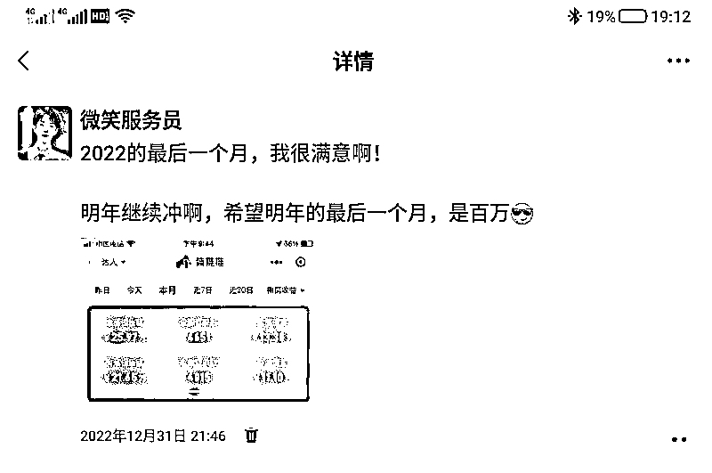
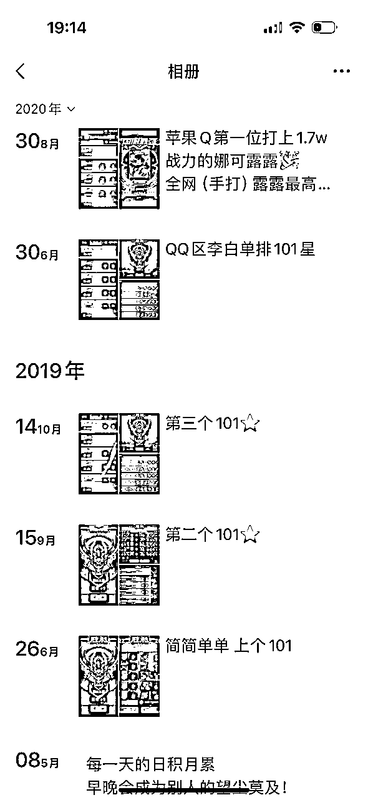
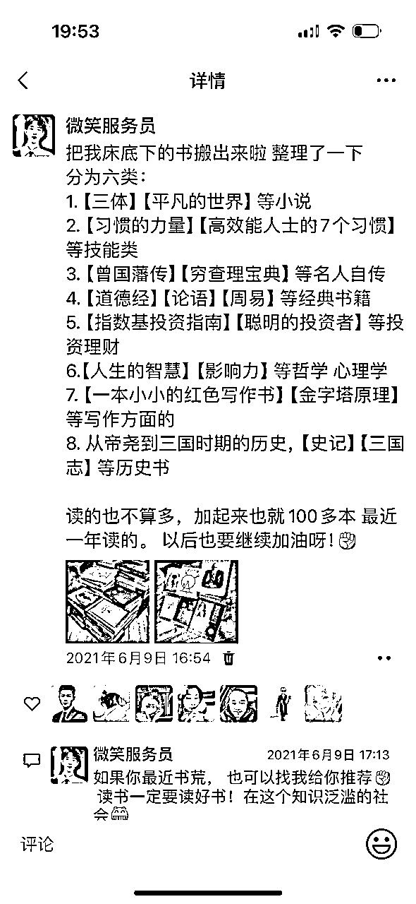
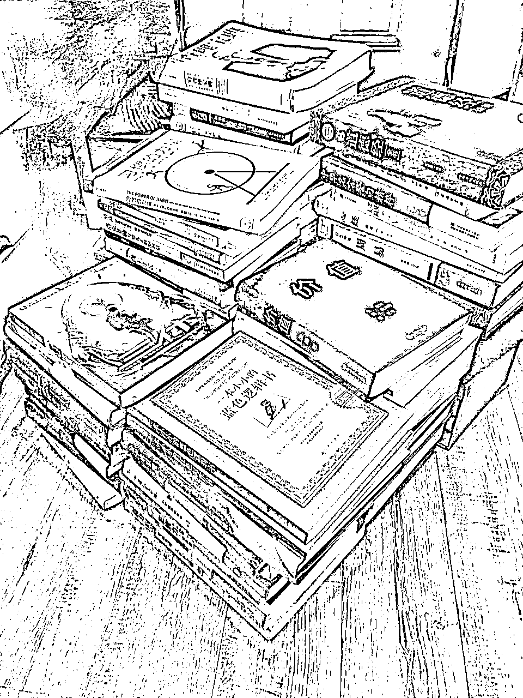
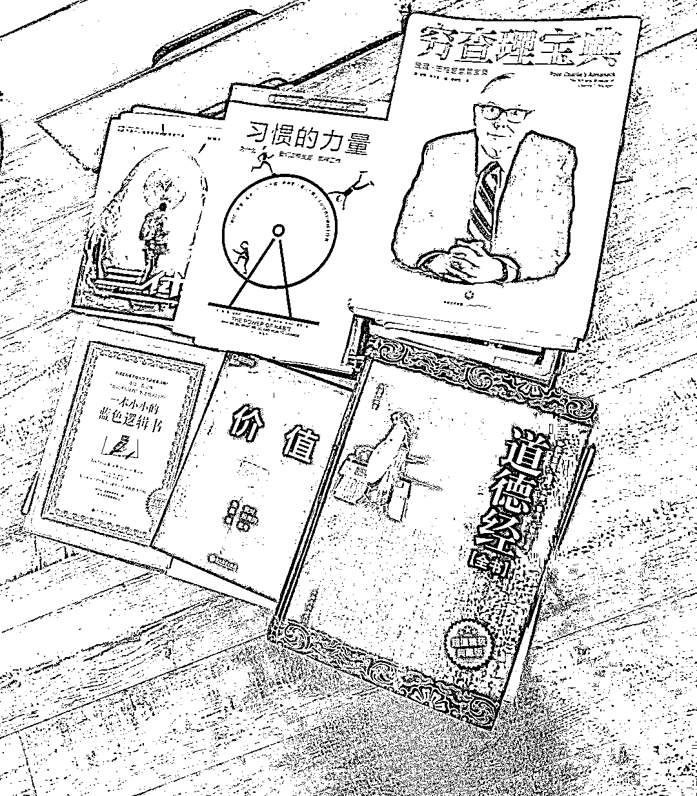
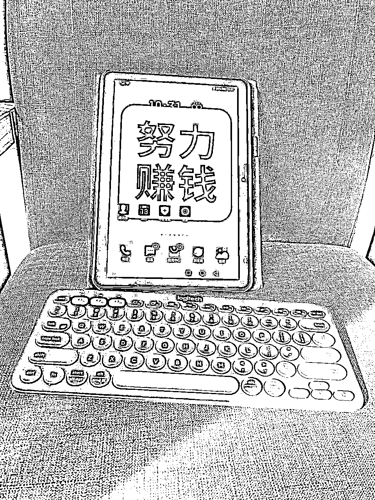
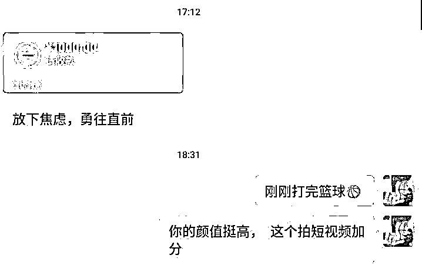
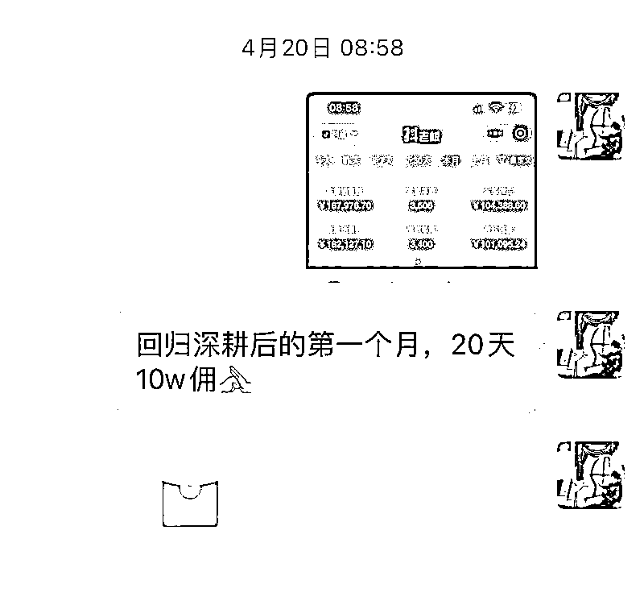
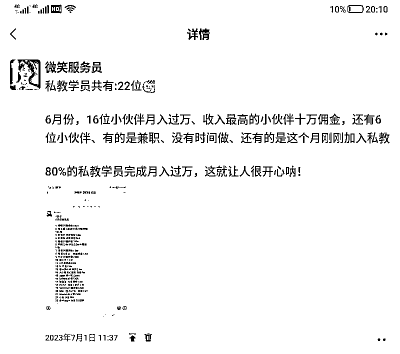
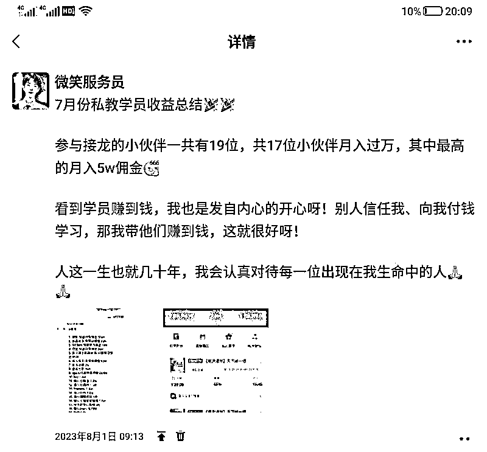

# 00后的农村孩子:如何通过网赚项目赚到自己的第一个100w

从辍学农村娃到百万身家，我做对了什么？

我是微笑，一个从农村走出来的00后。今天不聊虚的，就讲讲我怎么从初中没毕业的穷小子，一步步靠网络项目攒下人生第一个100万。

有人问我，一个农村娃，学历不高，也没背景，凭啥能翻身？看完我这条弯路走过来的经历，你大概就能找到答案。

### 从打工到代练：人生第一桶金

2016年，我还在读初中，家里突然出了变故，只能辍学。一开始在自家小快餐店帮忙，端盘子、洗碗、送外卖。后来店因为生意差加上没有营业执照，不到一年就关了。朋友介绍我去小区当保安，年纪不够，就借了成年人的身份证冒名上班。那活儿是半个月白班、半个月夜班，夜班又不让睡，我就整夜打王者荣耀。打着打着，竟然上了王者段位，然后顺理成章成了游戏代练。那一年，代练每月能挣五六千，行情好的时候能到七八千。

干代练攒了点钱，2019年游戏直播正火，我就买了台电脑，也开始做游戏主播。本来就是自己爱打游戏，播到第6个月，单月进了3万块。尝到甜头后我更玩命了，每天直播至少8小时，有时候能干到10小时。

### 被身体教育了一课

这么拼到2020年初，身体先扛不住了。久坐、熬夜、作息全乱，每天都累得不行。去医院一查，结核性胸膜炎，住院一个月，出院还得吃整整一年的药，一天三次、顿顿饭后。那一年多，我几乎是在跟死神掰手腕，身上又痛又累，又没有任何收入，绝望到不止一次想轻生。

实在没办法，我开始看书——历史、人文、小说、个人成长，连诺贝尔文学奖的也啃，到现在读了300多本。其中最喜欢名人自传，读着读着发现，那些牛人早年也一个比一个惨，这么一对比，我很快释然了。

按历史规律，早年越惨的人，后面往往越能翻身。

可命运又跟我开了个玩笑：那阵子我正靠读书熬日子，天天埋头看，结果眼睛又闹罢工，得了干眼症。手机看不了，书也看不了，等于什么都干不了。那阵子我是真的怨天怨地，为什么越努力反而越惨？后来想通了：不是不够拼，是根本不会休息。太用力的人，跑不远。

从那时起，我开始学着休息。干眼症找老师治好了——热敷加上睑板腺按摩，还给自己换了个无蓝光的类墨水屏平板，继续看书。

2021年4月，我终于停药，身体检查一切正常。我还记得停药那天，连空气都是甜的。

### 创业第一年：只赚1000块

2021年10月底，我从广州回到老家，正式开始折腾短视频。一开始想做理财号，因为那会儿特别迷巴菲特，想当“股神”，结果根本不赚钱。又做读书博主，没流量也没收入。再转情感号，29天口播涨了1万粉丝，还收了第一个徒弟，赚到1000块，可惜粉丝没法变现。后来去试抖音测评，闷头干了一个月，出了几单还是我自己买的样品。

但我就是不服气。从游戏主播那时候起，我这事业路就没顺过，但越是失败我越不信邪。直到有一天，我在视频号广场刷到郭晓文的直播，看到“短视频赚钱宝典”星球，抱着试错的心态花了199块进去。2022年9月，我报名了郭晓文的养生号训练营，同时还报了别的课一起试错。兄弟们，倒霉了这么久，风水终于要轮流转了。

### 第1个月赚3000，第3个月赚10万

2022年10月，我赚了3000块。虽然不多，但这是我互联网上第一笔正反馈，开心坏了。11月，月入过万。每天就是起号过千粉、发涨粉视频，千粉后开始发带货作品。带货就一招：抄爆款——盯着24小时内的高赞带货视频，天天看榜单。有一天我的带货视频爆了，单条赚了4000块，直接送我过了万。

12月，时来运转，月入10万。当时我看到榜单上有人做无人直播医案特别赚钱，就1:1复制。第一个号就爆了，一条种草视频跑了120万播放，还有好几个几十万的，光这一个号就赚了9万。整个月进账12万左右。哪有什么技术含量，无非是第一时间跟爆款、照抄逻辑、把执行力拉满。真到了月入10万，我反而觉得：也就这么回事。

### 搭建团队：从一团乱麻到稳定出单

收入上来后，2023年1月，我想搭团队放大收益。但没当过老板，也不会招人，就找了两个熟人：一个是在上海打工的表哥，月薪五六千；另一个是刚中专毕业的亲戚家孩子小明。3月人到齐后，问题一堆：剪辑不过关、看法不一致、管理全靠吼。表哥被我骂了一顿，赌气回家单干；小明天天讲些没用的，还总想着学会了就跑。

那几个月我的收入也明显缩水，1-2月还能赚五六万，3月只剩一万多。中间我还想换项目，试过成人识字、小红书无货源，都不行。后来文哥建议我继续做养生号；表哥单干一个月只赚500，又回来了；小明磨合久了也慢慢能共事。我们开了个会，定了规矩：我是老大，所有人都听我的，每天早睡早起、读书、运动。方向也定了：无人直播为主，短视频带货为辅。

4月15日，我测出一个品叫《天下第一相书》，靠它20多天赚了10万佣金。

这也验证了我选爆品的能力可以复制。爆单的同时，我开始收私教学员，学员也跟着出单爆单，日入几千上万。之后爆品一个接一个：5月《出马无师自通》，6月《奇门改运秘术》，7月《性学报告》，8月《图解阳宅大全》。选爆品的方法很简单：盯销量爆款榜，出现次数最多的品就是爆品。4到7月，我每个月带货佣金都有十几万，还带出了几十个月入过万的学员。

粗略一算，从去年12月到今年12月，带货赚了70万左右，培训赚了30万左右，加起来100万+。

### 转型新玩法：MCN和美食号

手里有点钱后，8月我想转型做口播带货MCN，想前端后端一起赚。当时拉了30个小伙伴一起测试，起号、千粉、带货、出单，闭环跑通了。但准备放大时发现投产比不高，不是每个人都能跑出来，而且百货类目佣金太低。于是又转到图文带货，做食品饮料类目，我管它叫“美食号”。从8月到11月，一边测试一边线下调研了两家培训机构，磨出一套新玩法：

第一，账号轮动玩法，盯热点品和功效品。比如前两天的X东方事件，蹭到热点出单就很丝滑；功效品就是美白、失眠这类。但这种玩法得靠账号数量轮动，因为随时可能被封30天。

第二，长期玩法，围绕人群需求选品。比如你定位18-30岁人群，就卖他们需要的小零食、服装、光腿神器。

### 个人IP：复制成功就是捷径

现在我准备做个人IP。基本盘是团队做抖音带货，同时教学员；最近还在新增一条业务线，叫公域引流创业粉，已经跑通，正在放大。方向就两个：

一是带货实战，团队稳定持续地打磨“爆单的成功路径”；
二是公域引流获客，搞流量、导到私域，卖自己的付费产品，做私域IP。

其实不管是带货爆单还是公域引流，底层逻辑都一样：抄爆款、找对标、1:1复制、数量取胜。这五年互联网实战经验告诉我，成功的捷径就是：复制成功。

### 感恩

最后，真心感恩这一路遇到的人和圈子。今年4月加入龙哥盟，是我成长最快的一年，在里面链接了很多有结果的大佬，一个人想变优秀，真的得混进一个优质的圈子。还要感谢梁靠谱小姐姐，她看问题总是一针见血，每次跟她聊完，又清醒又能量满满。最后，感谢带我的好大哥郭晓文。

如果你也是个普通出身的孩子，希望我的故事能给你一点信心：起点低不可怕，怕的是不抄、不执行、不坚持。先复制，再超越，你也可以。