# 土逗的图文排版自动化工具

# 一、先看效果演示，视频下载见文末

# 二、这个工具强在哪

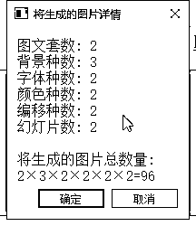

做电商投放时，经常会遇到各种组合试错的需求。同一套模板要配多组图文内容，不同的内容又想在多种版式下对比效果，版式确定后还想换一批背景图看看质感。手工操作的话，就是“图文套数 × 幻灯片数 × 背景种数”的乘法。哪怕只是小规模的2×2×3，也要重复12次。更别说后续还想微调字体样式、字色、元素位移，那又会变成“字体种数 × 颜色种数 × 位移种数”，一下子就是96种手工变体。

用上这款排版工具，所有维度都能被程序化地批量跑完。产出文件会自动带上完整的命名信息，比如“字体测试实例_1_背景1_字魂扁桃体_52096C_2.52,-7.35_2.png”，其中“_1_”代表第1套图文内容，末尾的“_2”代表第2套排版结构，中间的“背景1”、“字魂扁桃体”、“52096C”、“2.52,-7.35”依次对应背景图、字体、字色、图文偏移量。这6个维度是否启用完全看你需求，想用就为每个维度定义若干方案，不用就跳过。工具还支持不少细节的个性化配置。

# 三、这个工具好用在哪

所有前期素材准备好后，后期只需要选定一个文件夹或直接拖进输入框确认即可。下面从前端准备说起。

## 1、图文套数的准备

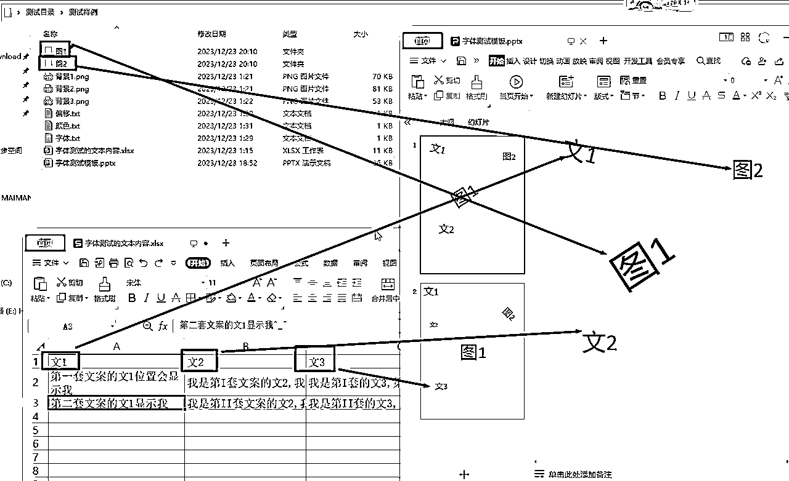

在根目录“测试样例”文件夹内放一个.pptx作为主模板。文字元素的位置、尺寸、颜色、字体、倾斜、加粗等，图片元素的位置、尺寸，以及所有元素的图层层级，都在PPT里直接调。内容则写在.xlsx里，比如A列文案有两行，就对应生成两套文案。图片素材统一放在“图1”、“图2”等文件夹中，图片数量与文案行数一一对应。最终生成的PPT或图片，文案以Excel为准，其余样式全部继承自PPT模板。用PPT调样式远比在自定义界面里点选更直观高效。

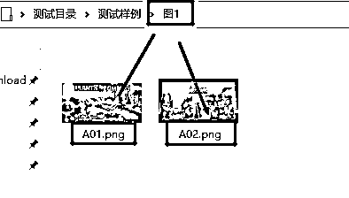

标签A01会自动匹配.xlsx的第2行，A02匹配第3行，匹配规则是按数值升序排列。你也可以把A01改成005，只要后续A02、A03等编号递增即可。

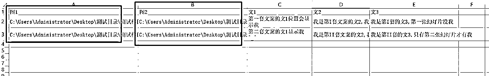

市面上很多工具要求你一条条手动填图片路径，我觉得这种做法很反效率。哪怕有一键导入，也多此一举。只要把所有素材的根目录告诉程序，代码会自动推断出对应图片路径。以后增加图3、图4、图5时，也不用在表格里新增列再手动填，完全自动化。

## 2、排版结构数的准备

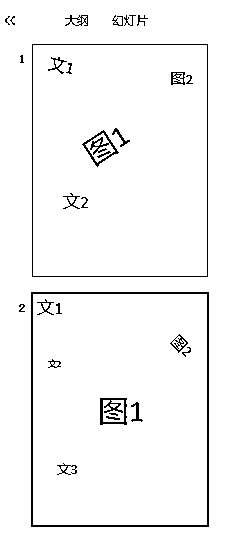

想要几种版式，就在模板PPT里做几张幻灯片即可。

## 3、背景种数的准备

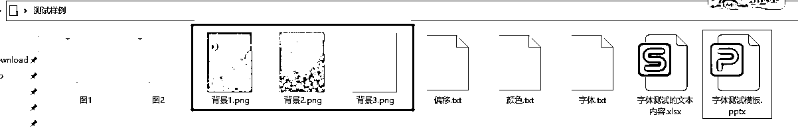

想要几种背景，就把对应数量的背景图丢到根目录“测试用例”文件夹里就行。

## 4、字体种数的准备

这里的字体种数指的是宋体、楷体等系统字体，以及各种自定义字体。先说一个冷知识：从网上下载.ttf文件后双击安装，安装完成后就能在PPT、Excel、Word等办公软件里直接用了，如下图。

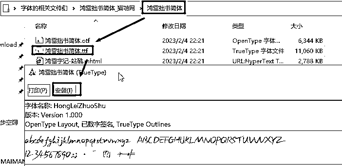

安装好“鸿雷拙书”、“字魂扁桃体”等字体后，在工具里就能调用了，如下图。

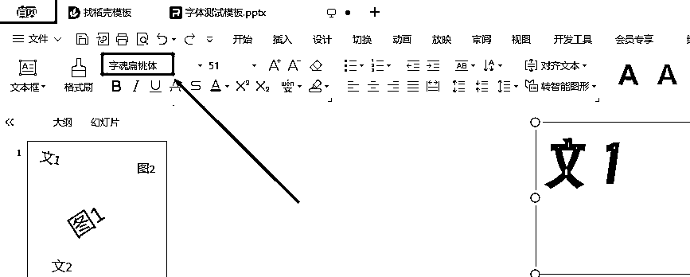

字体调用的前提就是完成上述安装，除非你只用系统自带字体。安装完成后像下图这样填写配置即可愉快使用。有两个要点要注意：第一，配置文件名必须是“字体.txt”，后续的“颜色.txt”、“偏移.txt”同理；第二，填写的字体名以PPT里实际显示的名称为准，比如安装“鸿雷拙书”后，PPT里显示的是“HongLeiZhuoShu”，那么“字体.txt”里就要写这个英文名。

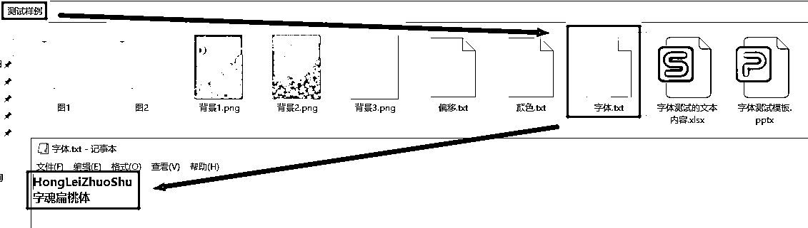

## 5、颜色种数的准备

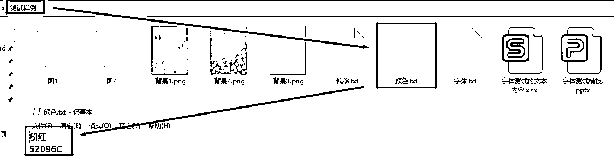

配色支持两种写法：16种基础色可直接写“粉红”或“粉红色”；自定义色就写6位RGB码如“F1F2F3”。支持的基础色如下图。

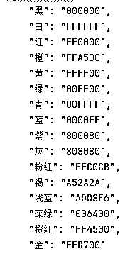

## 6、偏移种数的准备

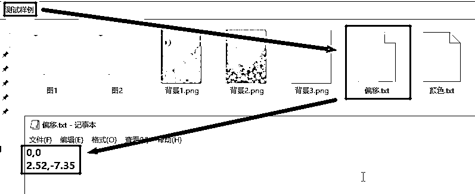

第一种偏移方案就是沿用模板原位，第二种方案是基于原位向右平移2.52厘米、向上平移7.35厘米。左侧数值不带符号为右移，带负号为左移；右侧数值不带符号为下移，带负号为上移。

## 7、补充说明

6个维度并非每次都要全开，“字体”、“颜色”、“偏移”这三类配置文件可有可无。没有就沿用PPT模板的默认字体、默认颜色、不做偏移；有了就按“字体.txt”的行数A、“颜色.txt”的行数B、“偏移.txt”的行数C，自动生成A×B×C种组合。同样“背景1.png”、“图1”文件夹等素材也都是按需提供。这样就能随心组合，批量产出你需要的图文。

# 四、结语

本工具基于Python开发，核心依赖pypptx库。原本想过用影刀的Python模块做个影刀版，但近期项目堆积，只能先放一放。目前在做的项目还有：

1）“🛰️自动养号及加人”安卓.apk脚本
2）“卡密模块接入”用于脚本工具商品化
3）“🛰️支付及小程序基础接入”等

未来可能启动的方向有：

1）PC端、安卓端的电商自动化辅助工具，涵盖自动发笔记、养号、引流、信息采集等
2）电商视频方向的辅助软件，视频去重、视频生成等
3）电商直播方向的辅助软件，视频流复制/合成、摄像头模拟等

如果你对这类工具的开发制作感兴趣，想系统学习，本人愿意招收学员。

最后自我介绍一下：体制内辞职下海的全栈程序员，自动化玩家，工具箱提供者，电商等领域的 peda 技术支持。

工具下载：
https://www.123pan.com/s/SmvCjv-OkJgh.html
提取码：6666