# 职场宝妈0基础，通过社群卖家庭教育课程，自卑内耗到80天突破月入过万

一个30岁职场妈妈的惊人蜕变：从崩溃想离婚，到80天靠社群卖课月入破万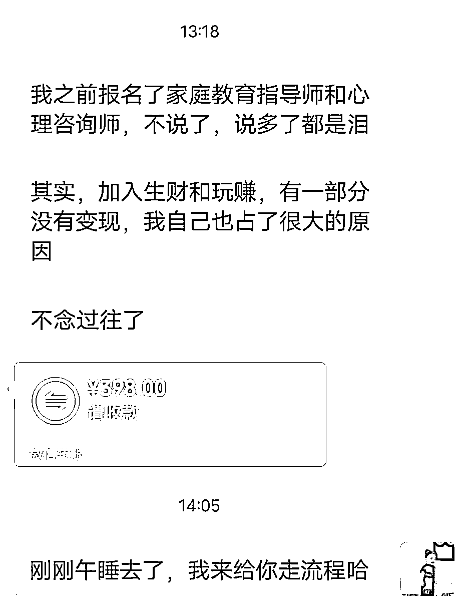

先自我介绍一下：粒晴（Sea），玩赚社群的合伙人，专注家庭养育方向。过去很长一段时间，我的状态都很低迷——白天被工作追着跑，晚上回家接着带娃，还要在婆媳关系里左右周旋。和老公之间，几乎变成了同一屋檐下的合租客，彼此没什么话讲。最糟的时候，我提过几次离婚，整个人陷在“是不是嫁错了人”的反复追问里。今年孩子大了一些，我下定决心：必须自己做点事。靠谁都不如靠自己，只有经济独立，才能在家里真正抬起头来。

刚好赶上玩赚社群的交流氛围，里面有太多人一边带娃一边赚钱，看得我心里又痒又急。后来我才意识到，真正让我改变的，不是环境的刺激，而是自己终于肯迈出第一步。今天我把整个过程拆成4个部分讲给你听。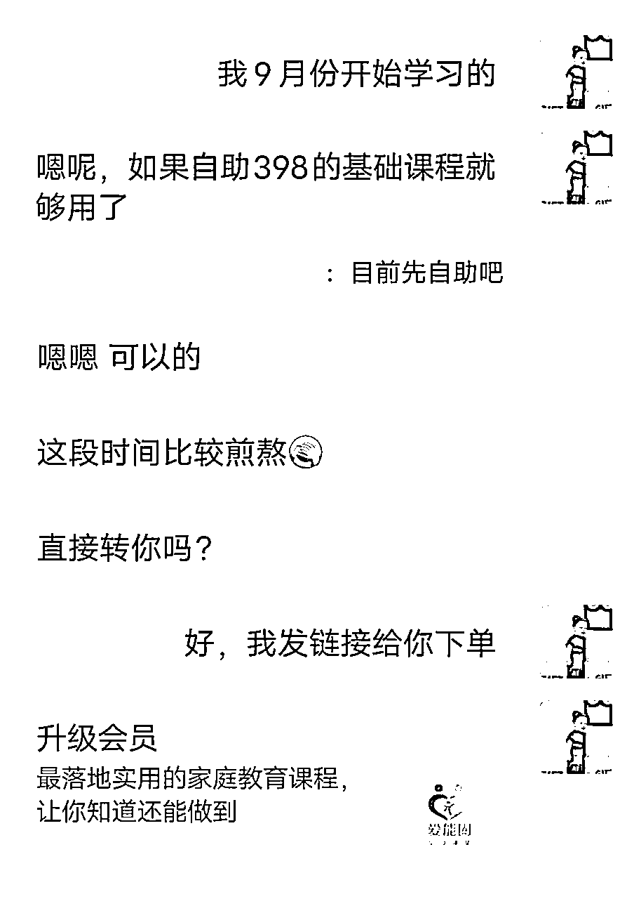

**一、没有方向时，怎么找到自己的赛道？**

很多朋友问我：想开辟一份额外收入，可总在犹豫，该从哪里下手呢？我的经验是：先别急着想，先把自己扔进一个高质量圈层里，看看现在大家是怎么赚钱的。然后挑几个你能力够得着的项目立刻去试。这里有一个很反直觉的事实：大多数人并不是先想好目标才出发的，而是走了一路，才慢慢看清自己的方向。你看到有人晒出几十万的月收入，感觉这就是我想要的；结果自己下场跑一圈，没见着钱，又开始怀疑人生。这不代表你不行，只是说明你还没找到那条真正属于你的路。

在真正确定方向之前，她先后试过十几种项目：二手闲置转卖、短视频带货、爆款文章写作、亲子英语资源分享、暑假资料包……听着很多吧？每一个都有人赚钱，但每一个都需要你追着平台的玩法跑。做带货那段时间，每天睁开眼就是研究商品、反复测试、不断调整，一旦平台改了打法，之前的经验可能全部作废。这让她的危机感越来越重。

后来一次优势测评点醒了她。对方很直白地说：她之所以总是焦虑，是因为一直在向外寻找肯定，内在的缺口永远填不满；她真正想要的不是钱，而是安宁感，还有自我成长带来的踏实。那一刻她终于明白，要找的不是一个“风口”，而是一个能长期沉淀自己、能力能跟着时间一起增值的方向。结合宝妈这个身份，以及对儿童心理、女性成长话题的天然热情，她最终把目光停在了家庭养育这个细分领域。既能一边学习一边带好自家孩子，又能在专业深耕后把它变成一份事业。

**二、为什么看好家庭养育？**

光凭热情还不够，她还专门做过一番功课。查了行业报告、翻了很多同行分享、也留意了政策风向。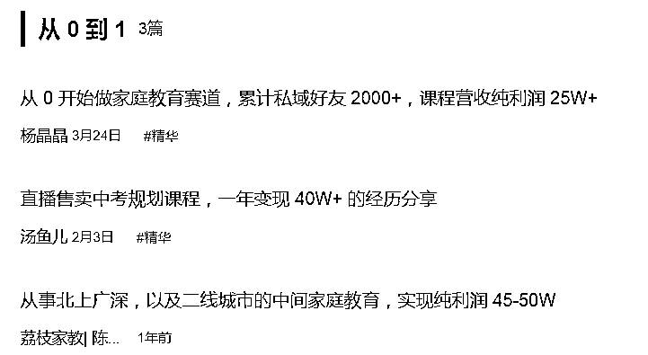

最直观的是需求侧的信号：我那上高二的侄女，平时看着开朗活泼，可谁也没想到，她竟然是学校心理辅导室的常客，甚至几次站到过天台边。这件事让我后背发凉——很多孩子看上去没事，内心早就已经撑不住了。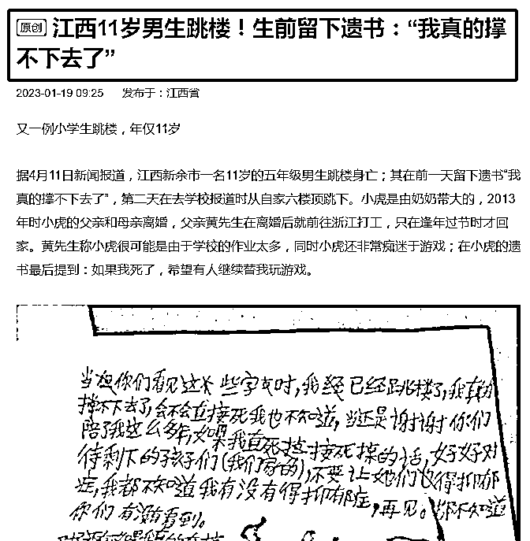

行业侧也有数据支撑。早在2022年，市场就把家庭养育辅导称为“黄金职业新方向”，连教育圈几家头部公司也开始低调布局这块。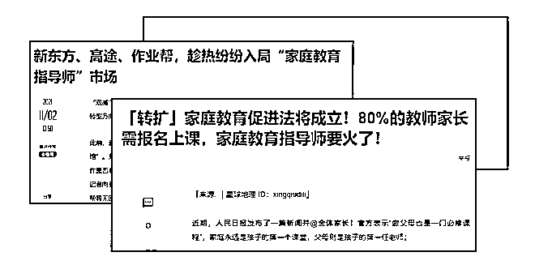

与此同时，各类中小学也开始成体系地给家长开设成长讲座，政策注意力的背后往往跟着市场和就业机会。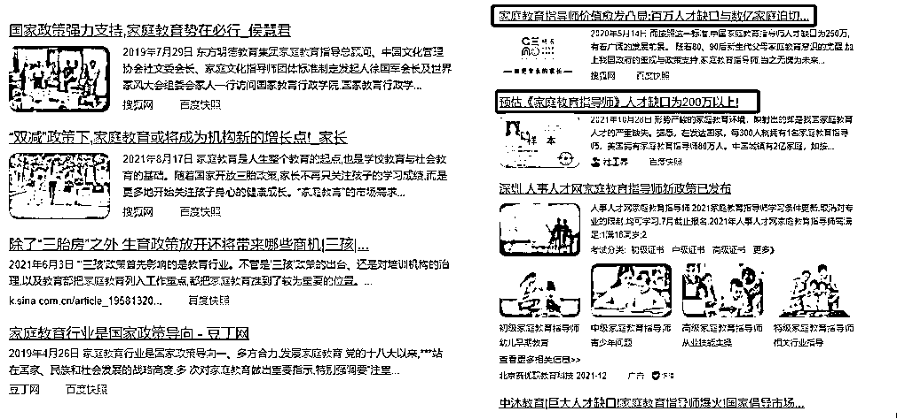

再从国际对比看，欧美大约每300个居民就配了一位专业家庭养育顾问，全美约有80万人；按同样的密度折算，国内人才缺口超过400万。这样一个时间越长越值钱、越做越稀缺的领域，为什么不选？

**三、从濒临分开，到夫妻同心、孩子自律**

三个月前那个她，如果看到今天的自己，大概会被吓一跳。那时候她的婚姻已经走到悬崖边，心里反复闪过离婚的念头；现在她和老公的关系却像回到恋爱期，连孩子都有了明显变化。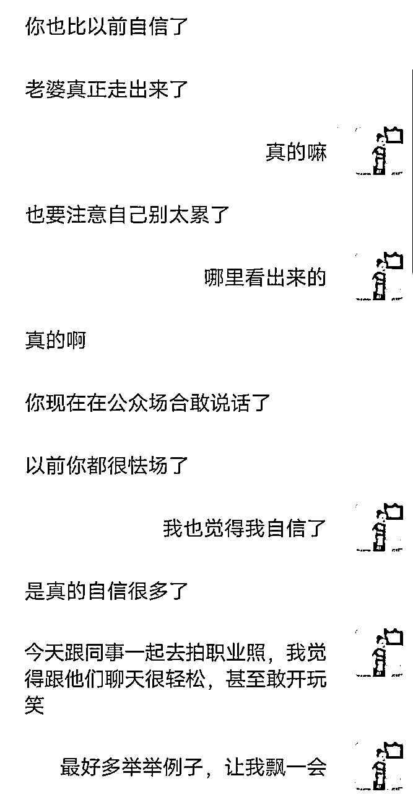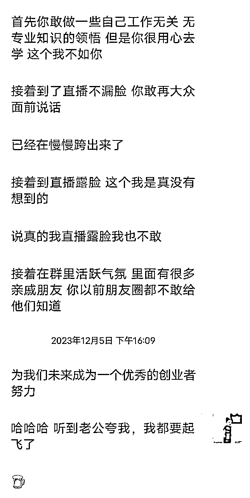

这一切的转折点，不是老公变了，而是她先变了。她每天清早5点起床，趁家人还没醒，安安静静地学习育儿知识和内容创作的方法。白天上班时反而精神更集中，效率高了，回家后面对那些琐事也不再有那种被掏空的感觉。心情平复下来，孩子的状态也跟着好了，整个家的气压都变了。

以前她和老公几乎不交流，各自抱着手机，像两个合租室友。学完之后她才知道，夫妻关系才是一家人的根基，于是她不再等着对方主动，而是拿孩子当桥梁，一点点试探着靠近。没想到老公的变化比她想象中快得多——开始主动嘘寒问暖，破天荒地夸她，还时不时转个账、带她出门吃饭。孩子以前只黏妈妈，连爸爸抱一下都要哭闹，脾气还不小；现在情绪平和多了，每天自己主动看书，周末还会点名要爸爸陪他去看书。

**四、手里没货、好友不多，怎么做到月入五位数？**

说完状态的变化，再来聊聊最实在的问题：手里没有现成的课、🛰️好友也没几个，她怎么能在80天里把月收入做到五位数？

她给出的方法，概括起来叫“借力”。她说，普通人刚开始什么都没有时，最忌讳的是自己埋头造一个产品出来。线下开店时，最快的方法是什么？进货、加盟。在线上做内容生意也一样，先去分销那些已经跑通并且有口碑的产品，把别人的品牌当作你的门面。哪怕你能力暂时不足，也可以在卖出产品后再送上一份长期的陪伴服务，让对方觉得超值。

她曾经也卡在“不想推销”这个心结上，总觉得又没亲自验证过，怎么张得开嘴。后来才发现自己想多了：你不需要证明产品有多牛，你只需要让别人感受到你的真诚。她加入了一个支持体系，产品、成交、服务全都借到了力，收入闭环被大大缩短。她说，证书很重要，但不能帮你解决现实中的具体问题；先跑起来，在真实反馈里打磨能力，比啥都强。

关于流量，她说：很少有人的🛰️好友一开始就是几千人，大佬们也是从零开始的。引流无外乎两条路：去公开渠道做内容，把陌生人变成关注者；或者在私域圈子里多露面、多帮忙、多分享，让别人因为看到你而主动靠近。公域的门槛在于玩法比较复杂，靠自己摸索容易撞得头破血流；找个有经验的老师带，配上超强的行动力，才是最快路径。私域则相对简单，在同学群、兴趣社群里多当那个活跃的人——该捧场时捧场，该交作业时交作业，把你能提供的价值亮出来。如果你一直潜水、从不出声，别人为什么要给你付费？

关于社交动态的更新，她强调了无数遍：那是你对外展示的一扇窗。很多人不敢发，是怕打扰别人。但请想一想，你分享的是有用的、能帮到人的内容，别人感激还来不及，怎么会反感？真诚就是最好的文案。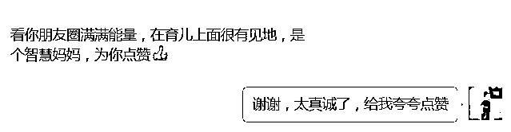

她刚开始更新动态的那一个月，既没有互动也看不到反馈。她没有停，坚持每天发3条，一直发了70多天。慢慢地，有朋友留言说“每天看你的动态已经成为习惯”；再后来，有人私信她：“你可以卖什么？我想买。”第一位付费客户就是这样来的，一位40岁的姐姐，关注她的动态很长时间，直接付了398元。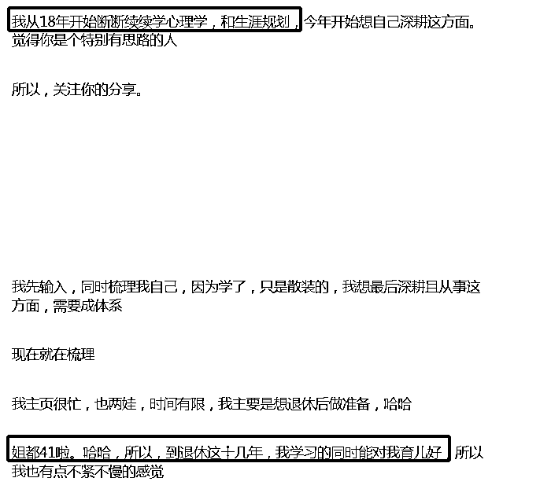

社群这边，她也踩过坑。最早她尝试做了一个付费群，收了10个人、每人19.9，结果分享没到两个月，因为总想着责任没尽到，内疚得只能停掉。后来她调整策略，先开一个不收费的群，告诉自己：别想那么多，先让大家认识你。可现实给了她当头一棒——她给通讯录里的3000多人逐个发送消息，两天下来，只有5个人回应。她一度怀疑是自己不会操作群发，还专门试发给爸妈验证。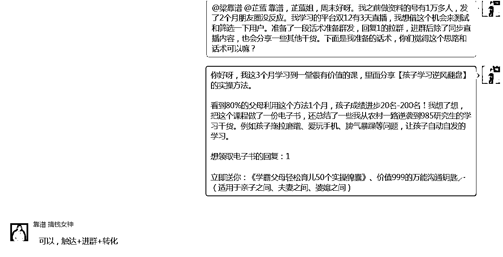

但她没放弃，一边继续更新动态，一边在群里固定分享有价值的内容。刚开始只有60多人进群，大约30天之后，群已经满200人。正是这个看似不起眼的群，让她的收入在短时间内上升到了五位数。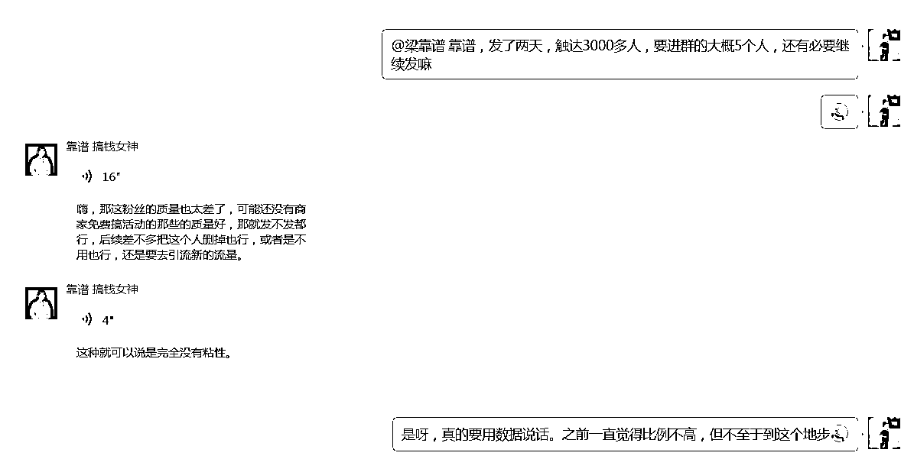

后来，群里有人被她日复一日的真诚分享打动，主动给她发红包；有人把朋友、甚至老公都拉进群，说这个群太值了。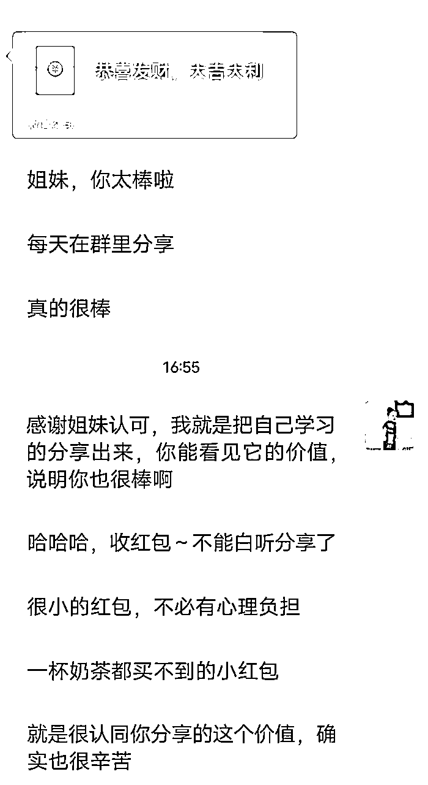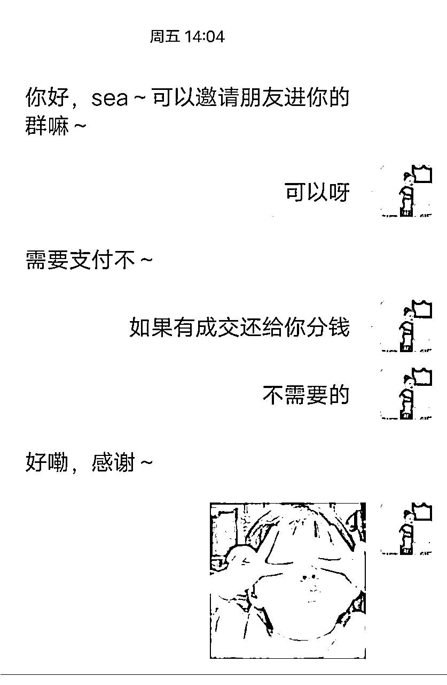

她说：小白有小白的活法。没有光环，就拼真诚；没有资源，就拼坚持。你想要什么样的生活，就从当下这一刻开始去交换。从那个天天想逃的职场妈妈，到如今一边照顾家庭一边实现收入增长，这段路她只走了80来天。她最认同的话是：先把注意力放在提升自己上，别急着追钱。普通又怎么样？只要不甘心，你迟早会活成自己喜欢的样子。

我是你们的粒晴（Sea），一位普通但不想认输的30岁职场妈妈。喜欢研究赚钱，也喜欢和认知同频的人做朋友。如果你也想一边带娃一边突破自己，欢迎来链接我，一起见证成长。