# 三天搞定GPT文章项目？这个副业香爆了！

最近我复盘了满打满算五期学员的实战情况，总共34个人，数据都已经汇总出来了。从结果看，这个项目确实还有很大的优化空间。

我是星泽，大一那年就靠文章项目赚到了人生第一个一百万，现在也有了自己的公司。ChatGPT一出来，直接让这套玩法的效率提升了好几个量级。

早在新冠疫情刚出现的时候，我就听到人工智能算法相关的消息了。当时正好被困在家里，有大把时间去研究ChatGPT。越研究越觉得，这东西一旦正式问世，绝对能把互联网炸翻天，对我们这个行业来说，更是变革级的助推器。后来的事实也证明，我的直觉没错。我已经把GPT嵌入文章项目的完整流程，做成了一份精简版SOP，今天分享给新手圈友。

全文内容比较多，想获得更好的阅读体验，可以移步飞书文档。

# 一、先拆风险：论文代写到底能不能碰？

市面上这类中介不少，可论文代写到底是什么性质？我给大家拆开讲。

论文代写本质上属于学术不端，但关键要看“学术”两个字怎么定义。不是所有论文都配叫学术。

大学里的水课课程论文，以及专科毕业论文，说实话，学术价值并不高，算不上真正的学术研究。很多学生自己都调侃自己写的是“学术垃圾”。学术不端的帽子，主要扣在高端论文头上——期刊论文、硕士论文、985/211的本科毕业论文。前阵子华中农大11名学生举报导师，那才是真·学术不端：窃取成果、伪造结论、篡改数据，这些事放在水课论文上可能没人追究，因为影响力有限。可一旦出现在顶级核心期刊或SCI上，性质就完全不同了。这类论文能推动整个学科进步，影响力巨大，造假后果相当严重。

所以我们从来不做高端论文市场，GPT也搞不定那活儿。高端市场我们只做正规辅导，由985博士、博导级别的老师一对一指导。这是我们团队的后端资源。

那为什么不接专科论文辅导？因为专科压根没这个市场。很多专科学生几年基本是混过来的，倒不是歧视谁，就是陈述一个事实。平时不学习，论文自然想花钱找人全包。专科老师心里也明白，通常也懒得管，因为整体氛围已经那样了。所以专科只认代写，不认辅导。

我们的定位就很清晰：低端论文市场，直接服务；高端论文市场，只做正规辅导。这样一来，学术不端的风险就基本规避掉了。

# 二、市场需求有多大？

每年都有毕业季。全国高校加起来三千多所，一半是本科，还有大约1500所职业学校、300所成人高校，加起来1800多所专科类学校。专科生几乎人人都需要搞定毕业论文——这是我们做了四年、做了大量调研之后得出的结论。市场需求完全不用怀疑，而且年年都有新人顶上。

# 三、🛰️谈单，手把手教你收钱

**报价怎么报？**

专科论文，5000字大概在200到400元，你有本事往高了谈也没问题。基本上价格波动区间就是：字数的一半除以10，这个只适用于专科纯理论。本科在此基础上加一两百。

举个例子：专科8000字纯理论，报价大概400；本科8000字纯理论，600到800左右。

报价时一定要把服务说清楚：XX元包含论文初稿、后期修改、知网查重、答辩答疑、包毕设通过。定金收全款的一半，尾款后付。

客户不信任怎么办？直接拿朋友圈信誉截图说话。毕业是终身大事，一辈子就一次。再亮出师资团队：老师都是硕士起步，简历随时可看。

**实战流程走一遍：**

第一步，加上客户，服务态度要专业，然后让客户把具体要求发过来。重点问清楚：学历、字数、专业、查重，是纯理论还是需要数据分析？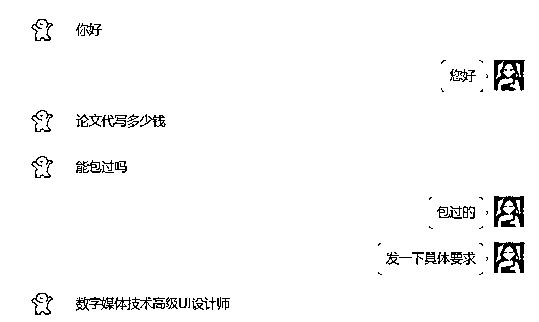

第二步，客户发完要求，你在心里报个价，然后说给客户听。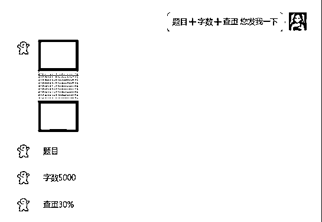

第三步，重点来了！报价和服务都说清楚了，客户还是嫌贵，千万别放弃。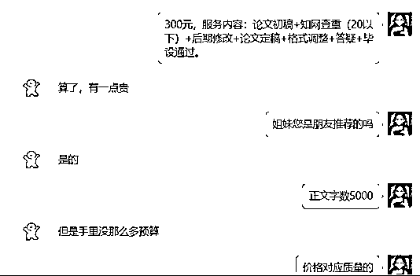

这时用话术来回拉扯一下。如果客户油盐不进，直接说“不看质量只看查重”，那就适当降点价——反正纯利润，少赚点也是赚。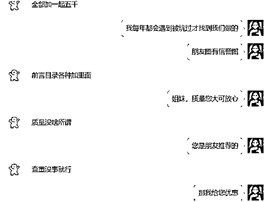

当客户开始问“能优惠多少”，说明有戏了。只要价格谈到位，基本就拿下了。比如我这边直接优惠60块，客户还想继续砍，就看接下来的话术了。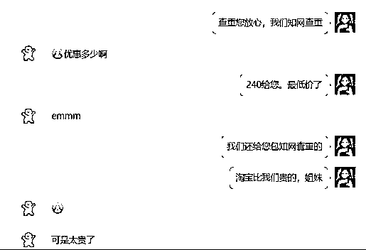

客户还在压价，这时候你反倒可以坚决一点。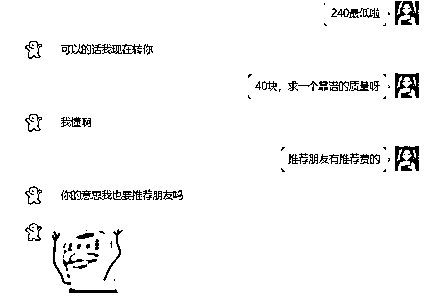

到这一步基本上已经成了。为啥？因为客户不再纠结价格，而是开始问“论文什么时候能写完”——这就是成交信号。接下来就是付款环节。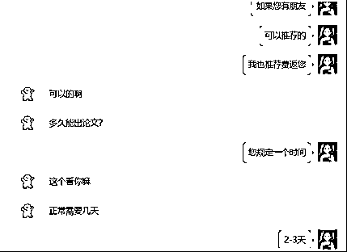

第六步，收款，销售闭环。我遇到的这个客户算很爽快，直接付了定金。有些客户会问怎么支付，这时候要引导走支付宝，顺便提一句朋友圈全是信誉图，拉近距离。尽量别用🛰️收钱。

# 四、📕引流，零基础也能上手

**账号搭建：**

先注册一个全新📕号，头像、名字、简介、背景图全部设置成专业号的样子。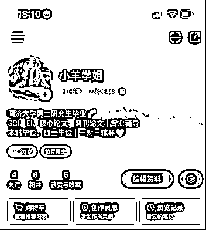

然后找3到5个对标账号：蓝V认证的1-2个，没认证的1-2个，粉丝多一点的优先。全部关注，研究他们的创作类型。搜索关键词就用：论文、论文写作、论文辅导、毕业论文这些。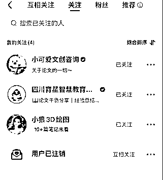

拆完马上复盘，找出共性。前期以干货分享为主，先涨粉再说。

**爆文笔记公式（3分钟就能学会）：**

笔记维度怎么搭？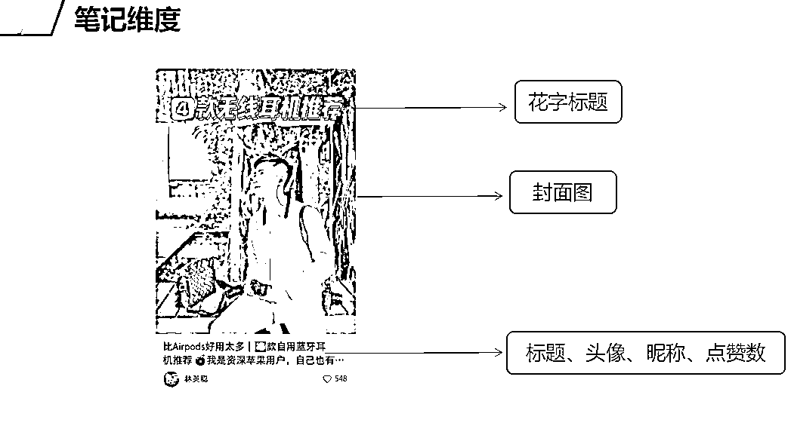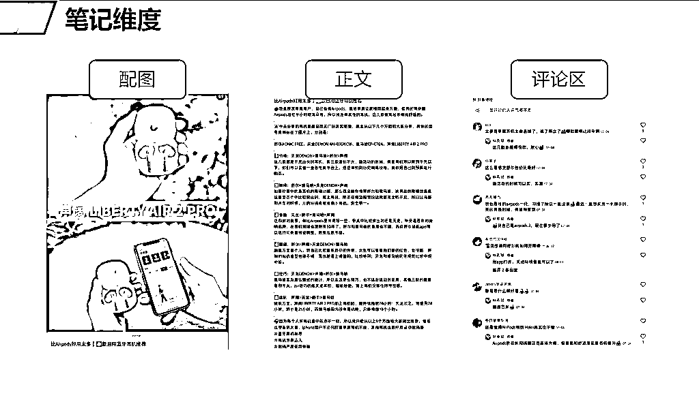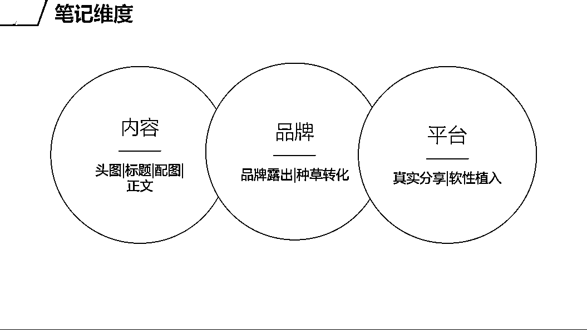

头图公式在这。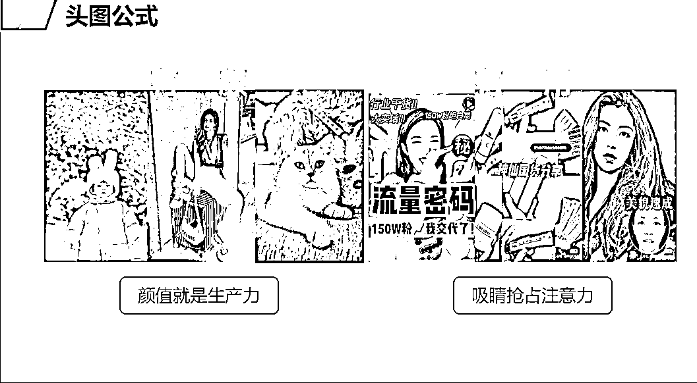

头图还能优化：加文字、突重点，颜值立刻提升。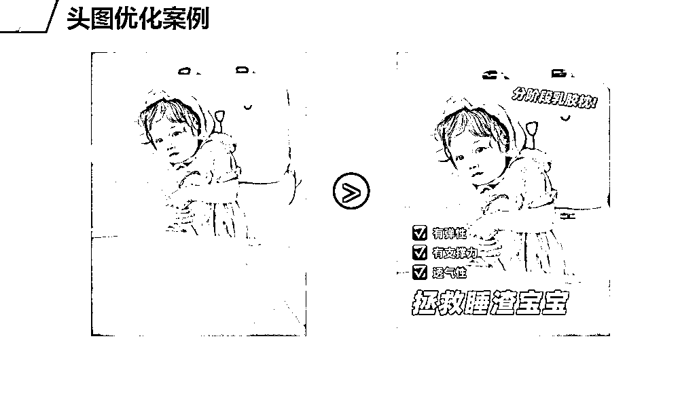

标题关键词联想技巧。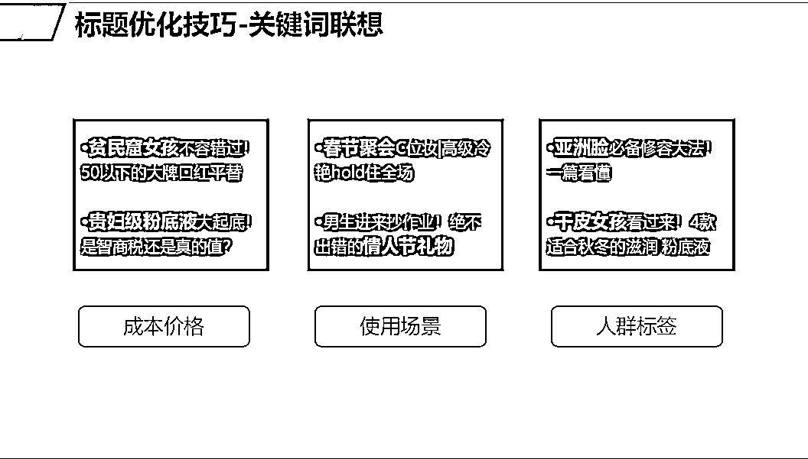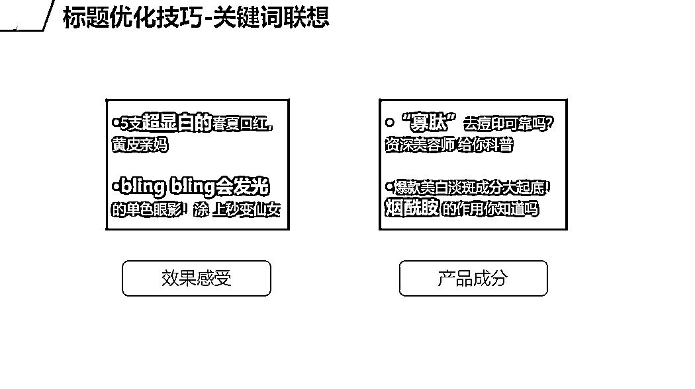

标题公式放这。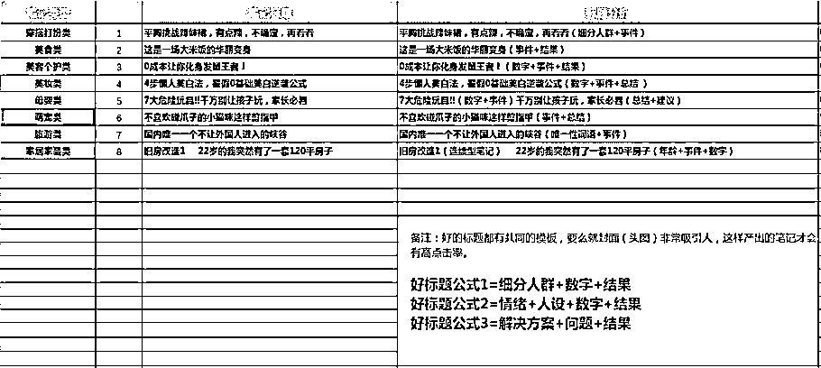

配图方案。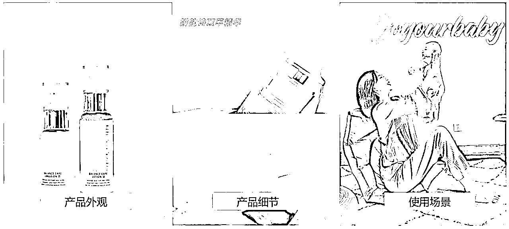

正文写法。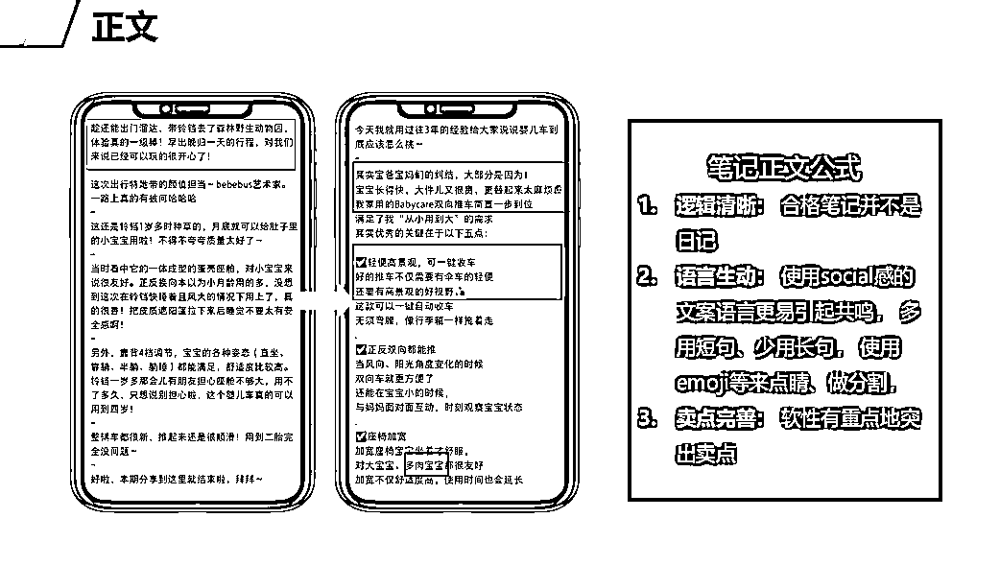

过审秘籍：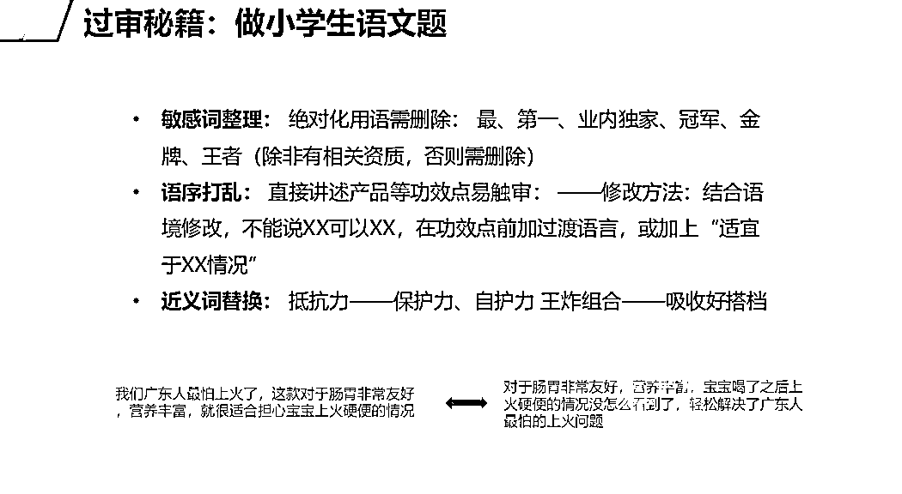

零克查词，检测违规词。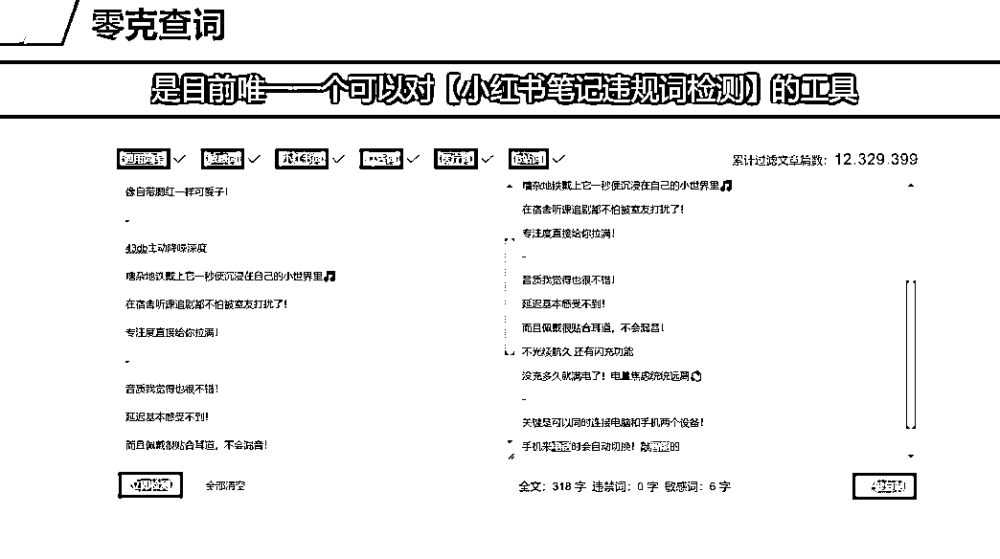

千瓜平台，帮你检索热点词。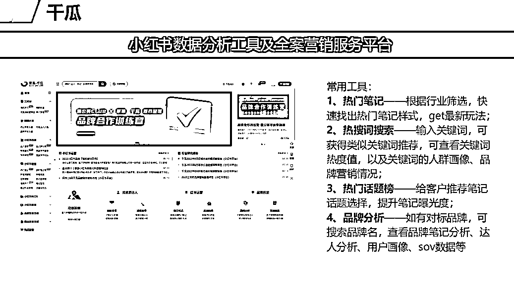

**图片素材哪找？**

我试过各种图片素材网站，最后发现还是黄油相机最靠谱。充个会员，模板免费使用。首图永远是门面，第一印象太重要了。

具体怎么润色？电脑没办法操作黄油相机，只能手机端自己摸索，其实很简单，后面我单独出一期视频讲。抖音上也有黄油相机的教程，大致就是加文字、优化图片这些操作。后面的图可以放🛰️信誉截图，每篇笔记3到4张就够。

**文案咋写？**

直接模仿同行就行，然后让GPT帮你润色、改写。文末用#号带上相关标签，比如论文辅导、论文写作。

**薯条加热：**

笔记发完后，点右上角三个点，可以选择薯条加热。不过光靠薯条进不了白名单，还得配合企业号一起操作。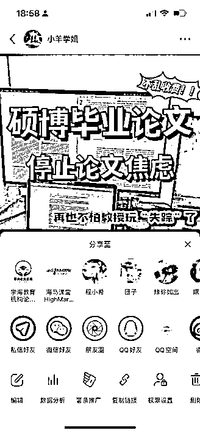

# 五、GPT指令，直接抄作业

**选题：**

定金到账后，就可以开工了。第一步定题目。之前在问客户要求时，他已经给出了专业/研究方向，我们只需要让GPT根据这个关键点列题目。

基础指令：根据XX专业/研究方向，列五个专科/本科毕设论文题目，不需要对题目做任何解释。

优化指令：根据XX专业，列五个本科/专科毕设论文题目，不需要对题目做任何解释，不要实证研究，不要数据分析，题目必须纯理论。

为什么要列五个？发给客户让他挑就好。如果客户不满意，比如嫌题目太宽泛、老师不会同意，那就换个指令：你上次列的题目很不错，但唯一的不足是太广泛了，请修正这个缺点，把改善后的题目发给我。

**大纲：**

毕业论文大纲通常长这样：

题目、摘要、关键词、Abstract、Keywords、一、绪论/引言（里面含1.1研究背景、1.2研究意义、1.3国内外研究现状、1.4研究内容与方法，第一章绪论不论题目是什么都是这套结构）、二、三、四章（自定标题）、五、总结与展望（5.1结论、5.2展望，不管题目怎么变基本都这样）、参考文献。

拿到题目后，让GPT列大纲的指令：题目是：XXXXX。请根据这个题目列一个专科毕业论文大纲，要求五个章节，第一章为绪论，最后一章为结论。一级标题用一、，二级标题用1.1，三级标题用1.1.1，标题下不需要出现文字说明。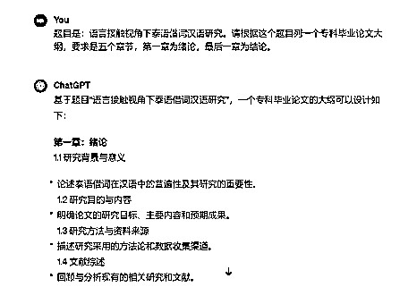

**填充内容：**

大纲出来后就简单了，让GPT逐章节填充就行。GPT完成的论文可以直接过查重，无需降重。AIGC检测方面，用我们的指令也能规避掉很多。而且专科学校大多不要求AI检测，这波优势相当明显。

# 六、写在最后

以前写一篇2000字的文章，怎么也得半个小时，甚至更久。现在用GPT，10分钟就能出一篇更长的。每年9月到次年6月都是旺季，2月更是旺上加旺。趁旺季还没完全过去，我赶紧把项目分享出来，希望大家都能靠它赚到第一桶金。

我们团队也在持续招人，目前已经开到第四期私教课了。有什么不懂的，欢迎🛰️私信我，我会根据大家反馈的问题不断迭代优化课程。

攀一座山，看一场雪，追一场梦。感恩遇见！