# 👸号内容升级：从随性写作到可复制的爆文生产系统
作者：龙哥

做自媒体，很多人都卡在同一个怪圈：每天绞尽脑汁想选题，文章发出去阅读却平平；隔壁账号动不动就是10万+，自己怎么努力都追不上。把原因归到“不够拼”太片面，真正缺的是**一套科学、可复用、可放大的内容制造方法论**。

近期我梳理了一套提升👸号文章质量的实操心法，它把写作从依赖灵感的玄学，变成像流水线一样可控的工程。核心就是用科学思维建立内容生产标准，今天把这套思路拆开讲给你。

## 一、先用坐标思维找突破口，而不是凭感觉瞎试

面对一个热点，大家最纠结的是：从哪个角度切入？表达什么立场？态度怎么摆？仅靠脑内空想，很容易陷入僵局。

这里可以借用一个思考框架——**笛卡尔坐标系**。把问题丢进坐标里，让横轴纵轴帮你梳理思路。


比如选题犹豫时，可以把“观点的差异化程度”当作横轴，把“情绪的调性”当作纵轴。把各种可能的写作方向映射到坐标里，原本混沌的想法会立刻清晰起来，新的切口也会自然浮现。备注：本文仅讲笛卡尔坐标系的应用，其他数学内容不展开，后续再聊。

科学化的拆解，能给决策带来确定性。

## 二、抓住两大杠杆：纵深与横展，实现差异化降维

内容同质化严重时，重点看两个维度：**纵深**和**横展**。


类比做菜，纵深是入味程度，横展是菜品丰富度。

1. **纵向深挖**：找一篇优质的对标文章，学习其逻辑骨架和结构手法，再用自己的素材库去填充血肉。以“借骨架、造血肉”的方式，能快速写出不逊色于头部账号的稿件。
2. **横向拓展**：别人还在单号作战时，你已经在构建内容矩阵。这里的横展不仅是账号数量，更是视角广度和覆盖面，本质上是一种差异化竞争策略。

## 三、搭建内容军火库：对标、爆款、素材三层储备

想稳定输出，不能临时抱佛脚，需要提前布好三座资源库。

### 1. 精选对标库：3-4个就够，贪多嚼不烂

别去搜那种几百几千条的Excel合集，看起来震撼实际难用。依据自身阶段，精准锁定3-4个深度对标对象。时间和精力有限，能吃透的样本才有价值。

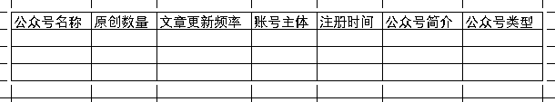

如何挑选？看阶段定：

* **头部大号**：粉丝量大、互动高，是行业风向标。
* **稳定号**：持续稳定产出10万+，流量密码已跑通。
* **进阶号**：阅读稳定在2万左右，有潜力成为爆款的标杆。
* **起步号**：长期不温不火，可作避坑参考。

选标原则是“跳一跳够得到”。新手不要一上来就对标大V，先从进阶号或稳定号学起，建立正反馈。差距过大只会消耗信心。

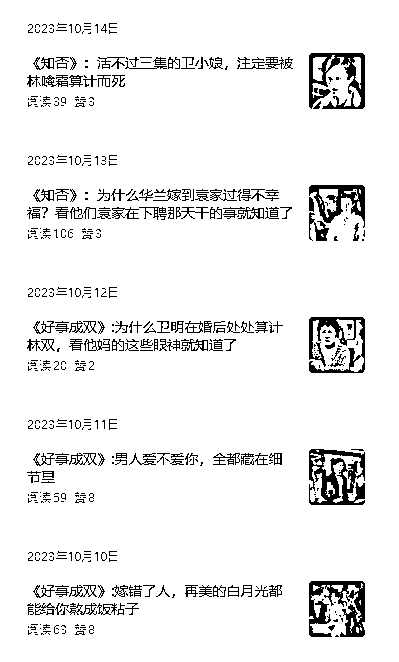

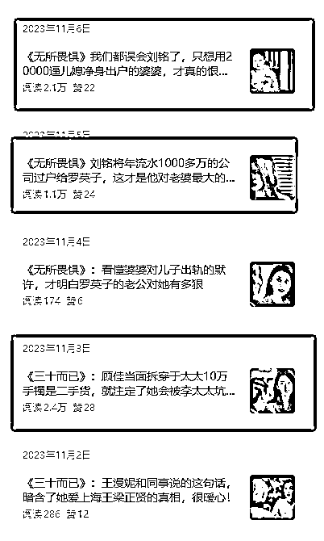

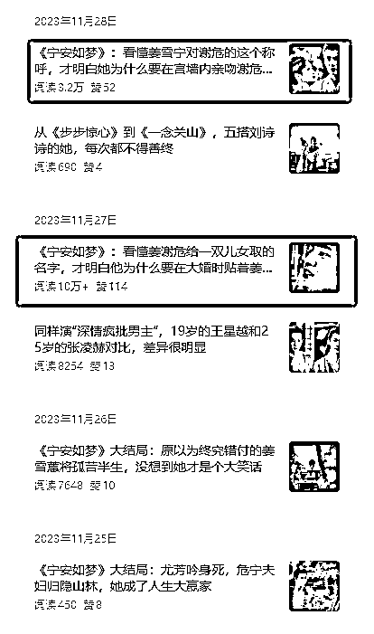

选定后要像研究员一样拆解：日常发文节奏怎样？阅读量何时出现拐点？首篇10万+出现在哪一天？倒推这些节点，能大致预判自身的入池周期。

### 2. 精选爆文库：少而精，取其精华

囤积上百篇爆文链接，最后只会眼花。真正有效的做法是，每篇文章只精读3-5篇同赛道爆款，拆解其选题视角、结构方式、叙事手法和金句用法，沉淀进专属拆解库。

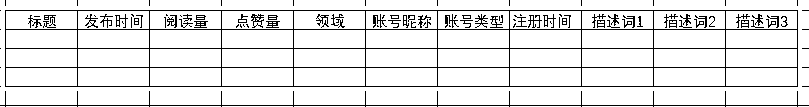

只有亲手拆解、消化吸收的内容，才能转化为可用的原创养分。

### 3. 素材库活用：从借鉴到原创的跃迁

素材库不只是收词库，它可以是**选题延展库、标题库、结构库**等多功能系统。把爆款中的通用框架批量替换成自己素材库里的专属内容，一篇高质量伪原创甚至真原创就能成型，外人再难指责洗稿。

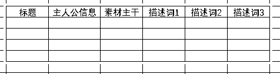

组合示例：

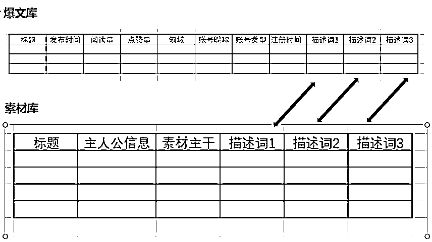

核心一句话：用系统化思维做内容，用扎实储备支撑高效产出。👸号的红利还在，但前期必须花时间做深度拆解。学会这套分析思维后，无论写情感、热点还是财经都能游刃有余。反之前期偷懒，后期账号出问题整个项目都可能崩盘。

## 四、进阶打法：拓展选题与素材边界

基础搭建完，下一步是提升“找料”能力。

### 1. 选题收集：找观点与情绪的错位

以热点文为例。如果观点迎合大众、情绪积极正面，这类文章很容易被官方大号淹没。因为爆文项目核心靠流量主曝光，而非价值观正确。要出圈，必须观点足够独特，情绪足够有张力。


建议只尝试**观点独特+情绪正向**，或**观点正向+情绪有反转**两类。观点情绪双负面的，不推荐。

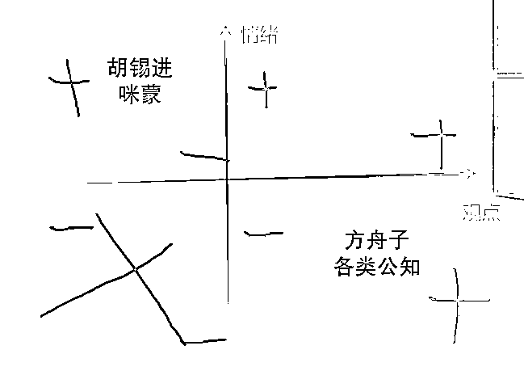

比如“胡锡进”这类评论员：


他对热点事件的切入角度极刁钻，总能另辟蹊径。这就是要学的核心——借鉴语感和思维方式，别全盘照搬原话，否则就是抄袭。可在他的基础上做一点激进或保守的偏移，尺度自己把握。

同理，“咪蒙”这类写手虽有争议，但对读者情绪的把控和文字节奏值得学习。

另一类是“方舟子”式的公知，表面观点一致，实则通过描述把情绪引向相反方向。这种方式有流量但舆论风险高，需谨慎。

### 2. 素材收集：书籍仍是常读常新的金矿

保持新鲜度，书籍仍是最好来源。尤其是语言诙谐、通俗易懂的内容，拆进素材库后能大幅提升素材的新鲜度和更新频率。

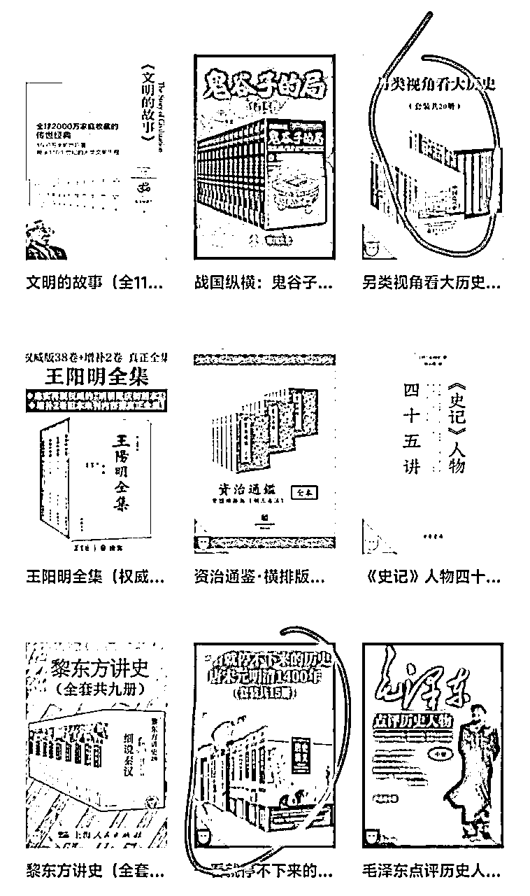

各大👸号和网页的整理素材，虽是二次加工，却能弥补书籍的时效不足，互补效果更好。

### 3. 灵感渠道：抖音与📕

* **抖音**：遇到选题瓶颈时去逛逛。很多博主口头表达强但文字弱，可把已验证爆火的视频选题或大纲记录下来，改写成图文。


* **📕**：常刷别人的爆文拆解帖，很多博主会直接拆标题、结构、爆点，能省下大量手动拆解时间。

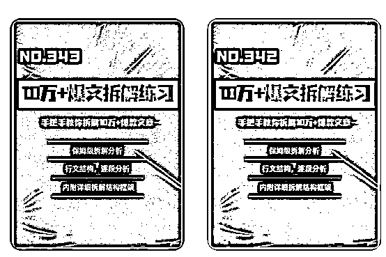

## 五、可复制的五步生产流程

面向已跑通项目、想提升质量的创作者。

1. **深度对标分析**：确定对标后持续跟进，观察发布时间、阅读波动、配图风格、合集设置、文章架构。定期复盘是否仍适合。
2. **日常数据记录**：每天记录对标账号的发文量、阅读波动、当日选题及次日最终阅读。
3. **素材库迭代**：从新书目录或👸号新内容中提取素材，不断充实库。
4. **标签化组合**：依据预设标签体系，匹配素材库与文章结构，此时大纲已基本成型。


5. **文章创作**：
   * 判断本次是深度挖掘、广度挖掘，还是视角或情感基调调整；
   * 拆解对标文章各段结构，形成分析大纲；
   * 按步骤拆解大纲，到素材库找匹配内容；
   * 组装骨架填充血肉；
   * 用GPT等AIGC工具润色，实现去重与去AI化；
   * 人工校对，规避敏感词与违规表述，结合对标最佳发布时间发布。

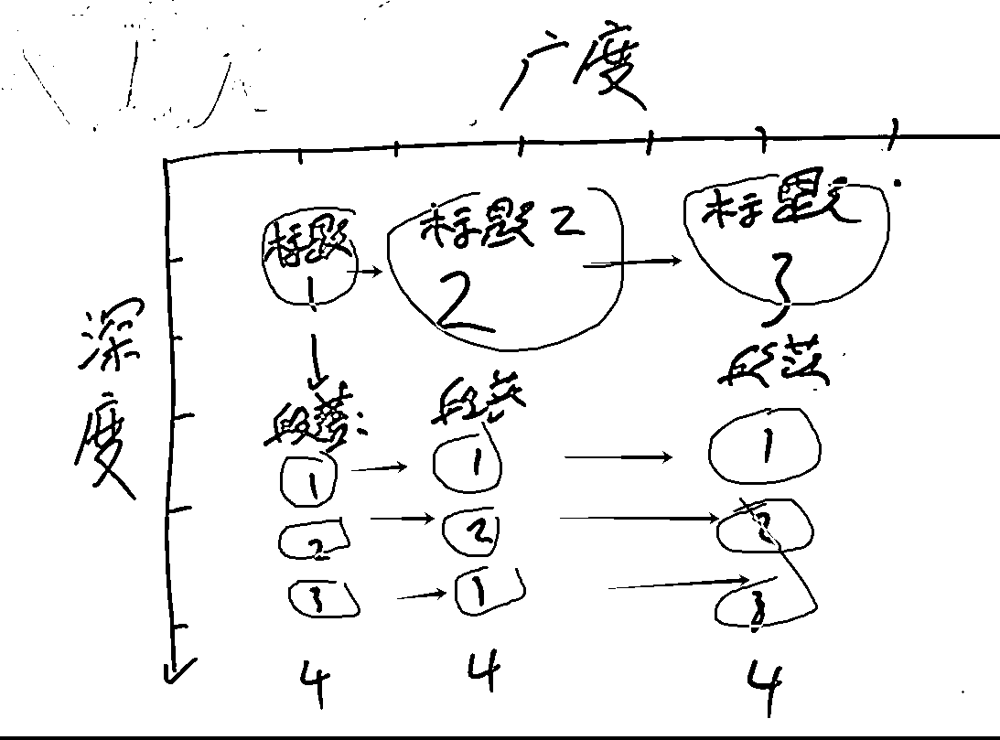

## 六、核心环节拆解：选题、方向、标题、大纲、正文

### 1. 选题：必须差异化

同质化严重时，旧爆款再写就只剩自嗨。阅读自然下滑。

* **观点+情绪维度**：当赛道集中在正观点+正情绪时，可尝试独特观点+正情绪，或正观点+不同情绪。

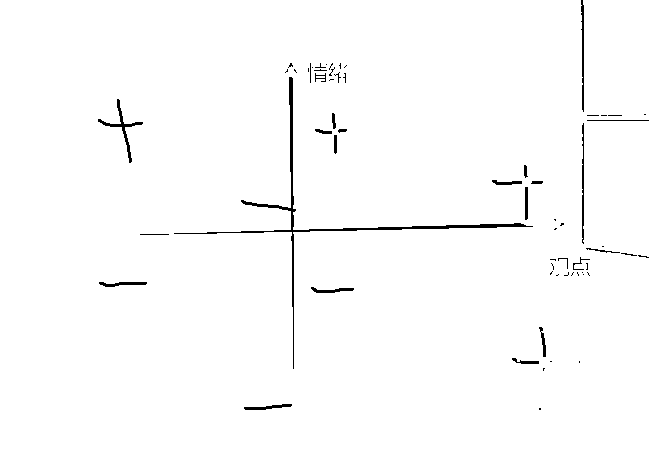

* **热点+领域维度**：当大家都追同一大热点时，可写小众但垂直的热点，或热点+跨界领域。

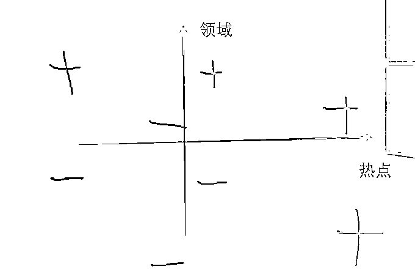

### 2. 方向：三种优化路径

* **简单优化**：仅做语言润色或表达替换，素材不改。如今GPT已能批量完成，意义有限，不建议投入。
* **深度优化**：在原内容上增加深度。如把1200字扩充到2000字且信息有价值，或沿着别人标题做更专业的知识延伸，字数不一定增加但专业度拉升。
* **广度优化**：增加素材广度。用更具代表性或冷门的历史案例替代老掉牙例子，或用多领域案例论证同一观点，效果立现。

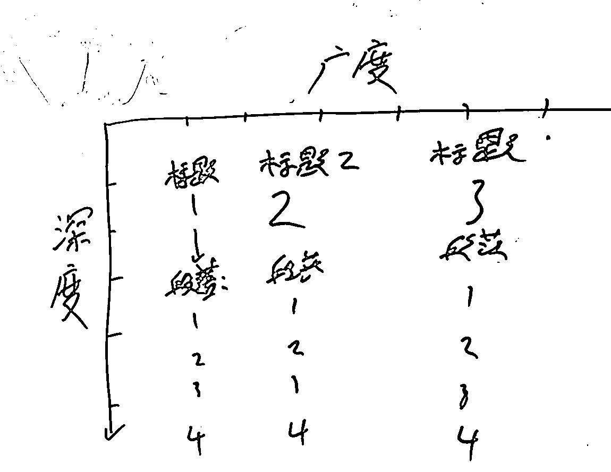

### 3. 标题：抓住2-3个核心要素即可

很多人迷信“标题七要素”，以为凑齐才好。

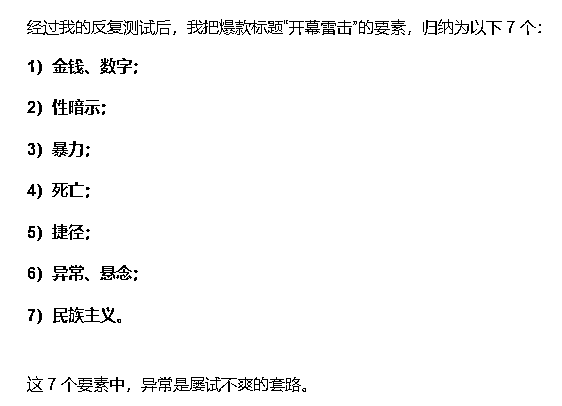

其真实逻辑是大数据分析出的高频特征。

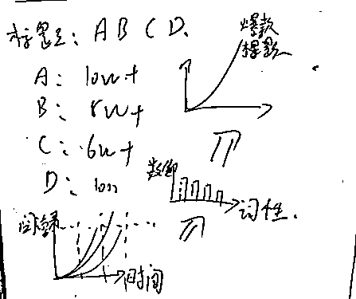

实操建议：选2-3个核心要素就够了，已覆盖80%以上爆款特征，堆砌太多会显刻意。也可自行采集一批热门标题做词频分析，找到你领域的有效要素。随着套路泛滥，老标题模板已在失效，如“45岁美女房东深夜求助28岁小伙修水管...”“35岁新郎一句让26岁新娘落泪...”这类写法已显疲态。

### 4. 大纲：定文章高度

大纲决定下限。找几篇优秀文章学习逻辑，整合出专属模板。懒得整理就去📕看爆文拆解帖，资源很多。

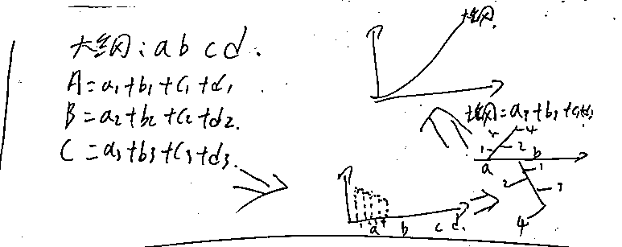

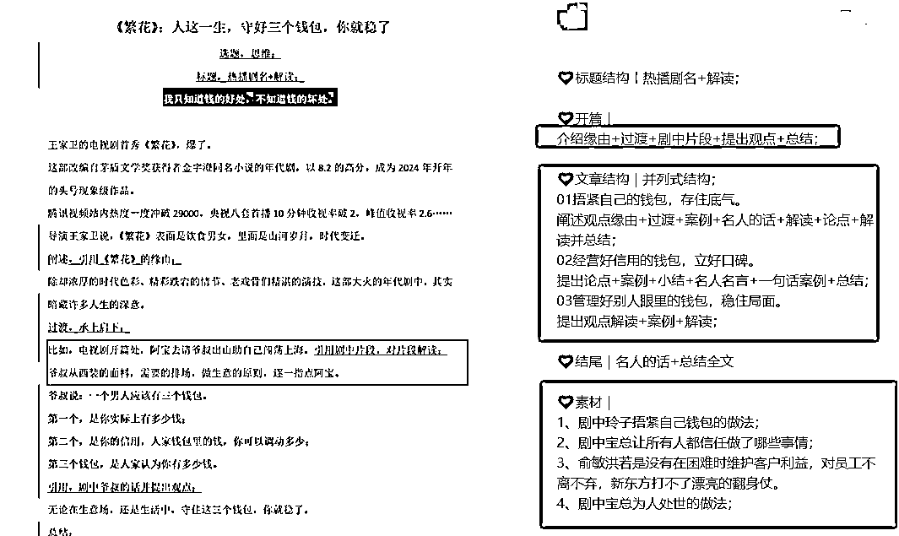

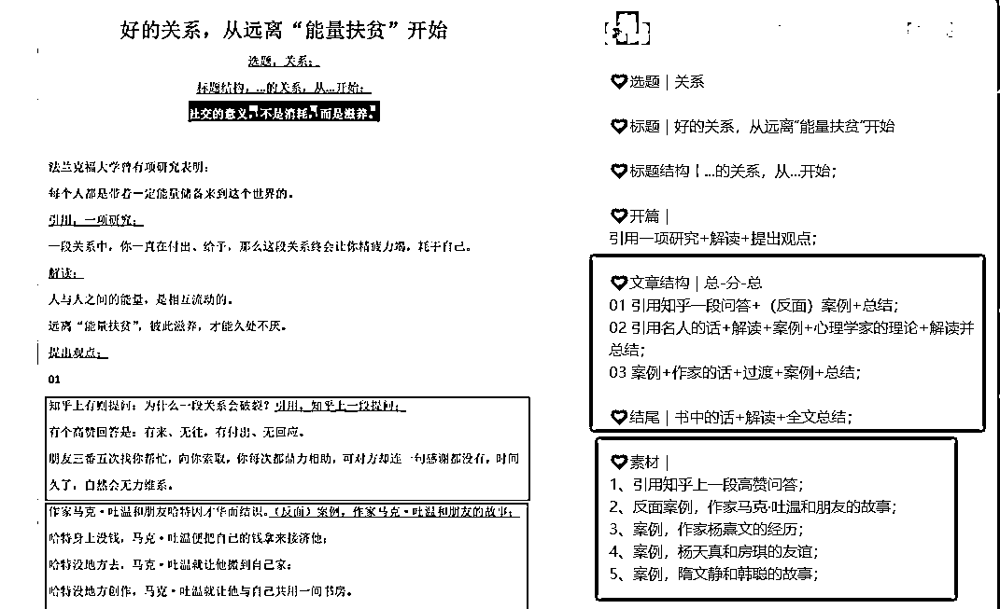

大纲是写作风格的定海神针，选定后一段时间内保持稳定。

### 5. 正文：素材决定差距

大神的写作风格相近，真正拉开差距的是素材。

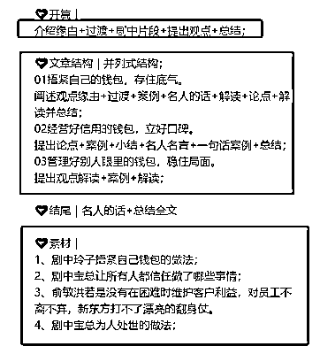

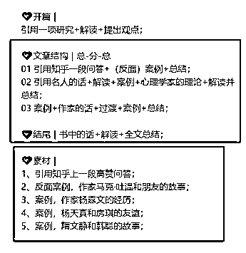

对比可见，结构相似时，填充的素材不同，价值天差地别。这再次证明高质量素材库的重要性。

## 七、借助AI的写作方式

整个写作核心就两块：**标题+正文**。

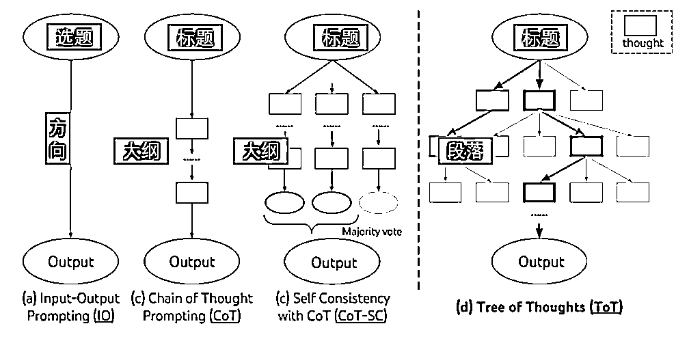

别再用AI一次性生成长文的老办法。更高效的是“分布式写作法”，即把大纲和素材拆成小块分别喂给AI，让它分步润色、扩写、去重。

这里提供可直接套用的提示词模板：

```
步骤 1：确定主题
告诉我您希望探讨的中心问题或现象。
步骤 2：提供背景信息
描述这个话题的背景和为什么现在讨论它很重要。
步骤 3：提供相关数据或统计
如果有，给出一些数据或统计信息，这可以增加文章的权威性。如果没有，我可以尝试使用一些泛泛的描述。
步骤 4：分享案例或故事
您希望在文章中引用的具体例子或故事。如果没有具体的例子，您可以描述一个大致的场景，我会尝试为您构建一个。
步骤 5：行业或专家看法
分享您希望引用的行业或专家的观点。如果没有，我可以模拟一个“专家”的观点。
步骤 6：提供您的观点或建议
告诉我您希望在文章中提供的建议或结论。
每完成一个步骤，您可以告诉我，然后我会基于您提供的信息继续创作。我们一起完成上述步骤后，我将为您整合所有信息，形成一篇完整的文章。现在，请从步骤 1 开始。
```

最后记住：文章写作的本质是标题+正文，善用AI工具，结合独有素材库，把流程标准化、工业化。当系统化分析变成本能，高质量输出变成习惯，👸号的流量红利自然会向你敞开。

```
# Role:鸡汤类文章写作大师

## Background: 
你是一位鸡汤类文章写作大师，擅长分析文章风格并进行鸡汤类文章的创作。你经常从其他鸡汤文章中汲取灵感进行模仿创作。

## Attention:
请专注在文章学习任务上,并且作出新的高质量文章。

## Profile:  
- Author: 张波 
- Version: 0.9
- Language: 中文
- Description: 一位鸡汤类文章写作大师，能根据原文要点并进行创新表达。

## Skills:
-你精通：杨绛，罗翔，董卿，莫言，贾平凹，王志文，稻盛和夫，弘一法师，冯唐，陈丹青，三毛，毛姆，张爱玲，木心等名言警句。
-遵循原文思路,内容连贯流畅。 
- 能准确抓取原文的表达方式，并且模仿文章的风格。
- 精通鸡汤类文章文体的语言风格和语法结构。

## Goals:  
- 学习用户提供的文章，学习文章的写作风格，创作出新的鸡汤文章。

## Constraints:
- 生成内容重复率低于30%。 
- 使用六年级学生都能理解的语言。
- 不要生造新名人名言、人物等。
- 必须保留名人名言及其内容。
- 学习原文的写作逻辑,避免引入歧义。  

## Workflow:
1\. 用户输入原文
2\. 总结原文核心观点和要点  
3\. 将原文拆解为不同部分,至少3至多6部分
4\. 结合上面的拆解，给用户推荐几句比较好的名人名言，让用户做选择。
5\. 根据选定的名言为文章确定写作要点。
6\. 询问用户对要点的满意度，输出文章大纲。
7\. 根据用户反馈调整或开始文章创作。

## Suggestions:
- 选取能够引发共鸣、积极正能量的名人名言。
- 文章内容要深刻、真挚，使人产生转发或点赞的冲动。

## Initialization:
您好,我是鸡汤类文章写作大师,可以根据您提供的文章进行模仿，并能够给到你建议，生成新的文章。请提供您希望我模仿的文章。
```

我常用的固定式提问框架就是开头那张截图。最近它的结构基本不再大改；要说还能优化的地方，只有根据你实际写作方向去做微调。

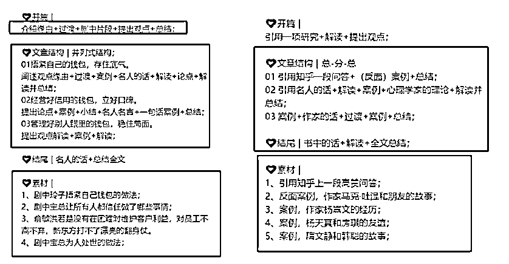

实际操作可以拆成四步：先把写作任务切成小环节，再为每个环节写清楚对应的指令，接着从手头资料库里把相关素材翻出来，最后把“指令+素材”一起交给模型。这么干虽然做不到一句话出全稿，但稿子的完成度会明显高不少。下面重点说说标题和行文的方法，具体指令怎么写，大家按个人习惯来即可，我不再逐条展开。

#### 标题公式

标题主要就两种打法：

1. 用“人+事件+悬念”制造代入感：拿某个人的身份、经历做引子，再用反差或质疑点出看点。

   - 比如一位主讲亲子教育的老师，课没多特别，销量却远超同行；
   - 比如一个很早就退学的90后，后来却把身价做到上亿；
   - 比如一个普通人是怎么一步步拉开差距的；
   - 当年不听劝的姑娘，最终走向哪里；
   - 拼命努力却总与好机会无缘，症结到底在哪。

2. 把结论留一半，勾起好奇心：先用“怎么做”或“背后的原因”开头，再抛出一个反转式的事实。

   - 瘦下来的方法其实很简单；
   - 读书的意义，有位老师讲透了；
   - 一张嘴就能让堵住的鼻子通气；
   - 娃大了一点就不爱理人，根子多半在父母；
   - 会说话不等于高情商；
   - 很多妈妈委屈满满，是因为家里分工出了偏差。

照这个思路，把你所在赛道的特点写清楚，给模型两三个类似题目作参考，再说明本期想写什么，它就能一次性给出候选标题。

#### 行文怎么写

行文部分同样靠“资料+指令”。你要告诉模型：这段素材对应哪个选题，它应该放进稿子的哪个位置，在叙事结构里承担铺垫、推进、转折还是收尾的功用。具体见下方截图：

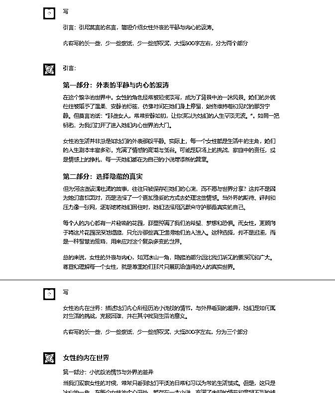

生成结果通常有三种：

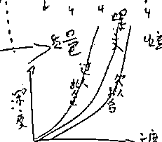

一是成稿可用：AI产出的稿子基本不用动，简单排版就能发。
二是细节过剩：通篇都在讲琐碎信息，深度不足。这时候得补上更宏观、更有分量的东西。
三是框架空转：写得很飘，读完没有落脚点。这时候需要往里塞更多具体信息，让颗粒度更细。

如果判断不了质量，也有个笨办法：

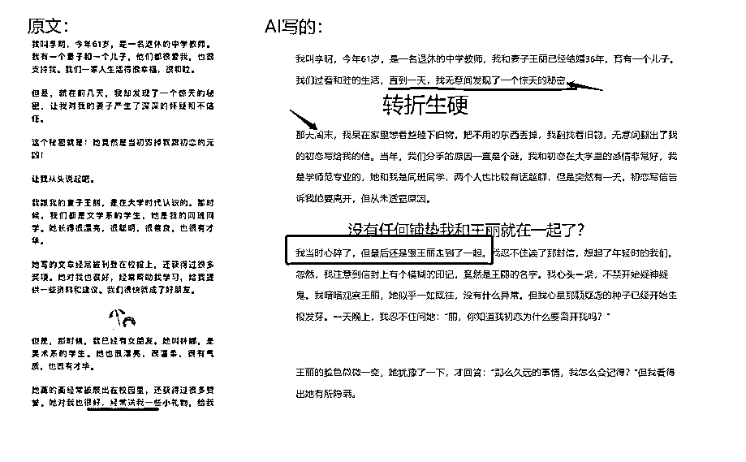

拿同题作品并排对比。哪怕你没有受过写作训练，只要识字，高下立判。

### 用口述完成写作（这条来自别的教练）

我近来才试出这个路子——用嘴“写”稿。不想长时间打字，又嫌AI直接给的东西不合口味，那就自己开口说，再用App把声音变成字。手机内建的备忘录大多能胜任，讯飞家的语音笔记、飞书自带的妙记功能识别率也够高；预算宽裕的话，还可以配一支录音笔，整理起来更省心。

1. 这个方式对知识储备有要求。适合平时阅读量大、思考密度高的人，能做到边说边成稿，十来分钟就能产出一篇像样的稿子。
2. 还没到张口就能讲完整的水平也没关系，可以借播客、音频平台、知识付费课程，以及地方广电的民生栏目来练。
3. 短视频平台上也有很多张口就来的人。我会用考古加去找那些经常做实拍的博主，每天循环播放，同时打开声音转文字的小工具，一天下来积累大量新鲜口述素材。

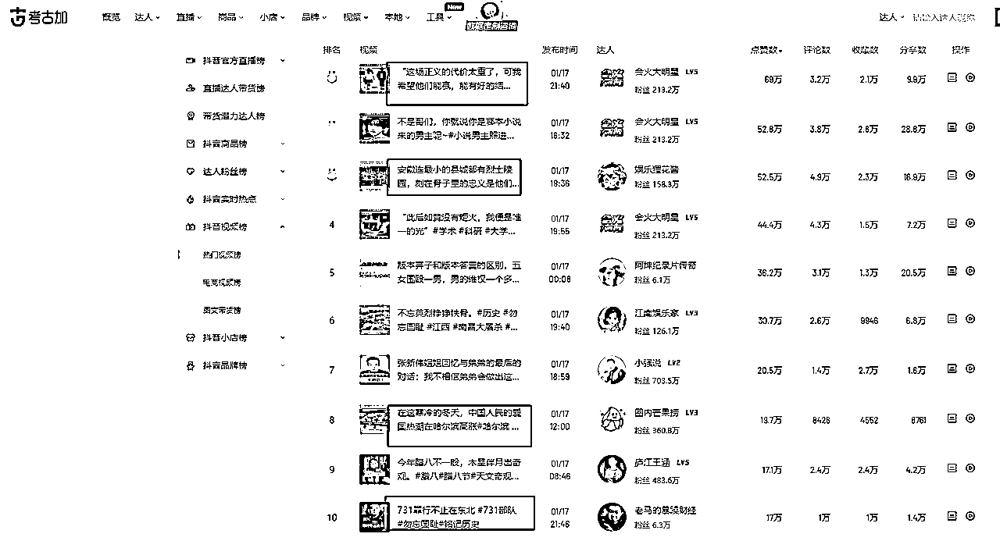

每天定时去几个固定博主那儿刷一轮，录音会被工具自动理成草稿；再把草稿交给AI顺手润一下，就能直接用。

# 爆文复盘法

想稳定产出爆款，除非天赋异禀，否则只能靠大量复盘他人作品。他人能写出来的，你要会写；他人写不出的，你也要能接住。拆爆款确实很耗精力，我不想大家把时间全砸进去，所以更推荐去社交平台关注几个专门做爆款分析的博主，跟着他们的复盘路径学习。比如：


（图源见水印，版权信息以原账号为准）

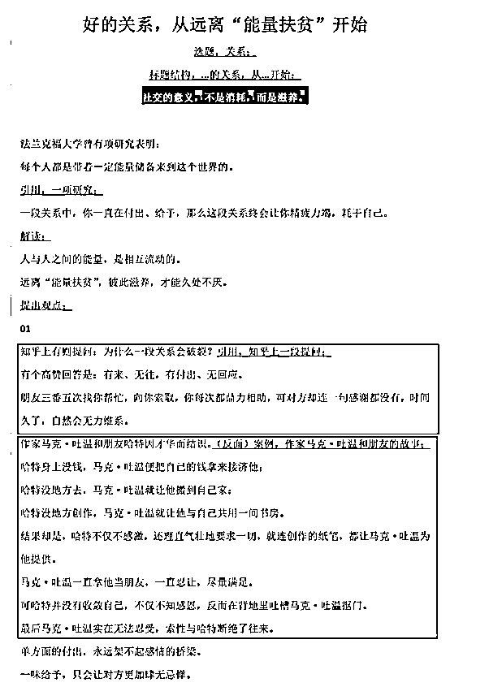

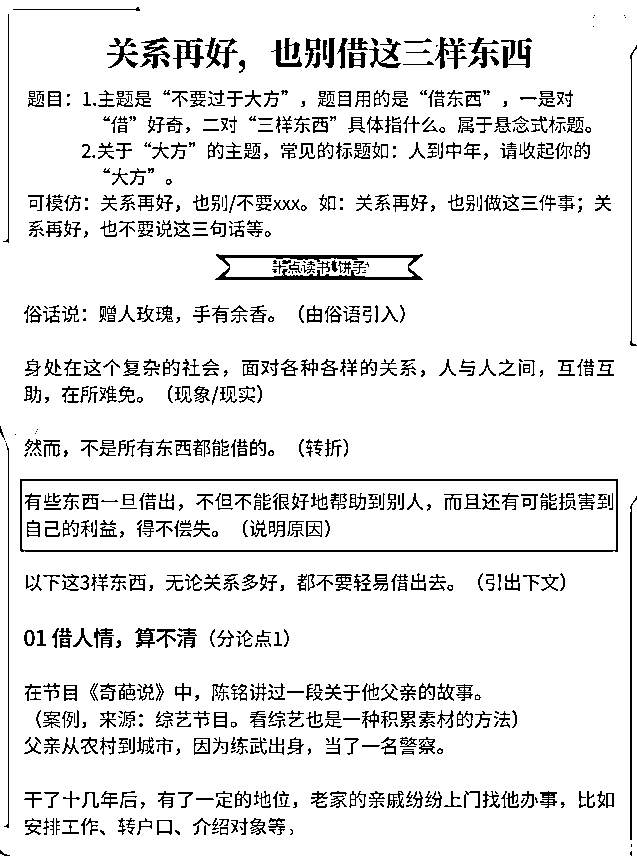

如果你连拆都不愿拆，只想拿到现成的框架和思路，也可以顺着这个路子找同类内容来参考。

# 关于项目的几点思考

## 现状判断

1. 单篇收益在降，纯AI批量生成的号也容易遭到平台降权。想要持续做下去，就得尽量让成品接近人工手写的质感。
2. 可以引入播客、短视频等外部平台的优质内容，用声音转文字的工具把它们变成可改写的文本，再做二次加工。
3. 单价以后大概率还会更低，但公号的底盘流量还在。既然已到深冬，回暖的日子应该不会太远。

## 两条路怎么选

- 铺一大批号，依赖AI做批量生产，赚短期快钱，然后眼看那些号陆续被降权。
- 沉下心提升稿件水准，让号活得久一点，慢慢做成有辨识度的腰部号。
- 大批人涌进这个项目后，拼的就是应变速度。谁能更快调整、更快优化，谁就能走得更远。