# 从日入几百到累计25W+：我们这30天做小红书无人直播的完整复盘

## 写在前面

我是梵野，一个90后宝妈。

这两年我一直在视频号这条赛道里摸爬滚打，也亲眼见证了这个平台从起步到爆发。今年视频号经历了一轮大的玩法切换，我们在继续挖视频号新机会的同时，也决定把视线投向小红书。

之所以会关注小红书，是因为今年6月我们跟风尝试过两个月的店群操作，3个店加起来做了20多万GMV。下面是一个店铺当时的后台数据：

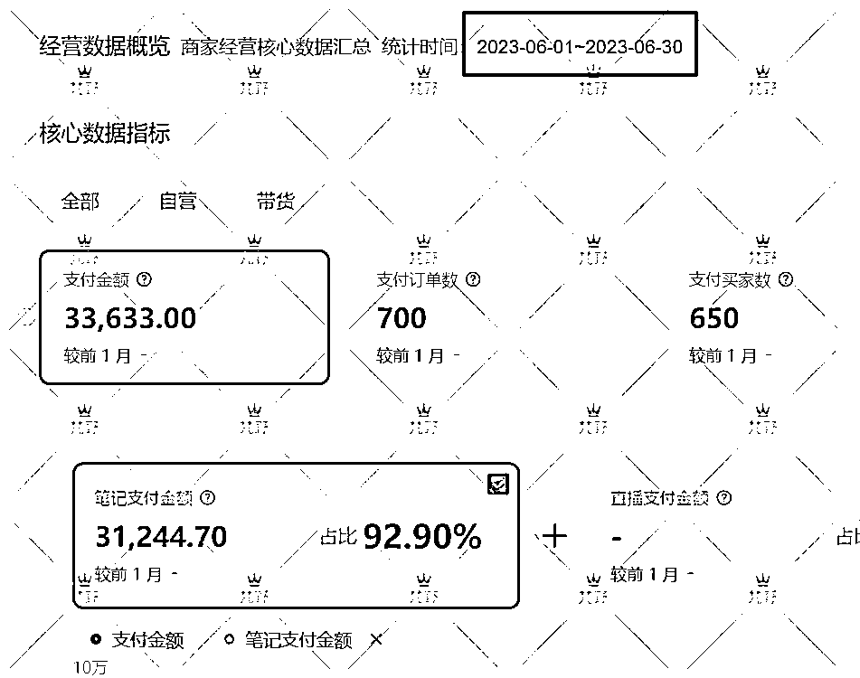

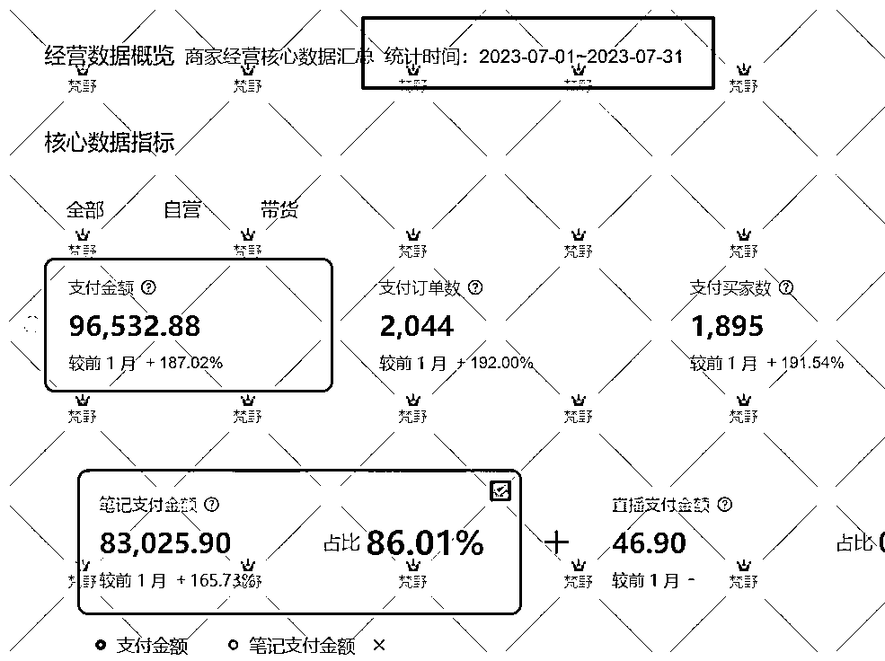

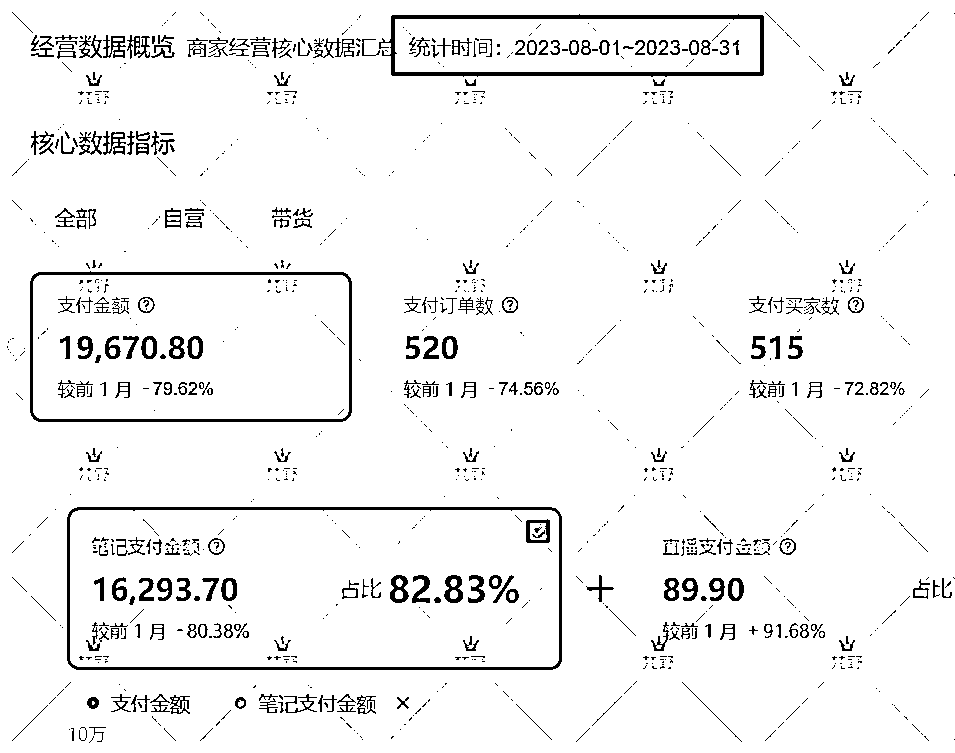

后来因为无货源稽查变严，再加上我们精力主要投入在视频号上，就逐步把店群放下了。

不过，也正是那段店群经历，让我们对小红书的玩法有了底子。今年11月底，我们拉了2个人的小团队专门去跑小红书直播。最开始一天也就几百块GMV，中间不断调试设备和玩法，坚持到现在30天，累计GMV已经来到25W+。

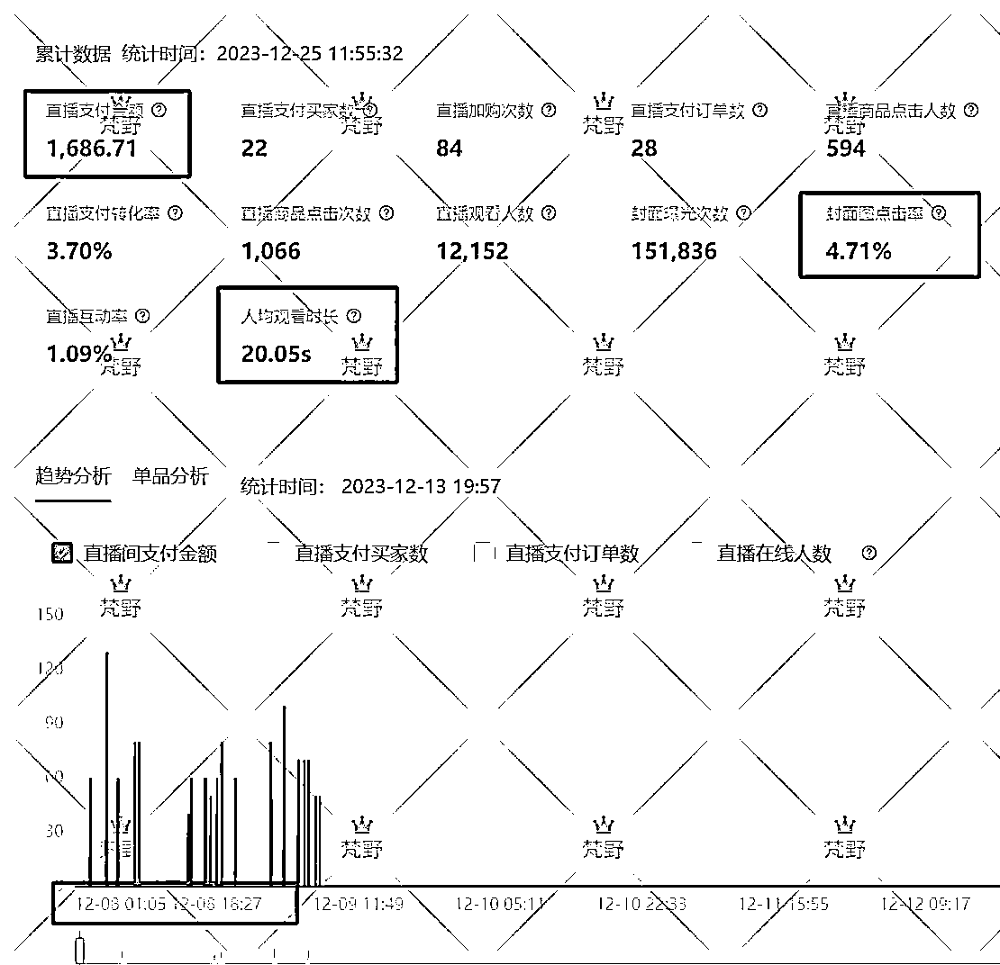

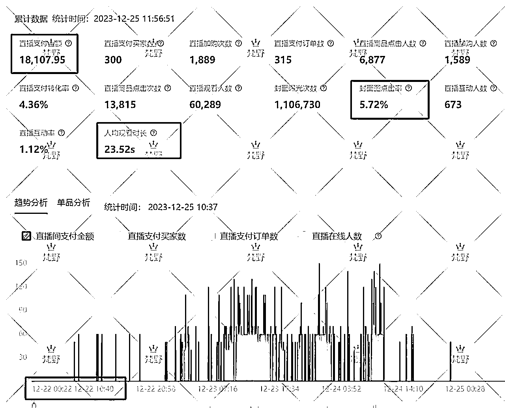

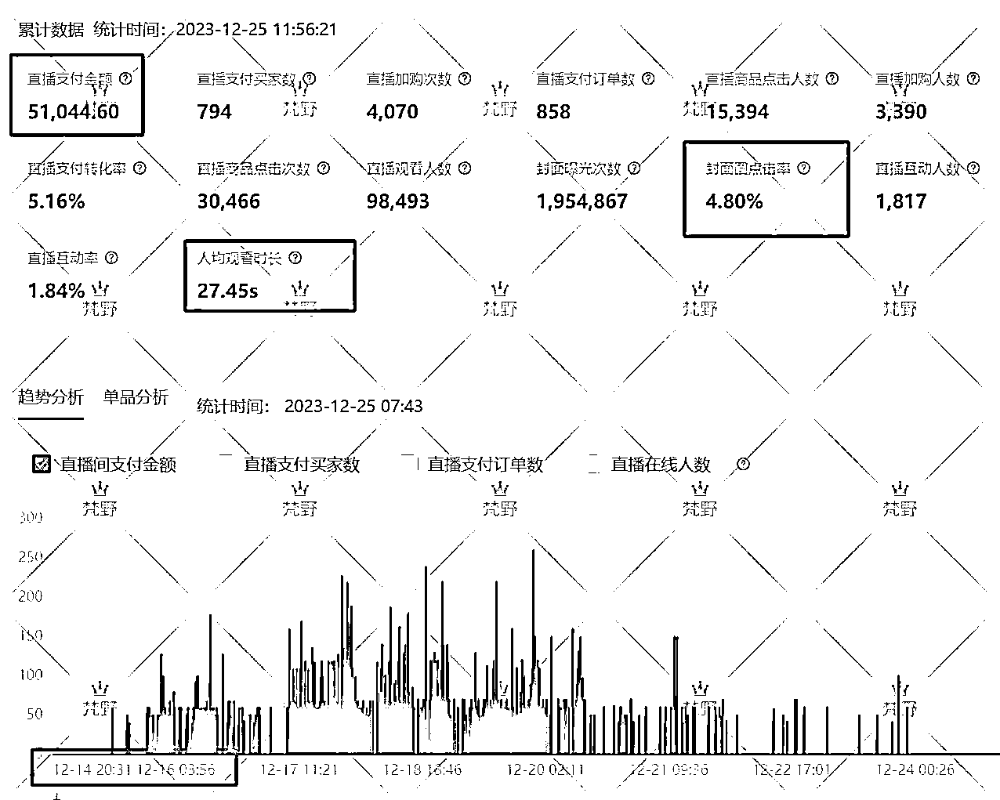

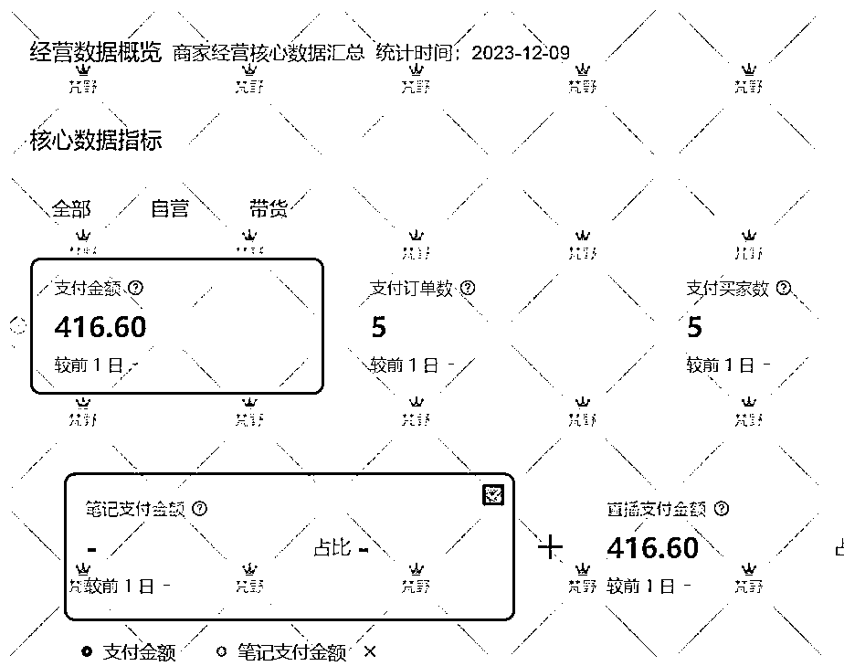

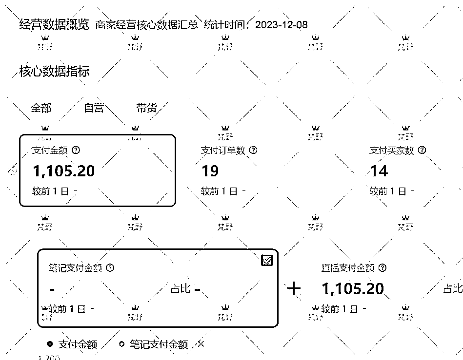

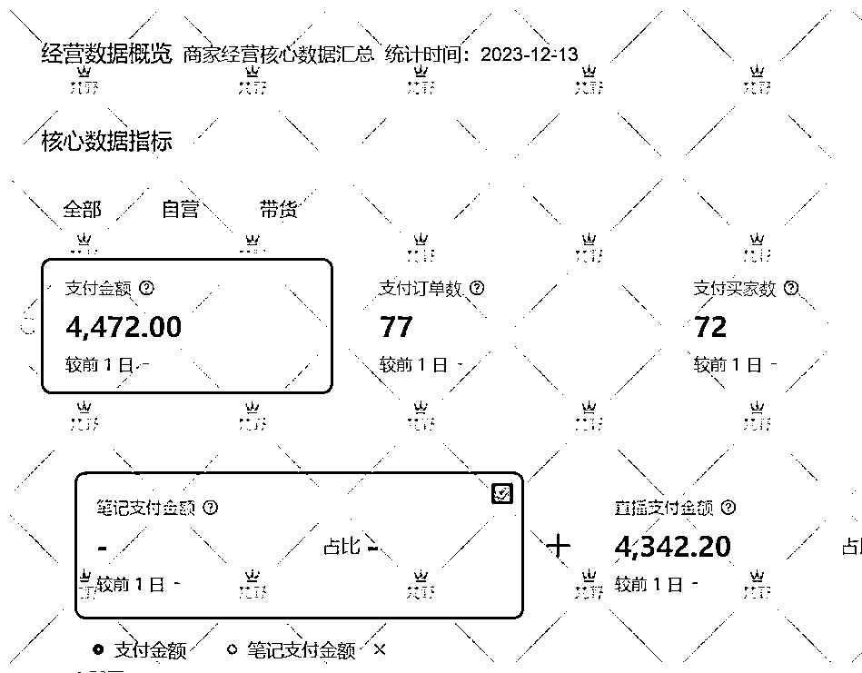

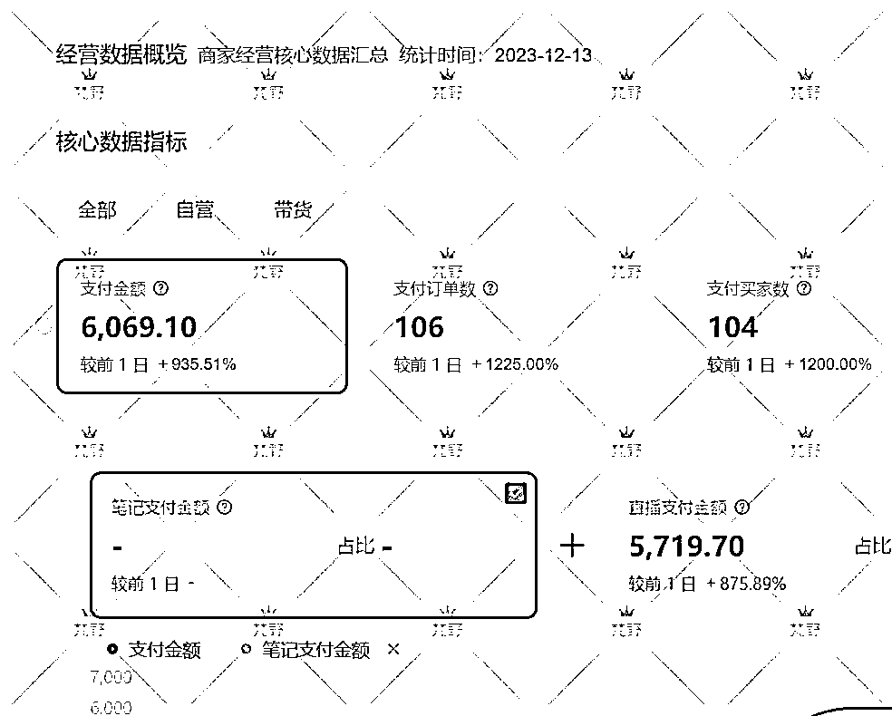

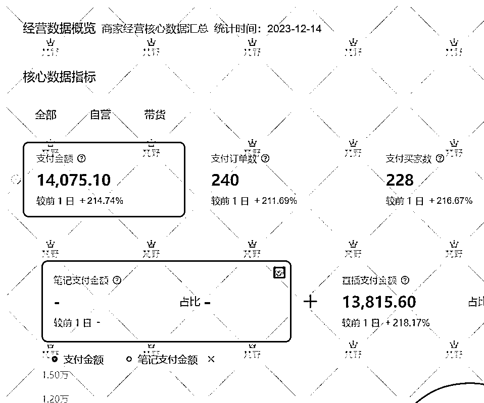

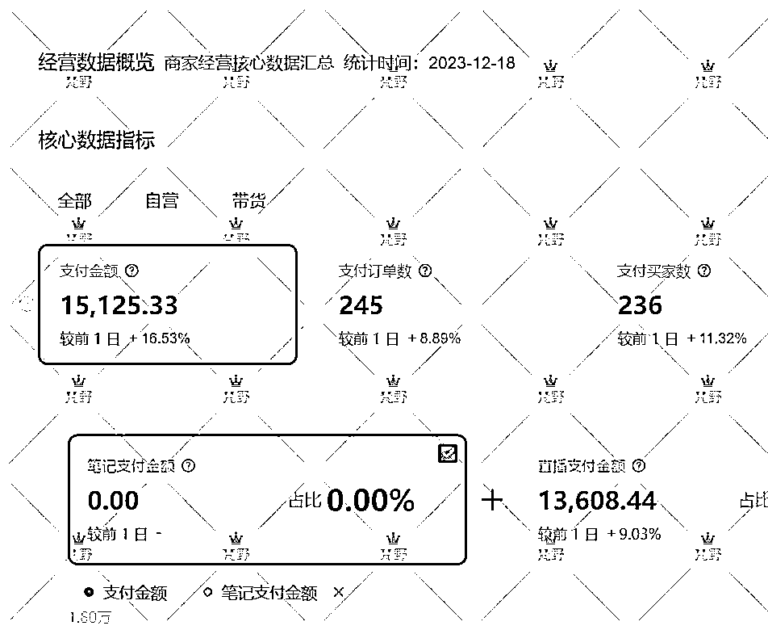

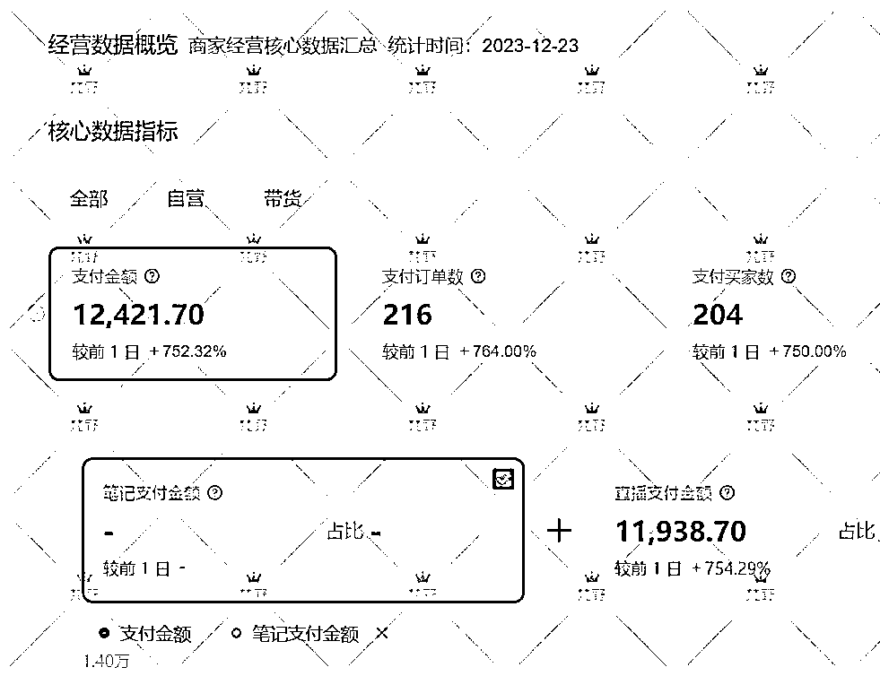

以上只是一部分截图。可以看到一条清晰的成长曲线：月初一天就几百块，月中到了大几千，最近已经能做到每天几万的量级。

一路踩坑，一路爬坡。现在的流程我们已经非常娴熟，所以昨天直接把小红书无人直播小组扩容——多了18台电脑（租赁）和30台手机，准备把这套验证过的25W+打法再复制放大一轮。趁着平台还没有严管，狠狠赚一波“快钱”，过个肥年。

下面就是这30天的全部复盘，希望能给到想入局的朋友一些参考。

## 一、项目本质

先说说小红书无人直播是怎么一回事：

逻辑其实不复杂——把抖音、快手直播间里的现成素材录下来，用OBS软件放到小红书直播间里循环播放，0粉丝就可以开小店，直播时挂上自己店铺的商品链接，出了单之后去1688拍下对应的商品，赚中间的差价。

好处不少：门槛低，一台电脑、一张执照、一点拍单的钱就能跑通整个闭环，只要品选得对，基本等于“睡后收入”。

但也要清醒：这个模式吃的是短期红利，平台的监管迟早会跟上。想当长期事业来做的人，我建议直接放弃。

## 二、我们踩过的那些坑

### 1\. 选品：跟爆款vs自己选

开始我们走了老路——按照以前做店群的逻辑来选品，说白了就是跟爆款：在小红书刷到那种只做直播不发笔记、场馆人数5000+且在稳定出单的爆款直播间，就把他们在播的款式，拿到抖音去找对应的直播间模仿场景来录。注意要找那种粉丝量小、在线人数高、不是投流起来的账号。

这样做确实能出单，但问题是数据一直卡在一天几百、勉强一千多，远远达不到预期。不过，这种跟款的方式很适合新手，能快速给你正反馈。

后来我们开会决定换思路：发挥自己的强项——自己选品。

我们对小红书的人群做了深度拆解。小红书的用户画像很好懂：绝大部分是18到35岁的年轻女性，往下还可以再细分出学生、白领、精致女性等等人群。但他们有个共同点——看重产品的调性和审美。在这个基础上还会根据年龄、季节产生不同需求，所以女装、食品、百货都是值得深入做的方向。

我们按人群细分，借助考古加这类第三方数据工具，筛出一批符合人群喜好的品，再去匹配符合要求的直播间来录。自己测品虽然起步慢一点，但爆款概率高很多。我们的GMV也从几百块冲到了两三千。

### 2\. 素材：录制、处理和违规词

录制方面，最开始用的是小绿点工具，后来发现它到了一定阶段就开始收费，而且免费版一个电脑只能录一个直播间，限制的是机器码。做矩阵的话非常难受；当然，自己低成本测试还是可以用的。

录制工具小绿点：https://www.maijiacanmou.com/218.html

后来我们换成了“江湖”这个工具，整体好用，就是偶尔录到一半会断，稳定性上稍有槽点。

真正吃过亏的是素材处理。我们前前后后“死”了好几个号，最后总结出：素材时长必须在2小时以上。初期我们做得很粗糙，素材没有精剪，里面大量出现抖音、快手、猫猫店、视频号等违规词——有些词平台是明令禁止的，我们一开始没在意，导致一批账号直接被封。

调整后，我们把素材控制在2小时以上，并且全部用飞书妙记过一遍，把违禁词挑出来。妙记的好处是可以定位到几分几秒出现违规词，方便我们去剪映精准剪辑，效率高了很多。

处理完素材后，放进OBS，按以下参数设置：视频——基画布分辨率调成1080x1920；声音——在高级音频属性中把要播放的视频设为“监听并输出”；码率6000；启动虚拟摄像机。

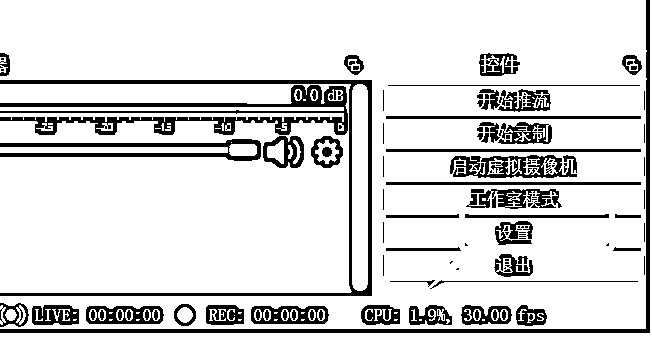

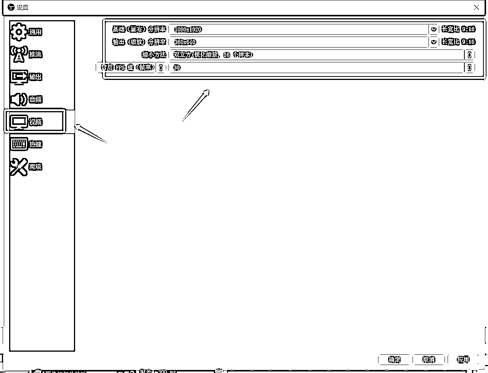

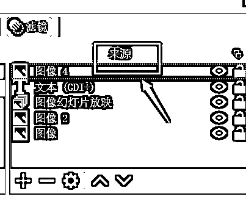

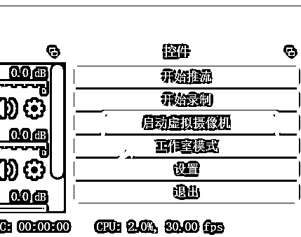

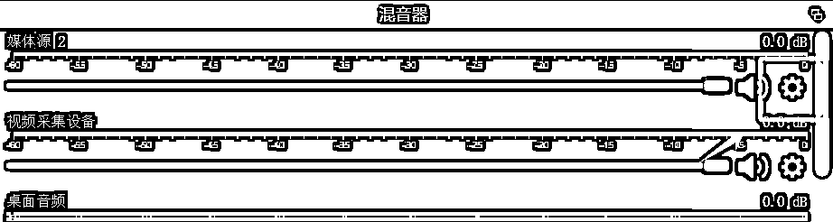

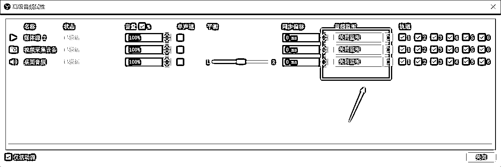

然后打开小红书直播助手（https://www.xiaohongshu.com/zhibo/robs），把画面源选为OBS虚拟摄像头即可。

### 3\. 封面：点击率就是生命线

起初我们觉得封面无所谓，直接放产品图或直播截图凑合。结果直播间点击率上不去，场馆数一直起不来。

好在我们有店群的经验底子，很快反应了过来：小红书的直播间和笔记一个道理，封面点击占了很大权重。

我们马上改打法，最简单有效的方式就是学爆款——去搜同品类下的爆款笔记，直接用人家验证过的封面和标题。判断标准很简单：封面点击率过4%就算好封面，不达标就下一场直播换掉。

### 4\. 测品：不要心急

一开始换品太频繁，素材也跟着换，浪费了大量时间。一场没跑起来就急着换，其实是大忌——品确实有生命周期，但测试的过程一定要给足耐心。

我们后来总结出来的标准动作是：一个品，3个号同时测，单个号的直播时长至少跑4-6小时。只要每场能有几百人正常进来看，说明账号本身没问题。三个号用不同的直播间素材去跑，看哪个素材的点击、完播、转化更好。

能出单就一直挂着。如果封面点击能做到4%、观看时长大于20秒，那基本离爆不远了。场馆起来之后，再用评论互动插件配合提升转粉和成交。

### 5\. 货源和拍单：算好利润比

当前这套玩法还是要自己开店自己拍单，所以选品之前必须先确认供货端跟利润空间，尤其是女装这种退货率极高的赛道，一个疏忽就是白干。

我们就吃过这种亏：品爆了，按订单价去找供应链，一算发现一件只赚一块多钱，加上退货，最后的局面是倒亏。货源必须提前敲定，利润比必须提前算清。

## 三、最后说几句

无人直播本质上是短期红利，账号被封是常态，心理上一定要稳得住。

我们总共做过20个号，前期测试和失误废掉了一半，目前有10个号在稳定出货，而且每天还在不断增加。整套标准流程下来，测品的起号成功率大概60%以上，如果你有自己的选品逻辑，爆款的概率可以说是相当大。就算某个号出了违规，那些号基本都是爆过几千甚至几万GMV的号，后期通过申诉还能救回来，所以就算暂时违规也都不心疼。下面是一个走申诉成功回来的号：

这一路走来，该踩的坑也踩得差不多了。写出来是希望给同样在这条路上摸索的圈友提供一点参考。

如果最近也在操作小红书无人直播，欢迎一起多交流，抱团取暖，2024一起暴富！