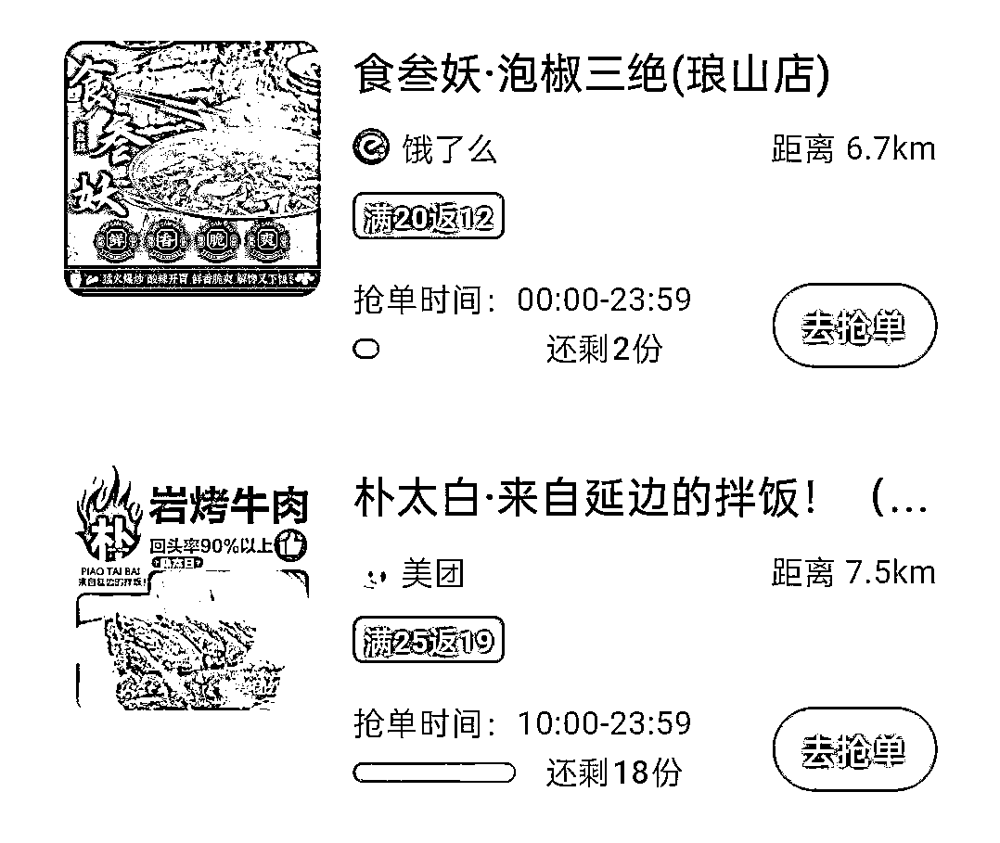
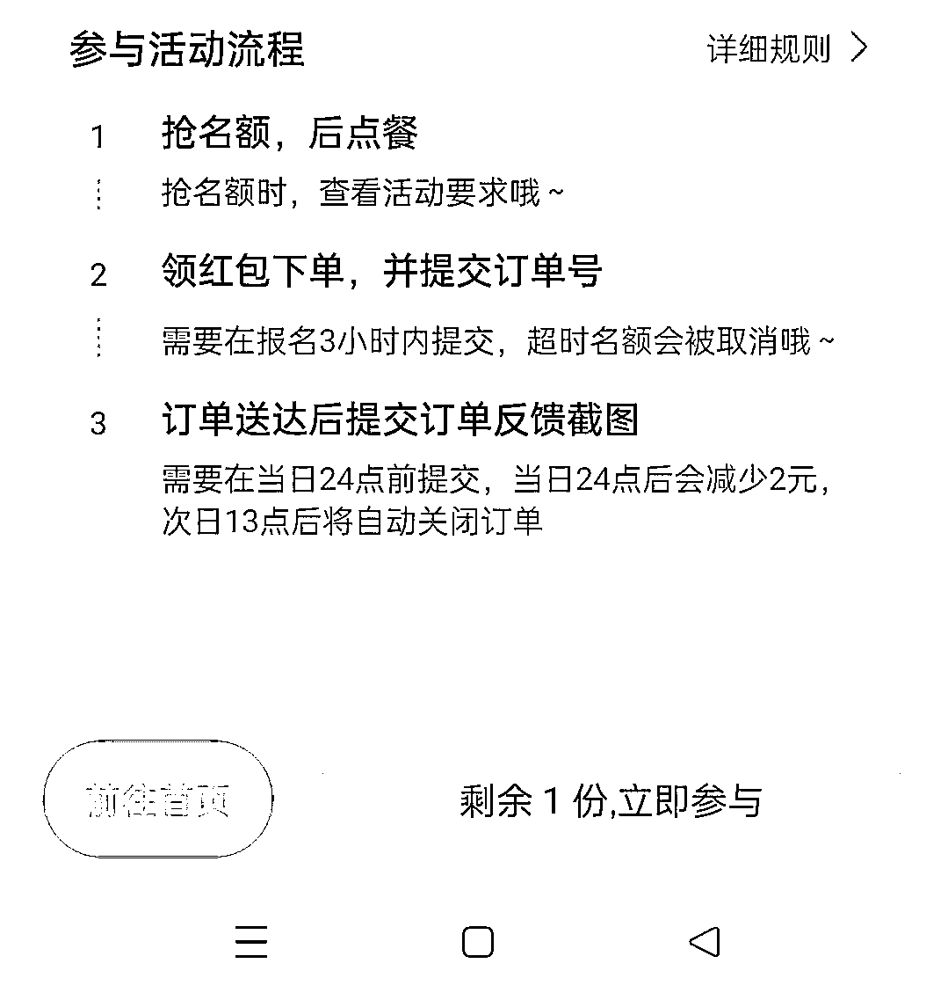
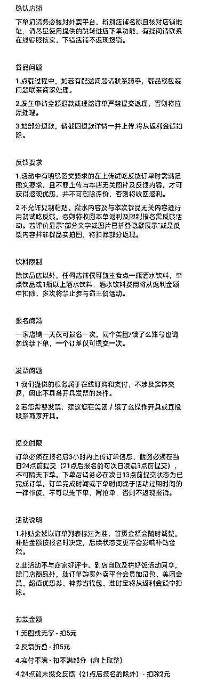
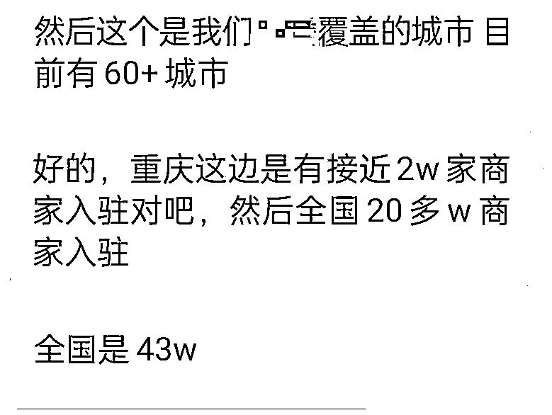
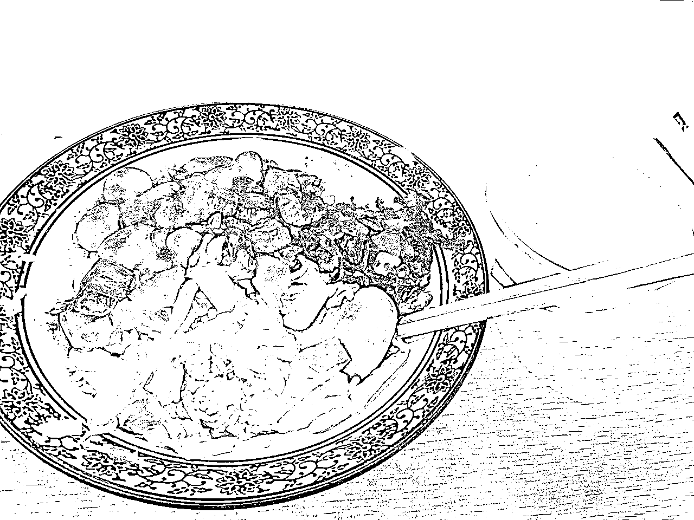
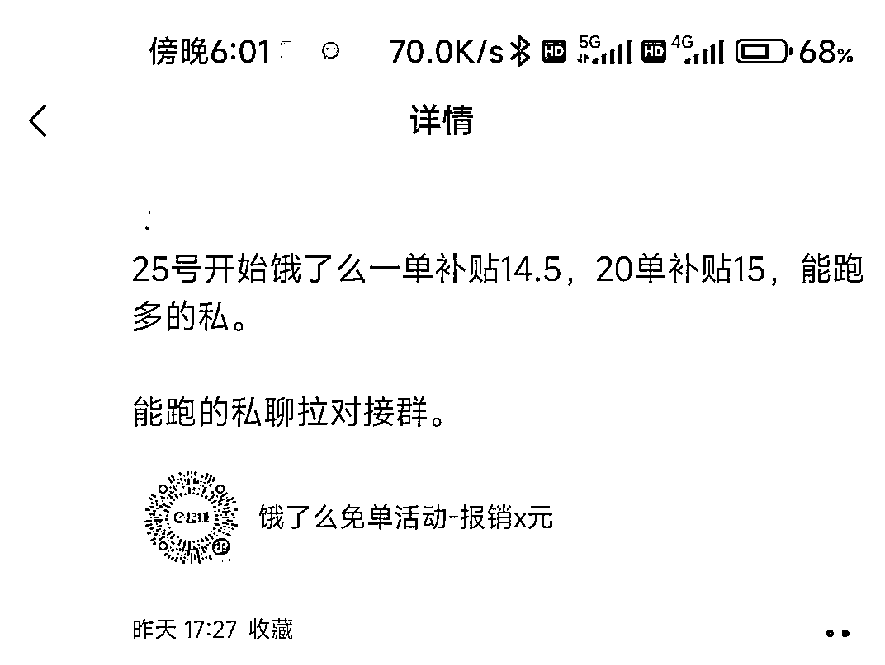
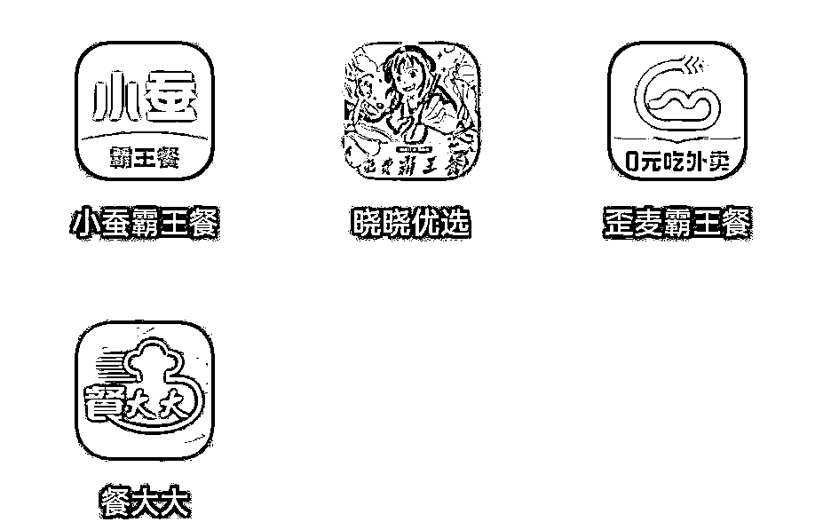
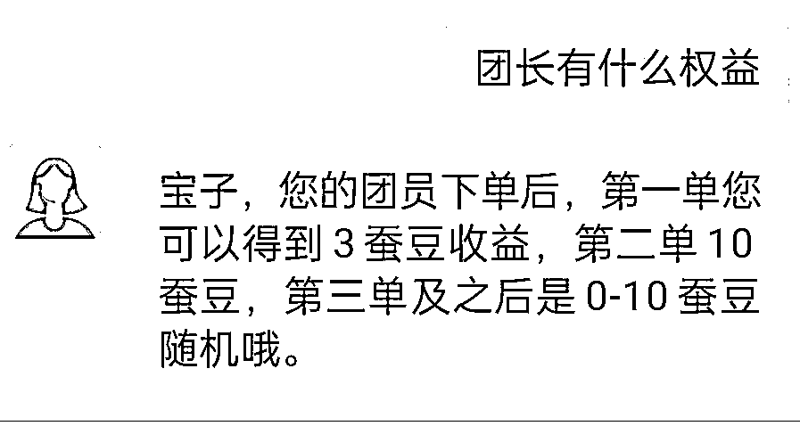
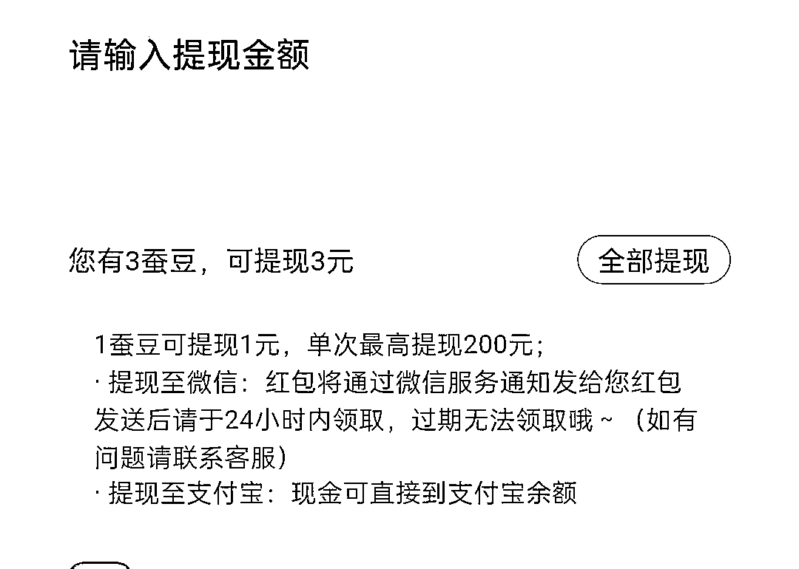

# 风向标拆解第二期-霸王餐到底还能不能玩了-文少

大家好，我是文少。去年418入圈的赚钱老新人，带过几期志愿者，现在主要在做视频号和抖音的无人直播。这次风向标选题终于轮到我了，来交作业。最近我专门花了几天时间去探了下外卖霸王餐这条线，整理了一些实操观察，分享给大家参考一下。

## 外卖霸王餐到底是什么玩法

饭点一到，打开那些叫“霸王餐”的App，就能看到各式各样的外卖商家在放单。店名旁边通常会写着“满20返15”“满25返19”这种高额返现的提示。

商家会先声明指定下单渠道，美团还是饿了么，然后在不同时段释放不同数量、不同返现力度的名额。

比如有的店能全天24小时抢，有的店就只分上下午两波放单，这样能把客流摊匀，不至于集中爆单。一些挂着“大牌”标签的店还会设门槛，比如“三天内只能抢一次”“必须是LV2以上的用户”。

流程很固定：按要求去指定店铺下单，收货后打五星好评，再把订单号和好评截图填回去，返现就到账了。算下来一顿饭到手基本十块钱以内。

对上班族和常点外卖的人来说，这简直是白嫖福利。第一次薅到便宜就会上头，黏性和复购率都很高。

同样的东西花更少的钱，吃得更香，哪个用户不爱呢？

那这些平台靠什么赚钱？

逻辑很直接，就是中介抽佣。举个例子，一单外卖20块，商家给平台15块返现，平台只返给用户12-13块，自己落差2-3块。

别看单笔利润薄，但量大就可怕。一天十万单就是三十万，一个月就是九百万。我司现在在做的小说推文项目，单笔利润也是几块钱，但日活激活几千个，量起来就是钱。

“薄利多销，量大见效”。

### 霸王餐这波又起来了吗？

商家入驻美团、饿了么的本质就是要曝光、要流量。老客会直接搜店名，新客的来源就全靠平台算法推。

新客下单前肯定会看距离、准时率、评价这些指标。商家想被优先展示，要么掏钱买平台广告，要么就把销量和好评做上去拿算法权重。

付费投放像电商一样贵，而且效果不确定，完全靠运气开盲盒。

于是商家更倾向于低成本地刷销量和好评。

其实给好评返利的老套路很多：找亲戚朋友下单、外卖里塞返现扫码卡、送小水果小饰品、店门口找人地推……但效率低，还容易被系统判定刷单，通过手机号、WiFi地址、下单频率等风控，轻则降权，重则封店。

这时候霸王餐App就成了刚需。它能给商家提供更安全、更分散的真实客源，商家愿意买单。

有需求、有付费意愿、模式跑通，霸王餐就成了商家“花钱买好评”需求的集合地。游走在规则边缘，不上台面，但活得很滋润。

#### 商家到底赚不赚钱？高返利会不会亏？

吃点饭的时间，我专门聊了几家在做霸王餐的店。

第一家老板说效果还行，每天放20单左右，再多就扛不住。他说同行放单更猛的，一天上百单都有。

我算了一下，一天100单，一个月就是3000单，平台抽3块就是9000块，这还是一家店的流水。

那如果是1万家、10万家这样的店呢？

据某霸王餐内部人士透露，目前他们平台在重庆就有近2万家商家入驻，全国更是达到43万家，而且还在持续增长中。

我问老板为什么要入驻，他说偶尔也需要刷点好评，关键是同行都在做，自己不做销量会被拉开。

我追问会不会亏，他说短期看是亏的，但只要在能承受的范围内把好评和销量做上去，长期就是赚的。

聊完我顺手在他家点了一份盖饭表示感谢。

第二家是我常吃的店，老板开了8年，主要靠回头客和路人。也有入驻霸王餐，但好几天才放一单，他说自己靠的是硬实力，好评不需要刷太多。

我问他为什么还要入驻，他说主要是用来对冲偶尔的差评，把分数抹平。看我熟，他还给我看了他跟平台负责人线下结算的聊天记录。

第三家跟第二家差不多，老板说现在人手不够，外卖单都忙不过来了，打算把返利关了。

总结下来，急需拉新、销量不佳的新店对霸王餐需求最旺，老店和原本销量就好的店需求相对弱。但现实是，大部分商家都属于需要补量的那一类。

那美团、饿了么会不会自己下场？

肯定会，而且已经在做了。抖音本地生活这类平台未来大概率也会跟进。

目前很多用户甚至没听过霸王餐App，我要不是在赚钱，也不会接触到。这说明市场教育空间还很大，增量充足。

### 普通人能分一杯羹吗？

搞明白了玩法和盈利逻辑后，作为普通人能不能靠外卖霸王餐赚钱？

是可以的。虽然做不了第三方平台，但可以从单点切入。

现在市面上大概有十来个霸王餐平台，有App也有小程序。我自己装了4个，还有不少没装，大家可以自己去搜。

用法和返现力度都大同小异，主要区别就是入驻的商家池不一样。

普通人能玩的变现思路，我想到这几个，补充欢迎讨论：

1、自己薅羊毛省钱

最直接的玩法。自己本来就要点外卖，那就走霸王餐渠道。每天吃两顿，一个月省个近千块的外卖费没问题。

2、做平台团长做分销

霸王餐支持发展下级，相当于帮平台拉新。你的团员下单你就能拿佣金。如果你有私域，或者做一个薅羊毛类型的账号去引流，月入几千上万是真实可能的。

3、叠加美团圈圈CPS

前段时间火的美团圈圈分销可以和霸王餐叠加。先在圈圈里分销霸王餐里有的商品，用小号通过自己的链接下单，再去霸王餐平台回填单号和好评截图，一笔单赚两份佣金。

以上就是我整理的普通人入局的几种方式，肯定不止这些，欢迎大家一起交流。

拆解到这里就结束了，希望能给在赚钱的伙伴们一点启发。祝大家龙哥盟！