# 📕账号没人设？难怪你流量有了，订单却没有

> 来源：同原文链接

我是艾小飞，天天跟📕流量打交道。

先问一句：你做📕，是不是也经常陷入这种状态——笔记发了不少，赞藏数据看着还行，可就是没人下单？

如果是，那这篇文章请你耐心看完。我敢说，光是人设这一环想通了，你的流量和转化都能上一个台阶。信不信，看完你就懂了。

这篇我继续聊聊《📕人设定位，咋就那么难？》，把我自己的实战经验和踩过的坑都摊开讲。

# 一、为什么标题起得这么“扎心”？

因为人设这件事，不是玄学，它直接卡着你的流量和转化率。

很多人做📕是“跟风式”发笔记：同行发什么，我也发什么。结果呢？流量来了，订单没有。为啥？

说白了，就是没做“人设”。

你如果不信，自己去📕逛一圈就会发现：每一个真正爆了的笔记，背后都站着一个活生生的人，而不是一个冷冰冰的账号。

# 二、人设到底是啥？

一句话，人设就是“有性格的身份”。

其实我们每个人在不同场景下都自带人设：

- 在公司，可能是雷厉风行的领导；
- 回到家，可能是温柔耐心的爸爸；
- 面对父母，又成了孝顺懂事的儿子；
- 跟朋友出门，那就是仗义豪爽的哥们儿。

这些都是有血有肉、有温度的身份。

做账号也一样。你得让用户透过文字和图片，感知到屏幕背后是一个怎么样的人。

试想一下：你是愿意看一个冷冰冰、像机器人写的笔记，还是想看到一个有情绪、有温度的分享？不用想，肯定是后者。

📕用户，也一样。

# 三、为什么好人设能拉高转化率？

上个月我做📕残蟹项目，一开始也在琢磨自己的人设定位。

我观察了一圈同行，发现他们发的基本都是这种笔记：

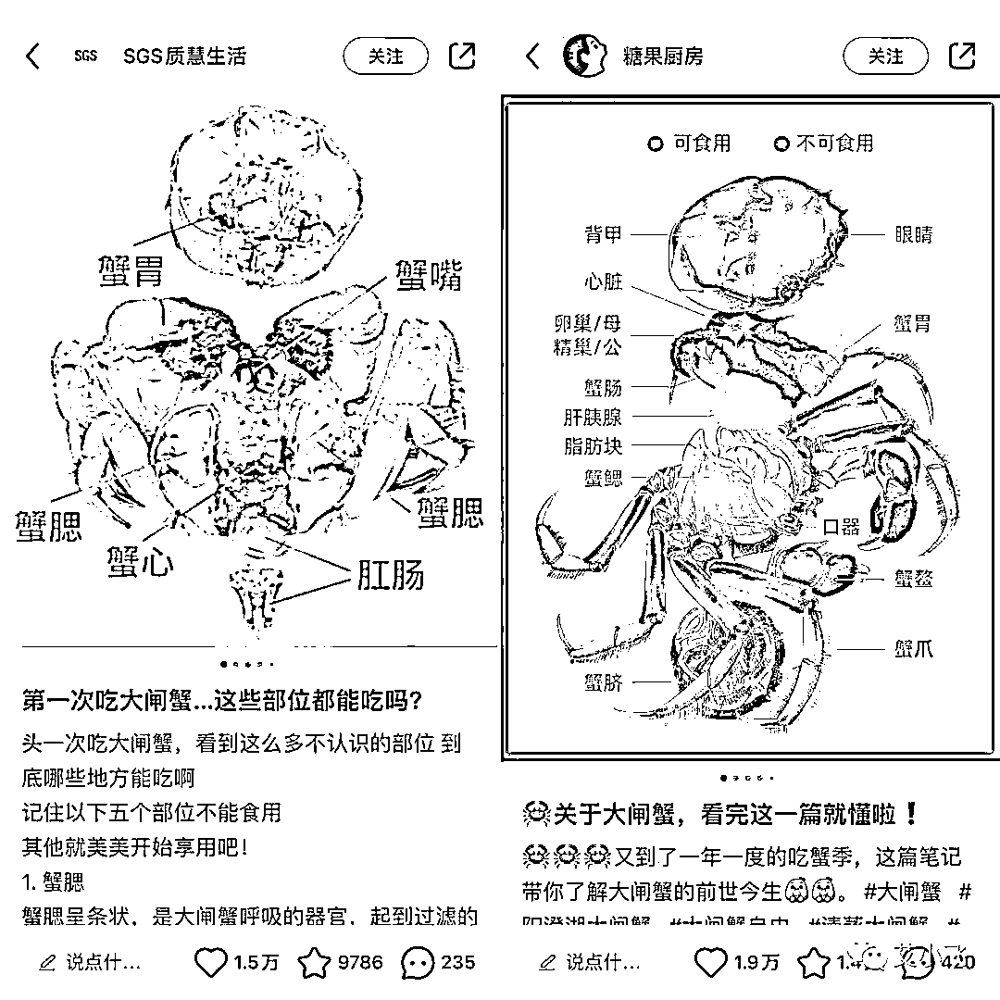

点赞收藏都不低，可转化率惨不忍睹。

他们在用户眼里就是个“有用的工具人”——需要时翻出来看一眼，用完直接划走。

为了破局，我决定重新给自己找身份。

我借了同行都在用的“商家”人设，再加上他们没有的“女儿”身份。因为人在广西，IP一露，别人一眼就看出我不是苏州大闸蟹商家，所以我又加了“在外地上学的大学生”身份来混合。

最后定下来一个“在校大学生商家女儿”的人设，跟同行搞错位竞争，目标就是快速拿单。

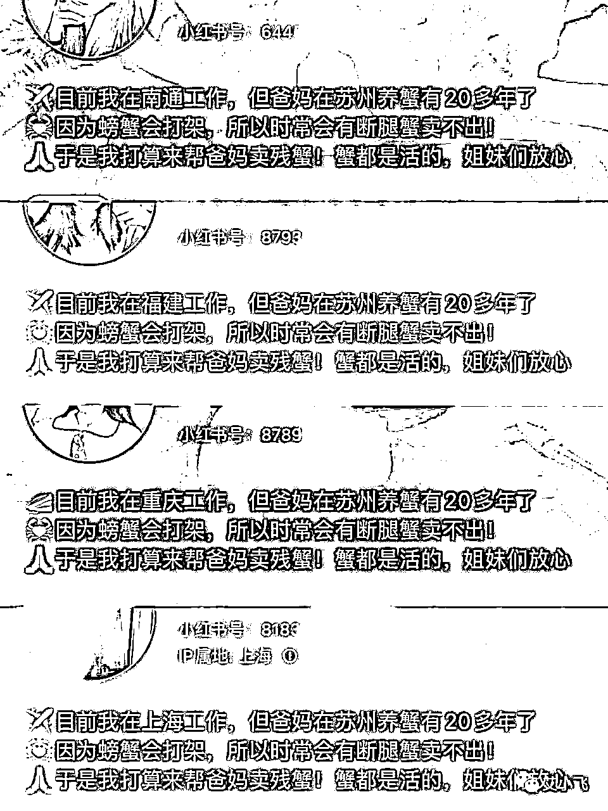

笔记内容上，我既给了实用价值，又给了情绪价值，还把“想吃又怕贵”这个心结给解开了。

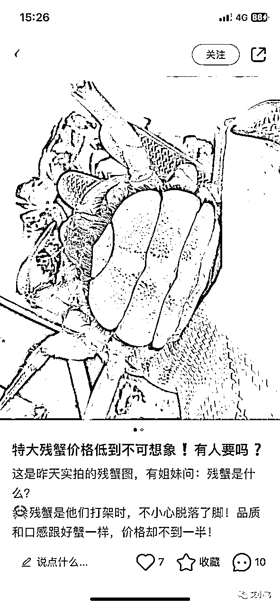

利用“占便宜”和“好奇”的心理，把同行的潜在客户快速引流到我这边围观。

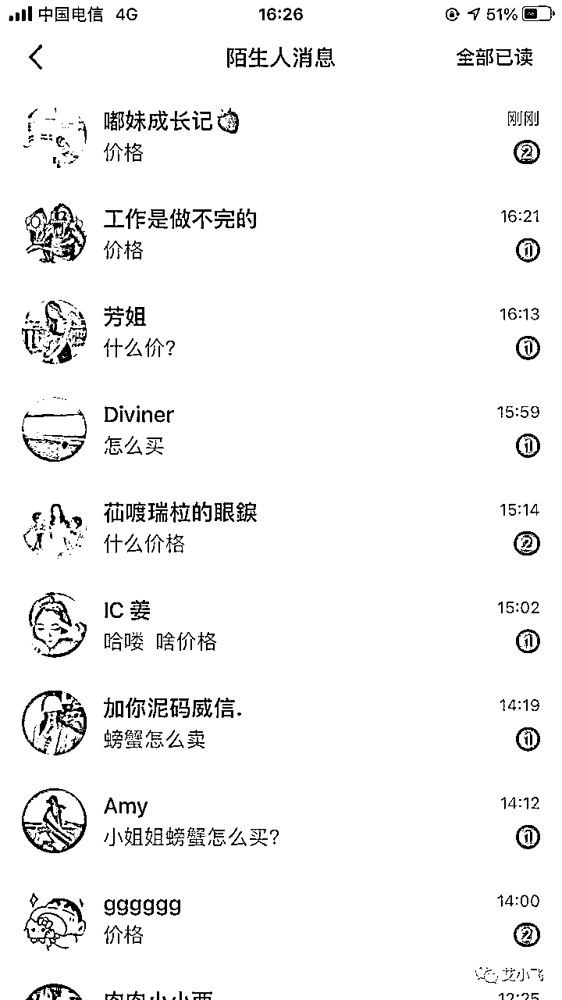

来咨询的人，开口基本就是：“怎么买”“多少钱”“在哪买”。

只要价格能接受，下一步直接问“怎么付款”。转化率高到吓人，新号第二天就破零。

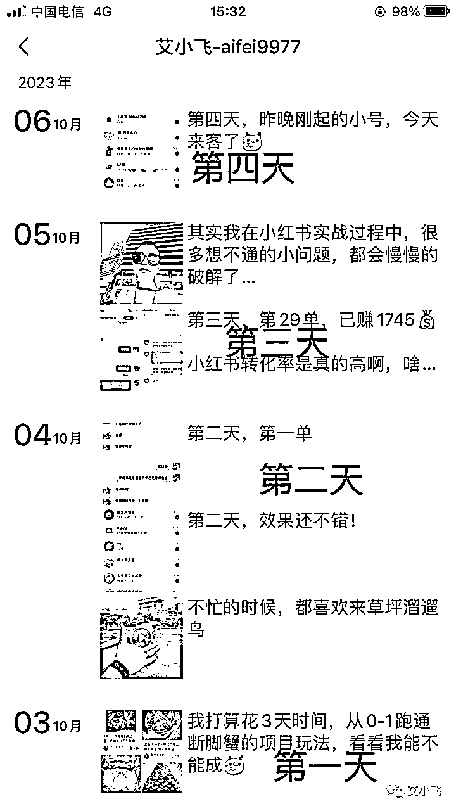

回到刚才那个问题：好人设为什么能影响转化率？

现在的年轻人，早就看腻了“十年养蟹人”“品质保证”这种老套说法。你去搜养蟹账号，十个里七八个都这么写，谁知道真假？

而我换了一个角度，重新定义了身份，让人眼前一亮。

再加上文案里的实用价值+情绪价值+下单引导，这就是我做项目跟别人拉开差距的地方，也是提前打造好人设能带来高转化的真正原因。

强烈建议大家去试试这套打法，真的能提升产品的成交速度。

# 四、怎么打造一个“值钱”的人设账号？

问你个问题：如果你想在📕卖珠宝翡翠，你会用什么人设来做账号？给你5秒思考。

有答案了吗？不管你的答案是什么，我先说我会怎么做。

我肯定不会用一个“路人”或“普通用户”的视角，去分享翡翠干货。

用“路人/用户”+“干货知识”的组合做账号，结果往往就是转化低、账号没价值。

如果换我来打造人设，我会用一个“自有翡翠加工厂老板女儿”的身份，专门发“产品有微瑕但价格很低”的账号。

我为什么这么设计？思路是这样的：

你稍微逛一圈📕翡翠区就会发现，几乎每个商家都在强调自己的货“精”“贵”“值”。

要是我也去硬拼“高货”，根本拼不过，不如换个方向打。

现在大环境都在消费降级，拼多多市值都超淘宝了，你再主打“贵”，注定走不远。

所以我反着来：别人强调“贵”，我强调“性价比”。

有微瑕，但整体不影响美观，价格却只有精品的一半甚至更低。很多人怕错过“捡漏”的机会，都会忍不住来问价。

价格合适的话，他们下单特别果断，连犹豫都不带犹豫的。

这就是我帮朋友做翡翠人设账号的成功思路。现在他靠纯自然流量，每天引流80人以上，日营业额稳定在5到8万，利润一天5000多，比那些常年不开单的同行强太多了。

这就是“值钱人设”的打法，你们可以举一反三，直接拿去用。

# 五、为什么好人设很难同时做到“爆款”＋“高转化”？

说到底，这两件事本来就有点矛盾。

最近我自己就撞上了。前几天，我一条产品引流笔记突然爆了。

注意，这是引流笔记，不是娱乐内容！

我随手一发，第二天早上播放量冲到7万。我当时心想：哇，这要发财了，又是引流贴，这波不得过个肥年？

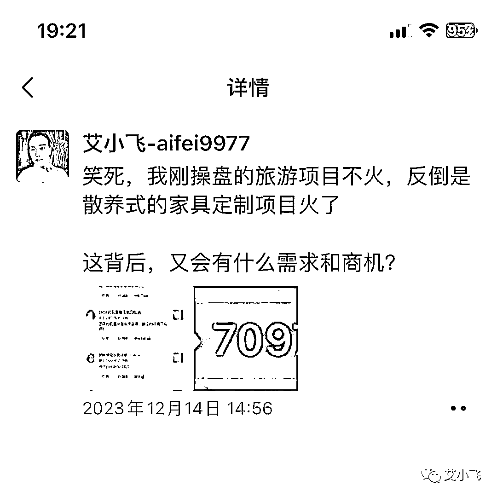

结果第二天晚上，直接飙到68万！我都懵了。

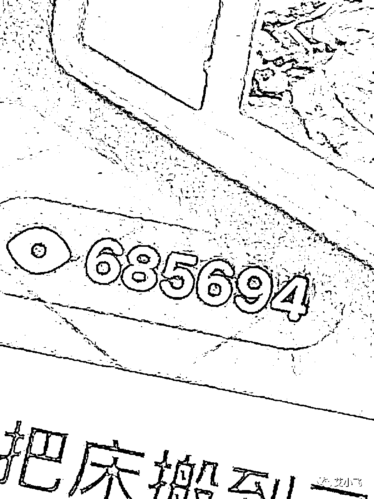

以前娱乐贴我跑过百万播放，但引流贴是真没到过这个量级。

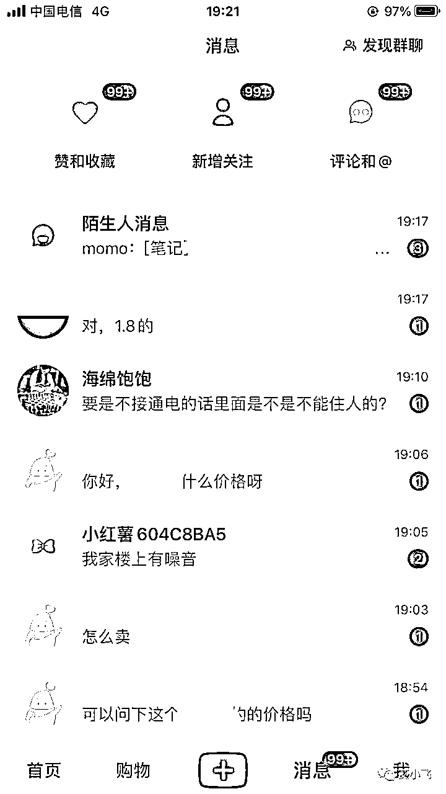

你试过一刷新点赞列表全是“刚刚”吗？试过刚回完评论，返回又是99+吗？试过回私信回到手都僵了吗？

那几天，我是真真切切体会到了。

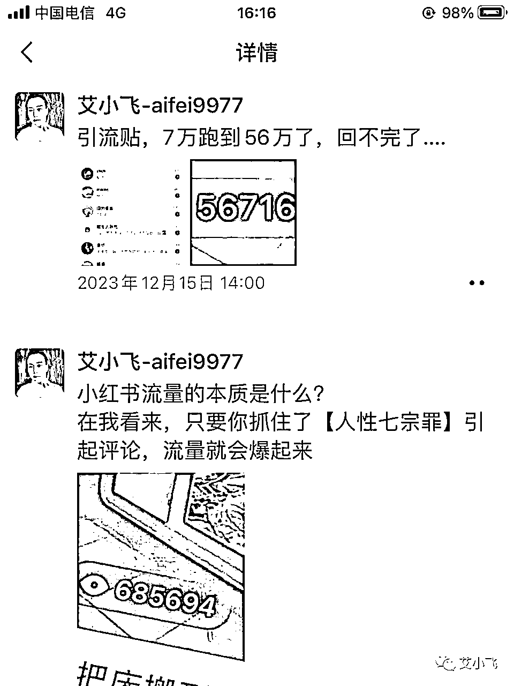

猜猜看：68万播放、2天1000多私信，最后引流了多少人？成交了多少单？

哈哈，说出来怪丢人的，还是不说了。

事实就是，最后的结果并没有想象中那么美好。想同时做到高流量、高转化、还不被封号，基本是地狱级难度。

我当时测的是家居定制类，客单价大概2万，客单高，利润也高。评论区一堆人问“多少钱”“怎么买”，还互相@朋友来看这个神奇的东西。

因为产品够新、痛点够深、价格不透明，标题够奇葩，封面又有想象空间，播放量才从1000多两天冲到68万。

我明知道这是引流贴，平台也知道我在引流。所以账号马上被列成“重点观察对象”——同行盯着我，平台也盯着我，但凡有一点违规动作，立刻处理。

📕引流一旦被抓，轻则限流，重则永久封号。

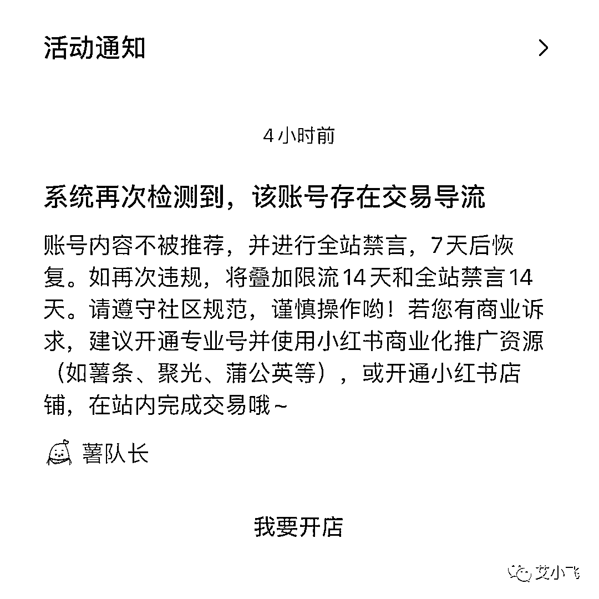

当时很多人来问价，我反而怕了，不敢引流了。

流量正猛的时候，我有两个选择：

一，引流成交，号没了，赚一笔收工；
二，不引流，号保住，留得青山在。

二选一，没有中间选项。换成你，你怎么选？

所以，一个账号想同时做到爆款、高转化、还不封号，几乎不可能。除非花钱投流。

# 六、怎么提升客户转化率？

要想转化高，别整天发干货。

直接从人设出发，发那种能让用户主动来询单的内容。

举个例子：昨天有个粉丝找我咨询，他做哈尔滨旅游，想卖团游路线。价格不贵，但转化率特别低。

我翻了下他的笔记，人设是“商家”，方向没错，但内容全是大段干货攻略：

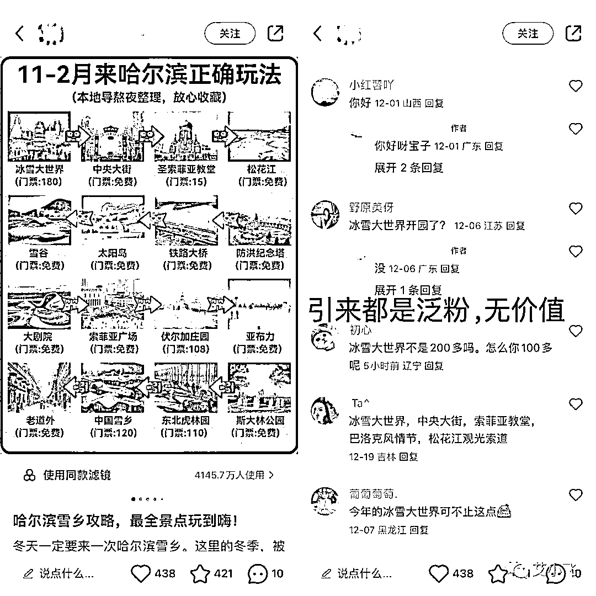

人设没问题，就是用错了场景。

我让他换了个标题，换了张封面，第二天订单马上起来了。

怎么改的？

原来是《哈尔滨雪乡攻略，最全景点玩到嗨》这种，我让他改成类似《哈尔滨+长白+延吉玩6天！人均才3K，实话！》的钩子型标题。

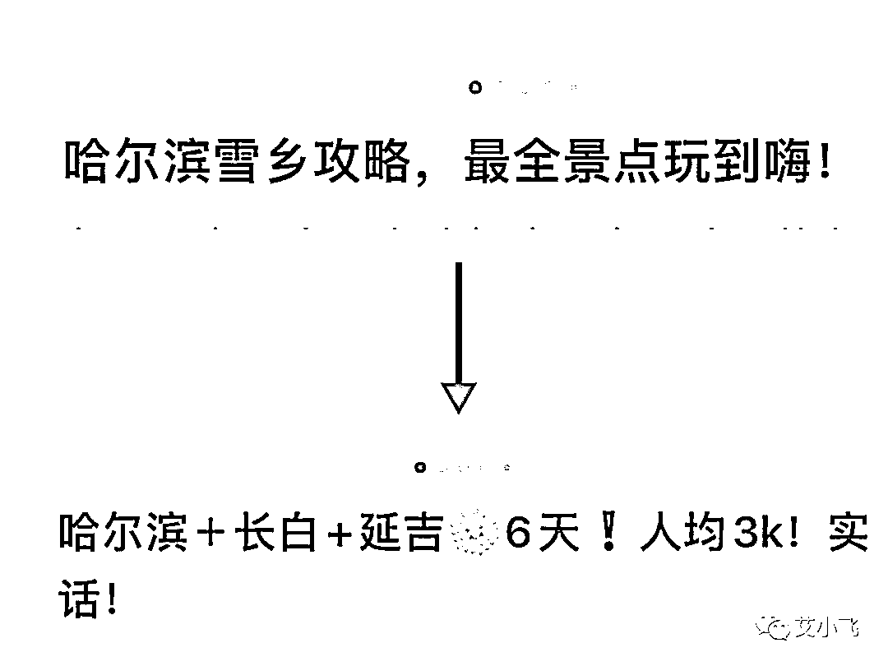

封面也换成了这种爆款排版：

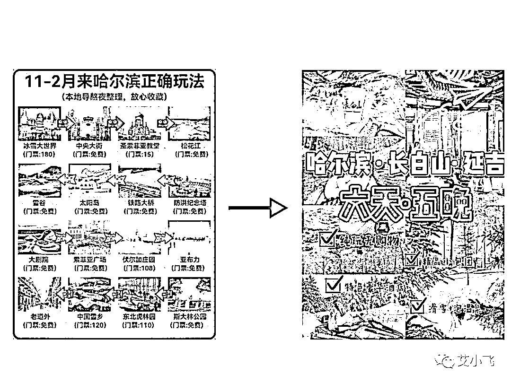

两张图的差距，你们自己感受：

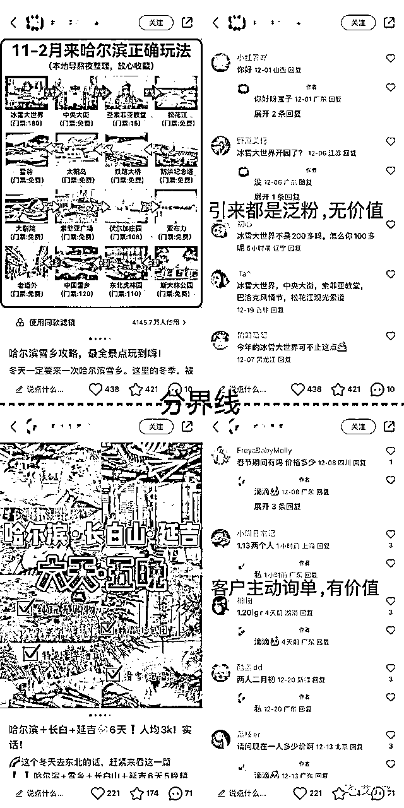

所以再提醒一次：做任何产品，想提高转化率，就不要去发干货知识类内容。那东西很难变现，对账号没什么实际价值。

真想提升转化，就围绕用户痛点，直接发产品需求。最好利用“人性七宗罪”去拉满吸引力，尤其是“贪婪”。

# 七、干货笔记为什么转化率低？

前面我说了，干货类内容干巴巴、没有情绪，发得像机器式答案，用户只会把你当成“有用的知识”收藏，根本不会意识到“原来你这还有旅游路线啊”。

你不主动说出自己的目的，用户只能靠猜。

要提升转化，从现在开始改人设、换笔记类型，订单和客户才不会被同行抢走。这年头赚钱不容易，但人设做对了，流量和客户真不缺。

# 八、最后几句真心话

其实打造人设本身一点都不难，难的是在搬运素材的情况下，还能做出爆款，还能引流99+。

这里头是有技巧的。

就比如我那篇家居定制的爆款笔记，图片是别人的，标题是别人的，连文案都是别人的！！（哈哈没想到吧）

我是怎么把它盘活起来的？

为什么我搬运还能不封号？

为什么我搬运还能持续出爆款？

这里面到底藏了什么小技巧？

别急！

下集更精彩！

我是艾小飞，专做📕流量。感谢你的阅读和点赞！

有📕问题，欢迎留言或后台找我。

点赞越多，更新越快，下期见！

原创：艾小飞

转载可私信

禁止搬运和抄袭

往期高赞好文

原创：艾小飞

转载可私信

禁止搬运和抄袭

🛰️：aifei9977（记得备注来意）